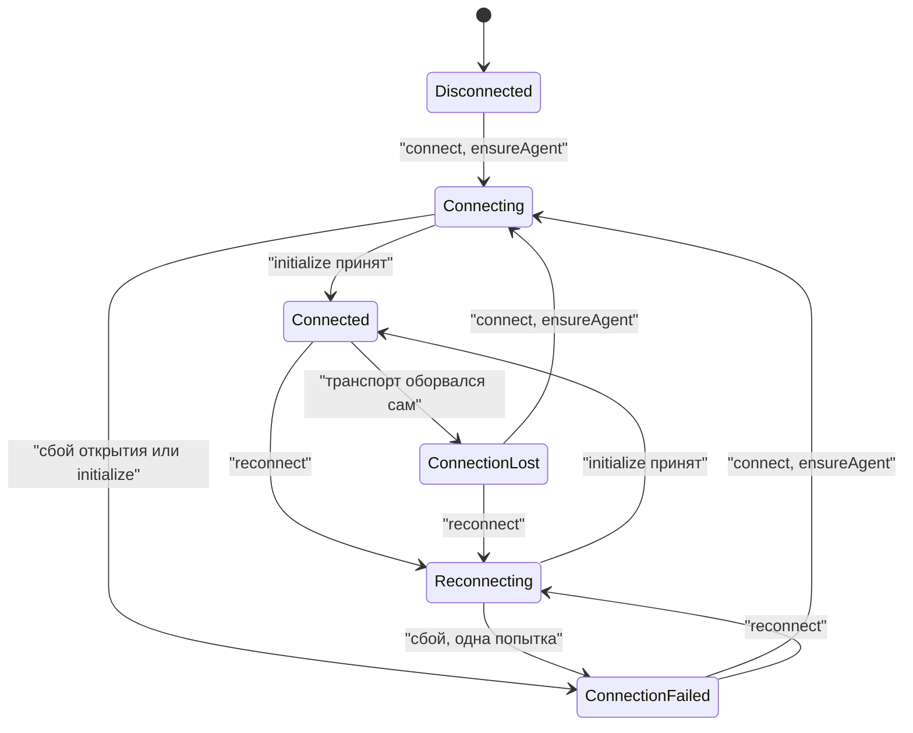
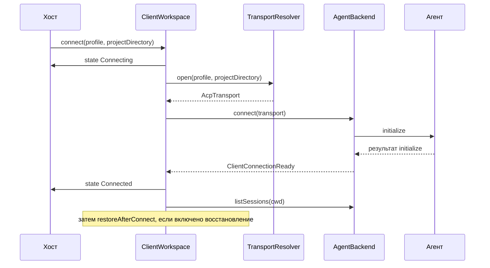
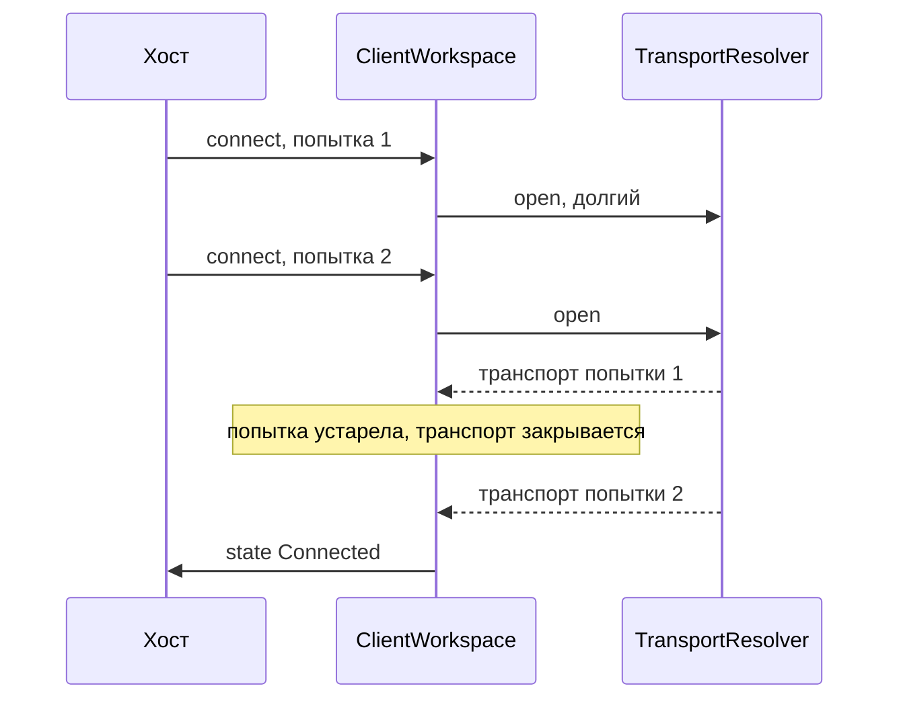

# Подключение

Глава разбирает, как `ClientWorkspace` подключается к агенту: из чего состоит профиль, как профиль становится транспортом, какие состояния проходит соединение и что слой делает, когда попытки накладываются друг на друга или соединение обрывается. Сессии после подключения — [глава 4](04-sessions.md); профили и токены — [глава 12](12-profiles-and-secrets.md).

## Профиль и резолвер

`ConnectionProfile` — чистые данные о том, куда подключаться (`lib/src/connection/connection_profile.dart`). Закрытая иерархия:

| Профиль | Что хранит | Как открывается |
|---|---|---|
| `StdioProfile` | `command`, `args`, `env`, `runInProjectDirectory` | дочерний процесс с ACP по stdin и stdout |
| `WebSocketProfile` | `uri`, `tokenRef` | WebSocket; токен — ссылка, а не значение |
| `EmbeddedProfile` | `hostProfile` — строка с именем профиля хоста (`embedded-cli`, `embedded-app-desktop`) | встроенный агент в процессе клиента; профиль открывает только резолвер хоста |

У всех есть `id` — стабильный ключ хранения — и `label` — имя для интерфейса и диагностики. Секретов в профиле нет: у `WebSocketProfile` только `tokenRef` вида `env:<NAME>` или `secret:<имя>` ([глава 12](12-profiles-and-secrets.md)). Адрес для показа человеку строит `profileOrigin(uri)`: `scheme://host[:port]` без userinfo, пути и query, потому что они могут нести токен.

`TransportResolver` превращает профиль в `AcpTransport`:

```dart
abstract interface class TransportResolver {
  bool supports(ConnectionProfile profile);

  Future<AcpTransport> open(
    ConnectionProfile profile, {
    required String projectDirectory,
  });
}
```

Слой выбирает **первый** резолвер списка, у которого `supports` вернул `true` (`_resolverFor`). Порядок списка — решение composition root. В CLI он такой: `ioTransportResolver(...)` (stdio и WebSocket), затем `EmbeddedTransportResolver` (`apps/codelab_cli/lib/src/composition_root.dart`).

Параметр `projectDirectory` метода `open` — корень процесса агента, то есть `WorkspaceState.agentDirectory`, а не обязательно выбранный проект. Имя сохранено ради совместимости (комментарий к `TransportResolver`).

`ConfigTransportResolver` — готовый резолвер для `StdioProfile` и `WebSocketProfile`; фабрики транспортов ему передаёт хост (`stdio:`, `webSocket:`):

- для stdio он собирает `StdioAcpTransportConfig`; `cwd` процесса — `projectDirectory`, только если `runInProjectDirectory` истинно;
- для WebSocket читает токен из `SecretSource` по `tokenRef` в момент `open` и собирает `WebSocketAcpTransportConfig`;
- `EmbeddedProfile` не поддерживает: `supports` вернёт `false`, а `open` бросит `UnsupportedConnectionProfileException`.

`ioTransportResolver` в `codelab_client_io` собирает этот резолвер с настоящими транспортами ([глава 13](13-ports-and-stores.md)). Свой резолвер — [рецепт](15-extending.md#рецепт-свой-резолвер-транспорта).

Профиль без резолвера — не падение, а сбой подключения: `connect` публикует `ConnectionFailed(startFailed, 'No transport resolver supports profile "<label>".')` и бросает `UnsupportedConnectionProfileException`. Транспорт при этом не открывается.

## Автомат соединения

`ConnectionView` — закрытая иерархия, а не набор флагов (`AGENTS.md` §8). Поле `WorkspaceState.connection` по умолчанию — `Disconnected`.

| Состояние | Значение |
|---|---|
| `Disconnected` | подключения не было |
| `Connecting` | идёт `connect` или `ensureAgent`: открывается транспорт и идёт `initialize` |
| `Connected` | `initialize` принят, агент готов |
| `Reconnecting(attempt)` | идёт `reconnect`; `attempt` сейчас всегда `1` |
| `ConnectionLost(reason, message)` | установленное соединение оборвалось без вызова `connect` или `reconnect` |
| `ConnectionFailed(reason, message)` | попытка `connect` или `reconnect` не удалась |

`reason` — значение `ConnectionFailureReason` из `codelab_client_acp`: `startFailed`, `sendFailed`, `receiveFailed`, `protocolViolation`, `unsupportedProtocolVersion`, `disconnected`, `closed`, `timeout`, `unknown`.

На схеме — основные переходы. `connect` можно вызвать из любого состояния, в том числе повторно; `reconnect` тоже.



Что важно:

- `ConnectionLost` и `ConnectionFailed` — разные состояния намеренно (design D1 change `add-connection-and-error-states`). Пользователь работал в ленте, и хост рисует над ней баннер с кнопкой Reconnect; `ConnectionFailed` — результат только что нажатой кнопки. Переподключение разрешено из обоих.
- Переподключение — **одна попытка** текущего профиля, без повторов. Поле `attempt` оставлено на случай политики повторов; её введение потребует OpenSpec change (спецификация, «Явный автомат соединения»). После сбоя новую попытку начинает только действие пользователя.
- Отдельного `disconnect` у `ClientWorkspace` нет. Закрытие клиентского конца заменой транспорта делает ядро клиента при следующем `connect` или `reconnect`; встроенный агент замечает закрытие сам.

## `connect`

`connect(profile, projectDirectory:)` подключается к агенту и запоминает папку проекта. Порядок событий в `_connect`:



Подробнее:

1. Резолвер подбирается до всего остального. Нет подходящего — сбой профиля (см. выше).
2. Публикуется `Connecting` вместе с профилем и папками.
3. Если уже есть открытые сессии (повторный `connect`, в том числе к другому агенту), каждая приостанавливается: `suspend()` переводит её связь в `reattaching`, промпты встают в очередь, очередь не сливается ([глава 4](04-sessions.md)). Новый процесс агента сессий не знает, и без этого промпт ушёл бы ему и упал с «Session not found» (комментарий в `_connect`).
4. `resolver.open` создаёт транспорт, `backend.connect` заменяет им транспорт ядра клиента и выполняет `initialize`.
5. По `ClientConnectionReady` слой запоминает возможности агента (`AgentCapabilities`: `loadSession`, `sessionCapabilities.list`, расширения `_meta.codelab`), сбрасывает расход открытых сессий ([глава 10](10-usage.md)) и публикует `Connected`.
6. Открытые сессии загружаются заново или становятся `detached` ([глава 4](04-sessions.md)).
7. Агенту со `sessionCapabilities.list` уходит первый `session/list` проекта; `Future` завершается после него. Сбой списка — диагностика, а не ошибка подключения.
8. Если включено восстановление, выполняется второй шаг восстановления ([глава 5](05-restore.md)).

Если шаги 4–5 не удались, `connect` публикует `ConnectionFailed`, возвращает приостановленные сессии в работу (`resume()`) и бросает исключение вызывающему: ошибку транспорта и агента (`AcpClientApplicationException`, `AcpTransportException`) или `ClientWorkspaceException` самого слоя. Хосту стоит ловить исключения, чтобы показать их, но каноническая правда — состояние в `state`.

Текст сообщения `ConnectionFailed`: если ядро клиента объявило сбой этой попытки (поколение выше того, что было при старте попытки), берутся его `reason` и `message`; иначе — `startFailed` и сообщение исключения (`_publishFailure`). Для отказа по токену хост использует `describeConnectFailureByToken` ([глава 12](12-profiles-and-secrets.md)).

## Две папки: проект и корень процесса

`WorkspaceState` различает две папки:

- `projectDirectory` — выбранный проект: `cwd` новых сессий, ключ `session/list`, часть снимка восстановления;
- `agentDirectory` — корень процесса агента: то, что получает резолвер.

`connect(profile, projectDirectory:)` задаёт обе одинаково — это путь CLI. Хост приложения запускает агента сам и выбирает проект отдельно: для этого служит `ensureAgent` (design D15 change `require-project-folder`).

## `ensureAgent`

`ensureAgent(directory, {profile})` — «агент должен работать»: триггеры хоста (выбор проекта, «New session», фокус на `notLoaded` или `detached`, «Retry») вызывают его одинаково, и параллельные триггеры не открывают второй транспорт. Поведение по состоянию:

| Состояние | Что делает `ensureAgent` |
|---|---|
| профиль неизвестен (нет ни аргумента, ни текущего) | `ClientWorkspaceException`, резолверы не вызываются |
| `Connected` | ничего, запросов к агенту нет |
| `Connecting`, `Reconnecting` | возвращает `Future` идущей попытки (single-flight, [`concurrency.md`](../../../../docs/architecture/concurrency.md) §29–§30); корень процесса задал первый триггер |
| `Disconnected`, `ConnectionFailed`, `ConnectionLost` | новая попытка как у `connect`: `directory` становится `agentDirectory`, а `projectDirectory` не меняется |

Без `projectDirectory` `session/list` не запрашивается: ACP без `cwd` вернул бы сессии всех папок. Сам слой попытки не повторяет.

`_begin` запоминает `Future` идущей попытки в `_attemptFuture` и очищает поле, когда попытка завершилась, если её не заменила следующая. Он намеренно не вешает `whenComplete` на возвращаемый `Future`: производный `Future` с той же ошибкой, которого никто не ждёт, дал бы необработанное исключение.

## `reconnect`

`reconnect({profile, projectDirectory, agentDirectory})` заменяет транспорт текущего профиля (или переданного `profile`: форма подключения могла измениться). Папки:

- `projectDirectory` задаёт и проект, и корень процесса (путь CLI);
- `agentDirectory` задаёт только корень процесса (например, «Restart agent» с корнем из папки сессии);
- без обоих — прежний `agentDirectory`, а без него — `projectDirectory`.

Без профиля или без папки — `ClientWorkspaceException('Connect an agent before reconnecting.')`.

Порядок: `Reconnecting(attempt: 1)`; приостановка всех сессий (ход, оборванный заменой транспорта, не должен слить очередь в новое соединение раньше, чем сессия загружена); `backend.reconnect` с `transportFactory`, который вызывает резолвер; публикация `Connected`; перезагрузка сессий; `session/list`. `session/cancel` перед заменой транспорта слой не шлёт (`AGENTS.md` пакета, §3): старый транспорт закрывается, и агент отменяет ход вместе с соединением.

Одно важное следствие замены транспорта в ядре клиента: все ожидающие одобрения снимаются (`cancelled`) — подробности в [главе 8](08-approvals.md).

## Потеря соединения

Неожиданный обрыв приходит потоком `connectionStates`. `_handleConnectionState` решает, что с ним делать:

- Если явной попытки нет (`_transition == none`) и соединение было `Connected`, сбой публикуется как `ConnectionLost` с причиной от транспорта, а в диагностику пишется `Connection to ACP agent lost: <причина>` (источник `transport`, секреты вычищены). Сессии слой не трогает: ядро клиента само завершает ошибкой запросы оборванного соединения (идущий `session/prompt` получает `AcpConnectionLostException`) и снимает ожидающие одобрения; `canRetry` для такого сбоя всегда ложно ([глава 6](06-prompt-and-queue.md), [глава 8](08-approvals.md)).
- Если идёт явная попытка, `ready` и `failed` не публикуются: исход объявляет сам `connect` или `reconnect`; сбой ядра запоминается в `_coreFailure`, чтобы `_publishFailure` взял из него причину.

Реальный прогон на `FakeAcpTransport`: обрыв, переподключение к агенту без `loadSession`:

```text
--- transport drops
diag: WorkspaceDiagnostic(error, transport, Connection to ACP agent lost: agent process exited)
connection: ConnectionView.lost(reason: ConnectionFailureReason.closed, message: agent process exited)
--- reconnect to an agent without loadSession
states: Connecting -> Connected -> … -> ConnectionLost [idle] -> Reconnecting [idle] -> Connected [idle] -> Connected [detached]
session status: detached
notice: detached "The agent cannot restore sessions after reconnecting." reason=SessionRestoreReason
```

Источник: временный скрипт на `KitAgent` (`test/support/kit_agent.dart`, `FakeAcpTransport`); в скобках показан статус сессии. Тот же сценарий проверяет `test/sessions/reconnect_reload_test.dart`.

## Вытеснение и поколения

Повторный `connect` или `reconnect`, пока прежний идёт, **вытесняет** его. Прежний `Future` завершается без ошибки и без изменения состояния; итог читается из `state`. Типичный случай — долгий `open` встроенного агента, который пользователь прерывает новым Connect (AGENTS.md §9: поздние события старого запроса не меняют актуальное состояние).

Для этого в `DefaultClientWorkspace` три счётчика:

| Поле | Что считает | Зачем |
|---|---|---|
| `_attempt` | номер последней начатой попытки; растёт на каждый `connect`, `reconnect` и на `dispose` | `_isStale(attempt)`: попытка устарела, если номер не совпал; устаревшая не публикует состояние, не трогает сессии, не сбрасывает `_transition` |
| `_backendAttempt` | номер попытки, которая передала транспорт бэкенду | события ядра принадлежат текущей попытке, только если она сама отдала транспорт; иначе это хвост вытесненной попытки, и `_handleConnectionState` отбрасывает любое такое состояние |
| `_transition` | `none`, `connecting`, `reconnecting`: какой явный переход ведёт вызов | в окне явной попытки `ready` и `failed` не публикуются, а промежуточные состояния ядра при переподключении остаются `Reconnecting`, а не мигают `Connecting` |

Дополняет их `_coreFailure` — последний сбой, объявленный ядром во время явной попытки, с поколением ядра. Поколение (`AgentBackend.generation`) — число, которое ядро клиента увеличивает при каждой замене транспорта: сбой текущей попытки возникает на поколении выше того, что было при её старте (`baseGeneration`), а сбой вытесненной — нет.

Что происходит, когда первая попытка вытеснена второй:



Результат попытки 1 — закрытие её транспорта (`_closeSuperseded`: ошибка закрытия проглатывается, транспорт уже никому не нужен) и возврат без публикации. Если вытеснение пришло уже после передачи транспорта бэкенду, транспорт заменит следующая попытка. В `reconnect` устаревшую попытку прерывает внутренний `_SupersededAttempt`, выброшенный из `transportFactory` до замены транспорта; наружу он не выходит.

Все эти случаи покрыты `test/workspace/superseded_attempt_test.dart` и `test/workspace/ensure_agent_test.dart`, а порядок завершений в них задаёт `GatedWorkspace` ([глава 14](14-testing.md)).

## Что должен сделать хост

- Показать каждое состояние `ConnectionView` и дать действие: у `ConnectionLost` и `ConnectionFailed` — Reconnect.
- Для встроенного профиля зарегистрировать свой резолвер: `ConfigTransportResolver` его не поддерживает. Резолвер CLI сериализует `open`, а результат вытесненного `open` освобождает сам (`apps/codelab_cli/lib/src/embedded_transport_resolver.dart`).
- Не вызывать `connect` и `reconnect` в цикле: слой не повторяет попытки, а повтор без действия пользователя — решение хоста.
- Читать исход из `state`, а не из вернувшегося `Future`: вытесненная попытка завершается молча.
