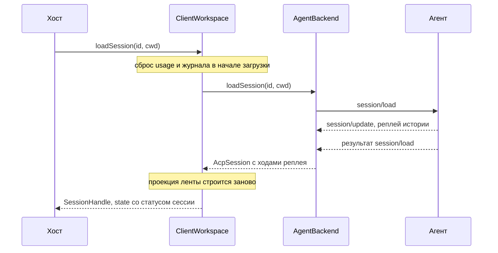
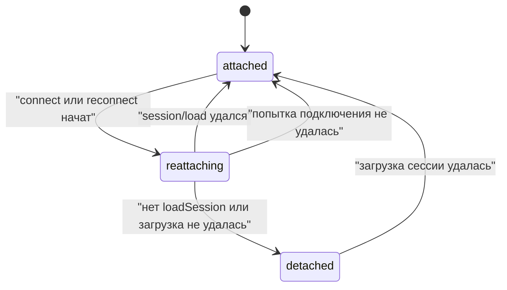

# Сессии

Глава разбирает, как слой открывает сессии, строит их список, загружает сессии агента, возвращает их после переподключения и когда считает сессию потерянной. Что происходит внутри одной сессии при промпте — [глава 6](06-prompt-and-queue.md); восстановление после перезапуска хоста — [глава 5](05-restore.md).

## Сессия и её список

Сессия ACP — одна беседа с агентом в рабочей папке `cwd`. Слой показывает сессии двумя способами:

- `SessionHandle` — объект сессии, открытой в этом запуске: `current`, `view`, `send`, `cancel`, `retry`, `respond`, `setConfigOption`, `queue`. Получить его можно из `newSession`, `loadSession` или `ClientWorkspace.session(id)`.
- `SessionSummaryView` — строка списка сайдбара: `id`, `cwd`, `status`, `title`, `updatedAt`. Список — `WorkspaceState.sessions`.

Список складывается из двух частей в `_summaries()`:

1. сначала открытые сессии от новой к старой (порядок `_order`; новая сессия встаёт в начало);
2. затем сессии агента из `session/list`, которых в этом запуске нет среди открытых, в порядке агента, со статусом `notLoaded`.

Если сессия есть и там и там, она показывается один раз — открытой; заголовок берётся у открытой сессии (`session_info_update`), а если его нет — из `session/list`. `updatedAt` приходит только из `session/list`.

Статус сессии для хоста — `SessionStatusView`:

| Статус | Откуда | Что значит |
|---|---|---|
| `idle` | `SessionLifecycleStatus.idle`, `active` | свободна |
| `running` | `runningTurn`, `awaitingApproval` | идёт ход; ожидание одобрения тоже «занята» |
| `cancelling` | `cancellingTurn` | `session/cancel` отправлен, ход ждёт ответа агента |
| `failed` | `failed` | статус ядра клиента |
| `notLoaded` | строка из `session/list` | у агента есть, в этом запуске не открыта, `SessionHandle` нет |
| `detached` | слой | открыта, но новое соединение её не знает |

`running` и `cancelling` вместе означают «сессия занята» (`SessionStatusView.of`; решение D4 change `extract-acp-client-kit`): разницу между ходом и ожиданием одобрения для решения «поставить промпт в очередь» слой стирает.

## Создание: `newSession`

`newSession({cwd, activate = true})` создаёт сессию через `session/new`:

- без `Connected` бросает `ClientWorkspaceException('Connect an agent before creating a session.')`;
- `cwd` по умолчанию — `projectDirectory`; без него — `ClientWorkspaceException('Select a project folder before creating a session.')`. Явный `cwd` без проекта допустим: сессия, которую открыл `ensureAgent` без выбранного проекта, живёт в своей папке;
- по умолчанию новая сессия становится активной (`activeSessionId`). `activate: false` кладёт её в список и в снимок, но не отдаёт ей фокус: по `activeSessionId` работают Files и терминал, и сессия устаревшего намерения не должна переключать их мимо чата (D15, D17 change `require-project-folder`).

`activate(id)` делает открытую сессию активной; неизвестный `id` и повтор игнорируются. Хост выбирает активную сессию сам: `loadSession` её не активирует.

## Список сессий агента: `session/list`

Агент, объявивший `sessionCapabilities.list`, отдаёт сессии проекта страницами. Слой запрашивает первую страницу:

- после `connect` и `reconnect` (`_listFirstPage`);
- при `selectProject(path)`, если агент подключён и папка изменилась.

Без возможности `list` или без `projectDirectory` запроса нет и `hasMoreSessions` ложно: ACP без `cwd` вернул бы сессии всех папок, а сайдбар показывает список проекта.

Следующую страницу даёт `loadMoreSessions()`, пока `WorkspaceState.hasMoreSessions`. Курсор `nextCursor` живёт только внутри слоя (`_nextCursor`) и наружу не отдаётся: ACP запрещает его хранить, и в снимок он не попадает. Повторный `loadMoreSessions`, пока запрос в полёте, — пустая операция (`_listing`).

Ответы не должны менять устаревший список. Для этого каждая **первая** страница получает новый номер `_listRequest`; ответ с прежним номером после `await` ничего не меняет (AGENTS.md §9, D15 и D17 change `require-project-folder`). Поэтому поздний ответ для прежнего проекта или соединения не влияет на актуальный список, а `loadMoreSessions` прежнего проекта не блокирует список нового.

Ошибка `session/list` — диагностика (`source: 'session'`, `Failed to list ACP sessions: …`); соединение остаётся, список прежний.

Реальные сценарии — `test/sessions/session_list_test.dart`.

## Загрузка: `loadSession`

`loadSession(id, {cwd})` открывает сессию агента через `session/load`: транскрипт строится из реплея с нуля, строка `notLoaded` становится открытой.

Правила:

- Повторный вызов для той же сессии, пока загрузка идёт, возвращает тот же `Future` (`_loading`); второго `session/load` нет.
- Без `Connected` или без `loadSession` у агента — `ClientWorkspaceException`, запроса к агенту нет.
- Ошибка агента — диагностика `Failed to load ACP session <id>: …` и исключение вызывающему; строка остаётся `notLoaded`.
- Загрузка уже открытой сессии перестраивает её транскрипт из реплея. Очередь промптов и флаги представления сохраняются.
- Проекция ленты при загрузке сбрасывается явно (`TranscriptProjector.reset`): id ходов реплея агента могут совпасть с прежними (`turn-1`), и по сравнению ходов замену не отличить (design D4 change `add-session-list-and-reload`).
- В **начале** загрузки (не по ответу) сбрасываются расход и журнал расхода сессии: снимок usage с поводом `load` приходит после ответа, но может быть обработан раньше обновления сессии, и сброс по ответу его стёр бы ([глава 10](10-usage.md)).
- Ход реплея не получает заметки об исходе (`turnStopped`): ACP не передаёт `stopReason` в реплее ([глава 7](07-transcript.md)).

## Потеря связи: `detached` и переподключение

Агент после перезапуска или смены профиля прежних сессий не знает. Слой различает три состояния связи сессии с соединением (закрытое перечисление `_Link`, не видно хосту):

- `attached` — сессия работает в текущем соединении.
- `reattaching` — идёт замена транспорта: промпты встают в очередь, очередь не сливается (`suspend()`).
- `detached` — новое соединение сессию не знает. В `SessionView.status` она получает `detached`, а в конец ленты на место прихода встаёт `NoticeItem` вида `detached` с типизированной причиной `SessionRestoreReason` (`agentCannotRestore` или `restoreFailed`).

Порядок после успешного `connect` или `reconnect` (`_reattachSessions`):

1. Список открытых сессий: активная первой, затем остальные. Пользователь сразу видит транскрипт активной, а фоновые его не задерживают.
2. Если агент не объявил `loadSession`, каждая сессия становится `detached` с уведомлением `The agent cannot restore sessions after reconnecting.`
3. Иначе каждая сессия загружается своим `cwd` через `session/load`; успех — `resume()`, и очередь сливается; ошибка — `detached` с уведомлением `Session <id> could not be restored after reconnecting.`, и только эта сессия.
4. Если во время цикла началась новая попытка, оставшиеся сессии не трогаются: новая попытка сама их приостановила и перезагрузит.
5. Список сессий проекта запрашивается заново.

Новую сессию вместо потерянной слой не подменяет (design D5 change `add-session-list-and-reload`): подмена потеряла бы транскрипт и контекст без ведома пользователя. Обратное в одном месте — [восстановление после перезапуска](05-restore.md): там при невозможности загрузки создаётся новая сессия с уведомлением `reconnected`.

Сессию, ставшую `detached`, возвращает `loadSession(id, cwd:)` — это триггер «фокус на `detached`»: при успехе связь снова `attached`, уведомление снимается, очередь сливается. При ошибке сессия остаётся `detached` с прежним уведомлением (D16 change `require-project-folder`).

Что делает промпт в `detached`-сессии: `send` не уходит в сеть, а возвращает `PromptFailed(ClientWorkspaceException('Session <id> is detached from the agent.'))`; очередь сохраняется ([глава 6](06-prompt-and-queue.md)).

## Что хост должен знать

- Статусов шесть, и `switch` по `SessionStatusView` обязан разобрать все: компилятор не даст пропустить.
- Для `notLoaded` у хоста нет `SessionHandle`: `ClientWorkspace.session(id)` вернёт `null`. Сначала `loadSession`.
- Открывать сессию по фокусу и активировать её — два действия: `loadSession` активацию не делает.
- Активную сессию после переподключения слой не меняет: `activeSessionId` остаётся прежним.
