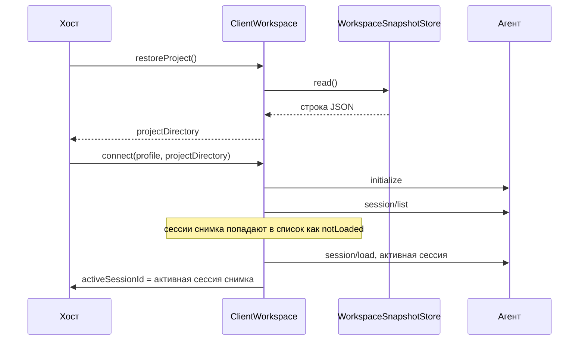

# Восстановление после перезапуска

Глава разбирает, как слой возвращает пользователя к работе после перезапуска хоста: что хранится в снимке, в каком порядке идут шаги, когда запись снимка разрешена и когда восстановление отменяется. Соединение и сессии — [главы 3](03-connection.md) и [4](04-sessions.md).

## Зачем снимок

Открытые сессии живут в памяти хоста и теряются при перезапуске, хотя агент их хранит. Чтобы вернуться к активной сессии с её транскриптом, достаточно трёх вещей: проекта, активной сессии и списка открытых сессий. Транскрипт отдаёт сам агент при `session/load`.

Восстановление включает параметр `ClientWorkspace(snapshots: …)`. Без него (`snapshots == null`) `restoreProject()` возвращает `null`, `startWithoutRestore()` ничего не делает, снимок не читается и не пишется. Хранилище даёт хост: в app это `SharedPreferencesWorkspaceSnapshotStore` (`apps/codelab_desktop/lib/core/platform/`), CLI снимок не передаёт и не восстанавливается. Для тестов в пакете есть `InMemoryWorkspaceSnapshotStore`.

## Что в снимке и чего в нём нет

`WorkspaceSnapshot`:

| Поле | Что |
|---|---|
| `projectDirectory` | папка проекта (`String?`) |
| `activeSessionId` | активная сессия (`SessionId?`) |
| `openSessions` | `SessionRef(id, cwd)` — сессии, открытые в этом запуске, плюс ещё не открытые сессии прошлого снимка |

Формат кодирует и разбирает слой (`WorkspaceSnapshot.encode` и `decode`); хранилище видит только строку. Реальный снимок после открытия одной сессии:

```text
{"version":1,"windows":{"main":{"projectDirectory":"/work","activeSessionId":"s-1","openSessions":[{"id":"s-1","cwd":"/work"}]}}}
```

Источник: прогон на `KitAgent` и `InMemoryWorkspaceSnapshotStore`. Ключ `windows` задуман по окну хоста; сейчас окно одно — `main`.

В снимок **не** попадают курсоры `session/list` (ACP запрещает их сохранять), транскрипты (их даёт реплей агента), очереди, профили и секреты; это проверяет `test/restore/workspace_snapshot_test.dart`. Другая версия формата или неверная форма при чтении — `FormatException`, для хоста это «битый снимок».

Изменение формата — новая версия `WorkspaceSnapshot.version` и OpenSpec change.

## Порядок шагов

Хост на старте вызывает ровно один из двух методов:

- `restoreProject()` — прочитать снимок и вернуть проект;
- `startWithoutRestore()` — не открывать проект прошлого запуска (настройка «Reopen the last project» в app, D9 change `add-app-general-page`).



1. **Шаг 1, `restoreProject()`.** Читает снимок, разбирает его и возвращает `projectDirectory`; хост выбирает этот проект до подключения. Битый снимок или неизвестная версия — диагностика `Workspace snapshot is invalid; starting fresh.` (источник `restore`, уровень предупреждения), и снимок удаляется (`clear`). Ошибка чтения — предупреждение, возврат `null`.
2. **Шаги 2–4, при первом успешном `connect()` запуска** (`restoreAfterConnect` внутри `_connect`):
   - если агент объявил `loadSession`, сессии снимка добавляются в список строками `notLoaded` (`rememberSessions`); без `loadSession` их не открыть и они выбрасываются;
   - активная сессия загружается `session/load` и становится активной;
   - агент без `loadSession` или ошибка загрузки — слой создаёт **новую** сессию в проекте, делает её активной и ставит в ленту `NoticeItem` вида `reconnected` с типизированной причиной `SessionRestoreReason` (`agentCannotRestore` или `restoreFailed`).
3. Восстановление ничего не отправляет агенту от пользователя: ни промптов, ни ответов на одобрения.

Шаги 2–4 выполняются один раз за запуск: при `reconnect` они не повторяются (`_reconnect` вызывает `_reattachSessions`, но не `restoreAfterConnect`).

Реальный прогон второго запуска:

```text
restoreProject -> /work
sent: session/load {sessionId: s-1, cwd: /work, mcpServers: []}
active=s-1 sessions=[s-1:idle]
```

Источник: временный скрипт на `KitAgent` с `InMemoryWorkspaceSnapshotStore`; ответ на `session/load` пустой, как у агента без реплея.

## Когда восстановление не выполняется

Три правила защищают от неожиданного `session/load`:

- **Активная сессия вне проекта.** Если `cwd` активной сессии снимка не равен проекту снимка (точное равенство строк), она не загружается и не активируется, `session/new` с уведомлением тоже не создаётся: сессия остаётся строкой `notLoaded` и открывается только явным выбором хоста (D10, HIGH-1 change `require-project-folder`). Иначе снимок `{project: /work/app, s1: "/"}` дал бы `session/load` с `cwd: "/"`, и агент получил бы весь диск. Правило не зависит от `loadSession` агента. Тест — `test/restore/active_session_outside_project_test.dart`.
- **Другой проект.** Если хост выбрал не проект снимка (`selectProject` или папка в `connect`), восстановление отменяется, а ещё не открытые сессии снимка в следующую запись не попадают: сессии принадлежат проекту снимка.
- **Снимок прочитан после первого подключения.** Если подключение запуска уже прошло, пока снимок читался (`_connectedOnce`), хост получает проект, но сессии не восстанавливаются ни сейчас, ни при `reconnect`: иначе `reconnect` отправил бы `session/load` без действия пользователя.

## Запись снимка

Запись идёт на каждое изменение `WorkspaceState` (`DefaultClientWorkspace._publish` вызывает `_restorer.observe`):

- **До чтения не пишет.** Пока `restoreProject()` не завершился, снимок не записывается: пустое рабочее пространство стёрло бы снимок прошлого запуска. Изменения за время чтения только отмечаются; после чтения состояние сверяется со снимком.
- **Без таймера.** Серия синхронных изменений — одна запись; изменения во время записи — одна следующая, с последним снимком (`_drain`). Записи не накладываются. Таймера нет: в тестах интерфейса он оставался бы висеть, а последняя запись не должна ждать паузы.
- **Дедупликация.** Если новый снимок равен последнему записанному или ожидаемому, записи нет.
- **Состав.** Открытые сессии (все со статусом не `notLoaded`) плюс ещё не открытые сессии прошлого снимка, пока пользователь их не откроет (ленивая загрузка).
- **Ошибки.** Ошибка чтения или записи — `WorkspaceDiagnostic` (`restore`, предупреждение `Failed to save workspace snapshot: …`), а не отказ операции.
- **Закрытие.** `flushSnapshot()` и `dispose()` дожидаются последней записи. Если снимок ещё читается, `flush` ждёт чтение не дольше 2 секунд (`WorkspaceRestorer.readWaitLimit`): зависшее хранилище не должно держать закрытие хоста (`AGENTS.md` §12).

## `startWithoutRestore`

Альтернатива `restoreProject()`: снимок не читается, проект не выбирается, первое подключение ничего по снимку не восстанавливает. **Запись при этом разрешена**: первая запись заменяет снимок прошлого запуска текущим. Иначе при выключенной настройке снимок вообще не писался бы, и её включение вернуло бы проект двухдневной давности.

Взаимодействие двух методов:

| Вызов | Результат |
|---|---|
| `restoreProject()` дважды или одновременно | второй вызов получает результат первого без повторного чтения |
| `startWithoutRestore()` дважды | второй — пустая операция |
| `startWithoutRestore()` после `restoreProject()` | пустая операция, восстановление идёт |
| `restoreProject()` после `startWithoutRestore()` | `null`, снимок не читается |

Тесты — `test/workspace/client_workspace_restore_test.dart`.

## Внутреннее устройство

`WorkspaceRestorer` (`lib/src/restore/workspace_restorer.dart`) не экспортируется из бареля. Свои операции он получает через внутренний интерфейс `RestoreHost`, который реализует `_RestoreHostAdapter` в `client_workspace.dart`: `rememberSessions`, `loadSession`, `activate`, `newSessionWithNotice`, `report`. Это держит алгоритм вне файла рабочего пространства и не раскрывает закрытые операции (design D6 change `add-session-list-and-reload`).
