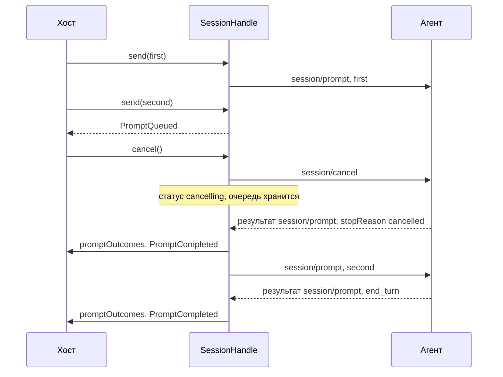

# Промпт, очередь, отмена и повтор

Глава разбирает, что происходит между вызовом `SessionHandle.send` и концом хода: когда промпт уходит агенту, когда встаёт в очередь, как очередь сливается, чем заканчивается отмена и в каких случаях ход можно повторить. Как строится лента ответа — [глава 7](07-transcript.md); одобрения посреди хода — [глава 8](08-approvals.md).

## Что решает `send`

Промпт — сообщение пользователя, которое уходит агенту запросом `session/prompt`. Пока ход идёт, агент не принимает новый промпт той же сессии, а пользователь продолжает писать. Чтобы сообщения не терялись и не уходили в чужую сессию, слой держит очередь на каждую сессию (спецификация, «Очередь промптов на сессию»).

`SessionHandle.send(text)` разбирает состояние сессии (`_SessionHandle.send`):

| Состояние | Что делает `send` | Результат |
|---|---|---|
| `detached` | не отправляет, публикует исход | `PromptFailed(ClientWorkspaceException('Session <id> is detached from the agent.'))`; исключения нет |
| занята (`running` или `cancelling`) или идёт переподключение (`reattaching`) | кладёт `QueuedPrompt` в очередь | `PromptQueued(item)`; в `promptOutcomes` не публикуется |
| свободна и связана с агентом | отправляет `session/prompt` | `PromptCompleted(turn)` или `PromptFailed(error)` после конца хода |

`PromptOutcome` — закрытая иерархия:

- `PromptQueued(sessionId, item)` — промпт встал в очередь;
- `PromptCompleted(sessionId, turn)` — агент ответил на `session/prompt`; `turn` — итоговое состояние хода, в том числе отменённого (`stopReason: cancelled`);
- `PromptFailed(sessionId, error)` — промпт не дошёл или ход сорвался; `error` — исключение `codelab_client_acp`.

`Future` от `send` завершается **после конца хода и слива очереди, которую этот ход освободил**: `send` вернёт исход своего промпта, но не раньше, чем уйдут и закончатся промпты, ждавшие в очереди (`_dispatch` вызывает `_drainIfFree` перед возвратом). Для промпта, ушедшего в очередь, `Future` завершается сразу значением `PromptQueued`.

Исходы всех ходов — и отправленных хостом, и ушедших из очереди сами — публикует `ClientWorkspace.promptOutcomes`; это единственный способ узнать итог промпта, который слой отправил за хост. В нём есть только `PromptCompleted` и `PromptFailed`.

## Очередь

`PromptQueue` — интерфейс очереди одной сессии, её реализует тот же `_SessionHandle` (`SessionHandle.queue`). Элементы — `QueuedPrompt(id, text)`; `id` вида `queued-<n>` из счётчика рабочего пространства: он общий для всех сессий и не переиспользуется. По `id` хост правит и удаляет элемент, даже когда соседние сдвинулись.

| Метод | Что делает |
|---|---|
| `items` | элементы по порядку отправки; то же, что `SessionView.queue` |
| `remove(id)` | убирает элемент и возвращает его (например, вернуть текст в композер); неизвестный `id` — `null` |
| `sendNow(id)` | отправляет элемент вне очереди, если сессия свободна, связана и соединение установлено; иначе `null`, элемент остаётся на месте |
| `clear()` | очищает очередь |

`sendNow` возвращает `null` при занятой сессии или оборванном соединении — это ожидаемая гонка (кнопку нарисовали до начала хода), а не ошибка. Очередь не сохраняется в снимке и агенту отправляется только промптом.

### Слив очереди

Слив запускает `_drainIfFree` после каждого завершённого хода. Условие — `_canDrain`: сессия не занята, связь `attached` и `Connected` в рабочем пространстве. Первый элемент снимается с очереди и уходит новым `session/prompt`; после его хода условие проверяется снова, пока очередь не опустеет или условие не нарушится.

Проверка идёт заново после каждого хода, а не по событию смены статуса. Слив из обработчика синхронного потока `sessionChanges` вызвал бы вложенную публикацию в тот же поток (комментарий к `_dispatch`).

Когда слив не идёт:

- сессия `detached`: элементы остаются в очереди, пока `loadSession` не вернёт связь;
- идёт переподключение: сессия `reattaching`, и очередь сливает `resume()` после успешной загрузки сессии в новом соединении;
- соединение не `Connected` (после обрыва ход завершается ошибкой и освобождает сессию, но очередь ждёт переподключения, а не уходит в оборванное соединение).

## Один ход

На схеме — ход с очередью и отменой (тест `cancel() sends session/cancel; the session stays cancelling until the agent answers, then the queue drains`).



Статус `running` ставит не слой, а ядро клиента: он выводится из `AcpSession.status` через `SessionStatusView.of`. Поэтому статус появляется вместе с отправкой запроса (в примере из [главы 0](00-getting-started.md) `rev=1 status=running`).

## Отмена

`SessionHandle.cancel()` отправляет `session/cancel` и возвращает `PromptTurn` хода. Ход остаётся `cancelling`, пока агент не ответит на его `session/prompt`; в ACP отмена подтверждается ответом `stopReason: cancelled` (`05-Prompt Turn.md`, «Cancellation»). Пока статус `cancelling`, сессия «занята»: новые промпты встают в очередь, а слив очереди идёт после ответа агента (решение D2 change `fix-prompt-cancel-tool-calls`).

Диагностика: `info` `Cancelled prompt turn <id>.` при успехе, `error` `Failed to cancel prompt turn: <причина>` и повторное исключение при ошибке.

Одобрения, ждавшие ответа в момент отмены, меняют вид транскрипта; детали — [глава 8](08-approvals.md).

## Сорвавшийся ход и `retry`

Если `session/prompt` завершился ошибкой, ход получает статус `failed` и типизированную причину `PromptFailure`:

| Причина | Откуда | `retry` |
|---|---|---|
| `AgentPromptFailure(errorClass, message, retryable)` | ответ-ошибка агента CodeLab с `data.codelab` | запрещён при `retryable: false` |
| `RequestPromptFailure` | ошибка JSON-RPC без расширения (сторонний агент) | разрешён |
| `ConnectionLostPromptFailure` | ход прерван обрывом транспорта | запрещён: сначала нужно переподключение |
| `UnknownPromptFailure(message)` | таймаут, ошибка декодирования, прочее | разрешён |

Классы определены в `codelab_client_acp` (`lib/src/domain/prompt_failure.dart`).

`SessionView.canRetry` истинно, если одновременно: связь сессии `attached`; статус не `running` и не `cancelling`; у сессии есть ходы; последний ход `failed`; причина не из запрещающих (`_canRetry`). Состояние соединения хост проверяет сам — оно в `WorkspaceState.connection`.

`retry()` отправляет `prompt` последнего хода новым `session/prompt`; прежний сорвавшийся ход остаётся в ленте. Исход публикуется в `promptOutcomes`, как у `send`. При ложном `canRetry` — `ClientWorkspaceException('Session <id> has no failed turn to retry.')` без запроса. В ленте сорвавшийся ход отмечен `NoticeItem` вида `error` ([глава 7](07-transcript.md)).

## Гонки и ограничения

Публикация синхронная ([глава 2](02-state-ownership.md)), поэтому порядок событий важен для хоста. Два случая проверены прогонами на `FakeAcpTransport`.

**Промпт, отправленный из обработчика `promptOutcomes`, опережает очередь.** Между завершением хода и сливом очереди есть окно: сессия уже `idle`, а первый элемент очереди ещё не ушёл (в выводе [главы 0](00-getting-started.md) это `rev=5 status=idle queue=1`). Если хост в этом окне синхронно вызовет `send`, сессия свободна, и промпт уйдёт сразу, раньше элементов очереди. Прогон: очередь `second`, обработчик `promptOutcomes` вызывает `send('third')`:

```text
outcome: PromptCompleted, queue=(second)
session/prompt order: [first, third]
queue now: (second)
```

`second` уйдёт только после хода `third`. Хосту, которому важен порядок, нужно не отправлять промпт, пока `SessionView.queue` не пуста, а ставить его в конец очереди.

**`send` из обработчика `view` ломает публикацию.** Обработчик `SessionHandle.view` вызывается внутри `_views.add`. Если он синхронно вызывает `send` (или другой метод, который тут же меняет сессию), публикация вложится в тот же поток. Прогон: обработчик `view` на состоянии `idle` с непустой очередью вызывает `send('third')`:

```text
host sees idle with queue=(second) -> send(third)
outcome: PromptCompleted
outcome: PromptFailed Bad state: Cannot fire new event. Controller is already firing an event
outcome: PromptFailed StateTransitionException: session already has an active prompt turn
session/prompt order: [first]
queue now: ()
```

Оба промпта, `third` и `second`, завершились `PromptFailed`, а очередь опустела. Поэтому из обработчиков синхронных потоков слоя вызывать `send` нельзя: вынесите вызов в микрозадачу (`scheduleMicrotask`) или в обработчик действия пользователя. Слой сам по той же причине не отправляет из события статуса. Оба прогона — временные скрипты на `KitAgent`; в тестах пакета этих сценариев нет.

## Что должен сделать хост

- Рисовать очередь из `SessionView.queue`, а не копировать её.
- Для результата промпта, ушедшего из очереди, слушать `ClientWorkspace.promptOutcomes`.
- Показывать `PromptQueued` как «в очереди», а не как отправленное.
- Кнопку «Retry» привязывать к `SessionView.canRetry` и к `ConnectionView` (при `ConnectionLost` сначала Reconnect).
- Кнопку Cancel включать, пока статус `running`; при `cancelling` показывать ожидание подтверждения агента.
