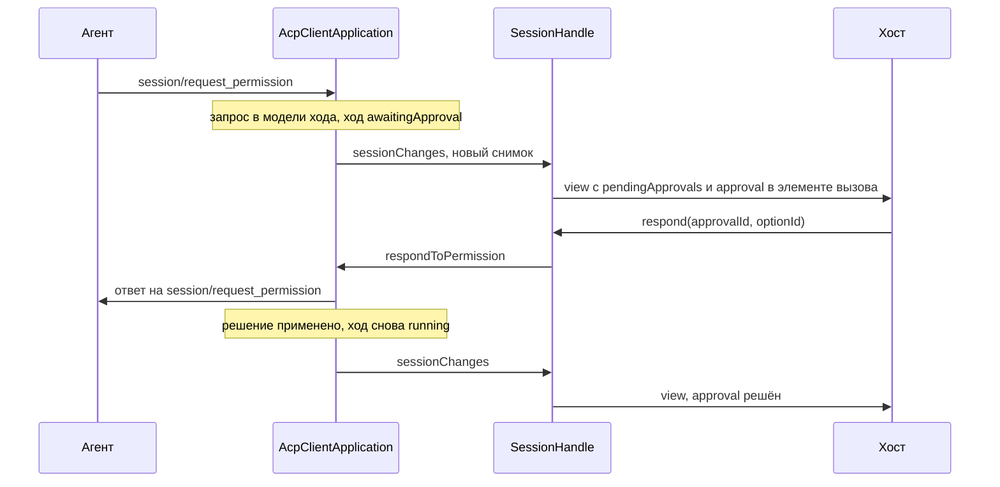

# Одобрения

Глава разбирает, как слой показывает запросы разрешения `session/request_permission`, привязывает их к вызову инструмента, принимает ответ пользователя и что делает с одобрениями при обрыве и замене соединения. Саму политику «что опасно» ведёт агент, а не клиент: клиентский слой только показывает вопрос и передаёт решение пользователя (корневой `AGENTS.md` §10, [`permissions.md`](../../../../docs/architecture/permissions.md)).

## Что приходит и что видит хост

Агент присылает `session/request_permission` с вызовом (`toolCall`) и вариантами ответа (`options`). ACP не имеет отдельного «отклонить»: отказ — тоже вариант (`reject_once`, `reject_always`). Слой показывает запрос двумя способами, и оба — один и тот же вид:

- `SessionView.pendingApprovals` — список ожидающих запросов сессии: ходы по порядку, внутри хода — порядок прихода (сортировки нет). Правило `requestedAt` нужно только для фокуса: `focused` получает самое раннее ожидающее одобрение;
- `ToolCallItem.approval` — запрос, встроенный в элемент вызова ленты ([глава 7](07-transcript.md)); у решённого — исход.

`ApprovalStateView` — закрытая иерархия:

| Вид | Поля | Когда |
|---|---|---|
| `PendingApprovalView` | `approvalId`, `sessionId`, `risk`, `command`, `rawInput`, `options`, `focused`, `critical`, `subagent`, `toolTitle` | ждёт ответа |
| `ResolvedApprovalView` | `label`, `outcome`, `agentLabel`, `subagent` | решён или снят |

`risk` — `ApprovalRiskLevel` из `codelab_client_acp`: `readOnly`, `unknown`, `localWrite`, `network`, `shell`, `destructive`. Вызов вида `other` или без вида получает `unknown`, а не `readOnly`: неизвестная возможность не считается безопасной (спецификация, «Неизвестный уровень риска вызова»). `rawInput` приходит уже готовым полем; сырой JSON хост показывает через `formatRedactedJson`, чтобы секреты прошли редакцию.

Сырые данные запроса хост не разбирает: `command` слой берёт из `rawInput.command`, а признак `critical` — из `_meta.codelab.critical` запроса или его `toolCall`; любое значение, кроме булева `true`, даёт `false`. Критичный запрос — опасная команда, которую headless-политика `allow-all` CLI не разрешает (комментарий к `ApprovalStateView.pending`).

## Привязка к вызову

Запрос привязан к `toolCallId` и к своей сессии: решение пользователя для одного вызова не применяется к другому (корневой `AGENTS.md` §10, PERM-003).

- **Вызов объявлен `tool_call`.** Одобрение встраивается в его `ToolCallItem`.
- **Вызова нет.** ACP разрешает `session/request_permission` для вызова без `tool_call`. Одобрение должно быть видно, поэтому для такого вызова слой добавляет элемент в конец хода — место, которое ни одно событие не задало точнее (`_unannouncedApprovalItems`). Заголовок берётся из `toolCall.title` запроса.
- **Несколько запросов на один вызов.** Агент вправе спросить повторно. Для элемента выбирается самое раннее ожидающее одобрение по `requestedAt`, а если ожидающих нет — последнее по порядку прихода (правило D13 change `fix-approval-focus`, `_chooseApproval`). Без этого решённый запрос стоял бы поверх ожидающего, и ответить на него в ленте было бы нельзя.
- **Фокус.** `PendingApprovalView.focused` истинно у самого раннего ожидающего запроса хода: только он отвечает на клавиши одобрения (embed-approval-in-thread/design.md, решение 6). Сравнение времени полное и транзитивное: сначала запросы с `requestedAt`, затем без него, равные остаются в порядке прихода.

Инвариант видимости (спецификация, «Одобрение в элементе вызова транскрипта»): каждое ожидающее одобрение корня из `pendingApprovals` с `focused` является одобрением своего элемента ленты.

## Ответ пользователя

```dart
final approval = session.current.pendingApprovals.first;
await session.respond(approval.approvalId, approval.options.first.optionId);
```

`SessionHandle.respond(approval, option)`:

1. передаёт бэкенду `RespondToPermissionCommand.selected(sessionId, approvalId, optionId)` — только своей сессии;
2. ядро клиента проверяет, что запрос ожидает и вариант есть в списке, отправляет ответ агенту и применяет решение к модели сессии;
3. слой пишет диагностику `info` `Resolved approval <id> (<status>).` или `error` `Failed to respond to approval request: …` и повторно бросает исключение.

Одобрение другой сессии, снятое или уже решённое ядро клиента отклоняет `StateTransitionException('permission request is not pending')`, и ответ ни в какое соединение не уходит. Отмена хода (`SessionHandle.cancel`) отвечает на все ожидающие запросы исходом `cancelled`, как требует ACP.

Реальный фрагмент прогона (`KitAgent`): запрос с `id` 7 приходит во время хода, пользователь отвечает `allow-once`.

```text
rev=6 status=running queue=[second] pending=1 items=[… | tool "Run dart test" queued approval=PendingApprovalView]
--- respond to approval permission-7
rev=7 status=running queue=[second] pending=0 items=[… | tool "Run dart test" queued approval=ResolvedApprovalView]
```

Источник: временный скрипт на `KitAgent` (`requestPermission`). Идентификатор `permission-7` ядро клиента строит из JSON-RPC `id` запроса.

На схеме — путь вопроса от агента до пользователя и обратно.



## Снятие при смене соединения

Одобрение привязано к соединению, в котором пришёл запрос. Когда соединение заменяется или рвётся, ответить агенту некуда, и позднее решение ушло бы в чужое соединение. Поэтому ядро клиента снимает ожидающие одобрения синхронно: статус становится `cancelled`, ход выходит из `awaitingApproval`, запрос пропадает из `pendingApprovals` и карточки вызова.

- При замене транспорта (`connect`, `reconnect`): `_dropPendingApprovals('ACP transport was replaced.')` до первого `await` замены — иначе ответ пользователя успел бы уйти в старый транспорт.
- При неожиданном обрыве установленного соединения: `_dropPendingApprovals('ACP connection was lost.')`.

В журнал ядра клиента уходит предупреждение с идентификаторами сессии, одобрения и вызова — без сырых аргументов. Поздний `respond` по снятому одобрению завершается ошибкой и ничего не отправляет. Очередь промптов при этом сохраняется. Запрос нового соединения с тем же JSON-RPC `id` обрабатывается как новый: наборы известных запросов при замене транспорта очищаются.

Решает это `codelab_client_acp` (`acp_client_application.dart`, `_dropPendingApprovals`); слой лишь отражает результат. Тесты слоя — `test/approvals/approvals_dropped_on_connection_change_test.dart`; сценарии — в спецификации «Одобрения привязаны к вызову».

## Ожидания для Time

`SessionView.approvalWaits` — интервалы `ApprovalWaitView(requestedAt, resolvedAt?)` одобрений **корня** последнего хода. Панель Usage вычитает их из времени хода: пока ход стоит на одобрении пользователя, Time расти не должно (design D3 change `fix-usage-pane-live-cards`). Ожидание потомка время корня не останавливает. Решённое одобрение без `resolvedAt` пропускается, чтобы хост не принял его за ожидающее и не заморозил Time. Метки времени ставит ядро клиента, слой их только переносит.

## Одобрения субагентов

Субагент (потомок вызова `agent`) тоже может спросить разрешение. Ключ `_meta.codelab.subagent` в таком запросе называет спрашивающего потомка, а не запущенный `agent`, поэтому это отдельный тип `SubagentRequester(id, type, description, depth, parentToolCallId, rootType, chainTypes)`, а не `SubagentCallView`.

- Панель решения у запроса потомка **одна**: блок под строкой `agent` корня — `ToolCallItem.childApprovals` (PERM-4, D43 п. 2). У дерева вызовов (итерация 5) то же одобрение лежит и в `approval` вложенной строки, но там показываются только ожидание и исход.
- `PendingApprovalView.subagent` и `ResolvedApprovalView.subagent` несут спрашивающего; `toolTitle` нужен, потому что у запроса потомка строки вызова в ленте может не быть.
- Путь спрашивающего (`review › explore wants to run`) строится по цепочке типов: корень — `subagentCall.type`, затем `rawInput.type`; промежуточные звенья — подъёмом по `parentToolCallId`; не найденное звено остаётся `…`.
- В панели Agents ожидающее одобрение помечает строку потомка (`SubagentRowView.approvalId`, самое раннее).

Тесты — `test/approvals/subagent_requester_test.dart`, `test/transcript/approval_in_row_test.dart`.

## Подпись и исход решённого одобрения

`ResolvedApprovalView.outcome` — `ApprovalOutcomeView`: `allowed` и `rejected` — по виду выбранного варианта ACP (`allow_*`, `reject_*`), `cancelled` — отменено, `unknown` — вариант неизвестен или ответ без варианта. Исход нужен, чтобы хост не рисовал зелёную галочку у отменённого запроса.

`label` — подпись для CLI: название выбранного варианта, `Cancelled` или `Resolved`. `agentLabel` — подпись агента (название варианта или его `id`, если варианта нет в `options`); `null` для запасных подписей слоя `Cancelled` и `Resolved`. Хост показывает `agentLabel` как есть, а при `null` строит подпись на своём языке по `outcome` (D6 change `add-desktop-localization`). Тест — `test/transcript/approval_agent_label_test.dart`.

Вызов, чьё одобрение отменено вместе с ходом, показывается `cancelled`, если он ещё не завершён: он так и не исполнился (комментарий к `_unannouncedApprovalItems`).

## Исключение: `fs/*` и `terminal/*`

Для ACP-методов `fs/read_text_file`, `fs/write_text_file` и `terminal/*` у клиента нет собственного гейта одобрений: permission остаётся ответственностью агента, а компенсирующий контроль — ограничение путей и `cwd` рабочей папкой сессии (корневой `AGENTS.md` §10, исключение). Эти методы обслуживает `codelab_client_acp`; клиентский слой одобрений для них не показывает.
