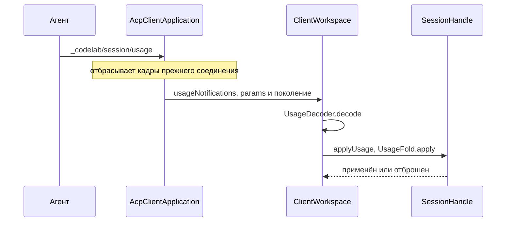

# Расход сессии (usage)

Глава разбирает, как слой показывает токены, деньги и заполнение контекста: откуда приходят числа, как слой отличает новый снимок от дубля и опоздания, что сбрасывает расход и как запрашивается журнал по ходам. Слой ничего не считает сам: все значения приходят готовыми от агента, а слой решает, какой снимок применять.

## Откуда числа

Расход — расширение CodeLab, а не часть ACP. Клиент при `initialize` объявляет `usage` в `clientCapabilities._meta.codelab` (`codelabClientExtensionsMeta` в `codelab_client_acp`), и агент CodeLab шлёт уведомления `_codelab/session/usage`. Агент объявляет `usage` в своих `agentCapabilities._meta.codelab`; слой читает объявление через `CodelabExtensions.parse`.

Путь снимка:



- `AcpClientApplication` маршрутизирует уведомление в поток `usageNotifications` (`sessionId`, сырые `params`, поколение соединения).
- `DefaultClientWorkspace._handleUsage` ищет сессию. Нет ни сессии, ни идущей загрузки — запись `usage.unknown_session`, снимок отброшен. Если сессию загружают, а её ещё нет в рабочем пространстве, снимок ждёт её регистрации: хранится последний по `seq` (`_pendingUsage`), а при сбое загрузки отбрасывается.
- `UsageDecoder` разбирает форму **в одном месте** пакета: `_meta.codelab.*` не разбирают ни виджеты, ни хосты. Разбор терпимый: неверное необязательное поле отсутствует, неверное обязательное (`sessionId`, `seq`, `trigger`, `session.tokens`) отбрасывает снимок целиком. Исключений нет, на каждое неразобранное поле вызывается `onWarning(field, reason)` — имя поля и короткая причина, без сырого значения.
- `UsageFold.apply` решает, применять ли снимок. `SessionView` получает ровно одну ревизию на применённый снимок.

## `UsageView`

`SessionView.usage`:

| Поле | Что |
|---|---|
| `support` | `UsageSupport`: `unknown` (агент не объявил `usage` и снимков не было), `awaiting` (объявил, снимков ещё нет), `reported` (применён хотя бы один) |
| `lastTurn` | агрегат хода последнего снимка с `turnId`; привязан к `turnId`: новый ход без разобранного `turn` даёт `null`, а не агрегат прошлого |
| `session` | сумма сессии из последнего снимка |
| `context` | `ContextFillView(used, size, compactAt)` — заполнение окна; считает агент, клиент не оценивает |
| `lastSeq` | `seq` последнего применённого снимка; `0` — снимков нет |
| `budget` | `TurnBudgetView` — лимиты хода (`steps`, `tokens`, `cost`, `duration`), `turnId`, `receivedAt`, `ended` |

Три значения `support` вместо `bool`: «агент не умеет» и «агент умеет, но ещё не прислал» рисуются по-разному (`—` и ожидание), а невозможное «пришло, но не умеет» не выражается. Без расширения хост показывает «неизвестно», а не нули (VIEW-6).

`UsageTotals` — `tokens` (`TokenCounts`: `input`, `output`, `cacheRead`, `cacheWrite`, `reasoning?`), `cost` (`Money?`), `steps`, `turns?` и `partial` (`UsagePartial`: `noUsage`, `noPrice`, `beforeLoad`) — причины, по которым сумма неполна. Хост ставит «~» перед числом по `usageTokensPartial` и `usageCostPartial`.

Деньги — целые микроединицы (`Money(micros, currency)`), без `double`: сумма дробных долларов в двоичной дроби накапливает ошибку, а на проводе стоимость — десятичная строка до шести знаков, которая точно ложится в целое. Целая часть — не больше 9 цифр, чтобы число оставалось точным на web. `cost: null` — цена неизвестна, хост показывает «—», а не `$0`.

## Свёртка: что применять

`UsageFold` — неизменяемая чистая свёртка (`lib/src/usage/usage_fold.dart`). Каждый переход — новое значение. Правило D7:

- снимок применяется, только если его `seq` больше последнего применённого **в том же поколении соединения**;
- в более новом поколении счёт начинается заново (`seq` нового агента может быть 1);
- снимок более старого поколения отбрасывается.

Реальный прогон (временный скрипт на `UsageAgent` из `test/support/usage_agent.dart`):

```text
declared: rev=0 support=awaiting lastSeq=0 session.tokens.input=null cost=null
seq 1: rev=1 support=reported lastSeq=1 session.tokens.input=94000 cost=$0.0041
seq 1 again (duplicate): rev=1 support=reported lastSeq=1 session.tokens.input=94000 cost=$0.0041
seq 3: rev=2 support=reported lastSeq=3 session.tokens.input=120000 cost=$1.20
seq 2 (late): rev=2 support=reported lastSeq=3 session.tokens.input=120000 cost=$1.20
94.0k
log: debug usage.stale {component: client, session_id: s-1, connection_generation: 1, seq: 1, last_seq: 1}
log: debug usage.stale {component: client, session_id: s-1, connection_generation: 1, seq: 2, last_seq: 3}
```

Дубль и опоздание не меняют ни `usage`, ни `revision`; о них остаётся запись `usage.stale`. Пропуск `seq` (с 1 на 3) допустим: применяется последний, а промежуточный, пришедший позже, — опоздание.

Как свёртка собирает остальное:

- Снимок с `turnId` заменяет `lastTurn` агрегатом `turn`; снимок без `turnId` (`compaction`, `load`) `lastTurn` не меняет и обновляет `session` и `context`.
- Бюджет хода (`budget`) ведётся по `turnId`: снимок с `budget` заменяет его; тот же ход без `budget` сохраняет прежний (снимок `turn` лишь ставит `ended`); новый ход без `budget` стирает; снимок без `turnId` бюджет не трогает. `ended` липкий в пределах хода: поздний `step` после итога не «оживляет» ход. Момент `receivedAt` берётся по часам рабочего пространства — свёртка `DateTime.now` не зовёт; оценку времени между снимками делает хост.
- Свёртку вызывает только `ClientWorkspace`; хост читает готовое `SessionView.usage`.

## Когда расход сбрасывается

Сброс — `UsageFold.initial(declared: …)`: `awaiting`, если новое соединение объявило `usage`, иначе `unknown`.

| Событие | Когда сбрасывается |
|---|---|
| новое соединение | по готовому `initialize` (`_resetUsage` в `_connect` и `_reconnect`) — для каждой открытой сессии, даже `detached` |
| `session/load` | в **начале** загрузки (`_SessionHandle.beginLoad`), до отправки запроса |

Сброс при замене соединения идёт не в `suspend()` начала `reconnect`, а по готовому `initialize` нового: до замены транспорта старый агент ещё может прислать снимок, и дальше поколение защищает от него в `UsageFold`. Сброс при `session/load` идёт в начале, а не по ответу: снимок `trigger: "load"` приходит после ответа, но может быть обработан раньше обновления сессии, и сброс по ответу его стёр бы.

Если повторный `session/load` открытой сессии завершился ошибкой, расход остаётся сброшенным до следующего снимка; прежние числа не возвращаются (спецификация, сценарий «Сорвавшаяся загрузка открытой сессии»).

Заметка хода `The turn stopped: budget exceeded: <лимит>.` строится из итога хода, а не из `usage` ([глава 7](07-transcript.md)).

## Журнал расхода по ходам

Журнал — подробный разрез по ходам, шагам, моделям и субагентам. Запрашивается отдельно: `_codelab/session/usage/ledger`. Клиент признак `usageLedger` не объявляет; его объявляет только агент.

`ClientWorkspace.refreshUsageLedger(sessionId, {rebuild = false})` ведёт `SessionView.usageLedger` — закрытую иерархию `UsageLedgerState`:

| Состояние | Когда |
|---|---|
| `unavailable` | агент не объявил `usageLedger`; запрос не уходит |
| `idle` | объявил, журнал не запрашивали или он сброшен переподключением или `session/load` |
| `loading(previous?)` | запрос в полёте; прежний журнал сохраняется |
| `loaded(view)` | `UsageLedgerView` получен |
| `failed(reason, previous?)` | сбой: `UsageLedgerFailure(kind, code)` — `agentError` (ошибка JSON-RPC с кодом), `decode` (ответ не разобрался или относится к другой сессии), `request` (запрос не ушёл или не получил ответа) |

Правила запроса (D10):

- На сессию не больше одного запроса в полёте. Вызовы во время полёта сливаются в **один следующий** запрос; `rebuild` побеждает. Ожидающие слитые вызовы завершаются вместе с ним.
- Ответ применяется, только если не сменились поколение соединения и «эпоха» журнала сессии (`ledgerEpoch`, растёт при сбросе). Иначе он отбрасывается с записью `usage.ledger.stale`, а состояние возвращается к `idle` или `unavailable`, не к `failed`.
- Ошибки агента не бросаются: они — состояние `failed`.
- Вызов для неизвестной сессии — `ClientWorkspaceException('Unknown session <id>.')`. Для закрытого рабочего пространства и без объявленного `usageLedger` запрос не уходит.

Слой не складывает журнал со снимками usage. Когда обновлять, решает хост: сравнить `usageLedger.view.seq` с `usage.lastSeq`. `UsageLedgerView` несёт `seq`, `total`, `turnCount`, `status` (`upToDate`, `rebuilt`, `inMemory`, `notSaved`), `turns`, `models`, `subagents`, `summaries`. Ответ разбирает `UsageLedgerDecoder`; деньги, валюта и причины — общие функции `usage_parsing.dart` вместе с `UsageDecoder`.

## Журнал kit

События слоя о расходе пишутся в `Logger`, который передан параметром `ClientWorkspace(logger:)` (по умолчанию — `StructuredLogLogger`, как у ядра клиента). В записях нет сумм и текста уведомлений — только идентификаторы:

| Событие | Уровень | Когда |
|---|---|---|
| `usage.stale` | debug | снимок отброшен как дубль или опоздание (`seq`, `last_seq`) |
| `usage.unknown_session` | debug | снимок для сессии, которой нет и которую не загружают |
| `usage.decode_failed` | warning | не разобралось поле (`field`, `reason`); не чаще раза на сессию и поле |
| `usage.ledger.requested`, `received` | debug | запрос журнала и ответ |
| `usage.ledger.stale` | debug | ответ отброшен как устаревший |
| `usage.ledger.failed` | warning | сбой запроса (`code`, либо `reason: malformed` или `request`) |
| `usage.ledger.decode_failed` | warning | поле журнала не разобралось |

Каждая запись несёт `session_id` и `connection_generation`. Набор «уже предупреждали» (`_usageWarned`, `_ledgerWarned`) очищается со сбросом соединения: новый агент вправе получить свою запись.

## Форматирование

Правила округления общие для desktop и CLI, поэтому лежат в слое (`lib/src/usage/usage_format.dart`). Функции чистые, без `double`, без `intl` и локали; разделитель дробной части — всегда точка.

| Функция | Что даёт |
|---|---|
| `formatUsageMoney(Money)` | `$1.20`, `$0.0041`, `12.34 EUR`: от `0.01` — два знака (половина вверх), ниже — две значащие цифры; нуль — `0.00` |
| `formatUsageMoneyExact(Money)` | точная запись для экспорта: `2.26`, `0.000041`, `0` |
| `formatUsageTokens(int)` | `999`, `94.0k`, `1.2M` |
| `usageInputTokens(TokenCounts)` | сумма `input + cacheRead + cacheWrite`, насыщается на 2^53 − 1 |
| `usageContextOf(ContextFillView)` | `UsageContextLabel(label, level)`: `79%`, `<1%`, `125%`; `null` без `size` или при `used = 0`; `UsageLevel` — `normal`, от 80 % `warning`, от 95 % `danger` |
| `usageTokensPartial`, `usageCostPartial` | признак «~»: токены неполны при `noUsage` или `beforeLoad`; стоимость — при любой причине |

Состав сегментов строки и цвет по `UsageLevel` решает хост. Тесты — `test/usage/usage_format_test.dart`.
