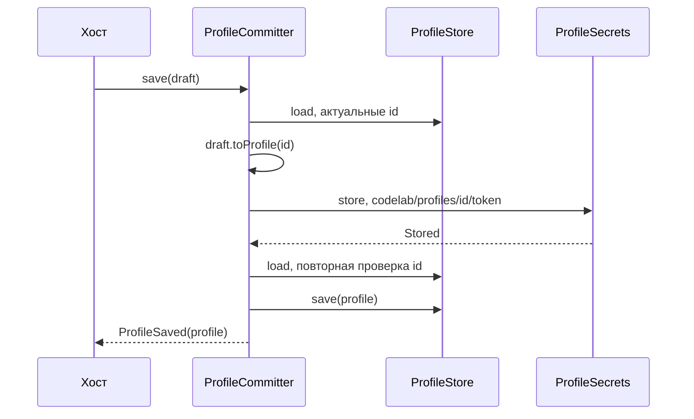

# Профили подключения и секреты

Глава разбирает правила профилей, которые слой держит общими для app и CLI: допустимые id, черновик профиля формы, ссылки на токен, источник значения токена и запись профиля вместе с секретом. Сам автомат соединения — [глава 3](03-connection.md); реализации хранилищ — [глава 13](13-ports-and-stores.md).

Главное правило: **секретов в профиле нет**. Профиль хранится в `profiles.json` и попадает в журналы, поэтому токен WebSocket в нём — только ссылка. Значение живёт там, где его держит хост, и читается в момент открытия транспорта (корневой `AGENTS.md` §10).

Сквозной путь секрета от записи в хранилище агента до запроса провайдера и токена внешнего агента — [алгоритм хранения и выдачи секретов](../../codelab_agent_core/doc/algorithms/secrets.md).

## Идентификатор профиля

Правила в `lib/src/connection/profile_ids.dart`:

| Функция | Что |
|---|---|
| `isValidProfileId(id)` | допустим ли `id` **нового** профиля: `^[a-z0-9][a-z0-9._-]{0,63}$` |
| `reservedProfileIds` | `{'embedded', 'default'}`: имена встроенного агента (`embedded` — слово `--agent`, `default` — его алиас) |
| `isReservedProfileId(id)` | входит ли `id` в резерв |
| `suggestProfileId(label)` | предложение по имени: нижний регистр, всё вне `[a-z0-9]` — `-`, повторы схлопнуты, `-` по краям убраны |
| `usableStoredProfiles(list)` | отделяет прежнюю запись `default` от пригодных профилей |

Нижний регистр и отсутствие `:` выбраны заранее, чтобы имя секрета `codelab/profiles/<id>/token` прошло правила имён секретов. Правило id применяется только к новым профилям: прежние профили с другими id (`Old`) читаются и выбираются как раньше.

`usableStoredProfiles` возвращает запись `(usable, ignoredDefault)`. `default` теперь имя встроенного агента, а в `profiles.json` старой версии такая запись могла остаться: хранилище её не прячет, а потребитель (CLI, страница «Connection») игнорирует и сообщает об этом. Файл не перезаписывается — запись удаляет только явный `ProfileStore.remove('default')`.

`parseShellWords(строка)` и `parseEnvLines(текст)` (`profile_parsing.dart`) разбирают поля формы: команду как POSIX shell без подстановок (кавычки, обратная косая; незакрытая кавычка — `FormatException`) и строки `KEY=value`.

Реальный разбор:

```text
suggestProfileId('My Dev-Box!')  ->  my-dev-box
parseShellWords('python -m "codelab agent" --name \'a b\' x\\ y')
  ->  [python, -m, codelab agent, --name, a b, x y]
```

## Ссылки на токен

`ProfileTokenRef.parse(ref)` не бросает исключений и не видит значения токена. Ссылка — закрытая иерархия:

| Ссылка | Тип | Откуда читается значение |
|---|---|---|
| `env:<NAME>` (`^[A-Za-z_][A-Za-z0-9_]*$`) | `EnvTokenRef` | переменная окружения процесса |
| `secret:<имя>` (правило `isValidSecretName`) | `SecretTokenRef` | хранилище секретов агента |
| всё остальное | `UnsupportedTokenRef` | нигде: подключение идёт без токена |

Голое имя секрета без префикса, `secret:` с недопустимым именем и искажённый `env:` — `UnsupportedTokenRef`: голое значение может оказаться токеном, вписанным не в то поле. Поэтому `toString()` у `UnsupportedTokenRef` — `UnsupportedTokenRef(<redacted>)`, и хосты саму ссылку не печатают.

Реальный разбор:

```text
env:BOX_TOKEN                       -> EnvTokenRef
secret:codelab/profiles/box/token   -> SecretTokenRef
my-token                            -> UnsupportedTokenRef
secret:Bad Name                     -> UnsupportedTokenRef
```

`isValidSecretName` — копия правила имён хранилища агента: слой не зависит от пакетов агента, а ссылка должна читаться ровно тогда, когда имя принимает хранилище. Правило слоя не мягче агентского (пустые сегменты `a//b` слой отвергает дополнительно).

## `SecretSource` и `ProfileSecretSource`

`SecretSource.read(ref)` — порт «ссылка → значение». `ConfigTransportResolver` читает через него Bearer-токен в момент открытия WebSocket и нигде не сохраняет; `null` — секрета нет, подключение идёт без токена.

`ProfileSecretSource(environment, {stored})` — общий источник app и CLI (design D15 change `add-app-settings-shell`):

- `env:` читает `environment[имя]`, `secret:` — `stored.read(имя)` через порт `ProfileSecrets`;
- пустое значение, отсутствующий секрет, отсутствие порта `stored` и `UnsupportedTokenRef` дают `null`;
- **кэша нет**: замена секрета другим процессом видна при следующем открытии транспорта;
- исключение порта не глотается: открытие транспорта должно завершиться видимой ошибкой, а не тихим подключением без токена;
- `hasToken(profile)` — `true`, если серверу уходит непустой токен; значение не читается (для `secret:` — `ProfileSecrets.isSet`);
- `isSecretMissing(profile)` — `secret:` без значения; исключение порта считается «нет». Хост пишет предупреждение `secretMissingWarning(profileId)` до подключения: `secret:` без значения — не ошибка, но пользователь должен узнать причину отказа сервера.

Окружение и порт передаются аргументами, чтобы слой оставался web-безопасным и тестируемым. `InMemorySecretSource` — источник в памяти для тестов и форм.

## Отказ по токену

Сервер может отклонить рукопожатие WebSocket статусом 401 или 403. Слой даёт общее для app и CLI определение:

- `tokenRejectionStatus(error)` — HTTP-статус 401 или 403 из цепочки причин ошибки (`AcpWebSocketHandshakeRejected` ищется по `cause` до глубины 8); другое — `null`. **Классифицировать по тексту сообщения запрещено:** он зависит от ОС и SDK и может нести секрет;
- `describeTokenRejection(error, tokenSent:)` — `the agent rejected the token (HTTP 401)`, если токен ушёл, или `the agent requires a token (HTTP 401)`, если нет;
- `profileTokenSent(profile, secrets)` — ушёл ли токен: `hasToken` у `ProfileSecretSource`, иначе `read` с немедленным отбрасыванием значения; сбой источника — «не отправлен»;
- `describeConnectFailureByToken(error, profile, source)` — склейка: нет 401 или 403 — сразу `null` без обращения к источнику.

Использование: `await describeConnectFailureByToken(error, profile, source) ?? describeFailure(error)`.

## Секретное значение: `SecretText`

Новый токен до записи в хранилище живёт в черновике только как `SecretText`: `toString()` и `toJson()` дают `***`, равенство по значению. Значение читает только `reveal()`, и вызывать его можно лишь в адаптере хранилища. Печатать или сохранять его иначе запрещено (`AGENTS.md` пакета, §2). Состояние формы после закрытия обязано забыть экземпляр.

## Черновик профиля `ProfileDraft`

`ProfileDraft` — неизменяемый черновик профиля stdio или WebSocket. Правила формы одни для app и CLI, поэтому они в слое, а не в Cubit-е.

| Поле | Что |
|---|---|
| `kind` | `ProfileKind.stdio` или `webSocket` (встроенный агент записью не создаётся) |
| `id`, `label` | ключ хранения и имя |
| `command`, `args` | команда и строка аргументов stdio; по умолчанию — `codelab-agent` и `serve --stdio` из `codelabAgentStdioProfile` |
| `env` | строки `KEY=value` |
| `runInProjectDirectory` | по умолчанию `true` |
| `url` | адрес WebSocket |
| `token` | `ProfileTokenChoice`: `NoToken`, `EnvToken(name)`, `StoredSecretToken(name)`, `NewSecretToken(SecretText)`, `KeepTokenRef(ref)` |

`validate(existingIds)` возвращает все проблемы сразу, каждую у своего поля: `ProfileDraftIssue(code, field, message, subject?)`. `code` — `ProfileDraftIssueCode`, `field` — `ProfileDraftField`; текст `message` английский и по умолчанию, форма локализует по `code`. В текстах никогда нет значений `env` и токена. `toProfile(existingIds)` — единственный путь из черновика в `ConnectionProfile`; он повторяет `validate` сам, поэтому профиль не получить в обход правил. Результат — `DraftAccepted(profile, warnings)` или `DraftRejected(issues)`. Предупреждения (`isWarning`) не блокируют сохранение: хост обязан показать их до записи.

Реальный прогон `validate`:

```text
empty stdio: [labelEmpty@label, idEmpty@id]
reserved id: [idReserved@id]
secret-like env: [envSecretLike@env]
ws with userinfo: [urlUserInfo@url]
ws plaintext remote: [plaintextToRemote@url(warning)]
profile: box ws://box.example.test tokenRef=env:BOX_TOKEN warnings=[plaintextToRemote]
```

Источник: временный скрипт с `ProfileDraft`. Правила, которые стоит знать:

- имя ключа `env`, похожее на секрет, — ошибка `envSecretLike`, потому что `env` попадает в `profiles.json`;
- адрес с `user:password@` — `urlUserInfo`: секрет ушёл бы Basic-авторизацией; токен задаётся полем Token;
- `ws://` к нелокальному хосту — предупреждение `plaintextToRemote` (`SETUP-10`); локальность определяет публичная `isLocalHost`;
- `idTaken` сравнивается без учёта регистра; `tokenSecretExists` черновик не выдаёт — его даёт `ProfileCommitter`;
- для `NewSecretToken` пустое значение — `tokenSecretEmpty`, а id, который не даёт допустимого имени `codelab/profiles/<id>/token`, — `tokenSecretNameInvalid`.

Для `StdioProfile` поля WebSocket игнорируются и наоборот.

`profileKindsFor(resolvers)` возвращает типы профилей, которые умеет открыть хотя бы один резолвер, в порядке stdio, затем WebSocket (SETUP-22): хост без stdio-резолвера не должен предлагать stdio в форме.

## Запись профиля вместе с токеном: `ProfileCommitter`

Профиль лежит в `profiles.json`, токен — в хранилище секретов; две записи не атомарны. `ProfileCommitter(store: ..., secrets: ...)` держит порядок, при котором не бывает профиля со ссылкой на несуществующий секрет и секрета-сироты без ведома пользователя (SETUP-19, SETUP-24). Политика одна в слое, чтобы app и CLI не разошлись.

`save(draft)` возвращает `ProfileCommitResult` и не бросает исключений:



1. Перечитывает id из хранилища: между проверкой формы и записью id мог занять другой процесс. Занятый — `ProfileRejected(idTaken)`.
2. Для `NewSecretToken` WebSocket-профиля пишет секрет `codelab/profiles/<id>/token` (`ownTokenSecretName`). `Exists` — `ProfileRejected(tokenSecretExists)` без записи; чужой секрет без явного «Replace it» не перезаписывается (SETUP-5). `ReadOnly` и `Failed` — `ProfileSaveFailed` без записи профиля.
3. Повторно проверяет id непосредственно перед записью (окно гонки сужено до двух соседних вызовов) и пишет профиль. Отказ записи — откат созданного секрета; откат не удался — `ProfileSaveFailed(orphanedSecret: имя)`, по которому хост показывает «Remove it with codelab secret delete NAME».

Исходы: `ProfileSaved`, `ProfileRejected(issues)`, `ProfileSaveFailed(reason, message, orphanedSecret, errorType, storeReason)`. `ProfileSaveFailedReason` — `secretReadOnly`, `secretWrite`, `profileWrite`. `errorType` — `runtimeType` исключения без текста: текст мог бы процитировать значение. `storeReason` — причина, которую назвало само хранилище при `secretReadOnly`; app показывает её как есть, а при `null` — свой перевод, CLI — прежнее `message`.

`remove(id, {deleteOwnSecret = false})`: сначала профиль, и только после успеха — секрет, если профиль ссылается именно на `codelab/profiles/<id>/token` и ни один другой профиль на это имя не ссылается. Секрет, выбранный «Use stored secret», не удаляется никогда. Ошибка удаления секрета профиль не восстанавливает. Исходы: `ProfileRemoved(secret: OwnSecretOutcome)` (`notRequested`, `notOwned`, `shared`, `deleted`, `alreadyAbsent`, `deleteFailed`), `ProfileNotFound`, `RemoveFailed`.

Список секретов для выбора «Use stored secret» — `selectableProfileTokenSecrets(names)`: только `codelab/profiles/*` и только допустимые имена, по алфавиту. Ключи провайдеров и секреты MCP-серверов в него не входят: выбрать их токеном профиля почти всегда ошибка. Фильтр касается только выбора в интерфейсе; ручная ссылка `secret:<имя>` в `profiles.json` по-прежнему читается.

Тесты — `test/connection/profile_commit_test.dart`; двойники хранилищ с журналом вызовов `calls` — `test/support/profile_fakes.dart`.
