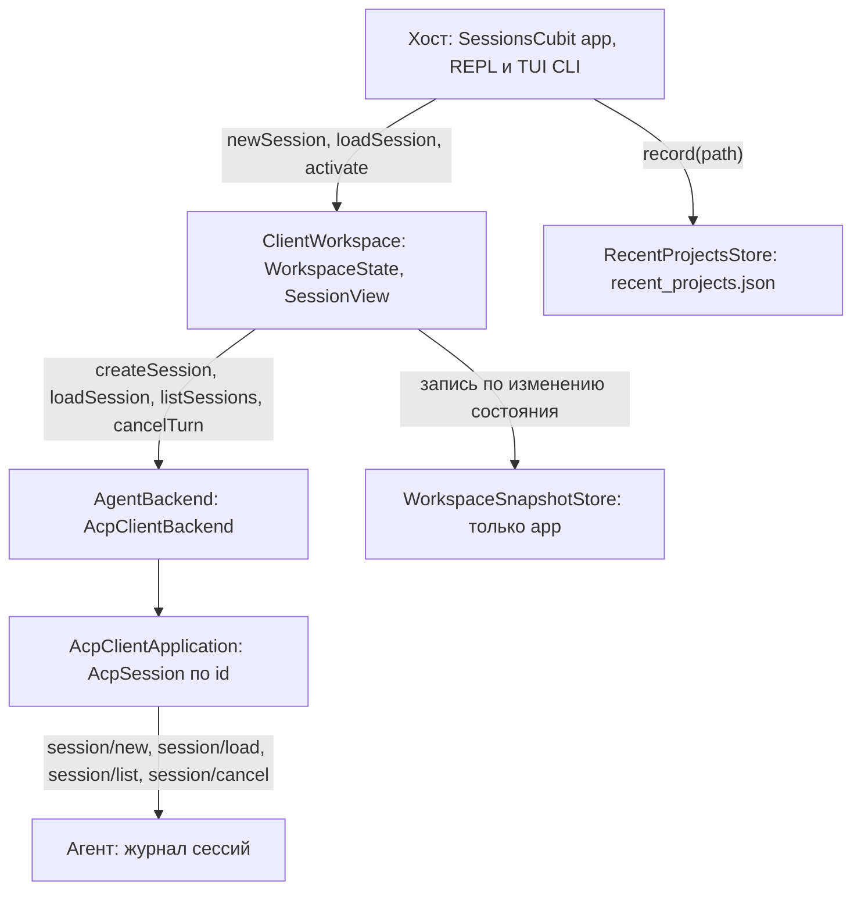
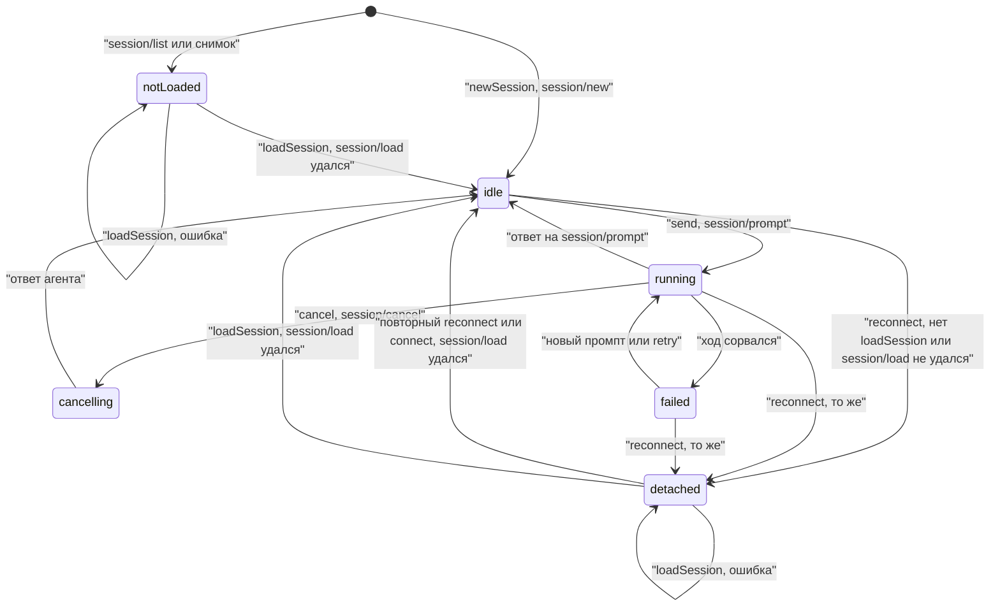
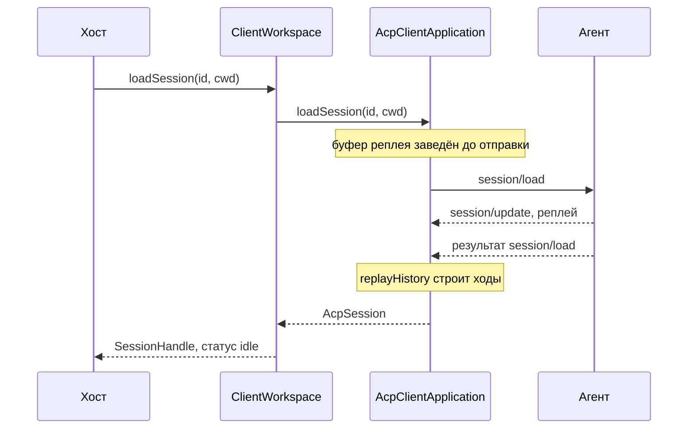
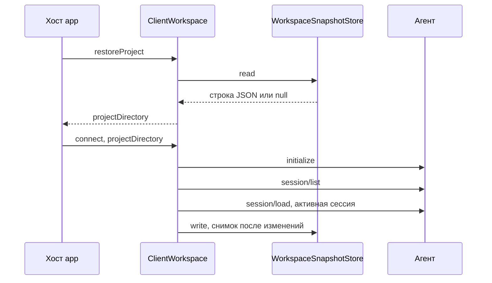

# Хранение и управление сессиями: сторона клиента

Документ описывает путь сессии на стороне клиента от начала до конца: как её создают, как клиент узнаёт о сессиях агента, как открывает их, что делает при разрыве связи и что помнит после перезапуска. Читается подряд. Журнал сессии на диске, `session/list` и `session/load` со стороны агента описывает его документ: [алгоритм сессий агента](../../codelab_agent_core/doc/algorithms/sessions.md). Здесь они — «чёрный ящик» с известным ответом.

Справочники по частям не пересказываются, на них стоят ссылки:

- [глава 4. Сессии](04-sessions.md) — статусы, `detached`, список;
- [глава 5. Восстановление](05-restore.md) — снимок рабочего пространства;
- [глава 6. Промпт и очередь](06-prompt-and-queue.md) и [глава 8. Одобрения](08-approvals.md);
- [глава 13. Порты и хранилища](13-ports-and-stores.md) — недавние проекты;
- журнал, записи и ремонт на стороне агента — [глава 8 `codelab_agent_core`](../../codelab_agent_core/doc/08-sessions-and-compaction.md); мост ACP агента — [`codelab_agent_acp`](../../codelab_agent_acp/doc/02-session-bridge.md);
- нормы — [`acp-client-kit`](../../../../openspec/specs/acp-client-kit/spec.md) («Список и загрузка сессий проекта», «Сессии после переподключения», «Восстановление после перезапуска», «Старт без восстановления рабочего пространства», «Хранилище недавних проектов в CODELAB_HOME»), [`codelab-cli`](../../../../openspec/specs/codelab-cli/spec.md) («Сессии в REPL»), [`agent-workbench-ui`](../../../../openspec/specs/agent-workbench-ui/spec.md) («Workbench restores sessions after reconnect and restart»);
- ACP: `docs/protocols/acp/protocol/03-Session Setup.md` (создание и загрузка сессий), `04-Session List.md` (список сессий).

Пути в псевдокоде даны от `packages/dart/` и `apps/`: `client_io` — `codelab_client_io/lib/src/`, `core` — `codelab_client_core/lib/src/`, `acp` — `codelab_client_acp/lib/src/`, `cli` — `codelab_cli/lib/src/`, `desktop` — `codelab_desktop/lib/`.

## Что хранит клиент и что берёт у агента

Сессия принадлежит агенту. Агент пишет её историю в журнал и отдаёт её по `session/load`. Клиент хранит только то, что нужно, чтобы показать сессии и вернуться к ним:

| Данные | Где живут | Переживают перезапуск клиента |
|---|---|---|
| История сессии (сообщения, вызовы инструментов) | журнал агента | да, пока журнал цел: клиент строит транскрипт из `session/load` заново |
| Список сессий проекта | ответ `session/list` | нет, запрашивается после каждого подключения |
| Транскрипт, статус, очередь промптов, одобрения, расход | память `ClientWorkspace` | нет |
| Курсор `session/list` | память, наружу не отдаётся | нет (ACP запрещает его хранить) |
| Снимок: проект, активная сессия, открытые сессии (`id`, `cwd`) | app: `shared_preferences`, ключ `codelab.workspace.snapshot`; CLI: нет | да, только в app |
| Недавние проекты | `$CODELAB_HOME/recent_projects.json`, общий у app и CLI | да |

Гарантии:

- Клиент не придумывает сессию: статус `notLoaded` есть только у сессии из `session/list` или снимка, `detached` — только у сессии, которую он сам открывал.
- Слой `ClientWorkspace` не подменяет потерянную сессию новой, кроме восстановления после перезапуска: там `restoreAfterConnect` создаёт новую сессию, если у агента нет `loadSession` или загрузка упала, и пишет об этом в ленте. Подмену `detached`-сессии новой делают хосты: REPL и TUI (`_reopenIfDetached`).
- Поздний ответ или кадр прежнего соединения, проекта или запроса состояние не меняет (`AGENTS.md` §9): ниже каждое такое место названо.
- Снимок и список недавних проектов не содержат транскриптов, очередей, токенов и ключей.

Чего клиент не делает: не удаляет, не переименовывает, не закрывает и не ветвит сессии. В `codelab_acp_protocol` для этого нет методов (есть `session/new`, `session/load`, `session/list`, `session/prompt`, `session/cancel`, `session/set_config_option`, `session/set_mode`), и `SessionHandle` не имеет `close`. Открытая сессия живёт в памяти до `dispose` рабочего пространства. Заголовок сессии клиент не задаёт: он приходит от агента в `session_info_update` и в `session/list`.

## Вход и выход

**Вход.**

- Папка проекта: `projectDirectory` (`connect`, `selectProject`, `restoreProject`) и `cwd` сессии (`newSession(cwd:)`, `loadSession(id, cwd:)`).
- Профиль подключения: встроенный агент по умолчанию, внешний — по явному выбору (`--agent`, `stdio:…`, `ws://…`, профиль app).
- Возможности агента из `initialize`: `loadSession` и `sessionCapabilities.list`.
- Решения пользователя: «новая сессия», «открыть», «переподключиться», выбор строки списка.
- Хранилище снимка (порт `WorkspaceSnapshotStore`) и недавних проектов (порт `RecentProjectsStore`).

**Выход.**

- `WorkspaceState.sessions` — строки списка (`SessionSummaryView`), `activeSessionId`, `hasMoreSessions`.
- `SessionHandle` и поток `SessionView` для каждой открытой сессии: статус, транскрипт, очередь, одобрения.
- Кадры ACP `session/new`, `session/list`, `session/load`, `session/cancel` в сторону агента.
- Записи снимка и `recent_projects.json`.
- Диагностика `WorkspaceDiagnostic` (`session`, `restore`) при отказах.

**Побочные эффекты.** Подключение или переподключение сбрасывает расход (`usage`) открытых сессий и снимает ожидающие одобрения (см. [главу 8](08-approvals.md)).

## Кто чем владеет

Владелец клиентского состояния — `ClientWorkspace` из `codelab_client_core`. Cubit-ы app и REPL/TUI CLI его только показывают. Ниже `AcpClientApplication` хранит протокольное состояние сессии (`AcpSession`), а `ClientWorkspace` превращает его в то, что видит хост.



Роли:

| Тип | Где | Что хранит |
|---|---|---|
| `AcpSession` | `acp/domain/domain_models.dart` | `id`, `cwd`, `title`, `SessionLifecycleStatus`, ходы, режимы, опции; иммутабельный снимок, заменяет `_storeSession` |
| `SessionHandle` (`_SessionHandle`) | `core/workspace/client_workspace.dart` | `SessionView`, очередь, связь `_Link`, уведомление `_notice`, проекцию ленты |
| `SessionSummaryView` | `core/workspace/workspace_state.dart` | строка списка: `id`, `cwd`, `status`, `title`, `updatedAt` |
| `SessionView` | `core/session/session_views.dart` | `revision`, `status`, лента, очередь, одобрения, план, расход |
| `_listed` | `core/workspace/client_workspace.dart` | неоткрытые сессии из `session/list` и снимка (`SessionInfo`) |
| `_handles`, `_order` | там же | открытые сессии и их порядок: новая — первой |

Один и тот же `id` может быть и в `_handles`, и в `_listed`. Строка списка строится один раз, из открытой сессии (`_summaries`).

## Жизненный цикл: что видит хост

Статус сессии для хоста — `SessionStatusView`. Первые четыре значения выводит `SessionStatusView.of(SessionLifecycleStatus)`, `notLoaded` и `detached` задаёт сам слой.



Что важно знать:

- `running` объединяет ход и ожидание одобрения, `cancelling` — отправленную отмену. Вместе они значат «занята».
- `detached` держится не в `AcpSession`, а в закрытом перечислении `_Link` обработчика (`attached`, `reattaching`, `detached`). `reattaching` хост не видит: промпт в нём ставится в очередь, а слив очереди ждёт загрузки.
- Состояние `detached` клиента (`_Link.detached`) не то же, что `detached` моста агента (`SessionBridge._detached`): первое — «новое соединение не знает сессию», второе — «у сессии нет живого клиента, ход идёт в окне ожидания». Это разные механизмы, см. [документ агента](../../codelab_agent_core/doc/algorithms/sessions.md).
- Закрытого состояния нет. Сессия, которую не показывают, остаётся в `_handles`.

## Создание сессии

Создание — запрос `session/new` с `cwd` и пустым списком `mcpServers`.

```text
newSession(cwd, activate = true):                      // core/workspace/client_workspace.dart: newSession
  1. если соединение не Connected -> ClientWorkspaceException    // «Connect an agent before creating a session.»
  2. directory = cwd ?? projectDirectory
     если directory == null -> ClientWorkspaceException          // «Select a project folder before creating a session.»
  3. session = backend.createSession(cwd: directory)             // acp/application/acp_client_application.dart: createSession
       3.1 отправить session/new {cwd, mcpServers}
       3.2 session/update, пришедшие до ответа, лежат в буфере _earlyUpdates и применяются к новой сессии
       3.3 AcpSession(status = active), _storeSession
  4. handle = _track(session)                                    // создать _SessionHandle, _order.insert(0, id)
  5. publish(sessions = _summaries(),
             activeSessionId = activate ? session.id : прежняя)  // _publish
  6. вернуть handle
```

Пояснение:

- Шаг 2. `cwd` по умолчанию — выбранный проект. Явный `cwd` без проекта допустим: так открывает сессию `ensureAgent`, которого запустили без проекта.
- Шаг 3.2. Агент может прислать `session/update` раньше, чем клиент получит ответ `session/new`. Буфер хранит их, пока открыта хотя бы одна операция создания (`_sessionsBeingCreated`). Без него первое `available_commands_update` терялось бы.
- Шаг 5. Фокус отдаётся только при `activate: true`. Устаревшее намерение «новая сессия» в app вызывает `newSession(activate: false)`, чтобы Files и терминал не переключались мимо чата (D15, D17 change `require-project-folder`).

### Откуда берутся `cwd` и профиль

| Хост | `cwd` | Профиль |
|---|---|---|
| app | папка выбранного проекта (`SettingsCubit.projectDirectory`); без проекта действие «New session» открывает выбор папки и ничего не шлёт агенту (`desktop/features/workbench/application/sessions_cubit.dart`: `_createSession`) | встроенный агент по умолчанию; внешний выбирается в настройках подключения |
| REPL, TUI | `-C`/`--cwd`, иначе текущая папка; `/new` берёт `cwd` REPL (`cli/repl/commands/new_session.dart`) | встроенный по умолчанию, иначе `--agent` |
| `-p` (headless) | то же | то же |

Профиль не влияет на сам алгоритм: `newSession` одинаков для встроенного агента, `stdio` и `ws`. От профиля зависит, где лежит журнал: у встроенного агента — в процессе клиента, у внешнего — на его стороне (подробнее — [документ агента](../../codelab_agent_core/doc/algorithms/sessions.md)).

## Список сессий агента

Список нужен, чтобы показать сессии проекта, которые клиент в этом запуске не открывал.

```text
_listFirstPage():                                       // core/workspace/client_workspace.dart: _listFirstPage
  1. request = ++_listRequest; _listing = null; _listed.clear(); _nextCursor = null
  2. если capabilities.sessionCapabilities.list == null
        или projectDirectory == null:
        publish(sessions = _summaries(), hasMoreSessions = false); конец
  3. _fetchPage(cursor = null, request)

_fetchPage(cursor, request):                            // core/workspace/client_workspace.dart: _fetchPage
  1. page = backend.listSessions(cwd: projectDirectory, cursor)   // session/list
  2. если request != _listRequest -> выбросить ответ (поздний)
  3. для каждой SessionInfo: _listed.putIfAbsent(id)              // порядок агента (открытая сессия остаётся в _listed, а в списке показана открытой)
  4. _nextCursor = page.nextCursor
  5. при ошибке: диагностика «Failed to list ACP sessions: …»; _listed и курсор уже очищены шагом 1 `_listFirstPage`, если это первая страница
  6. publish(sessions = _summaries(), hasMoreSessions = _nextCursor != null)

_summaries():                                           // core/workspace/client_workspace.dart: _summaries
  1. для id в _order: строка открытой сессии (title = handle.title ?? _listed[id].title,
                                              updatedAt = _listed[id].updatedAt)
  2. для info в _listed, которых нет в _handles: строка notLoaded
```

Пояснение:

- Первая страница запрашивается после каждого `connect` и `reconnect` (`_connect`, `_reconnect`) и при `selectProject`, если агент подключён и папка изменилась.
- Шаг 2 первой функции. Без `sessionCapabilities.list` клиент `session/list` не отправляет: `AcpClientApplication.listSessions` в этом случае бросает `AcpClientApplicationException`, но слой до этого не доходит. Без `projectDirectory` запроса нет, потому что ACP без `cwd` вернул бы сессии всех папок. В обоих случаях список состоит только из открытых сессий и сессий снимка.
- `request` — номер запроса первой страницы (`_listRequest`). Ответ с прежним номером, пришедший после смены проекта или соединения, ничего не меняет. Следующие страницы получают тот же номер, и их ответ после новой первой страницы тоже отбрасывается.
- Курсор `_nextCursor` наружу не уходит. Один вызов `loadMoreSessions()` загружает одну страницу (шаги 1–6 с курсором); вызывать его можно, пока `hasMoreSessions`. Цикл по страницам есть только в `/sessions` (до 10 страниц). Вызов, пока запрос в полёте (`_listing`), — пустая операция. Ошибка первой страницы оставляет в списке только открытые сессии и `hasMoreSessions = false` (хранилище `_listed` очищено до запроса); ошибка `loadMoreSessions` список не меняет.
- Открытая сессия поднимается в начало открытых (`_order.insert(0)`) и показывается один раз; её запись в `_listed` не удаляется, из неё берётся заголовок и `updatedAt`. Заголовок берётся у открытой сессии, затем из `session/list`. `updatedAt` приходит только из `session/list` и после `reconnect` у открытой сессии пропадает, если агент её не вернул.

### Недавние проекты и сессии

Недавние проекты и сессии связаны только папкой. Список проектов — файл `$CODELAB_HOME/recent_projects.json`, общий у app и CLI. Сессия в нём не записана. После выбора проекта клиент запрашивает `session/list` с его `cwd`, и агент возвращает сессии этой папки.

```text
// запись проекта
  1. app: SettingsCubit._selectProject -> RecentProjectsStore.record(path)       // desktop/features/workbench/application/settings_cubit.dart
  2. REPL и TUI (не `-p`): после успешного connect -> JsonFileRecentProjectsStore(recent_projects.json).record(cwd)   // cli/run.dart: _recordRecentProject
  3. record = mergeRecentProjects([RecentProject(path, now)], текущий список)    // core/stores/stores.dart
       одна запись на путь с наибольшим lastOpenedAt, порядок — от нового к старому, не больше 10
  4. запись: временный файл рядом, flush, rename                                  // client_io/stores/json_file.dart: writeBytesAtomically
```

- Файл с другой `version`, не объект или с записью неверного вида даёт `FormatException`; `record` его не перезаписывает, чтобы не стереть данные более нового клиента. CLI (REPL и TUI; headless `-p` проект не записывает) глотает ошибку (печатает тип ошибки только с `--verbose`), app пишет предупреждение в диагностику.
- Недопустимый `CODELAB_HOME` в app: вместо хранилища — `UnavailableRecentProjectsStore` (оба класса определены в `desktop/core/platform/recent_projects_migration.dart`, `app_scope.dart` их только связывает), `load` и `record` дают `RecentProjectsUnavailableException`.
- Миграция. Активный change `remove-recent-projects-migration` ещё не реализован. В коде app всё ещё стоит обёртка `MigratingRecentProjectsStore` (`desktop/app/app_scope.dart`), которая при первом `load` или `record` один раз переносит список из ключа `codelab.recent_projects` в файл. Change удаляет её до первого `stable` (смена идентификатора бандла); после него ключ app не читает. На сессии это не влияет: переносится только список папок.

## Открытие сессии: `loadSession`

Хост открывает строку `notLoaded` (или `detached`) вызовом `loadSession(id, cwd:)`. Клиент просит агента повторить историю и строит транскрипт заново.



```text
loadSession(id, cwd):                                    // core/workspace/client_workspace.dart: loadSession
  1. если для id уже идёт загрузка -> вернуть её Future   // _loading, второго session/load нет
  2. если соединение не Connected -> ClientWorkspaceException
  3. если !capabilities.loadSession -> ClientWorkspaceException   // запроса агенту нет
  4. _loadAndResume(id, cwd)                              // _loadAndResume
       4.1 wasDetached = handle?.isDetached
       4.2 handle = _load(id, cwd)
       4.3 если wasDetached и попытка подключения не сменилась: handle.resume(); publish(sessions)

_load(id, cwd):                                          // _load
  1. _reloading.add(id); handle?.beginLoad()              // сброс usage и журнала usage — В НАЧАЛЕ
  2. session = backend.loadSession(id, cwd)               // acp: loadSession
       2.1 _sessionReplays[id] = []                       // буфер заводится до отправки
       2.2 отправить session/load {sessionId, cwd, mcpServers: []}
       2.3 session/update этой сессии идут в буфер, а не в состояние
       2.4 ответ -> replayHistory(буфер)                  // acp/domain/state_machines.dart: replayHistory
       2.5 modes и configOptions ответа главнее реплея
       2.6 если у сессии был активный ход при замене или потере транспорта (_interruptedTurns):
           последний ход помечается cancelled              // _markInterruptedTurn
       2.7 _storeSession(session)
  3. handle = _track(session)                              // новая -> _SessionHandle; иначе reload() или update()
       3.1 reload: проекция ленты сбрасывается и строится заново, очередь и флаги сохраняются
  4. publish(sessions = _summaries())
  5. при ошибке: диагностика «Failed to load ACP session <id>: …», исключение вызывающему
  6. finally: _reloading.remove(id); ожидавший снимок usage отбрасывается, если сессии нет
```

Пояснение:

- Шаг 3 первой функции. Агент без `loadSession` не получает запрос: `ClientWorkspaceException('The ACP agent cannot load sessions.')`.
- Шаг 4.3. `resume()` снимает уведомление `detached`, возвращает связь `attached` и сливает очередь. Если за время загрузки началась новая попытка подключения, `resume` не вызывается: новая попытка сама перезагрузит сессию.
- Шаг 2.1. Буфер стоит до отправки, потому что реплей может прийти раньше, чем вернётся `await`. Реплей сессии, которая уже открыта, тоже уходит в буфер: история заменит прежнее состояние после ответа, а не дополнит его.
- Порядок применения реплея. Ответ приходит после всех `session/update`, поэтому `replayHistory` применяет их по порядку прихода (`acp/domain/state_machines.dart`):
  1. обновления уровня сессии (режимы, опции, команды, заголовок) применяются сразу;
  2. `user_message_chunk` начинает ход: подряд идущие реплики пользователя до первого ответа склеиваются в один промпт;
  3. остальные обновления накладываются на открытый ход; обновление, пришедшее до первого `user_message_chunk`, открывает ход с пустым `prompt`;
  4. в конце ход закрывается как `completed`.
  У хода реплея нет `stopReason`, поэтому заметка об исходе (`turnStopped`) к нему не добавляется. Id ходов (`turn-N`) назначает клиент заново.
- Шаг 2.6. Клиент помечает последний ход отменённым, если ход шёл при замене или потере транспорта. Это верно, когда агент отменяет ход вместе с соединением (`detachGrace = 0`; так настроены оба хоста, по умолчанию окно — 30 секунд). Реплика пользователя пишется в журнал в начале хода. Подробности — [документ агента](../../codelab_agent_core/doc/algorithms/sessions.md).
- Шаг 1. Сброс `usage` идёт в начале, а не по ответу: снимок расхода с поводом `load` приходит после ответа, но может быть обработан раньше обновления сессии, и сброс по ответу его стёр бы ([глава 10](10-usage.md)).
- Поздние события. Обновление `session/update` для неизвестной сессии (не открыта, не создаётся и не загружается) отбрасывается (`_handleSessionUpdate`). Ответ `session/prompt`, пришедший после замены транспорта, не меняет состояние: `_requireCurrentGeneration` сверяет поколение соединения.
- Загрузка не активирует сессию. Активирует хост: `activate(id)`.

## Разрыв и переподключение

Разрыв бывает двух видов. Неожиданная потеря соединения (процесс агента умер, WebSocket закрыт): состояние `ConnectionLost`, сессии остаются на месте. Замена транспорта: `connect` или `reconnect` по решению пользователя. Агент после перезапуска прежних сессий не помнит, пока не прочитает их из журнала.

Что происходит во время разрыва:

- Ожидающие одобрения снимаются сразу при замене и при потере соединения: ответить агенту уже некуда, и позднее решение ушло бы в чужое соединение. Очередь промптов сохраняется ([глава 8](08-approvals.md)).
- Очередь не сливается, пока соединение не `Connected` (`_canDrain` проверяет `_isConnected()`). В очередь встаёт промпт в занятую сессию или в сессию со связью `reattaching` (`send`). Промпт в свободную сессию при `ConnectionLost` в очередь не попадает: после оборванного хода сессия в статусе `failed`, `send` идёт в `_dispatch` и получает `PromptFailed`. Сохраняется и не сливается только очередь, накопленная до разрыва (`connection_lost_and_retry_test.dart`).
- `send` в `reattaching`-сессию ставит промпт в очередь, `send` в `detached`-сессию возвращает `PromptFailed` без запроса.

```text
_reconnect(profile?, projectDirectory?, agentDirectory?):       // core/workspace/client_workspace.dart: _reconnect
  1. target = profile ?? текущий; directory = agentDirectory ?? projectDirectory ?? прежние
     нет target или directory -> ClientWorkspaceException
  2. publish(connection = Reconnecting(attempt: 1)); attempt = ++_attempt
  3. для каждого handle: handle.suspend()                        // attached -> reattaching
  4. backend.reconnect(transportFactory: открыть транспорт)      // старый транспорт закрывается
       4.1 если attempt вытеснен новой -> закрыть открытый транспорт, выйти
  5. capabilities = из нового initialize; _resetUsage(); publish(connection)
  6. при ошибке: handle.resume() у всех, publish(failure), исключение
  7. _reattachSessions(attempt)
  8. если attempt вытеснен -> конец
  9. _listFirstPage()

_reattachSessions(attempt):                                      // _reattachSessions
  1. ids = [активная] + остальные из _order
  2. для каждого id:
       2.1 если attempt вытеснен -> выйти
       2.2 если !capabilities.loadSession ->
             handle.detach('The agent cannot restore sessions after reconnecting.',
                           SessionRestoreReason(agentCannotRestore)); continue
       2.3 _load(id, handle.cwd); handle.resume()
       2.4 при ошибке (кроме вытеснения):
             handle.detach('Session <id> could not be restored after reconnecting.',
                           SessionRestoreReason(restoreFailed, sessionId: id))
  3. publish(sessions = _summaries())
```

`connect` при открытых сессиях делает то же самое: `reattach = _handles.isNotEmpty`, и после успешного подключения идёт `_reattachSessions` (`_connect`). Разница с `reconnect`: после `_listFirstPage` вызывается `restoreAfterConnect` (он выполняется один раз за запуск, см. ниже).

Пояснение:

- Шаг 3. `suspend()` ставит связь `reattaching`. Пока она такая, промпты уходят в очередь, а `retry` недоступен.
- Шаг 6. Сбой подключения — одна попытка, без повторов. Сбой происходит на `initialize` нового транспорта. Сессии получают `resume()` и становятся `attached` к соединению в состоянии `ConnectionFailed` (`reconnect_reload_test.dart`: «a failed reconnect() is one attempt»); что делать дальше, решает хост.
- Шаг 7. Активная сессия грузится первой: пользователь сразу видит её ленту. Фоновые сессии не задерживают её.
- Шаг 2.4. Ошибка одной сессии переводит в `detached` только её. Остальные продолжают грузиться.
- `detach` ставит в ленту `NoticeItem` вида `detached` на место прихода (`_noticeAt`): ответы, которые придут позже, лягут ниже уведомления. Хост показывает текст по типизированной причине `SessionRestoreReason`, а не по английскому тексту.
- Шаг 2.1. Новая попытка подключения (`++_attempt`) вытесняет предыдущую: прежняя не публикует ничего и не трогает оставшиеся сессии. Это защита от позднего события (`_isStale`).
- Агент не подменяется: `detached`-сессия не получает новую вместо себя. В REPL и TUI после `/reconnect` и `/profile` вместо потерянной активной сессии открывается новая `newSession(cwd:)`, и хост сообщает об этом (`cli/repl/repl.dart`: `_reopenIfDetached`, `cli/tui/tui_command_context.dart`). Это решение хоста, а не слоя. app такого не делает: `detached`-сессия остаётся в списке, и выбор строки вызывает `loadSession`.

Повторное открытие `detached`-сессии — это тот же `loadSession` (шаг 4.3 выше). При ошибке сессия остаётся `detached`, уведомление прежнее.

## Восстановление после перезапуска

Перезапуск теряет всё, что в памяти: открытые сессии, ленту, активную сессию. Снимок возвращает проект и активную сессию. Ленту отдаёт агент по `session/load`. Только app передаёт `ClientWorkspace(snapshots: …)`. CLI снимок не использует: после запуска он открывает новую сессию, `--resume <id>` или `--continue` (последнюю сессию папки по `updatedAt` в первой странице `session/list`; нет сессии — `SessionSetupError`, `cli/session_setup.dart`: `openCliSession`).



```text
// шаг 1: чтение (host вызывает один раз вместо startWithoutRestore)
restoreProject():                                          // core/restore/workspace_restorer.dart: readProject
  1. если skip уже выбран -> null
  2. json = store.read(); ошибка чтения -> предупреждение, null
  3. snapshot = WorkspaceSnapshot.decode(json)             // другая версия или форма -> FormatException:
       предупреждение «Workspace snapshot is invalid; starting fresh.», store.clear(), null
  4. _written = snapshot
  5. если первое подключение запуска уже было (_connectedOnce) -> вернуть проект, сессий не восстанавливать
  6. _restoring = snapshot; _pending = openSessions снимка; вернуть projectDirectory

// шаги 2–4: при первом успешном connect запуска (после _listFirstPage)
restoreAfterConnect():                                     // restoreAfterConnect
  1. _connectedOnce = true; snapshot = _restoring; _restoring = null; нет снимка -> конец
  2. если capabilities.loadSession: rememberSessions(openSessions)  // строки notLoaded в _listed
     иначе: _pending.clear()
  3. если нет активной сессии или проекта -> конец
  4. cwd = cwd активной сессии из снимка ?? проект
     если cwd != проект (точное равенство строк) -> конец      // сессия остаётся notLoaded
  5. если !loadSession:
        newSessionWithNotice(проект, «The agent cannot restore sessions; a new session was started.»,
                             reason: agentCannotRestore)
     иначе:
        loadSession(active, cwd); activate(active)
        при ошибке: _pending.remove(active);
                    newSessionWithNotice(проект, «Session <id> could not be restored; a new session was started.»,
                                         reason: restoreFailed)
  6. ошибка шагов выше -> предупреждение «Failed to restore the workspace: …», без отказа подключению

// запись
observe(state):                                            // observe, _drain
  1. пока снимок читается (не _started): только отметить изменение
  2. если проект сменился и не равен проекту снимка: отменить восстановление, очистить _pending
  3. next = {projectDirectory, activeSessionId   // если их нет в состоянии, берутся из _restoring
                                               //   (workspace_restorer.dart: observe),
             openSessions = открытые (status != notLoaded) + ещё не открытые из _pending}
  4. если next == последний записанный или ожидаемый -> конец
  5. _wanted = next; запустить _drain()
_drain():
  1. дождаться микрозадачи; пока есть _wanted: store.write(next.encode()); _written = next
  2. ошибка записи -> предупреждение «Failed to save workspace snapshot: …»
```

Пояснение:

- Какие сессии попадают в снимок: открытые в этом запуске и ещё не открытые сессии прошлого снимка (ленивая загрузка). Так закрытие app, не открывшего вторую сессию, не теряет её.
- Шаг 4 `restoreAfterConnect` — защита от широкого `cwd`: снимок `{project: /work/app, s1: "/"}` дал бы `session/load` с `cwd: "/"`, и агент получил бы весь диск (D10, HIGH-1 change `require-project-folder`). Сессия остаётся `notLoaded`, а app открывает её только после подтверждения пользователя (D24).
- Шаг 5, ошибка загрузки. Это единственное место, где клиент создаёт новую сессию вместо потерянной: активная сессия нужна, чтобы рабочее место открылось.
- Запись идёт на каждое изменение `WorkspaceState`, а не по таймеру: последняя запись не должна ждать паузы, а таймер зависал бы в тестах интерфейса. Серия синхронных изменений — одна запись; изменения во время записи склеиваются в одну следующую.
- `flushSnapshot()` и `dispose()` дожидаются последней записи. Если снимок ещё читается, ожидание ограничено `WorkspaceRestorer.readWaitLimit` (2 секунды), чтобы зависшее хранилище не держало закрытие (`AGENTS.md` §12).
- `startWithoutRestore()` пропускает чтение и восстановление, но запись разрешена: первая запись заменяет снимок прошлого запуска. app вызывает его при выключенной настройке «Reopen the last project» (`SettingsCubit._restoreProject`).
- После `restoreProject` app проверяет, что папка проекта есть на диске и не корень; иначе предупреждение в диагностике, проект не выбирается.

## Несколько сессий, переключение, закрытие

- **Одновременно.** Каждая открытая сессия имеет свой `SessionHandle`, статус, очередь и ленту. Ход фоновой сессии идёт и виден в списке без переключения (`SessionStatusView` строки) — в app это спецификация «Sessions run prompt turns independently of the active session».
- **Активная сессия.** `activeSessionId` — единственное, что «переключает» слой: по нему работают Files и терминал в app. `activate(id)` игнорирует неизвестный id и повтор. `newSession` активирует новую сессию по умолчанию, `loadSession` — нет.
- **app.** Строки сайдбара строит `SessionsCubit`. Выбор строки `notLoaded` или `detached` запускает `_loadAndSelect`: если нужно, стартует агента (`startAgent`), проверяет, что папка сессии есть на диске (для WebSocket-агента не проверяет), вызывает `loadSession` и показывает сессию. Сессия `detached` у агента без `loadSession` показывается для чтения, запроса нет. Сессия с `cwd` в корне диска сначала спрашивает подтверждение. Страницы списка подгружает `loadMoreSessions`.
- **REPL и TUI.** Команды из `cli/repl/commands/`:

  | Команда | Что делает |
  |---|---|
  | `/new` | `newSession(cwd: cwd REPL)`, активирует и печатает `New session <id>.` |
  | `/sessions` | подгружает страницы `session/list` (не больше 10), печатает сессии папки с номерами; в TUI — пикер |
  | `/resume <n или id>` | сессию, уже открытую в этом запуске, берёт из памяти без `session/load`, в том числе `detached`; иначе `loadSession`; печатает историю |
  | `/reconnect` | `workspace.reconnect()`, затем `_reopenIfDetached` |
  | `/profile <id>` | подключение к другому профилю |

  `--resume` и `--continue` при запуске всегда вызывают `loadSession` (общая функция `openCliSession`): открытых сессий в новом процессе ещё нет.
- **Закрытие.** Сессию закрыть нельзя. Выход из REPL или закрытие app вызывает `dispose` и `flushSnapshot`; транспорт закрывается, журнал агента остаётся.
- **Отмена хода.** `SessionHandle.cancel()` отправляет `session/cancel` и отвечает `cancelled` на ожидающие одобрения. Это не закрытие сессии.

Не реализовано: удаление, переименование, ветвление и закрытие сессии.

## Разобранный пример на реальном прогоне

Прогон шёл на настоящем клиенте и настоящем встроенном агенте со сценарной моделью. Модель отвечает фиксированным текстом, сети нет. Журнал сессий лежит во временном каталоге.

Как получен: временный тест в `apps/codelab_cli/test/` (удалён после прогона). Он собирает `buildCliRuntime(verbose: true)` с `scriptedEmbeddedAgentOpener(sessionsDir: …)` из `codelab_embedded/testing.dart`, подключается профилем `embeddedCliProfile` и вызывает методы `ClientWorkspace`. `verbose: true` включает полные payload кадров. «Кадры» ниже — `ClientWorkspace.protocolFrames`, «состояния» — поток `ClientWorkspace.state`. Часть «перезапуск» собирает `ClientWorkspace(snapshots: InMemoryWorkspaceSnapshotStore())` на тех же журналах. Маскировка: папка проекта — `~/projects/demo`, идентификаторы сессий — `<session-1>`, `<session-2>`, `<session-3>`.

Что проверено, а что нет: клиентская часть и обмен кадрами реальные. Агент реальный, но модель сценарная, поэтому текст ответа «Hello from the scripted model.» — часть сценария. Перезапуск процесса клиента заменён новым экземпляром `ClientWorkspace` с тем же хранилищем снимка; хранилище в памяти, не `shared_preferences`.

### Шаг 1. Подключение и список

Команда клиента: `connect(embeddedCliProfile, projectDirectory: ~/projects/demo)`.

Кадры:

```text
#0 outbound request  initialize
#1 inbound  result   initialize        agentCapabilities: {loadSession: true, sessionCapabilities: {list: {}}, …}
#2 outbound request  session/list      {"cwd":"~/projects/demo"}
#3 inbound  result   session/list      {"sessions":[]}
```

Состояния: `Connecting`, затем `Connected`; `sessions: []`, `activeSessionId: null`. Агент объявил `loadSession` и `list`, поэтому клиент спросил список. Журналов ещё нет, список пуст.

### Шаг 2. Создание

Команда клиента: `newSession(cwd: ~/projects/demo)`.

Кадры:

```text
#4 outbound request  session/new      {"cwd":"~/projects/demo","mcpServers":[]}
#5 inbound  result   session/new      {"sessionId":"<session-1>","modes":{…,"currentModeId":"standard"},"configOptions":[mode, model]}
```

Состояния:

```text
sessions=[<session-1>:idle]  active=null
sessions=[<session-1>:idle]  active=<session-1>
```

Первое состояние публикует `_track` через `_handleSession` (сессия появилась), второе — шаг 5 `newSession` (фокус). Лента пуста, `revision = 0`.

### Шаг 3. Ход и журнал агента

Команда клиента: `send('Say hello')`. Исход — `PromptCompleted`.

Кадры (`session/update` показаны по полю `sessionUpdate`):

```text
#6  outbound request       session/prompt
#7  inbound  notification  session/update  available_commands_update
#8  inbound  notification  session/update  agent_message_chunk
#9  inbound  notification  session/update  agent_message_chunk
#10 inbound  notification  _codelab/session/usage
#11 inbound  notification  _codelab/session/usage
#12 inbound  notification  session/update  session_info_update
#13 inbound  result        session/prompt
```

Состояния: `<session-1>:running`, `running`, `idle`. Строка списка получила заголовок `Say hello` (из `session_info_update`), лента — `[UserItem, AgentTextItem]`, `revision = 8`.

Журнал агента, который клиент не хранит и не читает (раскладка — по [документу агента](../../codelab_agent_core/doc/algorithms/sessions.md)):

```text
<sessions-dir>/data-project-d05e3a5e/2026-11-25T07-03-12-865Z_<session-1>.jsonl   1362 B
```

```text
{"type":"session","version":1,"id":"<session-1>","cwd":"~/projects/demo","created":"2026-11-25T07:03:12.865Z","agent":{"name":"codelab-agent","version":"0.1.0"},"metadata":{"profile":"embedded-cli"}}
{"type":"model_change","id":"1mvm82po","parentId":null,"timestamp":"…","provider":"scripted","modelId":"scripted-1",…}
{"type":"message","id":"rb31uh4x","parentId":"1mvm82po","timestamp":"…","message":{"role":"user","content":[{"type":"text","text":"Say hello"}],…}}
{"type":"message","id":"3hpz2x08","parentId":"rb31uh4x","timestamp":"…","message":{"role":"assistant","content":[{"type":"text","text":"Hello from the scripted model."}],…}}
{"type":"session_info","id":"cjsz9udu","parentId":"3hpz2x08","timestamp":"…","title":"Say hello","source":"auto"}
```

### Шаг 4. Вторая сессия без фокуса и переключение

Команды: `newSession(cwd: ~/projects/demo, activate: false)`, затем `activate(<session-2>)`.

Кадры: `session/new` (`#14`) и его результат (`#15`).

Состояния:

```text
sessions=[<session-2>:idle, <session-1>:idle]  active=<session-1>      // новая — первой, фокус не менялся
sessions=[<session-2>:idle, <session-1>:idle]  active=<session-2>      // activate
```

`<session-2>` пуста: `transcript=[]`, `title=null`. Вторая строка списка — `<session-1>` с заголовком `Say hello`.

### Шаг 5. Переподключение к агенту, который помнит сессии

Команда клиента: `reconnect()`. Встроенный агент запускается заново на том же журнале.

Кадры:

```text
#17 outbound request       initialize
#18 inbound  result        initialize
#19 outbound request       session/load  {"sessionId":"<session-2>","cwd":"~/projects/demo","mcpServers":[]}      // активная первой
#20-22 inbound notification session/update  current_mode_update, config_option_update, available_commands_update
#23 inbound  result        session/load  {"modes":{…},"configOptions":[…]}
#24 outbound request       session/load  {"sessionId":"<session-1>", …}
#25 inbound  notification  session/update  user_message_chunk
#26 inbound  notification  session/update  agent_message_chunk
#27-30 inbound notification session/update  current_mode_update, config_option_update, available_commands_update, session_info_update
#31 inbound  result        session/load
#32 outbound request       session/list  {"cwd":"~/projects/demo"}
#34 inbound  result        session/list
```

Ответ `session/list` (кадр `#34`):

```text
{"sessions":[
  {"sessionId":"<session-2>","cwd":"~/projects/demo","updatedAt":"2026-11-25T07:03:12.964Z"},
  {"sessionId":"<session-1>","cwd":"~/projects/demo","title":"Say hello","updatedAt":"2026-11-25T07:03:12.952Z"}]}
```

Состояния: `Reconnecting`, затем `Connected`; обе сессии остаются `idle`. У `<session-1>` лента снова `[UserItem, AgentTextItem]`, `revision` вырос с 8 до 11: проекция сброшена и построена из реплея заново. Строки получили `updatedAt` из `session/list`. Порядок строк открытых сессий задаёт `_order` (новая первой); здесь он совпал с порядком ответа агента.

### Шаг 6. Разрыв: агент не знает сессии

Чтобы показать `detached`, журнал на время убран: каталог сессий переименован, затем снова вызван `reconnect()`. Агент запустился без журнала.

Кадры:

```text
#37 outbound request  session/load  {"sessionId":"<session-2>", …}
#38 inbound  error    session/load  {"code":-32002,"message":"Session not found: <session-2>"}
#39 outbound request  session/load  {"sessionId":"<session-1>", …}
#40 inbound  error    session/load  {"code":-32002,"message":"Session not found: <session-1>"}
#41 outbound request  session/list  {"cwd":"~/projects/demo"}
#42 inbound  result   session/list  {"sessions":[]}
```

Состояния:

```text
Reconnecting   [<session-2>:idle,     <session-1>:idle]
Connected      [<session-2>:idle,     <session-1>:idle]
Connected      [<session-2>:detached, <session-1>:detached]
```

Ленты: у `<session-1>` — `[UserItem, AgentTextItem, NoticeItem]`, уведомление `Session <session-1> could not be restored after reconnecting.`, причина `SessionRestoreReason(restoreFailed)`. Прежний транскрипт сохранён: клиент его не стирал. Строки списка потеряли `updatedAt`: `session/list` пуст.

Промпт в `detached`-сессию: `send('Are you there?')` вернул `PromptFailed(ClientWorkspaceException('Session <session-1> is detached from the agent.'))`. Кадра `session/prompt` нет.

### Шаг 7. Повторное открытие

Журнал возвращён на место. Команда клиента: `loadSession(<session-1>, cwd: ~/projects/demo)`.

Кадры: `#43 session/load`, шесть `session/update` реплея (`user_message_chunk`, `agent_message_chunk`, `current_mode_update`, `config_option_update`, `available_commands_update`, `session_info_update`), `#50` результат.

Состояния:

```text
Connected  [<session-2>:detached, <session-1>:idle]    active=<session-2>
```

Вернулся тот же `SessionHandle` (`identical` — `true`), `revision` стал 15, а уведомление `detached` из ленты исчезло: `[UserItem, AgentTextItem]`. `<session-2>` остаётся `detached`: клиент загружает только то, что просит хост. `active` не менялся.

### Шаг 8. Перезапуск процесса клиента и снимок

Хост — новый экземпляр `ClientWorkspace(snapshots: …)`, журналы на месте.

Запуск 1: `restoreProject()` вернул `null` (снимка нет). `connect` показал две сессии `notLoaded` (`<session-2>` без заголовка, `<session-1>` — `Say hello`). Хост открыл `<session-1>` (`loadSession`) и вызвал `activate`. Снимок после `flushSnapshot()`:

```text
{"version":1,"windows":{"main":{"projectDirectory":"~/projects/demo","activeSessionId":"<session-1>","openSessions":[{"id":"<session-1>","cwd":"~/projects/demo"}]}}}
```

Запуск 2: новый `ClientWorkspace` на том же хранилище.

```text
restoreProject -> ~/projects/demo
#0 initialize   #1 result
#2 session/list   #3 result
#4 session/load {"sessionId":"<session-1>", …}
#5-10 session/update  user_message_chunk, agent_message_chunk, current_mode_update, config_option_update, available_commands_update, session_info_update
#11 result session/load
```

Состояние после `connect`:

```text
active=<session-1>
  <session-1>  idle       title=Say hello  transcript=[UserItem, AgentTextItem]
  <session-2>  notLoaded  title=null
```

Клиент не отправил ни промпта, ни `session/new`. Вторая сессия не в снимке, но агент вернул её в `session/list`, поэтому она в списке.

Запуск 3: журнал убран, снимок прежний. Кадры: `session/load` для `<session-1>` — ошибка, затем `session/new` (`<session-3>`). Состояние:

```text
active=<session-3>  <session-3> idle  transcript=[NoticeItem]
  <session-1>  notLoaded  title=null
notice: reconnected: Session <session-1> could not be restored; a new session was started.   reason=restoreFailed
```

Снимок после этого содержит только `<session-3>`: `<session-1>` из него удалена (`_pending.remove`). В списке строка `<session-1>` осталась как `notLoaded`: её добавил `rememberSessions`.

## Граничные случаи и отказы

| Ситуация | Что происходит | Где в коде |
|---|---|---|
| `newSession` без `Connected` | `ClientWorkspaceException`, кадров нет | `client_workspace.dart`: `newSession` |
| `newSession` без проекта и без `cwd` | `ClientWorkspaceException`; в app вместо этого выбор папки | `newSession`; `sessions_cubit.dart`: `_createSession` |
| Агент без `sessionCapabilities.list` | `session/list` не отправляется, `hasMoreSessions = false` | `_listFirstPage`, `acp_client_application.dart`: `listSessions` |
| Нет `projectDirectory` | `session/list` не отправляется (ACP без `cwd` вернул бы все папки) | `_listFirstPage` |
| Ошибка первой страницы `session/list` | диагностика `Failed to list ACP sessions`; в списке только открытые сессии, `hasMoreSessions = false` | `_listFirstPage`, `_fetchPage` |
| Ошибка `loadMoreSessions` | диагностика, список прежний | `_fetchPage` |
| Ответ `session/list` пришёл после смены проекта или соединения | отбрасывается по номеру `_listRequest` | `_fetchPage` |
| `loadMoreSessions` при запросе в полёте | пустая операция | `loadMoreSessions` (`_listing`) |
| Повторный `loadSession` той же сессии | возвращает тот же `Future`, второго `session/load` нет | `loadSession` (`_loading`) |
| `loadSession` без `loadSession` у агента | `ClientWorkspaceException`, кадров нет | `loadSession` |
| `session/load` вернул ошибку для `notLoaded` | диагностика, исключение вызывающему, строка остаётся `notLoaded` | `_load` |
| `session/update` для неизвестной сессии | отбрасывается | `acp_client_application.dart`: `_handleSessionUpdate` |
| Реплей приходит для уже открытой сессии | уходит в буфер, заменяет состояние после ответа | `_handleSessionUpdate` (`_sessionReplays`) |
| Ход был активен при замене или потере транспорта | после `session/load` последний ход — `cancelled` | `_markInterruptedTurn` (`_interruptedTurns`) |
| Ответ `session/prompt` пришёл из прежнего соединения | не меняет состояние | `sendPrompt`: `_requireCurrentGeneration` |
| `reconnect` к агенту без `loadSession` | все открытые сессии `detached`, причина `agentCannotRestore` | `_reattachSessions` |
| `session/load` одной сессии при `reconnect` не удался | `detached` только у неё, причина `restoreFailed` | `_reattachSessions` |
| Новая попытка подключения во время `_reattachSessions` | оставшиеся сессии не трогаются, `publish` не вызывается | `_isStale` |
| Сбой самого `reconnect` | одна попытка: `resume()` у сессий, `ConnectionFailed`, исключение | `_reconnect` |
| `session/load` при живом владельце сессии у агента | агент отвечает `-32602` с `data.codelab.reason = sessionBusy`; клиент переводит сессию в `detached` (`restoreFailed`) или создаёт новую при восстановлении | `agent_server.dart` (`codelab_agent_acp`), `_reattachSessions`, `restoreAfterConnect` |
| `send` в `detached`-сессию | `PromptFailed`, диагностика, кадра нет, очередь цела | `_SessionHandle.send` |
| `send` в сессию, пока идёт замена транспорта | промпт встаёт в очередь | `send` (`_Link.reattaching`) |
| Соединение потеряно (`ConnectionLost`) | очередь сохраняется и сливается после `reconnect` и загрузки сессии | `_canDrain`, `connection_lost_and_retry_test.dart` |
| Ожидающее одобрение при замене или потере соединения | снимается, поздний `respond` — ошибка | `_dropPendingApprovals` в `codelab_client_acp` |
| Снимок нечитаем или другой версии | предупреждение `Workspace snapshot is invalid; starting fresh.`, `clear` | `workspace_restorer.dart`: `_readProject` |
| Ошибка чтения снимка | предупреждение, `null`, восстановления нет | `_readProject` |
| Активная сессия снимка с `cwd` не равным проекту | не загружается, не активируется, новая не создаётся | `restoreAfterConnect` |
| Агент без `loadSession` при восстановлении | `session/new` в проекте и уведомление `reconnected` | `restoreAfterConnect` |
| Хост выбрал другой проект до подключения | восстановление отменено, сессии снимка не попадают в запись | `observe` |
| Снимок дочитан после первого `connect` | проект возвращается, сессии не восстанавливаются, и `reconnect` их не грузит | `readProject` (`_connectedOnce`) |
| Запись снимка не удалась | предупреждение `Failed to save workspace snapshot`; запись не повторяется, пока состояние не изменится | `_drain` |
| Хранилище снимка зависло при закрытии | `flush` ждёт чтение не больше 2 секунд | `readWaitLimit` |
| `recent_projects.json` повреждён | `FormatException`, файл не меняется; CLI молчит, app — предупреждение | `json_file_recent_projects_store.dart` |
| `CODELAB_HOME` недопустим (app) | `UnavailableRecentProjectsStore`, список пуст | `app_scope.dart` |
| `--continue` без сессий в папке | `SessionSetupError('No session to continue in <cwd>.')` | `cli/session_setup.dart`: `openCliSession` |
| `/resume` с номером вне списка | сообщение, запроса нет | `cli/repl/commands/resume.dart` |

## Параметры

У механизма нет ключей конфигурации. Значения заданы в коде и в параметрах хоста.

| Что | Значение | Где |
|---|---|---|
| `ClientWorkspace(snapshots:)` | `null` — восстановление выключено: `restoreProject` даёт `null`, снимок не пишется | `client_workspace.dart` |
| Версия снимка | `1`; ключ окна `main` | `restore/workspace_snapshot.dart` |
| Ключ снимка в app | `codelab.workspace.snapshot` (`shared_preferences`) | `desktop/core/platform/shared_preferences_workspace_snapshot_store.dart` |
| `WorkspaceRestorer.readWaitLimit` | 2 секунды | `restore/workspace_restorer.dart` |
| `recentProjectsLimit` | 10 | `stores/stores.dart` |
| Версия `recent_projects.json` | `1`; файл `$CODELAB_HOME/recent_projects.json` | `client_io/stores/json_file_recent_projects_store.dart` |
| Страниц в `/sessions` | не больше 10 (`SessionsCommand._maxPages`) | `cli/repl/commands/sessions.dart` |
| Возможности агента | `loadSession` и `sessionCapabilities.list` из `initialize` | `ClientWorkspace._capabilities` |
| Настройка app «Reopen the last project» | выключена — вызывается `startWithoutRestore` | `settings_cubit.dart`: `_restoreProject` |
| Флаги CLI | `-C`/`--cwd`, `-r`/`--resume <id>`, `-c`/`--continue` | `cli/cli_args.dart` |

## Как расширить

### Новое поле в `SessionView`

1. Поле и значение по умолчанию — в `SessionView` (`core/session/session_views.dart`), затем `dart run build_runner build`.
2. Заполнение — в `_SessionHandle._sessionFields` (если поле выводится из `AcpSession`) или отдельной операцией, как `usage`.
3. Если поле нужно после перезагрузки, решить, что делают с ним `reload` и `beginLoad`.
4. Тесты: `test/session/session_controls_test.dart`, `test/sessions/reconnect_reload_test.dart`, `test/sessions/load_session_test.dart`. Документы: [глава 2](02-state-ownership.md), [глава 15](15-extending.md).

### Новый статус `SessionStatusView`

1. Добавить значение и ветку в `SessionStatusView.of`, если оно выводится из `SessionLifecycleStatus`.
2. Разобрать его в `_SessionHandle._isBusy` и во всех `switch` хостов: компилятор покажет места в `desktop` и `cli`.
3. Тесты: `test/sessions/session_list_test.dart`, `test/sessions/reconnect_reload_test.dart`, `apps/codelab_desktop/test/features/workbench/application/session_list_test.dart`.

### Новое поле снимка

1. Поле в `WorkspaceSnapshot`, `encode`, `decode` (`core/restore/workspace_snapshot.dart`). Изменение формата — новая `version` и OpenSpec change (`AGENTS.md` §17).
2. Запись — в `WorkspaceRestorer.observe`, восстановление — в `restoreAfterConnect`.
3. Тесты: `test/restore/workspace_snapshot_test.dart`, `test/restore/workspace_restorer_test.dart`, `test/workspace/client_workspace_restore_test.dart`, `test/restore/active_session_outside_project_test.dart`; в app — `apps/codelab_desktop/test/features/workbench/application/workspace_restore_test.dart`.

### Новая операция над сессией (переименование, закрытие, ветвление)

1. Метод ACP должен быть в `docs/protocols/acp/` и `codelab_acp_protocol`; придумывать его нельзя (`AGENTS.md` §3.4). Если его нет — OpenSpec change.
2. Цепочка слоёв: `AcpClientApplication` (кадр, исход) → порт `AgentBackend` и `AcpClientBackend` → `ClientWorkspace` и `SessionHandle` → хост (`SessionsCubit`, команда REPL).
3. Правила стороны агента — в [документе агента](../../codelab_agent_core/doc/algorithms/sessions.md).
4. Тесты: `packages/dart/codelab_client_acp/test/application_use_cases_test.dart`, `packages/dart/codelab_client_acp/test/application/session_list_test.dart`, фикстуры `conformance:client`.

### Новый хост

Хост создаёт `ClientWorkspace` в composition root. Для восстановления он передаёт `snapshots`, при старте вызывает ровно один из `restoreProject` и `startWithoutRestore`, при закрытии — `flushSnapshot`. Недавние проекты пишет `RecentProjectsStore`. Подробнее — [глава 13](13-ports-and-stores.md).

## Наблюдения о коде

- `WorkspaceRestorer._drain` присваивает `_written = next` и после ошибки записи. Следующее состояние, равное этому снимку, запись пропускает (`observe`: `next == (_wanted ?? _written)`), и снимок на диске остаётся прежним, пока состояние не изменится. Спецификация требует только диагностики; повтора записи она не обещает.
- `openCliSession(last: true)` смотрит только первую страницу `session/list` и не вызывает `loadMoreSessions`: `--continue` выбирает последнюю сессию среди загруженных строк. Dart-агент отдаёт сессии от новых к старым по 50 штук, поэтому там дефект не проявляется. ACP порядок не задаёт, и у внешнего агента самая свежая сессия может не попасть на первую страницу.
