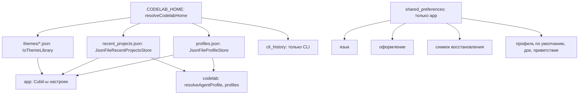
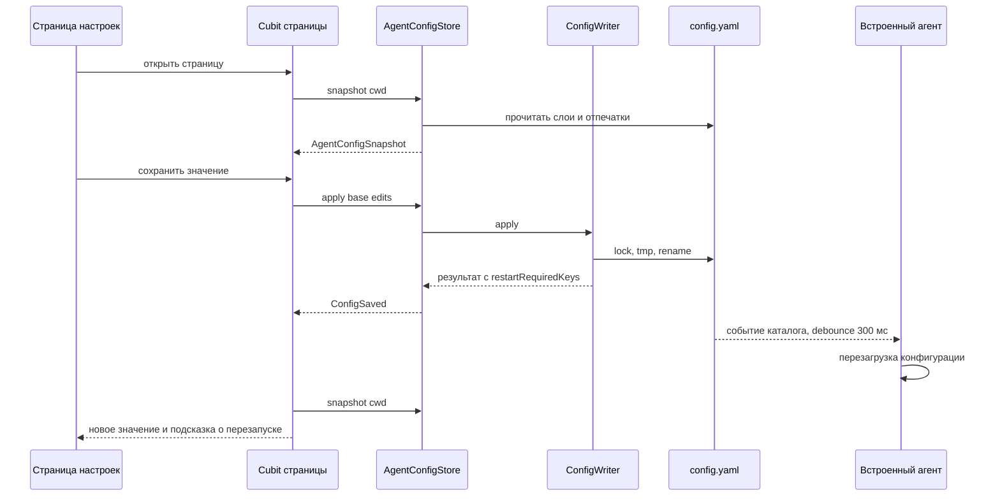

# Настройки на стороне клиента

У клиента (CodeLab app и терминал `codelab`) настройки двух видов. Свои: профили подключения, недавние проекты, темы, язык и оформление, снимок восстановления. Чужие, агентские: провайдеры, режимы, MCP-серверы. Агентские клиент не хранит, а правит в файлах агента через мост `codelab_setup`, если агент ему это позволяет. Документ описывает, где клиент хранит своё, как читает и сохраняет, что происходит при повреждённом файле и при одновременной записи, и как он редактирует настройки агента. Сторона агента и общая таблица «чьи настройки» — в [settings.md](../../codelab_agent_core/doc/algorithms/settings.md).

Документ читается целиком. Справочники по частям существуют, здесь они не пересказываются:

- порты и хранилища клиентского слоя — [глава 13](13-ports-and-stores.md); профили и токены — [глава 12](12-profiles-and-secrets.md); опции сессии — [глава 9](09-options-commands-plan.md); восстановление — [глава 5](05-restore.md);
- JSON-хранилища на диске — [`codelab_client_io`](../../codelab_client_io/doc/02-stores-and-extending.md);
- мост настроек агента — [`codelab_setup`](../../codelab_setup/doc/README.md): [доступ и снимок](../../codelab_setup/doc/02-config-store.md), [мастер провайдера](../../codelab_setup/doc/03-provider-wizard.md);
- приложения: [навигация и настройки app](../../../../apps/codelab_desktop/doc/04-navigation-and-settings.md), [`config` и мастер в CLI](../../../../apps/codelab_cli/doc/07-config-and-setup.md), [профили и домашний каталог CLI](../../../../apps/codelab_cli/doc/08-profiles-and-home.md);
- для пользователя: [каталог `CODELAB_HOME`](../../../../docs/ops/codelab-home.md), [настройка агента](../../../../docs/user/configuration.md);
- нормы: [`app-settings`](../../../../openspec/specs/app-settings/spec.md), [`client-themes`](../../../../openspec/specs/client-themes/spec.md), [`client-agent-setup`](../../../../openspec/specs/client-agent-setup/spec.md) (SETUP-*), [`acp-client-kit`](../../../../openspec/specs/acp-client-kit/spec.md), [`codelab-cli`](../../../../openspec/specs/codelab-cli/spec.md).

Пути в псевдокоде даны от `packages/dart/` и `apps/`: `core` — `codelab_client_core/lib/src/`, `client-io` — `codelab_client_io/lib/src/`, `setup` — `codelab_setup/lib/src/`, `cli` — `codelab_cli/lib/src/`, `desktop` — `codelab_desktop/lib/`, `acp` — `codelab_agent_acp/lib/src/`, `agent-io` — `codelab_agent_io/lib/src/`.

## Короткий ответ

1. **Файлы клиента лежат рядом с файлами агента, в `$CODELAB_HOME`.** `profiles.json`, `recent_projects.json` и `themes/*.json` общие у app и `codelab`. Остальные настройки app (язык, оформление, макет, снимок восстановления) живут в `shared_preferences` и CLI их не видит.
2. **Порт в слое, адаптер снаружи.** `codelab_client_core` объявляет порты (`ProfileStore`, `RecentProjectsStore`, `ThemeLibrary`, `WorkspaceSnapshotStore`) и держит правила чистыми функциями. `dart:io`-адаптеры — в `codelab_client_io`, адаптеры плагина — в app.
3. **JSON пишется атомарно, но без блокировки между процессами.** Временный файл и `rename`: файл целый старый или целый новый. Две копии клиента могут потерять запись друг друга, но не испортить файл.
4. **Нечитаемый файл не перезаписывается.** Хранилище бросает `FormatException` до записи; решает хост. Исключение — снимок восстановления: битый снимок удаляется с диагностикой.
5. **Профиль `default` — алиас встроенного агента.** Встроенный агент выбирается словом `embedded` или `default`, профилем в файле он не хранится и не сохраняется.
6. **Настройки агента клиент пишет только у агента, чей конфиг читает сам агент.** Встроенный агент и `codelab-agent` по stdio — да (слой `user`; слой `projectLocal` — только если известна папка проекта, а у stdio-профиля ещё и только при `runInProjectDirectory`); WebSocket и чужой агент — нет.
7. **Опции сессии клиент меняет по ACP** одинаково у любого агента, который их объявил.

## Вход и выход

| | Что |
|---|---|
| Вход | переменные окружения клиента (`CODELAB_HOME`, `HOME`), флаги `codelab` (`-a`, `-m`, `--mode`, `--ui`, `--no-color`), выбор пользователя на страницах настроек app, содержимое файлов `$CODELAB_HOME` и `shared_preferences` |
| Выход | профили и список недавних проектов для выбора агента и проекта; применённое оформление и язык; запись файлов клиента; правки файлов агента через мост; ACP-запросы `session/set_config_option` |
| Побочные эффекты | `profiles.json`, `recent_projects.json`, `themes/*.json` (только импорт), `cli_history` (CLI), ключи `codelab.*` в `shared_preferences`; файлы агента (`config.yaml`, `secrets.yaml`) через `codelab_setup` |
| Гарантии | запись JSON атомарна (временный файл, `flush`, `rename`); нечитаемый файл не затирается; токен WebSocket хранится только ссылкой, но `args` и `env` stdio-профиля лежат в файле открыто; значение ключа не попадает в состояние, журнал и сообщения; встроенный профиль не сохраняется в файл |
| Чего не гарантирует | что две копии клиента не потеряют запись друг друга в `profiles.json` и `recent_projects.json`; что `codelab` прочитает тему или язык app; что страница настроек покажет правку файла агента, сделанную в обход клиента, до перечитывания |

Что при ошибках и сбоях:

- **Ошибка записи JSON** — временный файл удаляется, исходный файл не меняется, исключение уходит хосту.
- **Повреждённый JSON** — `FormatException`; хост печатает ошибку (CLI) или показывает баннер (app) и не затирает файл. `profiles list` и `show` выходят с кодом `64`, `profiles add` и `remove` на битом файле сейчас падают необработанным исключением (пример 4).
- **Повреждённое значение `shared_preferences`** читается как значение по умолчанию и не перезаписывается; в журнал идёт предупреждение без значения.
- **Одновременная запись двух процессов** — побеждает последний `rename`; в `profiles.json` и `recent_projects.json` остаётся запись одного из них (пример 5).
- **Недопустимый `CODELAB_HOME`** — app запускается без файловых хранилищ (`UnavailableProfileStore`, `UnavailableRecentProjectsStore`, без пользовательских тем), `codelab` выходит с кодом `64`.

## Что хранит клиент

| Настройка | Порт (слой) | Хранилище | Читает | Пишет |
|---|---|---|---|---|
| Профили подключения | `ProfileStore` | `$CODELAB_HOME/profiles.json`, `JsonFileProfileStore` | app и CLI | `codelab profiles add`, `remove`; страница «Connection» app |
| Токен профиля | `SecretSource`, `ProfileSecrets` | ссылка в `profiles.json` (`env:ИМЯ` или `secret:имя`); значение в хранилище секретов агента | `ProfileSecretSource` в момент открытия транспорта | диалог профиля app, `codelab profiles add` (ссылка `env:CODELAB_AGENT_TOKEN`) |
| Профиль по умолчанию app | `ConnectionPreferences` (app) | `shared_preferences`: `codelab.connection.default_profile` | app | страница «Connection» |
| Недавние проекты | `RecentProjectsStore` | `$CODELAB_HOME/recent_projects.json`, `JsonFileRecentProjectsStore`; не больше 10 | app и CLI | app и REPL/TUI `codelab` при открытии папки |
| Снимок восстановления | `WorkspaceSnapshotStore` | `shared_preferences`: `codelab.workspace.snapshot` (только app) | `WorkspaceRestorer` | `WorkspaceRestorer` |
| Пользовательские темы | `ThemeLibrary` | `$CODELAB_HOME/themes/<имя>.json`, `IoThemeLibrary` | app; `codelab` пока не читает | вы; «Import JSON…» в app копирует файл как есть |
| Оформление (режим, темы режимов, системный акцент) | `AppAppearancePreferences` (app) | `shared_preferences`: `codelab.app.appearance`, один JSON-документ | app до первого кадра | страница «Appearance» |
| Язык интерфейса | `AppLanguagePreferences` (app) | `shared_preferences`: `codelab.app.language` (`en`, `ru`; `System` удаляет ключ) | app до первого кадра | страница «General» |
| «Открывать последний проект» | `StartupPreferences` (app) | `shared_preferences`: `codelab.workspace.reopen_last_project` | app при старте | страница «General» |
| Приветственные шаги | `OnboardingPreferences` (app) | `shared_preferences`: `codelab.app.onboarding_done` | app до первого кадра | app при завершении шагов |
| Макет дока, последняя страница настроек | `DockLayoutStore`, `SettingsPageStore` (app) | `shared_preferences`: `codelab.dock.*`, `codelab.settings.last_page` | app | app |
| История ввода CLI | `HistoryFile` | `$CODELAB_HOME/cli_history`, права `0600` | REPL и TUI | REPL и TUI |
| Отключение цвета, режим интерфейса CLI | — | только флаги `--no-color`, `--ui` | `codelab` | — |

Не реализовано: файл `cli.yaml` настроек CLI. Код его не читает; настройки CLI сейчас — флаги.

На схеме показано, откуда app и CLI берут настройки при старте и кто что пишет.



Через `CODELAB_HOME` app и CLI видят одни и те же профили, недавние проекты и темы. Настройки в `shared_preferences` читает только app, историю ввода пишет только CLI. Настройки агента в схему не входят: они живут в `config.yaml` и правятся через мост.

## Как клиент правит настройки агента

Клиент не читает и не пишет `config.yaml` сам. Он спрашивает мост `codelab_setup`, чьи это настройки, берёт снимок и пишет правки в слой, который мост разрешил.

| Профиль подключения | `SettingsAccess` | Что может клиент |
|---|---|---|
| встроенный агент | `EditableSettings` с `CODELAB_HOME` клиента | читать и писать слой `user`, а при известной папке проекта и `projectLocal` |
| stdio, команда `codelab-agent` | `EditableSettings`; `CODELAB_HOME` и `CODELAB_CONFIG` берутся из `env` профиля, `--config` из аргументов | то же, но `projectLocal` только при `runInProjectDirectory` профиля (без него агент не работает в папке проекта); файл `--config` только читается |
| stdio, любая другая команда или самоназвание агента не `codelab-agent` | `NotManaged(имя)` | ничего: конфиг не наш |
| WebSocket | `RemoteReadOnly(адрес)` | ничего: файлы на другой машине |

Цели записи — только `ConfigTarget.user()` и `ConfigTarget.projectLocal(cwd)`; слой `project` клиенты не пишут никогда (SETUP-3). Для `RemoteReadOnly` и `NotManaged` страницы app показывают InfoBar «только чтение», а команды REPL `/provider add|remove` и `/settings` отвечают «read-only», не обращаясь к файлам. Подкоманда `codelab provider add` (как `config`, `mcp`, `secret`) от профиля не зависит: она всегда правит локальный `$CODELAB_HOME` с `EditableSettings` (`cli/run.dart`, `_SetupKit`).

Что делает страница или команда при записи:

1. Берёт `AgentConfigSnapshot`: слои с отпечатками, итог загрузки, источник каждого ключа.
2. Строит правки (`ConfigEdit`) и вызывает `AgentConfigStore.apply(base, edits)`. Реализация `FileAgentConfigStore` вызывает тот же `ConfigWriter`, что `codelab config set` (CFG-14).
3. Исход: `ConfigSaved` (с предупреждениями и ключами `restartRequiredKeys`), `ConfigConflict`, `ConfigRejected`, `ConfigInlineSecret`.
4. Конфликт автоматически не повторяется (SETUP-6): страница перечитывает снимок и показывает баннер, решает человек.
5. Если агент встроенный, его наблюдатель за файлами видит запись и применяет её на лету; что ждёт перезапуска, клиент узнаёт из `restartRequiredKeys` и `restartRequiredProviders` и показывает подсказку «после перезапуска».

Что клиент не знает об агенте: применил ли агент правку. Он видит её по новому снимку файла или по `config_option_update` (список моделей).

## Псевдокод

Блоки идут в порядке выполнения: запуск app, запуск CLI, запись JSON-файла, выбор профиля, правка настроек агента, применение флагов опций, чтение пользовательской темы. Порядок шагов совпадает с кодом; пропущены только логи и защитные проверки.

### А. Запуск app: `main`

```text
main()
  // desktop/main.dart: main
  1. profileSecrets = openProfileSecrets(...)                       // токены профилей: хранилище секретов агента
  2. language = AppLanguageStart.fromLoad(shared_preferences codelab.app.language, системные языки)
        // load не бросает: незнакомое значение = System, без перезаписи ключа
  3. onboarding = OnboardingStart.fromLoad(codelab.app.onboarding_done)
  4. environment = ConnectionEnvironment.of(Platform.environment)    // desktop/app/connection_environment.dart
        недопустимый CODELAB_HOME → homeProblem, запуск не падает
  5. themeLibrary = codelabHome == null ? InMemoryThemeLibrary : IoThemeLibrary(home: codelabHome)
  6. appearance = AppAppearanceStart.resolve(codelab.app.appearance, themeLibrary, системный акцент)
        // файл темы читается не дольше 1 с; незнакомый документ = значения по умолчанию, ключ не перезаписан
  7. runApp(...)                                                      // первый кадр уже на нужном языке и в нужной теме
  8. composition root (desktop/app/app_scope.dart):
        ProfileStore = path != null ? JsonFileProfileStore(path) : UnavailableProfileStore(homeProblem)
        ConnectionPreferences = SharedPreferencesConnectionPreferences
        хранилище секретов страниц переоткрывается при каждом открытии страницы    // правка secrets.backend без перезапуска
```

### Б. Запуск `codelab`: `runCodelab`

```text
runCodelab(args)
  // cli/run.dart: runCodelab
  1. разбор аргументов (cli/cli_args.dart): флаги, подкоманды
  2. config | provider | mcp | secret:
        работают с файлами агента напрямую через мост; CodelabHome.ensureExists не вызывается;
        sessions/, profiles.json и cli_history не создаются
  3. profiles:
        home = CodelabHome.resolve(environment); await home.ensureExists()      // каталог с правами 0700
        runProfilesCommand(store: JsonFileProfileStore(home.profilesFile))
  4. REPL, TUI:
        home = CodelabHome.resolve(environment)
        profile = await resolveAgentProfile(--agent, store: JsonFileProfileStore(home.profilesFile))
        await home.ensureExists()
        _firstRun(...)                                                          // только встроенный профиль и терминал
        runtime = buildCliRuntime(...); connect
        onConnected → _recordRecentProject(home, cwd)                           // recent_projects.json, один раз за запуск
        openCliSession(workspace, cwd, resume, last) → applyConfigFlag(-m, --mode)
  5. headless -p, test-scenario:
        profile = resolveAgentProfile(...); runtime = buildCliRuntime(...)      // без ensureExists и без записи недавних проектов
        openCliSession(...) → applyConfigFlag
```

### В. Запись JSON-файла клиента: `JsonFileProfileStore.save`

```text
save(profile)
  // client-io/stores/json_file_profile_store.dart: save; json_file.dart: writeJsonObject, writeBytesAtomically
  1. isReservedProfileId(profile.id) → ArgumentError                  // до чтения файла; файл не меняется
  2. profiles = await load()                                          // readJsonObject: нет файла → пусто; битый → FormatException
  3. заменить профиль с тем же id на месте или добавить в конец
  4. writeJsonObject(path, {'version': 1, 'profiles': [...]})
        writeBytesAtomically:
           создать каталог
           tmp = <path>.<pid>.<случайное>.tmp; write(flush: true)
           rename(tmp → path)                                         // последний rename побеждает
           ошибка → удалить tmp, пробросить
  // нет ни блокировки, ни сверки отпечатка: два save без ожидания могут потерять правку одного
```

### Г. Выбор профиля подключения: `resolveAgentProfile`

```text
resolveAgentProfile(value, store, onWarning) -> ConnectionProfile
  // cli/profiles/profile_arg.dart: resolveAgentProfile
  1. value == null или 'embedded'  → embeddedCliProfile              // profiles.json не читается
  2. value == 'default'            → embeddedCliProfile; читается store только ради предупреждения о прежней записи default
  3. 'stdio:<команда> [аргументы]' → разовый StdioProfile id 'inline'  // parseShellWords; в профиль не сохраняется
  4. 'ws://…' или 'wss://…'        → разовый WebSocketProfile; токен — ссылка env:CODELAB_AGENT_TOKEN
  5. иначе                          → профиль с таким id из store
        нет такого → UsageError «Unknown agent profile»; битый файл → UsageError «Cannot read agent profiles: …»
  // app: профиль по умолчанию — shared_preferences codelab.connection.default_profile; нет ключа → встроенный агент
```

### Д. Правка настроек агента: `FileAgentConfigStore`

```text
snapshot(cwd) -> AgentConfigSnapshot
  // setup/io/file_agent_config_store.dart: FileAgentConfigStore.snapshot
  1. для слоёв user, project(cwd), projectLocal(cwd): writer.read(target)       // отпечаток файла
        слой с битым YAML остаётся вне карты (лог config.snapshot.layer_unreadable)
  2. loaded = ConfigLoader.load(cwd, environment, extraConfig: paths.extraConfig)
        ConfigUsageException → проблема в loaded.issues, а не исключение
  3. return AgentConfigSnapshot.fromLayers(layers, loaded, secrets, источники ключей)

apply(base: ConfigSnapshot, edits) -> ConfigSaveOutcome
  // setup/io/file_agent_config_store.dart: FileAgentConfigStore.apply
  // перед вызовом страница или команда уже решила: access = resolveSettingsAccess(...)
  //   (setup/access/settings_access.dart); не EditableSettings → apply не вызывается;
  //   цель base.target взята из EditableSettings.targets
  1. result = await ConfigWriter(codelabHome, environment, cwd).apply(base, edits)   // lock, отпечаток, проверка, rename
  2. исходы:
        записано                          → ConfigSaved(fingerprint, warnings, restartRequiredKeys)
        ConfigConflictException           → ConfigConflict(path)                // автоповтора нет (SETUP-6)
        ConfigInlineSecretException       → ConfigInlineSecret(key, suggestedSecretName)
        ConfigException                   → ConfigRejected(issues)
  3. клиент зовёт snapshot(cwd) заново: слежения за файлом в мосте нет
```

### Е. Опции сессии из флагов CLI

```text
openCliSession(...) → applyConfigFlag(session, name, value)
  // cli/session_setup.dart: openCliSession, applyConfigFlag
  1. option = опция с id == name, иначе с category == name
  2. нет опции → SessionSetupError «The agent has no "model" option.»  // без запроса к агенту
  3. value ∉ option.values → SessionSetupError «Unknown model "x". Available: …»
  4. option.currentValue == value → return                            // значение уже текущее: запроса нет
  5. session.setConfigOption(option.id, value)                        // ACP session/set_config_option; в файлы не пишется
```

### Ж. Тема в app: чтение каталога

```text
IoThemeLibrary.list() / read(name)
  // client-io/themes/io_theme_library.dart; core/themes/theme_file.dart: ThemeFile.parse
  1. нет <home>/themes → пустой список, каталог не создаётся
  2. не каталог или не перечисляется → ThemeCatalogException(notADirectory | unreadable)
  3. только *.json прямо в каталоге; читается не больше 64 КиБ + 1 байт на файл
  4. сбой чтения файла → запись с ошибкой (tooLarge, notUtf8, unreadable), перечисление не ломается
  5. ThemeFile.parse(имя, текст): ThemeLoaded(theme, warnings, unsetRoles) или ThemeRejected(issue)
        предупреждения (unknownKey, duplicateKey, terminalColor) тему применяют; ошибки — отклоняют
  6. import: копия байт в байт под именем из поля name темы; JSON не пересериализуется
```

## Пошаговое пояснение

**А2–А6. Читаем до первого кадра.** Язык, оформление и признак приветствия читаются до `runApp`, чтобы первый кадр сразу был на нужном языке и в нужной теме. Методы чтения не бросают: незнакомое значение читается как значение по умолчанию и не перезаписывается, иначе повреждённый ключ молча стёр бы выбор более новой версии клиента.

**А4. Недопустимый `CODELAB_HOME` не роняет app.** Файловые хранилища заменяются заглушками, пользовательских тем нет, а страницы показывают причину.

**Б2. Подкоманды не создают каталог.** `config`, `provider`, `mcp`, `secret` работают с файлами агента. Они не вызывают `ensureExists`, поэтому `sessions/`, `profiles.json` и `cli_history` в пустом `CODELAB_HOME` не появляются.

**В. Атомарность без блокировки.** Временный файл с `flush` и `rename` дают «целый старый или целый новый», но между процессами порядок не гарантирован. Это принятое ограничение: у файла один-два писателя на машине, а потерянная запись (профиль, недавний проект) восстанавливается повторным действием. Для агентской стороны конфликт опаснее, поэтому `config.yaml` пишется через lock и отпечаток ([settings.md](../../codelab_agent_core/doc/algorithms/settings.md)).

**В1. Резерв раньше чтения.** Встроенный агент выбирается словами `embedded` и `default`; сохранить профиль с таким id нельзя. Проверка идёт до обращения к файлу, чтобы отказ не зависел от его состояния. Запись `default` из старого файла остаётся, пока её не удалит `profiles remove default`.

**Г. Профиль на лету не сохраняется.** `-a stdio:…` и `-a ws://…` — разовые профили. Значения аргументов stdio-профиля клиент нигде не печатает: среди них бывает токен.

**Д1. Чей файл.** Команда профиля решает, наш ли это агент: самоназвание из `initialize` только опровергает (чужой агент под нашей командой), но не доказывает. По WebSocket файлов нет на этой машине, поэтому запись невозможна (CFG-14).

**Д3–Д5. Один писатель.** Клиент не повторяет запись сам: конфликт — сигнал, что файл изменили вне клиента. Автоповтор перезаписал бы чужую правку (SETUP-6).

**Е. Флаги опций — это ACP.** `-m` и `--mode` меняют опцию сессии на старте, а не конфигурацию: после выхода значение не сохраняется. Выбранная модель попадёт в журнал сессии и в `state/last-model.json` агента ([settings.md](../../codelab_agent_core/doc/algorithms/settings.md)).

**Ж. Тема — работа клиента.** Агент тему не читает. Нестрогий разбор: предупреждения не отменяют тему, а решение, строго ли относиться, принимает потребитель: app применяет тему с предупреждениями, CLI считал бы любую проблему ошибкой (но CLI темы пока не читает).

## Схемы

### Чтение и запись настроек агента со страницы

На схеме — страница настроек агента в app: чтение снимка, запись и конфликт. Для встроенного агента наблюдатель в том же процессе подхватывает запись.



Если между `snapshot` и `apply` файл изменили, `apply` возвращает `ConfigConflict`; Cubit перечитывает снимок и показывает баннер, автоповтора нет.

## Разобранные примеры

Данные получены запусками текущей ветки. Бинарь `codelab` собран командой `fvm dart compile exe`; запуски шли в чистом окружении (`env -i`) с временными `HOME` и `CODELAB_HOME`. Пути заменены на `~/demo/…` и `/home/user/…`, временные каталоги удалены. Хранилища `recent_projects.json` и тем запущены драйвером на Dart из пакета `codelab_client_io` с подставленными часами.

### Пример 1. `profiles.json`

Файл, который записывает `codelab profiles add` (профили `stdio` и WebSocket, токен только ссылкой `tokenRef`), с командами и разбором прав доступа — в [главе 2 пакета `codelab_client_io`](../../codelab_client_io/doc/02-stores-and-extending.md#profilesjson). Здесь пример не повторяется: хранилище — реализация `codelab_client_io`, а порт `ProfileStore` и правила выбора профиля — этого пакета.

### Пример 2. `recent_projects.json`

Источник: три вызова `record` (путь `demo` открыт дважды) с часами, идущими секунда за секундой.

```json
{
  "version": 1,
  "projects": [
    {
      "path": "/home/user/projects/demo",
      "lastOpenedAt": "2026-11-25T10:00:03.000Z"
    },
    {
      "path": "/home/user/projects/other",
      "lastOpenedAt": "2026-11-25T10:00:02.000Z"
    }
  ]
}
```

Одна запись на путь с наибольшим временем, последний открытый первым, не больше десяти (`mergeRecentProjects`).

### Пример 3. Пользовательская тема

Файл `~/demo/cc/themes/acme.json` написан вручную, в нём опечатка в ключе роли:

```json
{
  "name": "acme",
  "extends": "light",
  "colors": {
    "accent": "#3366ff",
    "acent": "#ff0000"
  }
}
```

Разбор `IoThemeLibrary.list` и `ThemeFile.parse`:

```text
loaded acme base=ThemeBase.light
warning: ThemeIssue(unknownKey 6:5 key=acent value=null hint=accent)
```

Тема загружена, опечатка — предупреждение с позицией (строка 6, столбец 5) и подсказкой ближайшего ключа. App применила бы такую тему; ошибка (неверное значение цвета, имя не совпадает с файлом) отклонила бы её целиком.

### Пример 4. Повреждённый `profiles.json`

Файл содержит `{"version": 1, "profiles": [` (оборван).

```bash
codelab profiles list
```

```text
codelab: Cannot read agent profiles: Unexpected end of input
```

Код выхода `64`. Тот же файл и `codelab profiles add x ws://127.0.0.1:9/x`:

```text
Unhandled exception:
FormatException: Unexpected end of input (at line 2, character 1)
…
#6      readJsonObject (package:codelab_client_io/src/stores/json_file.dart:14)
#7      JsonFileProfileStore.load (package:codelab_client_io/src/stores/json_file_profile_store.dart:26)
#8      JsonFileProfileStore.save (package:codelab_client_io/src/stores/json_file_profile_store.dart:67)
#9      runProfilesCommand (package:codelab_cli/src/profiles/profiles_command.dart:106)
```

Код выхода `255`, и `profiles remove x` ведёт себя так же. Файл при этом не тронут: `save` читает его раньше записи. Это расхождение с остальными командами: `list`, `show` и `-a <id>` превращают `FormatException` в `UsageError` и код `64` (`profiles_command.dart`: `_load`), а `add` и `remove` вызывают хранилище без этой обёртки. Дефект заведён как REV-11 ([backlog](../../../../docs/backlog/review-2026-11-25-developer-guides.md), issue #484).

`recent_projects.json` с записью `{"path": ""}` даёт и при `load`, и при `record`:

```text
FormatException: Expected a non-empty "path" in ~/demo/cc/recent_projects.json.
```

После `record` файл остался прежним (`{"version": 1, "projects": [{"path": ""}]}`): чтение падает раньше записи.

### Пример 5. Восемь одновременных `profiles add`

Источник: восемь запусков `codelab profiles add p<N> ws://127.0.0.1:9/p<N>` одновременно в пустом `CODELAB_HOME`.

```text
$ codelab profiles list
p3  ws: ws://127.0.0.1:9/p3
p6  ws: ws://127.0.0.1:9/p6
p8  ws: ws://127.0.0.1:9/p8
```

Выжили три профиля из восьми, файл целый. Каждый процесс прочитал список, добавил свой профиль и записал целиком; последний `rename` затёр остальные. Поэтому сохранять профили из двух клиентов одновременно нельзя, а повторное действие восстанавливает потерю.

### Пример 6. Агентские настройки из клиента

Запись агентского конфига клиентом идёт через `ConfigWriter`, поэтому выглядит как у `codelab-agent`. Источник: шесть одновременных `config set budget.max_steps <N>` ([settings.md](../../codelab_agent_core/doc/algorithms/settings.md), пример 7): две записи прошли по очереди, четыре получили `config file changed during the edit; run the command again` и код `1`. Отличие от примера 5: проигравший знает о конфликте.

## Граничные случаи

| Ситуация | Что происходит | Где в коде |
|---|---|---|
| Повреждённый `profiles.json` | `list`, `show`, `-a <id>`: `Cannot read agent profiles: …`, код `64`; `add`, `remove`: необработанное исключение, код `255`; файл не меняется (пример 4); в app страница «Connection» показывает причину `ProfilesUnsupportedFile` | `cli/profiles/profiles_command.dart`: `_load`, `runProfilesCommand`; `desktop/features/settings/application/connection_settings_cubit.dart` (`ProfilesUnsupportedFile`) |
| Повреждённый `recent_projects.json` | `FormatException`; список пуст, новые проекты не пишутся, файл не затирается; CLI глотает ошибку (код выхода прежний), `--verbose` печатает тип | `client-io/stores/json_file_recent_projects_store.dart`; `cli/run.dart`: `_recordRecentProject` |
| Другая `version` файла | `FormatException: Unsupported … version in <путь>.` | `client-io/stores/json_file_*_store.dart` |
| Две копии app или CLI пишут одновременно | в `profiles.json` и `recent_projects.json` одна запись может потеряться, файл цел (пример 5); для `config.yaml` — lock и конфликт (пример 6) | `client-io/stores/json_file.dart`: `writeBytesAtomically`; `agent-io/config/config_writer.dart` |
| Повреждённое значение в `shared_preferences` (язык, оформление, «открывать последний проект») | читается как значение по умолчанию, ключ не перезаписан, в журнал — предупреждение без значения (`appearance.stored_value_invalid`) | `desktop/core/platform/*_preferences.dart`; спецификация `app-settings` («Хранение оформления», «Язык интерфейса app») |
| Повреждённый снимок восстановления | диагностика, снимок удаляется, восстановление пропускается | `core/restore/workspace_restorer.dart`: `_readProject`; `workspace_snapshot.dart`: `decode` |
| Сбой записи `shared_preferences` | выбор остаётся применённым до конца работы app, страница показывает ошибку и «Retry» (оформление) | спецификация `app-settings` («Хранение оформления») |
| Недопустимый `CODELAB_HOME` | app: `UnavailableProfileStore`, пустой список недавних, без тем, страницы показывают причину; `codelab`: код `64` | `desktop/app/connection_environment.dart`; `cli/home.dart`: `CodelabHome.resolve` |
| Профиль `default` в старом `profiles.json` | игнорируется с одним предупреждением; файл не меняется; удаляет `profiles remove default` | `core/connection/profile_ids.dart`: `usableStoredProfiles` |
| Попытка сохранить профиль `embedded` или `default` | `ArgumentError` до чтения файла; CLI до `save`: `embedded is built in; use --agent embedded` для `embedded`, `default is the built-in agent; use --agent embedded` для `default` (`UsageError`) | `client-io/stores/json_file_profile_store.dart`: `save` |
| Профиль с `secret:` без значения | `codelab: profile <id> has no stored secret value; connecting without a token.` | `cli/profiles/profile_arg.dart`; [глава 12](12-profiles-and-secrets.md) |
| Опция, которую клиент не знает | тип, отличный от `select`, отбрасывается при разборе; неизвестная `category` приходит как есть; app и CLI показывают любую `select` по её `id` | `codelab_acp_protocol/lib/src/acp/session.dart`: `parseSessionConfigOptionList`; `core/session/session_views.dart`: `ConfigOptionView.of` |
| Внешний агент без `configOptions` | выбрать модель и режим нельзя; `-m`, `--mode`: `SessionSetupError`. Режим «только чтение» страниц агента — другая причина: его задаёт `SettingsAccess` (транспорт и команда профиля), а не наличие опций; `codelab-agent` по WebSocket тоже только для чтения, хотя опции у него есть | `cli/session_setup.dart`: `applyConfigFlag`; `setup/access/settings_access.dart` |
| Смена опции, пока идёт предыдущая | вторая — пустая операция (`configOptionInFlight`); показывается значение, которое подтвердил агент | `core/workspace/client_workspace.dart`: `setConfigOption` ([глава 9](09-options-commands-plan.md)) |
| Смена модели посреди хода | клиент шлёт запрос сразу; агент применит модель на границе шага ([settings.md](../../codelab_agent_core/doc/algorithms/settings.md), пример 9) | `acp/agent_server.dart`: `_setConfigOption` — сторона агента |
| Страница агента при WebSocket или чужом агенте | InfoBar «только чтение»; REPL-команды `/provider add|remove` и `/settings`: «read-only». Подкоманда `codelab provider add` профиль не учитывает и правит локальный конфиг | `setup/access/settings_access.dart`: `resolveSettingsAccess`; `cli/setup/settings_access.dart`: `settingsAccessOf` |
| Конфликт записи агентского конфига | баннер, снимок перечитан, автоповтора нет | `setup/io/file_agent_config_store.dart`; SETUP-6 |
| В REPL `/config`, `/mode`, `/model` | это команды клиента (опции ACP); команда агента с тем же именем — `/agent:<имя>` | `cli/repl/command_router.dart`: `route` |
| Тема не читается `codelab` | файлы `themes/*.json` в CLI не используются; `--no-color` отключает цвет | `docs/ops/codelab-home.md` («themes») |

## Параметры

### Файлы клиента

| Путь | Что | Права |
|---|---|---|
| `$CODELAB_HOME/profiles.json` | профили подключения, `version: 1` | по `umask` |
| `$CODELAB_HOME/recent_projects.json` | недавние проекты, `version: 1`, до 10 записей | по `umask` |
| `$CODELAB_HOME/themes/<имя>.json` | пользовательские темы, до 64 КиБ, имя `[a-z0-9-]{1,32}` | по `umask` |
| `$CODELAB_HOME/cli_history` | история ввода CLI | `0600` |
| `$CODELAB_HOME` | создаётся интерактивными режимами `codelab` и `profiles` | `0700` |
| `shared_preferences`, ключи `codelab.*` | настройки app | у платформы |

`$CODELAB_HOME` по умолчанию — `<HOME>/.codelab`; `~` раскрывается, `~user` недопустим (код `64`). Правило одно у app и CLI (`resolveCodelabHome`).

### Ключи `shared_preferences` (app)

| Ключ | Значение |
|---|---|
| `codelab.app.language` | `en` или `ru`; нет ключа — язык системы |
| `codelab.app.appearance` | JSON: `version`, `mode` (`light`, `dark`, `system`), `light_theme`, `dark_theme`, `system_accent` |
| `codelab.app.onboarding_done` | `true` после приветственных шагов |
| `codelab.connection.default_profile` | id профиля; нет ключа — встроенный агент |
| `codelab.workspace.reopen_last_project` | `false` — не открывать проект прошлого запуска; нет ключа или нечитаемое значение — `true` |
| `codelab.workspace.snapshot` | снимок восстановления (JSON `{"version": 1, "windows": {"main": …}}`) |
| `codelab.dock.open_panes`, `codelab.dock.active_pane`, `codelab.dock.width` | макет дока |
| `codelab.settings.last_page` | `slug` последней открытой страницы настроек |
| `codelab.recent_projects` | прежний список недавних проектов: переносится в `recent_projects.json` один раз (`MigratingRecentProjectsStore`) |

### Флаги и переменные клиента

| Что | Значение |
|---|---|
| `-a`, `--agent` | `embedded`, `default`, `stdio:<команда>`, `ws://…`, `wss://…` или id из `profiles.json`; по умолчанию встроенный агент |
| `-m`, `--model`, `--mode` | опции сессии через ACP на старте, не пишутся в файлы |
| `--ui` | `line` (по умолчанию) или `tui` |
| `--no-color` | без ANSI-цветов |
| `CODELAB_HOME` | корень файлов клиента и агента |
| `CODELAB_AGENT_TOKEN` | токен WebSocket по умолчанию (ссылка `env:CODELAB_AGENT_TOKEN`) |
| `CODELAB_CONFIG`, `CODELAB_SECRET_*`, `CODELAB_DEBUG_SECRETS` | настройки встроенного агента, их читает процесс клиента |

Остальные переменные и флаги — [настройка агента](../../../../docs/user/configuration.md), [переменные окружения](../../../../docs/ops/environment.md).

## Как расширить

**Новая настройка клиента.** Порядок такой.

1. Решите, кто её читает. Если нужна и app, и CLI, файл общий, в `$CODELAB_HOME`; если только app — `shared_preferences` и порт в `lib/core/platform/` приложения. Не клади клиентскую настройку в `config.yaml` агента: это настройки агента, и клиент их не владеет.
2. Если решение меняет поведение или контракт продукта, начните с OpenSpec change (корневой `AGENTS.md` §17): правила в `app-settings` или `client-themes`.
3. Порт объявите в `codelab_client_core` без `dart:io`; правила (лимиты, слияние, зарезервированные значения) — чистыми функциями слоя, как `mergeRecentProjects`.
4. Реализацию на `dart:io` положите в `codelab_client_io` через `readJsonObject` и `writeJsonObject` (атомарная запись, `version`, `FormatException` на битом файле); реализацию на плагине — в `apps/codelab_desktop/lib/core/platform/`. Читающий метод не должен бросать (незнакомое значение — значение по умолчанию без перезаписи), если настройка нужна до первого кадра.
5. UI: Cubit в `features/settings/application`, страница в `presentation/`, хост страницы создаёт и закрывает Cubit, фабрика — в `CodeLabDependencies` (`apps/codelab_desktop/lib/app/app_scope.dart`). Секрет в состоянии держать нельзя.
6. Если настройка агентская, не пишите файл сами: используйте мост `codelab_setup` и `resolveSettingsAccess`, цель записи берите из `EditableSettings.targets`.
7. Документация: таблицы этого документа и [`codelab_client_io`](../../codelab_client_io/doc/02-stores-and-extending.md), [`docs/ops/codelab-home.md`](../../../../docs/ops/codelab-home.md), если файл новый.

**Тесты и фикстуры.**

| Что изменилось | Что обновить |
|---|---|
| правило слоя (слияние, лимиты, разбор темы) | `packages/dart/codelab_client_core/test/` |
| JSON-хранилище | `packages/dart/codelab_client_io/test/`: чтение, битый файл, `version`, очередь операций; `melos run guard` — если меняются границы пакетов |
| порт и его двойник | `InMemory…` двойник рядом с портом; контрактный тест (как `theme_library_contract_test.dart`) |
| настройка app | `apps/codelab_desktop/test/` (Cubit, порт `shared_preferences` через `SharedPreferences.setMockInitialValues`) |
| настройка или флаг CLI | `apps/codelab_cli/test/`; `melos run test:e2e:cli:embedded` |
| агентская правка из клиента | `packages/dart/codelab_setup/test/` |

## Справочные главы

- [Глава 12. Профили и секреты](12-profiles-and-secrets.md), [глава 13. Порты и хранилища](13-ports-and-stores.md), [глава 9. Опции, команды, план](09-options-commands-plan.md), [глава 5. Восстановление](05-restore.md).
- [Хранение и управление сессиями](session-management.md): снимок и недавние проекты в пути сессии.
- [`codelab_client_io`: хранилища и расширение](../../codelab_client_io/doc/02-stores-and-extending.md).
- [`codelab_setup`: хранилище конфигурации](../../codelab_setup/doc/02-config-store.md), [мастер провайдера](../../codelab_setup/doc/03-provider-wizard.md).
- Сторона агента: [настройки: слои, перезагрузка, ACP](../../codelab_agent_core/doc/algorithms/settings.md), [хранение и выдача секретов](../../codelab_agent_core/doc/algorithms/secrets.md).
- Для пользователя: [каталог `CODELAB_HOME`](../../../../docs/ops/codelab-home.md), [настройка агента](../../../../docs/user/configuration.md).
