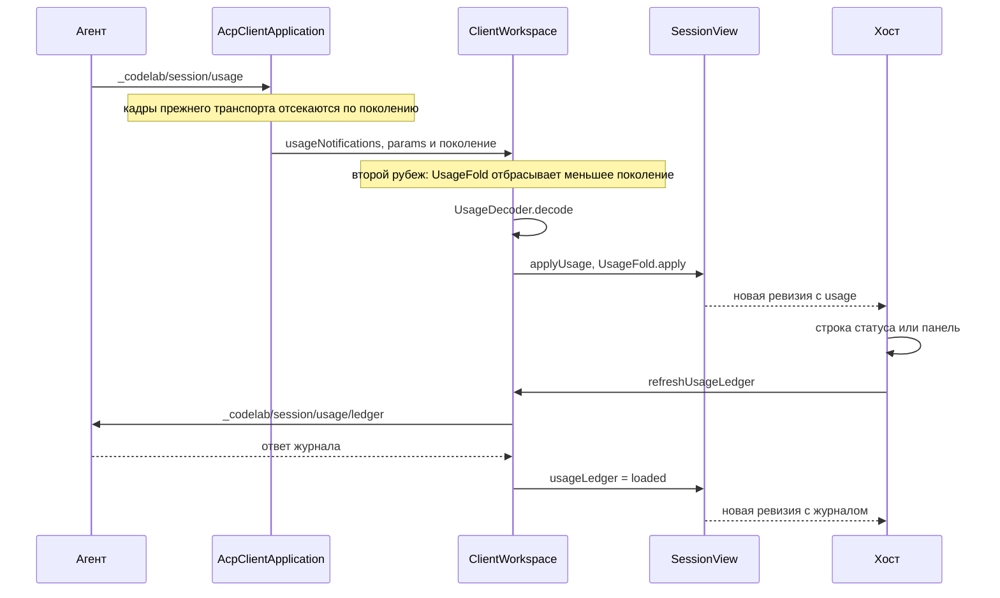
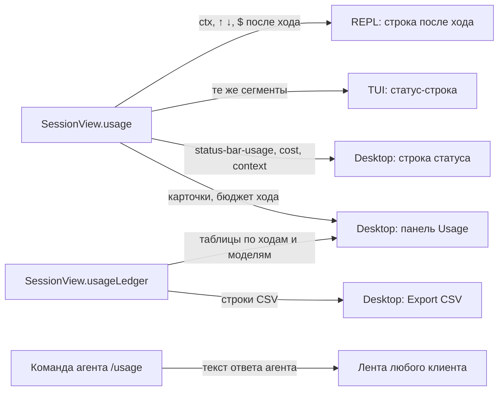
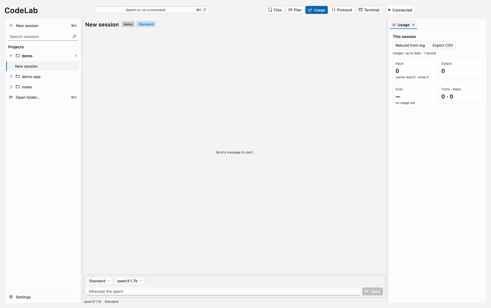

# Учёт usage на стороне клиента: от кадра `_codelab/session/usage` до строки статуса и панели Usage

Usage — токены и деньги, которые сессия потратила на запросы к модели. Агент считает их сам, а клиент только принимает готовые числа, решает, какое из них актуально, и показывает. Документ описывает эту сторону по шагам: что клиент объявляет, как принимает снимки и журнал, когда сбрасывает расход и как desktop, CLI и TUI превращают его в строку статуса, панель и команду `/usage`. Сторона агента — [алгоритм учёта usage в `codelab_agent_core`](../../codelab_agent_core/doc/algorithms/usage.md). Состояние слоя, правила свёртки и форматирование описывает [глава 10](10-usage.md); здесь повторено только то, что нужно для сквозного хода, а подробности — ссылками на неё.

Документ читается целиком:

- состояние и правила свёртки (`UsageView`, `UsageFold`, `UsageLedgerState`, форматирование) — [глава 10](10-usage.md);
- как слой делится на клиентский ACP и ядро клиента — [обзор](01-overview.md), [кто чем владеет](02-state-ownership.md);
- подключение и поколение соединения — [глава 3](03-connection.md); `session/load` — [глава 4](04-sessions.md);
- нормы — [`acp-client-kit`](../../../../openspec/specs/acp-client-kit/spec.md) («Usage сессии», «Журнал usage сессии в клиенте», «Бюджет хода в usage сессии», «Точная запись суммы usage»), [`acp-protocol-client`](../../../../openspec/specs/acp-protocol-client/spec.md) («Приём уведомления `_codelab/session/usage`», «Запрос журнала usage»), [`agent-workbench-ui`](../../../../openspec/specs/agent-workbench-ui/spec.md) («Панель Usage», «Экспорт usage в CSV», строка статуса, DSK-11, VIEW-6), [`codelab-tui`](../../../../openspec/specs/codelab-tui/spec.md) (статус-строка), [`codelab-cli`](../../../../openspec/specs/codelab-cli/spec.md);
- решения — changes [`add-usage-extension`](../../../../openspec/changes/archive/2026-11-18-add-usage-extension/design.md), [`add-usage-ledger`](../../../../openspec/changes/archive/2026-11-18-add-usage-ledger/design.md), [`add-desktop-usage-pane`](../../../../openspec/changes/archive/2026-11-18-add-desktop-usage-pane/design.md), [`fix-usage-pane-live-cards`](../../../../openspec/changes/archive/2026-11-18-fix-usage-pane-live-cards/design.md).

Пути в псевдокоде даны от `packages/dart/`: `acpc` — `codelab_client_acp/lib/src/`, `core` — `codelab_client_core/lib/src/`. Расширения `_codelab/*` — не ACP: в схеме ACP нет полей про токены и стоимость ([`17-Schema.md`](../../../../docs/protocols/acp/protocol/17-Schema.md) называет только причину остановки `max_tokens`), а правила собственных методов задаёт [`15-Extensibility.md`](../../../../docs/protocols/acp/protocol/15-Extensibility.md).

## Вход, выход, гарантии

**Вход.**

- Уведомление `_codelab/session/usage` от агента: `sessionId`, `seq`, `trigger` (`step`, `turn`, `compaction`, `compactionDiscarded`, `load`), агрегаты `step`, `turn`, `session`, `context`, `budget`, `currency`.
- Ответ на запрос `_codelab/session/usage/ledger`: история по ходам, шагам, моделям, субагентам и суммаризатору.
- Объявление агента `agentCapabilities._meta.codelab.usage` и `usageLedger` в ответе на `initialize`.
- События слоя: новое соединение (поколение растёт), начало `session/load`.

**Выход.**

- `SessionView.usage` (`UsageView`): последний ход, сумма сессии, заполнение контекста, бюджет хода, `lastSeq`, `support`.
- `SessionView.usageLedger` (`UsageLedgerState`): журнал агента или причина, почему его нет.
- В хосте: строка статуса (desktop, REPL после хода, TUI), панель Usage и экспорт в CSV (desktop), текст команды агента `/usage` (все клиенты).

**Что точно, а что оценка.**

| Величина | Точность |
|---|---|
| токены и деньги в `session`, `turn`, `step` | как их прислал агент; клиент ничего не складывает и не оценивает |
| деньги | целые микроединицы валюты (`Money.micros`): на проводе десятичная строка до шести знаков, клиент не использует `double`; сама стоимость — оценка агента по ценам каталога, а не счёт провайдера |
| `context` | оценка заполнения окна, которую считает агент ([context.md](../../codelab_agent_core/doc/algorithms/context.md)); клиент не пересчитывает |
| `~` перед числом в хосте | сумма неполна: агент пометил `partial` (`noUsage`, `beforeLoad` — для токенов; любая причина — для стоимости) |
| `—` вместо числа | значение неизвестно (нет цены или агент не объявил usage); нуль печатается только как известный нуль |
| проценты контекста | целые, вниз; меньше 1 % при `used > 0` — `<1%` |

**Что переживает перезапуск клиента.** Ничего: usage не пишется ни в профиль, ни в снимок рабочего пространства, а `SessionView.usage` живёт в памяти. После перезапуска числа даёт агент: при `session/load` он присылает снимок `load` с полной суммой, а журнал клиент запрашивает заново.

**Что теряется.**

| Когда | Что теряется |
|---|---|
| новое соединение (переподключение, перезапуск агента) | расход и журнал всех открытых сессий сбрасываются; числа вернутся со следующим снимком агента |
| начало `session/load` | расход и журнал загружаемой сессии сбрасываются до отправки запроса; итог вернёт снимок `load` |
| снимок с `seq` не больше последнего в поколении | отбрасывается (дубль, опоздание); запись `usage.stale` |
| снимок сессии, которой нет и которую не загружают | отбрасывается; запись `usage.unknown_session` |
| поле снимка не разобралось | неверное необязательное поле отсутствует, неверное обязательное (`sessionId`, `seq`, `trigger`, `session.tokens`) отбрасывает снимок; предупреждение `usage.decode_failed` |
| ответ журнала пришёл от прежнего соединения или до сброса | отбрасывается, состояние возвращается к `idle` или `unavailable`; запись `usage.ledger.stale` |
| агент не объявил `usage` | расхода нет, `support == unknown`; хост показывает «неизвестно» |

## Кто что делает

| Слой | Ответственность | Где |
|---|---|---|
| `codelab_client_acp` | объявляет `usage` в `initialize`; читает объявление агента; маршрутизирует уведомление в поток `usageNotifications` с поколением соединения; отправляет запрос журнала и отдаёт ответ сырым | `acpc/domain/codelab_extensions.dart`, `acpc/application/acp_client_application.dart`, `acpc/application/usage_ledger_reply.dart` |
| `codelab_client_core` | разбирает форму (`UsageDecoder`, `UsageLedgerDecoder`), свёртка по `seq` и поколению (`UsageFold`), состояние журнала, сбросы, форматирование | `core/usage/`, `core/workspace/client_workspace.dart` |
| хост (desktop, CLI, TUI) | решает, что и когда показывать и когда запрашивать журнал; цвет и состав сегментов | `apps/codelab_desktop/lib/features/usage/`, `apps/codelab_cli/lib/src/render/usage_segments.dart` |

Хосты не разбирают `_meta.codelab` и не суммируют числа: так требуют [правила пакета](../AGENTS.md) и VIEW-6. Протокол — в `codelab_client_acp`, разбор формы и свёртка — в `codelab_client_core`, показ — в хосте.

## Псевдокод

Шаги идут в порядке кода. Логирование и служебные вызовы опущены, где не меняют результат.

### А. Объявление и приём снимка

```text
K1. initialize: клиент отправляет clientCapabilities._meta.codelab.usage = {version: 1}
                                                    // acpc/domain/codelab_extensions.dart: codelabClientExtensionsMeta
K2. ответ initialize: CodelabExtensions.parse(agentCapabilities._meta)
      usage       = агент объявил usage {version: 1}
      usageLedger = агент объявил usageLedger {version: 1}        // тот же файл: CodelabExtensions
K3. уведомление _codelab/session/usage -> поток usageNotifications
      (sessionId, сырые params, поколение соединения); кадр без sessionId отбрасывается (usage.dropped)
      запись usage.received (debug; trigger — step, turn, compaction или other)                               // acpc/application/acp_client_application.dart: _handleUsageNotification
K4. DefaultClientWorkspace._handleUsage(notification):            // core/workspace/client_workspace.dart
      нет ни сессии, ни идущей загрузки -> usage.unknown_session, выход
      snapshot = UsageDecoder.decode(params)                      // core/usage/usage_decoder.dart
          обязательное поле неверно -> null, warning usage.decode_failed
      сессии ещё нет, но она загружается -> хранить последний по seq (_pendingUsage), выход
      handle.applyUsage(snapshot, generation)
K5. _SessionHandle.applyUsage -> UsageFold.apply(snapshot, generation, receivedAt)
      generation < известного                  -> null (отбросить)
      base = (generation == известному) ? lastSeq : 0
      snapshot.seq <= base                     -> null (дубль или опоздание), usage.stale
      иначе: новый UsageView (lastTurn, session, context, budget, lastSeq, support = reported)
      одна ревизия SessionView на применённый снимок              // core/usage/usage_fold.dart
```

### Б. Сброс

```text
K6. по готовому initialize нового соединения (_connect, _reconnect):
      _resetUsage(): для каждой открытой сессии, даже detached,
          UsageFold.initial(declared: usage объявлен новым агентом)   // awaiting или unknown
          журнал: idle или unavailable, ledgerEpoch++               // core/workspace/client_workspace.dart: _resetUsage
K7. начало session/load (beginLoad), до отправки запроса:
      тот же сброс для этой сессии
```

### В. Журнал по запросу хоста

```text
K8. refreshUsageLedger(sessionId, rebuild):                         // core/workspace/client_workspace.dart
      сессии нет -> ClientWorkspaceException('Unknown session …')
      рабочее пространство закрыто (_disposed) -> выход, состояние не меняется
      usageLedger не объявлен -> выход, состояние unavailable
      запрос в полёте -> слить в один следующий, rebuild побеждает, ждать общий итог
      иначе _driveLedger: state = loading(previous)
          reply = AcpClientApplication.requestUsageLedger(sessionId, rebuild)
                                                                    // acpc/application/acp_client_application.dart
          сменились поколение соединения или ledgerEpoch -> ответ отбросить (usage.ledger.stale)
          ошибка агента (-32603 …) -> failed(agentError, code)
          ответ не разобрался или относится к другой сессии -> failed(decode)
          запрос не ушёл или без ответа -> failed(request)
          иначе UsageLedgerDecoder.decode -> loaded(UsageLedgerView)
```

### Г. Хост

```text
K9. хост читает готовое SessionView.usage и SessionView.usageLedger
      строка статуса: usageSegmentsOf(usage)  (CLI, TUI)  /  status-bar-* (desktop)
      панель Usage (desktop): ledgerRefreshNeeded(...) -> refreshUsageLedger
      /usage — не клиентская команда: текст строит агент
```

## Пошаговое пояснение

**К1–К2.** Клиент объявляет `usage` всегда, когда это умеет его ACP-слой. Агент CodeLab отвечает объявлением `usage` и `usageLedger` только тогда, когда клиент прислал объект `_meta.codelab` в `initialize`; значение с версией, отличной от целого `1`, согласием не считается. Клиент признак `usageLedger` не объявляет: он нужен только агенту (запрос журнала не требует согласия клиента). Поэтому `unavailable` у журнала значит «агент не умеет», а не «клиент не просил».

**К3.** Уведомление маршрутизируется вместе с поколением соединения. Поколение растёт при каждом `connect` и `reconnect`. Прежние кадры отсекает ACP-слой по поколению транспорта: `_bindTransport` отбрасывает кадр прежнего транспорта до маршрутизации и пишет `event_ignored` с `reason: stale_generation` (сценарий «Уведомление старого соединения» спецификации `acp-protocol-client`). Поколение передаётся дальше как второй рубеж: `UsageFold` отбрасывает снимок меньшего поколения, а в новом начинает `seq` заново. В записи `usage.received` поле `trigger` — только `step`, `turn` или `compaction`; остальные, включая `load` и `compactionDiscarded`, пишутся как `other` (`acp_client_application.dart`: `_handleUsageNotification`). Декодер превращает `compactionDiscarded` в `UsageTrigger.unknown`.

**К4.** Форма разбирается в одном месте — `UsageDecoder`. Разбор терпимый: неверное необязательное поле просто отсутствует. Снимок для сессии, которая загружается и ещё не зарегистрирована, не теряется: слой хранит последний по `seq` и применяет его, как только сессия появится. Это нужно потому, что снимок `load` приходит сразу после ответа на `session/load` и может обогнать регистрацию сессии.

**К5.** Правило свёртки одно: применять снимок только если его `seq` больше последнего в том же поколении. В новом поколении счёт начинается заново — `seq` нового агента может быть 1. Агент нарочно пропускает номера, когда кадр некому доставить, поэтому пропуск — норма, а не потеря. `UsageFold` — чистая функция без часов (момент применения передаёт вызывающий) и без сети: правило проверяется в тестах без сокетов.

**К6–К7.** Сброс идёт по готовому `initialize` нового соединения, а не в начале переподключения: до замены транспорта старый агент ещё может прислать снимок, и его отсекает поколение. Сброс при `session/load` идёт в начале загрузки, а не по ответу: снимок `load` приходит после ответа, но может быть обработан раньше обновления сессии, и сброс по ответу его стёр бы. Если загрузка открытой сессии завершилась ошибкой, расход остаётся сброшенным до следующего снимка.

**К8.** Журнал клиент запрашивает отдельно: он велик (до мегабайт на длинной сессии), поэтому слой его сам не обновляет. Состояние журнала — закрытая иерархия: `unavailable`, `idle`, `loading(previous)`, `loaded`, `failed(previous)`. Прежний журнал сохраняется при `loading` и `failed`: панель не мигает при обновлении. Ошибки агента не бросаются как исключения, а становятся состоянием `failed`. Сравнить журнал со снимками хост может по `usageLedger.view.seq` и `usage.lastSeq`: слой журнал и снимки не склеивает.

**К9.** Решение, что показывать и когда запрашивать журнал, принадлежит хосту. Клиентский слой даёт только готовые значения и общие функции форматирования, поэтому desktop и CLI округляют одинаково.

## Схемы

### От кадра до экрана

На схеме путь одного снимка. Участники — агент, ACP-слой клиента, рабочее пространство, сессия в нём и хост.



Журнал приходит отдельным запросом и отдельной ревизией: хост не ждёт его, чтобы показать строку статуса.

### Кто что показывает

На схеме — какой хост читает какое поле. Стрелка — «показывает».



Неочевидное: строка статуса и панель читают разные источники. Строка берёт только `usage` (живые снимки), поэтому работает и у агента без журнала. Таблицы панели и CSV строятся только из журнала, а блок бюджета хода — снова из `usage`. Команда `/usage` на схеме стоит отдельно: её текст строит агент, клиент его не разбирает и обычным сообщением кладёт в ленту, поэтому формат денег там (четыре знака) отличается от строки статуса.

## Показ в desktop, CLI и TUI

### Desktop

- **Строка статуса.** Сегменты `status-bar-usage` (токены хода), `status-bar-cost` (`<стоимость хода> · session <стоимость сессии>`) и `status-bar-context` (процент заполнения). Без объявления `usage` вместо сегментов — подпись `usage: —` с подсказкой `agent does not report usage`, нулей нет (DSK-11, VIEW-6). Неполная сумма помечается `~`. Клик по строке открывает панель Usage.
- **Панель Usage.** Вкладка дока, доступна, пока у агента есть `usage` или `usageLedger`. Карточки Input, Output, Cost, Turns · steps берутся из журнала, если он загружен и его `seq` не меньше `usage.lastSeq`, иначе из `usage.session`. Таблицы `Per turn` (ходы от нового к старому, раскрываются до шагов с подписью по вызову инструмента из ленты) и `Per model` (внизу строки `Subagents` и `Summaries`) строятся только из журнала. Блок бюджета хода (подписи `This turn` и `Last turn`) берётся из `usage.budget`, а не из журнала. Кнопка `Rebuild from log` запрашивает журнал с `rebuild`, `Export CSV` сохраняет показанный журнал одним файлом.
- **Когда запрашивается журнал.** Автоматически — когда панель показана, сессия не `running` и не `cancelling`, журнал `idle` или `loaded` с `seq` меньше `usage.lastSeq`, и для этого `lastSeq` запрос ещё не уходил (`ledgerRefreshNeeded`, `apps/codelab_desktop/lib/features/usage/application/ledger_refresh.dart`). `failed`, `loading` и `unavailable` сами не повторяются: только действие пользователя. Опроса по таймеру нет.
- **Команды.** `/usage-pane` открывает панель; `/usage` — команда агента, она отвечает текстом в ленте (в desktop их не путают).

Пустая панель до первого запроса к модели (снимок экрана приложения):



На снимке: журнал `up to date` из одной записи, все счётчики нулевые, стоимость `—` с подписью `no usage yet`.

<!-- screenshot: панель Usage с загруженным журналом (карточки с суммой, таблица Per turn с раскрытым ходом, строки Subagents и Summaries) -->

### CLI и TUI

CLI не запрашивает журнал: подробный разрез даёт команда агента `/usage`, а клиент показывает только сегменты суммы сессии. Они собираются общей функцией (`apps/codelab_cli/lib/src/render/usage_segments.dart`, `usageSegmentsOf`):

| Сегмент | Что |
|---|---|
| `ctx N%` | заполнение окна; цвет по уровню: от 80 % предупреждение, от 95 % опасность |
| `↑… ↓…` | вход (`input + cacheRead + cacheWrite`) и выход; `~` перед `↑` при неполных токенах |
| `$…` | стоимость сессии; `~` при любой причине неполноты; скрыта, если цена неизвестна |

Сегмент скрыт, если значение неизвестно; нулевые токены не печатаются. Режим `line` (REPL) печатает строку статуса после каждого хода, кроме хода, ушедшего в очередь; TUI держит её внизу и урезает по ширине в порядке «профиль, стоимость, токены, контекст, затем модель». Headless `-p` расход не печатает: на stdout только ответ.

Реальный сеанс REPL: `codelab --no-color --agent "stdio:codelab-agent serve --stdio --llm-script … --sessions-dir …"`, сценарная модель с ценами (`3 / 15 / 0.3 / 3.75`), два хода с usage `1200/300/cacheRead 10000` и `1500/400/cacheRead 12000/cacheWrite 800`, затем `/usage`:

```text
> Обзор схемы
Готово: обзор схемы.
─ standard · scripted/scripted-1 · ctx 8% · ↑11.2k ↓300 · $0.01
> Дополни обзор
Дополнение к обзору.
─ standard · scripted/scripted-1 · ctx 11% · ↑25.5k ↓700 · $0.03
> /usage
Session usage: 2 turns, 2 steps
Total: input 2700, output 700, cache read 22000, cache write 800, cost $0.0282
By model:
  scripted/scripted-1: 2 steps, input 2700, output 700, cache read 22000, cache write 800, cost $0.0282
Ledger: rebuilt from journal (6 records)
─ standard · scripted/scripted-1 · ctx 11% · ↑25.5k ↓700 · $0.03
>
```

Проверка чисел: вход после второго хода — `1200 + 10000 + 1500 + 12000 + 800 = 25500` (`↑25.5k`), выход — `300 + 400 = 700`, стоимость — `0.0111 + 0.0171 = 0.0282`, то есть `$0.03` по правилу «от 0,01 — два знака». Строка статуса идёт после `/usage` тоже: команда без шагов цифры не меняет. Строка `/usage` — текст агента, а не клиента: формат `input N, output N, …, cost $0.0282` с четырьмя знаками отличается от `$0.03` в строке статуса.

Тот же сеанс в TUI (`--ui=tui`, `tmux capture-pane` с окном 120×30, пустые верхние строки опущены):

```text
> Обзор схемы
Готово: обзор схемы.
> Дополни обзор
Дополнение к обзору.
> /usage
> /usage
Session usage: 2 turns, 2 steps
Total: input 2700, output 700, cache read 22000, cache write 800, cost $0.0282
By model:
  scripted/scripted-1: 2 steps, input 2700, output 700, cache read 22000, cache write 800, cost $0.0282
Ledger: rebuilt from journal (6 records)
>
Enter send · Shift+Enter/Alt+Enter new line · Esc/Ctrl+C cancel · PgUp scroll · ctrl+t tasks · ctrl+o details
inline · standard · scripted/scripted-1 · ctx 11% · ↑25.5k ↓700 · $0.03
```

Известный дефект REV-45 ([backlog](../../../../docs/backlog/review-2026-11-25-developer-guides.md)): в TUI команда агента (`/usage`, `/status`) печатается в ленте дважды, обычный промпт — один раз. Это не артефакт снимка: снимок взят `tmux capture-pane` после отрисовки, дубль остаётся и после следующих ходов (проверено на `/status`); в REPL дубля нет.

## Разобранный пример

Свёртка на реальных кадрах: временный скрипт читает кадры `_codelab/session/usage` из [прогона агента](../../codelab_agent_core/doc/algorithms/usage.md#разобранный-пример) (три хода, субагент, сжатие), пропускает каждый через `UsageDecoder.decode` и `UsageFold.apply` (поколение 1) и печатает итог сессии теми же функциями форматирования, что хосты. В конце скрипт повторно подаёт кадр `seq 3` и опоздавший `seq 1`. Источник — `codelab_client_core` текущей ветки, скрипт запускался на Dart VM без сети.

```text
declared:   support=awaiting lastSeq=0 session: — — ctx — partial=null
frame seq 1 step: support=reported lastSeq=1 session: ↑4.8k ↓60 $0.0045 ctx 3% partial=[]
frame seq 2 step: support=reported lastSeq=2 session: ↑11.1k ↓180 $0.01 ctx 4% partial=[]
frame seq 3 turn: support=reported lastSeq=3 session: ↑13.4k ↓420 $0.02 ctx 4% partial=[]
frame seq 4 step: support=reported lastSeq=4 session: ↑21.4k ↓22.4k $0.36 ctx 22% partial=[]
frame seq 5 turn: support=reported lastSeq=5 session: ↑21.4k ↓22.4k $0.36 ctx 22% partial=[]
frame seq 6 step: support=reported lastSeq=6 session: ↑54.4k ↓44.4k $0.71 ctx 41% partial=[]
frame seq 7 turn: support=reported lastSeq=7 session: ↑54.4k ↓44.4k $0.71 ctx 41% partial=[]
frame seq 8 compaction: support=reported lastSeq=8 session: ↑55.3k ↓44.5k $0.71 ctx 25% partial=[]
again seq 3 turn: отброшен (дубль или опоздание)
late  seq 1 step: отброшен (дубль или опоздание)
```

В строках `partial=[]` скрипт сам преобразовал множество в список для печати; `Set.toString()` дал бы `{}`.

Что видно:

- До первого кадра `support=awaiting`: агент объявил `usage`, снимков нет. Числа — `—`, а не нули.
- Кадр `seq 3` (`turn`) поднимает вход с `11.1k` до `13.4k` и стоимость с `$0.01` до `$0.02`: в итог хода вошёл субагент, а в шагах его ещё не было. Клиент этого не вычисляет, цифры приходят в кадре.
- `seq 5` и `seq 7` (`turn`) не меняют сумму: итог хода совпадает с последним шагом, потому что у ходов 2 и 3 по одному шагу.
- `seq 8` (`compaction`) без хода: вход вырос с `54.4k` до `55.3k` на usage суммаризатора, а заполнение окна упало с `41%` до `25%`.
- Повторный `seq 3` и опоздавший `seq 1` отброшены: ни `usage`, ни ревизия не меняются.

Дальше те же кадры в REPL и TUI — в разделе «CLI и TUI» выше: строка статуса показывает именно эти значения.

## Граничные случаи

| Ситуация | Что происходит | Где в коде |
|---|---|---|
| агент не объявил `usage` (внешний агент, чужой ACP-агент) | `support == unknown`; REPL и TUI без сегментов, desktop — `usage: —`; нулей нет. В ACP usage не описан, поэтому чужой агент его не пришлёт | `core/usage/usage_fold.dart`: `initial`; `apps/codelab_cli/lib/src/render/usage_segments.dart`: `usageSegmentsOf` |
| агент объявил `usage`, снимков ещё нет | `awaiting`: хост показывает ожидание или пусто | `usage_fold.dart`; `UsageSupport` |
| клиент без `usage` в `_meta` (чужой клиент) | агент снимков не шлёт; журнал по запросу отдаёт, `seq` в нём `0` | [алгоритм агента](../../codelab_agent_core/doc/algorithms/usage.md) |
| дубль или опоздавший снимок | отброшен, ревизия не растёт, запись `usage.stale` | `usage_fold.dart`: `apply`; `client_workspace.dart`: `_handleUsage` |
| пропуск `seq` | норма: применяется последний, промежуточный, пришедший позже, — опоздание | `usage_fold.dart`: `apply` |
| снимок от прежнего соединения | отброшен по поколению | `usage_fold.dart`: `apply` |
| `seq: 1` нового агента после переподключения | применяется: счёт нового поколения начался заново | `usage_fold.dart`: `apply` |
| переподключение | расход и журнал всех открытых сессий (даже `detached`) сбрасываются по готовому `initialize` | `client_workspace.dart`: `_resetUsage` |
| `session/load` | сброс в начале загрузки; итог возвращает снимок `load`; сорвавшаяся загрузка открытой сессии оставляет расход сброшенным | `client_workspace.dart`: `_SessionHandle.beginLoad`, `_pendingUsage` |
| перезапуск клиента | в клиенте ничего не хранится; числа даёт агент (`load` и журнал) | `workspace_snapshot.dart` не содержит usage |
| неверное поле снимка | необязательное отсутствует, обязательное отбрасывает снимок, предупреждение раз на сессию и поле в пределах соединения (`_usageWarned` очищается в `_resetUsage`) | `core/usage/usage_decoder.dart` |
| деньги не помещаются (больше 9 цифр целой части) | стоимости нет, снимок применяется | `core/usage/usage_parsing.dart` |
| неизвестная цена | `cost: null`, хост показывает `—`, а не `$0` | `usage_models.dart`: `Money`; хосты |
| `partial` не пуст | `~` перед токенами при `noUsage` или `beforeLoad`, перед стоимостью — при любой причине | `core/usage/usage_format.dart`: `usageTokensPartial`, `usageCostPartial` |
| агент не объявил `usageLedger` | журнал `unavailable`, запрос не уходит | `client_workspace.dart`: `refreshUsageLedger` |
| ошибка запроса журнала (`-32603`, `usageLedgerFailed`) | состояние `failed(agentError, code)`, прежний журнал сохраняется; исключения нет | `client_workspace.dart`: `_requestLedger` |
| ответ журнала не разобрался, ответ-не-объект (`JsonRpcProtocolException`) или относится к другой сессии (`view.sessionId != id`) | `failed(decode)` | `core/workspace/client_workspace.dart`: `_requestLedger`; `core/usage/usage_ledger_decoder.dart` |
| вызовы журнала во время полёта | сливаются в один следующий; `rebuild` побеждает | `client_workspace.dart`: `_driveLedger` |
| ход идёт | desktop журнал не перезапрашивает (журнал на длинной сессии — мегабайты); строка `running` у последнего хода приходит от агента | `ledger_refresh.dart`: `ledgerRefreshNeeded` |
| журнал отстаёт от снимков (`view.seq < usage.lastSeq`) | desktop запрашивает один раз на значение `lastSeq`; если агент всё равно ответил старым `seq`, второго автозапроса нет | `ledger_refresh.dart` |
| ответ журнала пришёл после смены соединения | отброшен, состояние `idle` или `unavailable`, запись `usage.ledger.stale` | `client_workspace.dart`: `_requestLedger` |
| файл `usage.json` не сохранился | журнал приходит, `status: notSaved`; desktop показывает `not saved` | `UsageLedgerView.status` |
| headless `-p` | расход не печатается | `apps/codelab_cli/lib/src/headless/` |
| отсоединённая сессия (`detached`) | снимки не приходят; расход остаётся до сброса новым соединением | `client_workspace.dart` |

## Параметры

У клиента нет ключей конфигурации для usage: ни цен, ни включения. Объявление `usage` — константа ACP-слоя; цены, каталог моделей и лимиты бюджета задаёт агент ([параметры агента](../../codelab_agent_core/doc/algorithms/usage.md#параметры)).

| Параметр | Значение | Где |
|---|---|---|
| версия расширения | `{"version": 1}`; другое значение — расширения нет | `acpc/domain/codelab_extensions.dart` |
| имя уведомления и запроса | `_codelab/session/usage`, `_codelab/session/usage/ledger` | `codelab_client_acp`: `usageNotificationMethod`, `usageLedgerMethod` |
| целая часть денег | не больше 9 цифр; цена хранится в целых микроединицах | `core/usage/usage_parsing.dart`, `usage_models.dart` |
| форматирование (деньги, токены, уровни контекста) | общие функции слоя, правила — в [главе 10](10-usage.md#форматирование) | `core/usage/usage_format.dart` |
| правило автозапроса журнала (desktop) | панель показана, сессия не идёт, журнал `idle` или `loaded` с `seq < lastSeq`, на `lastSeq` ещё не запрашивали | `apps/codelab_desktop/lib/features/usage/application/ledger_refresh.dart` |
| столбцы CSV (desktop) | `kind,turn,step,title,model,input,output,cache_read,cache_write,reasoning,cost,currency,partial`; RFC 4180, CRLF, UTF-8 без BOM | `apps/codelab_desktop/lib/features/usage/application/usage_csv.dart` |

## Как расширить

### Показ в новом клиенте

1. Подключить `codelab_client_core`, брать `SessionView.usage` и `SessionView.usageLedger`; не разбирать `_meta.codelab` и не суммировать (VIEW-6).
2. Форматировать общими функциями `formatUsageMoney`, `formatUsageTokens`, `usageContextOf`, `usageTokensPartial`, `usageCostPartial`: правила округления общие для всех клиентов.
3. Решить свою политику обновления журнала по `usageLedger.view.seq` и `usage.lastSeq`; слой журнал сам не обновляет.
4. Для статус-строки терминала взять состав сегментов `usageSegmentsOf` и очистку текста `sanitizeStatusText` (агент присылает режим, модель и валюту, а в терминале управляющие символы опасны).
5. Тесты: проверка применения снимка на фикстурах корпуса (`test/usage/usage_fixture_test.dart` в `codelab_client_core`), состав сегментов и «неизвестно вместо нуля» в своём хосте; пример — `apps/codelab_cli/test/e2e/status_line_usage_test.dart` и `apps/codelab_desktop/test/features/usage/`.

### Новое поле usage на проводе

1. Поле в `UsageTotals` или `UsageSnapshot` (`usage_models.dart`, freezed: после правки `fvm dart run build_runner build` по правилам пакета), разбор — в `UsageDecoder` и общих функциях `usage_parsing.dart`; необязательное поле при ошибке должно отсутствовать, а не ронять снимок.
2. Для журнала — `UsageLedgerDecoder` и `usage_ledger_models.dart`.
3. Хост: показывать новое поле в своих сегментах и CSV; не печатать нуль вместо неизвестного.
4. Расширение `{"version": 1}` не менять без решения: добавление необязательного поля совместимо, а переименование и смена смысла — нет. Решение — OpenSpec change, правка [алгоритма агента](../../codelab_agent_core/doc/algorithms/usage.md).
5. Тесты и фикстуры: `usage_decoder_test.dart`, `usage_ledger_decoder_test.dart`, `usage_fold_test.dart`, `session_usage_test.dart`, `session_usage_ledger_test.dart`, `usage_fixture_test.dart`; фикстуры `prompt-usage-steps`, `usage-ledger-request` в `codelab_acp_testing/fixtures/acp/` (`melos run conformance:client`).

### Новая причина неполноты

Причина `partial` — значение `UsagePartial`; клиент хранит его множеством (`Set<UsagePartial>`). Неизвестную причину декодер пропускает (forward compatibility). Новая причина требует: значения в `UsagePartial` и в `usageTokensPartial` или `usageCostPartial`, текста причины в хосте (desktop берёт тексты из ARB: `apps/codelab_desktop/lib/l10n/`, затем `melos run l10n:check`), теста в `usage_format_test.dart` и `usage_decoder_test.dart`.

## Смотрите также

- [Алгоритм учёта usage на стороне агента](../../codelab_agent_core/doc/algorithms/usage.md) — откуда числа, как считается стоимость, что хранится и что уходит клиенту.
- [Глава 10. Расход сессии (usage)](10-usage.md) — состояние слоя, правила свёртки, журнал событий, форматирование.
- [Управление сессиями на стороне клиента](session-management.md) — `session/load`, сброс при загрузке, восстановление.
- Руководства: [REPL](../../../../apps/codelab_cli/doc/03-repl.md), [TUI](../../../../apps/codelab_cli/doc/04-tui.md), [инструменты workbench в desktop](../../../../apps/codelab_desktop/doc/user/05-workbench-tools.md), [сессии `codelab-agent`](../../../../apps/codelab_agent/doc/user/09-sessions.md).
