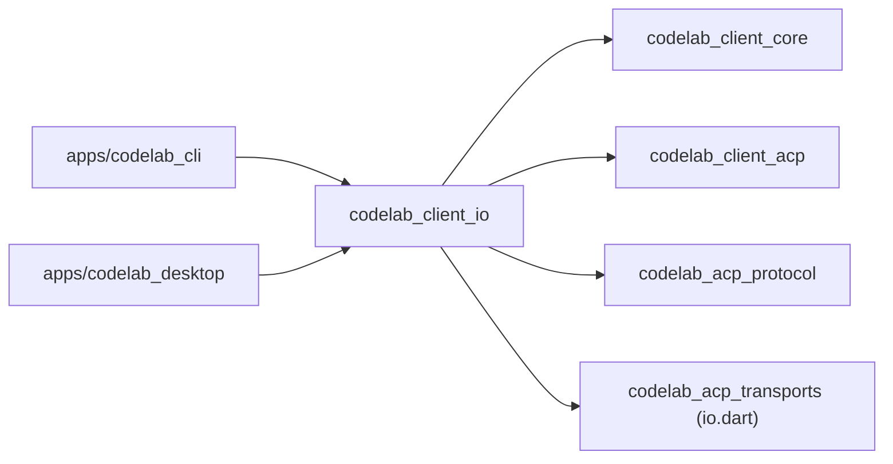

# codelab_client_io

Адаптеры `dart:io` для клиентского слоя CodeLab: файлы, процессы, сокеты и JSON-файлы. Пакеты `codelab_client_core` и `codelab_client_acp` web-безопасны и описывают только порты. Терминальный клиент `codelab` и CodeLab app на десктопе нуждаются в одних и тех же реализациях этих портов. Пакет хранит их в одном месте.

Политики здесь нет. Правила очереди, профилей и недавних проектов живут в `codelab_client_core`; пакет переносит их на файловую систему, процессы и сокеты.

## Место в архитектуре

Пакет — сторона `client`, слой `io` (ADR-0002): чистый Dart, без Flutter, не web-безопасен. Адаптеры создаются в composition root клиентов; Cubit-ы CodeLab app берут из пакета только тип порта `DirectoryExists`.



Стрелки — зависимости из `pubspec.yaml`; `path` — служебная. Обратные зависимости — `apps/codelab_cli` и `apps/codelab_desktop`. Расширять список зависимостей пакета можно только через OpenSpec change (сторож `melos run guard`).

## Что внутри

Публичное API экспортирует `lib/codelab_client_io.dart`.

| Часть | Для чего | Порт |
|---|---|---|
| `IoTextFileIo` | чтение и запись текстовых файлов для `fs/read_text_file` и `fs/write_text_file` | `TextFileReader`, `TextFileWriter` (`codelab_client_acp`) |
| `IoTerminalProcessRunner` | запуск процессов для `terminal/*`, сбор вывода, `SIGTERM` и `SIGKILL` | `TerminalProcessRunner` (`codelab_client_acp`) |
| `ioTransportResolver` | профиль подключения превращается в stdio- или WebSocket-транспорт | `TransportResolver` (`codelab_client_core`) |
| `IoProjectFiles` | дерево и просмотр файлов проекта | `ProjectFiles` (`codelab_client_core`) |
| `JsonFileProfileStore` | профили подключения в `profiles.json` | `ProfileStore` (`codelab_client_core`) |
| `JsonFileRecentProjectsStore` | недавние проекты в JSON-файле | `RecentProjectsStore` (`codelab_client_core`) |
| `WorkingDirectoryProvider`, `IoWorkingDirectoryProvider` | рабочая папка процесса клиента (`Directory.current`) | — |
| `DirectoryExists`, `ioDirectoryExists` | проверка, что папка проекта ещё существует | — |
| `resolveCodelabHome`, `CodelabHomeException` | единое правило вычисления `$CODELAB_HOME` | — |

Константа `acpClientIoPackageName` — имя пакета.

## Как использовать

Composition root создаёт адаптеры один раз и передаёт их в ядро клиента.

```dart
const textFileIo = IoTextFileIo();

final application = AcpClientApplication(
  transport: transport,
  clientInfo: const Implementation(name: 'my-client', version: '1.0.0'),
  textFileReader: textFileIo,
  textFileWriter: textFileIo,
  terminalProcessRunner: const IoTerminalProcessRunner(),
);

final home = resolveCodelabHome(Platform.environment);
final profiles = JsonFileProfileStore('$home/profiles.json');
final resolver = ioTransportResolver(secrets: mySecretSource);
```

`resolver` передают в `ClientWorkspace(resolvers: [...])`. Живой пример — `apps/codelab_cli/lib/src/composition_root.dart`.

Что вернётся при ошибках:

- `IoTextFileIo`: нет файла — `FsNotFoundFailure`, другая ошибка файловой системы — `FsIoFailure`.
- `IoTerminalProcessRunner`: процесс не запустился — `TerminalStartFailure`.
- `IoProjectFiles`: `ProjectFilesFailure` без содержимого файла.
- `resolveCodelabHome`: `CodelabHomeException` для `~user/…`, для `~` без домашнего каталога и когда нет ни `CODELAB_HOME`, ни `HOME`/`USERPROFILE`. Правило и таблица значений — в [каталоге `CODELAB_HOME`](../../../docs/ops/codelab-home.md).

### Как `ioTransportResolver` выбирает транспорт

Резолвер — это `ConfigTransportResolver` из `codelab_client_core` с подставленными фабриками `StdioAcpTransport.new` и `WebSocketAcpTransport.new` из `codelab_acp_transports/io.dart`. Строки `stdio:…` и `ws://…` резолвер не разбирает: их превращает в профиль хост (в CLI — `apps/codelab_cli/lib/src/profiles/profile_arg.dart`). Резолвер получает уже готовый профиль.

| Профиль | Что делает резолвер |
|---|---|
| `StdioProfile` (`stdio:…`) | процесс `command` с `args` и `env`; `cwd` — корень процесса агента, если `runInProjectDirectory` истинно, иначе не задан |
| `WebSocketProfile` (`ws://…`, `wss://…`) | WebSocket-соединение по `uri`; токен — значение `tokenRef`, прочитанное из `secrets`; нет `tokenRef` или `secrets` — токена нет |
| `EmbeddedProfile` (`embedded`, `default`) | не поддерживается: `supports` возвращает `false`. Встроенного агента открывает резолвер самого приложения (`EmbeddedTransportResolver` в `apps/codelab_cli` и `apps/codelab_desktop`) поверх `codelab_embedded` |

Профиль без подходящего резолвера даёт `UnsupportedConnectionProfileException`. Встроенный агент в `profiles.json` не записывается: `JsonFileProfileStore.save` отклоняет `EmbeddedProfile` и зарезервированные id (`embedded`, `default`) через `ArgumentError`, а файл не меняется. Записи `default` из старых файлов `load` возвращает как есть, `remove` их удаляет.

### Что хранят JSON-файлы

- `JsonFileProfileStore` пишет `{"version": 1, "profiles": [...]}`. Секреты в файл не попадают: у WebSocket-профиля только ссылка `tokenRef`. Нет файла — пустой список; битый файл, другая версия или неизвестный тип профиля — `FormatException`.
- `JsonFileRecentProjectsStore` пишет `{"projects": [...]}`: последний открытый проект первым, не больше `recentProjectsLimit`. Приложения сейчас его не используют: CLI не подключает его, а CodeLab app хранит недавние проекты в `shared_preferences`.
- Запись идёт во временный файл в том же каталоге с `flush: true`, затем `rename`. После сбоя питания остаётся целый старый или целый новый файл.

Где лежат эти файлы и кто их пишет — в [каталоге `CODELAB_HOME`](../../../docs/ops/codelab-home.md), в [эксплуатации `codelab`](../../../apps/codelab_cli/doc/operations.md) и в [эксплуатации CodeLab app](../../../apps/codelab_desktop/doc/operations.md).

## Границы рабочей папки

Здесь два разных механизма.

**`fs/*` и `terminal/*`.** Адаптеры `IoTextFileIo` и `IoTerminalProcessRunner` пути не проверяют. Ограничение `path` и `cwd` рабочей папкой сессии делает ядро клиента до вызова адаптера: `resolveWithinWorkingDirectory` в `codelab_client_acp` (`lib/src/domain/fs_access.dart`), вызывается из `AcpClientApplication`. Это единственный рубеж по `AGENTS.md` §10, поэтому адаптер нельзя подключать в обход `AcpClientApplication`.

**Панель Files.** `IoProjectFiles` проверяет границу сам: считает realpath корня и цели до перечисления и чтения, поэтому символическая ссылка внутри проекта не выводит наружу. Перечисляется один уровень (до 5000 записей, `.git` скрыт), читается не больше `maxBytes + 1` байт. Между проверкой и открытием ссылку можно подменить; окно узкое, чтение только на чтение. Подробности — в doc-комментарии класса и в design change `add-file-preview-and-tree`.

## Тесты

```bash
cd packages/dart/codelab_client_io
fvm dart test
```

Тесты идут на Dart VM: настоящие файлы во временной папке, дочерние процессы `/bin/sh`, агент из `codelab_acp_testing` и WebSocket-сервер на loopback. Сети наружу нет.

## Правила пакета

Правила для изменений — в [`AGENTS.md`](AGENTS.md). Главное: `lib/**` не импортирует Flutter, секреты не пишутся в файлы, политики в пакете нет.

## Смотрите также

- [`codelab_client_core`](../codelab_client_core/README.md) — порты и политики клиентского слоя.
- [`codelab_client_acp`](../codelab_client_acp/README.md) — протокольный клиент и порты `fs/*`, `terminal/*`.
- [`codelab_acp_transports`](../codelab_acp_transports/README.md) — транспорты stdio и WebSocket.
- [`codelab_embedded`](../codelab_embedded/README.md) — встроенный агент, который открывают резолверы приложений.
- [Разработка `codelab`](../../../apps/codelab_cli/doc/development.md), [разработка CodeLab app](../../../apps/codelab_desktop/doc/development.md).
