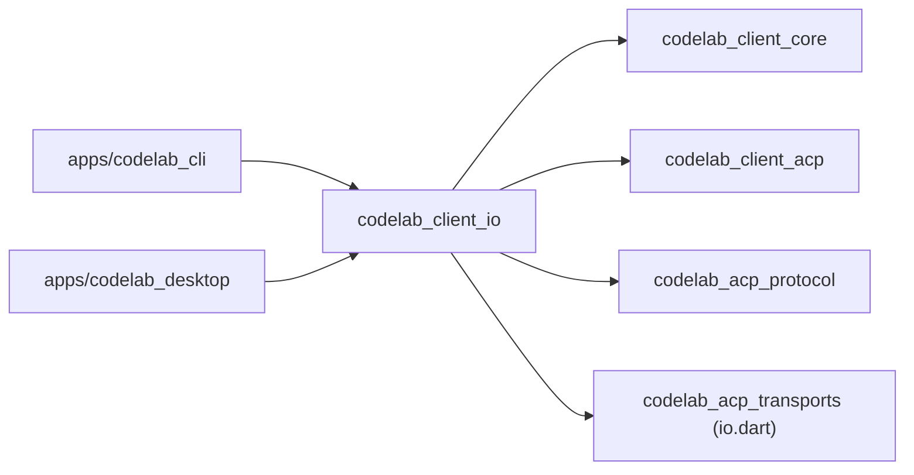
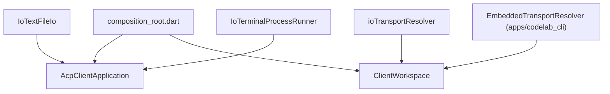

# 01. Обзор и сборка

Глава отвечает на три вопроса: где пакет стоит среди соседей, из чего он состоит и кто создаёт его адаптеры.

## Зачем пакет нужен

`codelab_client_core` и `codelab_client_acp` web-безопасны: они описывают порты (абстрактные интерфейсы) и политики, но не открывают файлы, процессы и сокеты. Терминальный клиент `codelab` и CodeLab app на десктопе нуждаются в одних и тех же реализациях этих портов. Их написали один раз и сложили в `codelab_client_io`.

Политики в пакете нет. Правило «последний открытый проект первым, не больше десяти», запрет зарезервированных id профилей и правила предпросмотра файлов живут в `codelab_client_core`. Пакет только переносит их на диск, процессы и сокеты (`AGENTS.md` пакета, §2).

## Место в слоях

Пакет — сторона `client`, слой `io` (ADR-0002). Это чистый Dart: `lib/**` не импортирует Flutter, но импортирует `dart:io`. Поэтому пакет не web-безопасен, и его нельзя импортировать из `codelab_client_core`.



Стрелки взяты из `pubspec.yaml` пакета: `codelab_acp_protocol`, `codelab_acp_transports`, `codelab_client_acp`, `codelab_client_core`, `path`. `codelab_acp_testing` подключён только как `dev_dependency`. Список зависимостей закрыт сторожем (`pubspec_allowlist_test.dart`): расширить его можно только через OpenSpec change. Импортируют пакет composition root приложений и тесты.

## Карта `lib/src/`

Публичное API экспортирует барель `lib/codelab_client_io.dart`. Что в него не входит, помечено ниже.

| Каталог | Что внутри | Порт и его владелец |
|---|---|---|
| `files/` | `IoProjectFiles`: перечисление папки и чтение файла для панели Files | `ProjectFiles`, `codelab_client_core` |
| `platform/` | `IoTextFileIo` (`fs/read_text_file`, `fs/write_text_file`), `IoTerminalProcessRunner` (`terminal/*`) | `TextFileReader`, `TextFileWriter`, `TerminalProcessRunner`, `codelab_client_acp` |
| `platform/` | `resolveCodelabHome`, `CodelabHomeException` — правило `$CODELAB_HOME` | порта нет, это функция |
| `platform/` | `WorkingDirectoryProvider`, `IoWorkingDirectoryProvider`, `DirectoryExists`, `ioDirectoryExists` | порты определены здесь же |
| `stores/` | `JsonFileProfileStore`, `JsonFileRecentProjectsStore` | `ProfileStore`, `RecentProjectsStore`, `codelab_client_core` |
| `stores/json_file.dart` | `readJsonObject`, `writeJsonObject`, `writeBytesAtomically` — общая запись и чтение JSON | в барель не входит |
| `themes/` | `IoThemeLibrary`: каталог `<home>/themes/*.json` и импорт файла темы | `ThemeLibrary`, `codelab_client_core` |
| `transport/` | `ioTransportResolver` | `ConfigTransportResolver`, `codelab_client_core` |

Ещё барель экспортирует константу `acpClientIoPackageName`. Из `terminal_process_runner.dart` наружу выходит только `IoTerminalProcessRunner` (`show`): преобразование кода выхода — деталь адаптера.

## Кто создаёт адаптеры

Адаптеры создаёт composition root клиента, по одному экземпляру на процесс. Ни ядро клиента, ни Cubit-ы app сами их не конструируют (AGENTS.md §6).

| Адаптер | Терминальный клиент (`apps/codelab_cli/lib/src/`) | CodeLab app (`apps/codelab_desktop/lib/`) |
|---|---|---|
| `IoTextFileIo`, `IoTerminalProcessRunner` | `composition_root.dart`, `buildCliRuntime` | `app/app_scope.dart` |
| `ioTransportResolver` | `composition_root.dart`; в `scenario/agent_connector.dart` — для `test-scenario` | не используется: app собирает `ConfigTransportResolver` сам, со своими фабриками транспортов (`_transportResolvers` в `app/app_scope.dart`) |
| `JsonFileProfileStore` | `run.dart`, на `home.profilesFile` | `app/app_scope.dart` |
| `JsonFileRecentProjectsStore` | `run.dart`, `_recordRecentProject`: только `record` | `app/app_scope.dart` через `MigratingRecentProjectsStore` |
| `IoProjectFiles`, `ioDirectoryExists` | не используются | `app/app_scope.dart` |
| `IoThemeLibrary` | не используется | `main.dart` |
| `resolveCodelabHome` | `home.dart`, `CodelabHome.resolve` | `app/connection_environment.dart`, `app/client_profile_secrets.dart` |

`IoWorkingDirectoryProvider` и тип `WorkingDirectoryProvider` в `lib/` обоих приложений не используются: на момент написания на них ссылаются только тесты. Проверьте это поиском, прежде чем опираться на тип.

Схема сборки терминального клиента: резолвер из этого пакета стоит рядом с резолвером встроенного агента, который собирает сам клиент.



`ClientWorkspace` перебирает резолверы по порядку и берёт первый, чей `supports` вернул `true`.

## Как `ioTransportResolver` выбирает транспорт

Функция возвращает `ConfigTransportResolver` из `codelab_client_core` с фабриками `StdioAcpTransport.new` и `WebSocketAcpTransport.new` (`lib/src/transport/io_transport_resolver.dart`, `codelab_acp_transports/io.dart`). Строки `stdio:…` и `ws://…` резолвер не разбирает: хост уже превратил их в профиль.

| Профиль | Что делает резолвер |
|---|---|
| `StdioProfile` | запускает `command` с `args` и `env`; `cwd` — папка проекта, если `runInProjectDirectory` истинно, иначе не задан |
| `WebSocketProfile` | подключается по `uri`; токен — значение, которое `secrets.read(tokenRef)` вернул по ссылке `tokenRef`; нет `tokenRef` или `secrets` — токена нет |
| `EmbeddedProfile` | не поддерживается: `supports` даёт `false`, а `open` — `UnsupportedConnectionProfileException` |

Значение секрета резолвер читает в момент `open` и сразу передаёт в конфигурацию транспорта; на диск оно не попадает (AGENTS.md §10).

## Границы рабочей папки

Два адаптера разделяют обязанности по-разному.

- **`IoTextFileIo` и `IoTerminalProcessRunner` пути не проверяют.** Ограничение `path` и `cwd` рабочей папкой сессии делает ядро клиента до вызова адаптера — `resolveWithinWorkingDirectory` в `codelab_client_acp`, вызывается из `AcpClientApplication`. Это единственный рубеж по AGENTS.md §10, поэтому адаптеры нельзя подключать в обход `AcpClientApplication`.
- **`IoProjectFiles` проверяет границу сам.** Он считает realpath корня и цели до перечисления и чтения, поэтому символическая ссылка внутри проекта не выводит наружу. Перечисляется один уровень, до 5000 записей, `.git` скрыт; читается не больше `maxBytes + 1` байт. Между проверкой и открытием ссылку можно подменить: окно узкое, чтение только на чтение. Подробности — в doc-комментарии класса и в design change `add-file-preview-and-tree`.

`IoTerminalProcessRunner` собирает stdout и stderr вместе. При `outputByteLimit` вывод обрезается с начала по границе символа UTF-8. Если процесс не запустился, адаптер бросает `TerminalStartFailure`. Для `IoTextFileIo` отсутствующий файл — `FsNotFoundFailure`, остальные ошибки файловой системы — `FsIoFailure`.

## Тесты

```bash
cd packages/dart/codelab_client_io
fvm dart test
```

Тесты идут на Dart VM. Каталоги `test/` повторяют `lib/src/`:

| Каталог | Что проверяет |
|---|---|
| `test/stores/` | оба JSON-хранилища и общую атомарную запись |
| `test/transport/` | `ioTransportResolver`: настоящий процесс агента из `codelab_acp_testing` и WebSocket-сервер на loopback |
| `test/platform/` | `IoTextFileIo`, `IoTerminalProcessRunner` (дочерние процессы `/bin/sh`, остановка), `resolveCodelabHome` |
| `test/files/` | `IoProjectFiles`: границы, ссылки, лимиты |
| `test/themes/` | `IoThemeLibrary` |

Файлы пишутся во временную папку и удаляются в `tearDown`. Сети наружу нет. Маркеры секретов в тестах не должны попадать в вывод, в том числе в сообщения `expect` (`AGENTS.md` пакета, §2).

Дальше — [форматы файлов и рецепт нового хранилища](02-stores-and-extending.md).
