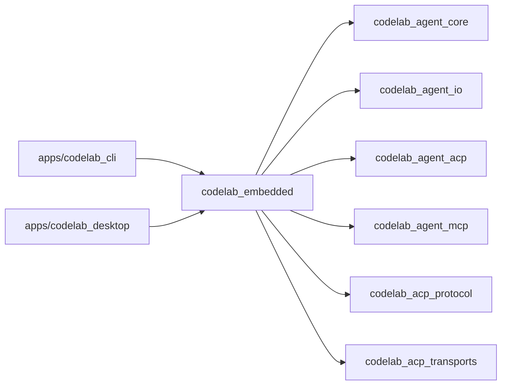
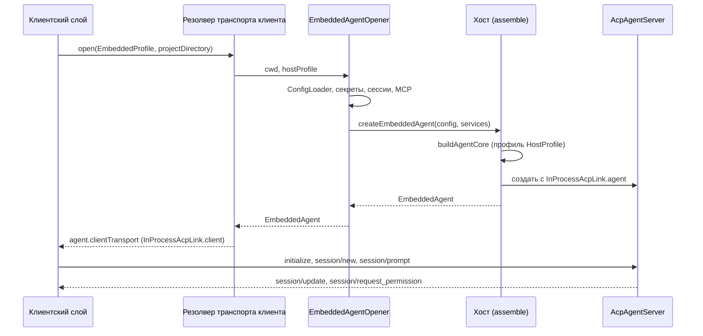

# codelab_embedded

Мост встроенного Dart-агента: собирает ядро агента внутри процесса клиента и соединяет его с клиентом по ACP (Agent Client Protocol) через пару в памяти. Пакет нужен, чтобы `codelab` и настольное приложение запускали агента без отдельной программы и без прямого импорта `package:codelab_agent_*`.

## Место в архитектуре

Мост между сторонами (ADR-0002), поэтому без префикса `codelab_agent_`. Чистый Dart, без Flutter. Основной барель web-безопасен; `dart:io` живёт только в `lib/io.dart`.

Схема показывает зависимости из `pubspec.yaml` и пакеты, которые зависят от моста.



Клиентских пакетов (`codelab_client_*`) среди зависимостей нет: клиент зависит от моста, а не наоборот. `codelab_client_acp` и `codelab_client_core` подключены только как `dev_dependencies` для замера в `benchmark/`. Резолвер транспорта, который превращает профиль подключения в `AcpTransport`, живёт в клиенте, а не здесь.

Правила слоёв — [layers-and-dependencies.md](../../../docs/architecture/layers-and-dependencies.md), границы с ACP — [acp-boundary.md](../../../docs/architecture/acp-boundary.md).

## Что внутри

| Часть | Для чего |
|---|---|
| `EmbeddedAgent` | запущенный агент: `clientTransport` для клиента, `closed`, `dispose()`, `mcpStatus(sessionId)`, `secretsInConfig` |
| `EmbeddedAgentOpener` | функция `({cwd, hostProfile}) → Future<EmbeddedAgent>`; клиент хранит её и вызывает при каждом подключении |
| `createEmbeddedAgent` | собирает агента из `EmbeddedAgentConfig` и `EmbeddedHostServices`; принимает профили `embedded-app-desktop` и `embedded-cli` |
| `EmbeddedHostServices` | порты хоста: окружение исполнения, сессии, секреты, `http.Client`, часы, `Random`, MCP и другие |
| `EmbeddedAgentConfigException` | невалидная конфигурация; текст указывает на `config.yaml` и `codelab config check` |
| `localEmbeddedAgentOpener` | настольный открыватель (`io.dart`): конфигурация, секреты, журнал сессий, MCP |
| `scriptedEmbeddedAgentOpener` | открыватель для тестов (`testing.dart`): модель заменена сценарием |

### Три бареля

| Барель | Содержимое | Кто имеет право импортировать |
|---|---|---|
| `package:codelab_embedded/codelab_embedded.dart` | типы выше и `Logger`, `LogLevel`, `McpStatusPort`, `McpServerSummary`, `McpServerState` из ядра | любой клиент; барель web-безопасен |
| `package:codelab_embedded/io.dart` | `localEmbeddedAgentOpener`, перенос секретов (`SecretMigrator`, `secretMigrationOptionsFor`, `ConfigLayer` и отчётные типы) | только composition root клиента: `apps/codelab_cli/lib/src/composition_root.dart`, `apps/codelab_desktop/lib/app/`; и тесты |
| `package:codelab_embedded/testing.dart` | `scriptedEmbeddedAgentOpener`, `FakeMcpHttpHost`, `FakeMcpServer`, `FakeMcpTool` | только тесты и `apps/codelab_cli/lib/src/scenario/` (драйвер `test-scenario`); в `lib/` настольного приложения импорт запрещён, чтобы сценарий модели не попал в релиз |

Правила проверяет `melos run guard` (`packages/dart/codelab_architecture_tests`). Основной барель не должен тянуть `dart:io`, `codelab_agent_io` и `io.dart`.

## Как использовать

Клиент не создаёт агента сам. Composition root передаёт открыватель резолверу транспорта; резолвер вызывает его при подключении профиля `EmbeddedProfile`.

```dart
import 'package:codelab_embedded/codelab_embedded.dart';
import 'package:codelab_embedded/io.dart'; // только composition root

final EmbeddedAgentOpener opener = localEmbeddedAgentOpener(
  environment: Platform.environment, // Map<String, String>
  logger: logger,                    // Logger из основного бареля
);

final agent = await opener(
  cwd: projectDirectory,
  hostProfile: 'embedded-cli', // или 'embedded-app-desktop'
);
// agent.clientTransport отдаётся клиентскому ACP-слою
await agent.dispose();
```

Что важно знать:

- Невалидный или отсутствующий конфиг даёт `EmbeddedAgentConfigException` до создания HTTP-клиента.
- `dispose()` идемпотентен; клиент вызывает его при смене проекта и выходе. Разрешения идут клиенту через ACP (`session/request_permission`), мост передаёт ядру заглушку `PermissionGate`, которая только включает `interactiveApproval`; вопросы задаёт `AcpPermissionGate` сервера.
- Профили `embedded-*` исполняют файлы и команды сами в процессе клиента, поэтому `fs/*` и `terminal/*` клиенту не уходят. Подробности — в `openspec/specs/embedded-agent/spec.md`.
- Переменная `CODELAB_TEST_SECRET_STORE` читается только в сборке с `-DCODELAB_ALLOW_TEST_SECRETS=true`.
- Необязательные параметры `localEmbeddedAgentOpener`: `debugSecrets`, `httpClient`, `clock`.

Профиль подключения `embedded` (и его алиас `default`) — профиль клиента по умолчанию; значение `hostProfile` в нём выбирает клиент: `embedded-cli` у `codelab`, `embedded-app-desktop` у приложения. Как пользователь выбирает агента — [руководство `codelab`](../../../apps/codelab_cli/doc/user-guide.md#выбрать-агента).

## Ключевой поток

Как клиент открывает встроенного агента: резолвер клиента вызывает открыватель, открыватель собирает ядро, пара `InProcessAcpLink` соединяет два конца.



Что неочевидно:

- `serve` и вся асинхронная работа агента идут в охраняемой зоне (`runZonedGuarded`). Сбой пишет в лог `embedded.agent.failed` и закрывает агентский конец пары; `EmbeddedAgent.closed` завершается.
- Ядро собирается только через `buildAgentCore` (HOST-6). `ToolRegistry(`, `Agent(` и `AgentRuntime(` в `lib/` не встречаются; это проверяет `host_assembly_guard_test.dart`.
- `http.Client`, `Clock`, `Random` и `IdGenerator` приходят от хоста через `EmbeddedHostServices`; сам пакет создаёт их только в `io.dart` и `testing.dart`.
- Если в сервисах есть `configSource` или `projectConfig`, `createEmbeddedAgent` строит функцию `modelsFor`, и ядро перезагружает модели без перезапуска агента.

## Тесты

```bash
cd packages/dart/codelab_embedded
fvm dart test
```

Агент в тестах открывается через `scriptedEmbeddedAgentOpener` во временном каталоге; клиент — тестовый ACP-клиент из `test/support/acp_client.dart`. Сети нет. Тесты процессов и файлов лежат в `test/io/`.

Скрипты Melos из корня репозитория:

```bash
fvm dart run melos run guard
fvm dart run melos run conformance:embedded
fvm dart run melos run web-compile
```

- `guard` — границы пакета: импорты барелей и allowlist зависимостей;
- `conformance:embedded` — `codelab test-scenario` проигрывает золотые фикстуры ACP против встроенного агента в процессе CLI, без дочернего процесса и сети;
- `web-compile` — компилирует `test/web_smoke/main.dart` в JavaScript и WebAssembly; на Dart VM тот же код проверяет `web_smoke_test.dart`;
- сквозные тесты клиентов: `test:e2e:cli:embedded` (входит в `melos run check`) и `test:e2e:app:embedded` (на macOS, только в `release/*`).

`benchmark/stream_latency_benchmark.dart` замеряет задержку потока с настоящим клиентским слоем.

## Правила пакета

Правила для изменений — в [`AGENTS.md`](AGENTS.md). Главное: `dependencies` — подмножество allowlist сторожа, расширение требует OpenSpec change; метод, поле или состояние ACP мост не добавляет.

## Смотрите также

- [`codelab_agent_core`](../codelab_agent_core/README.md) и [порты хоста](../codelab_agent_core/doc/host-ports.md) — ядро и `AgentCoreServices`;
- [`codelab_agent_io`](../codelab_agent_io/README.md) — `dart:io`-реализации портов, `ConfigLoader`;
- [`codelab_agent_mcp`](../codelab_agent_mcp/README.md) — MCP-клиент;
- [`codelab_agent_acp`](../codelab_agent_acp/README.md) — `AcpAgentServer`;
- [`codelab_acp_transports`](../codelab_acp_transports/README.md) — `InProcessAcpLink`;
- [`codelab_setup`](../codelab_setup/README.md) — второй мост, настройки агента для клиентов;
- [`apps/codelab_cli/doc/development.md`](../../../apps/codelab_cli/doc/development.md) и [`apps/codelab_desktop/doc/development.md`](../../../apps/codelab_desktop/doc/development.md) — как клиенты используют мост;
- [`openspec/specs/embedded-agent/spec.md`](../../../openspec/specs/embedded-agent/spec.md), [`09-12-stage-7-embedded.md`](../../../docs/architecture/proposals/dart-agent-and-clients/09-12-stage-7-embedded.md).
