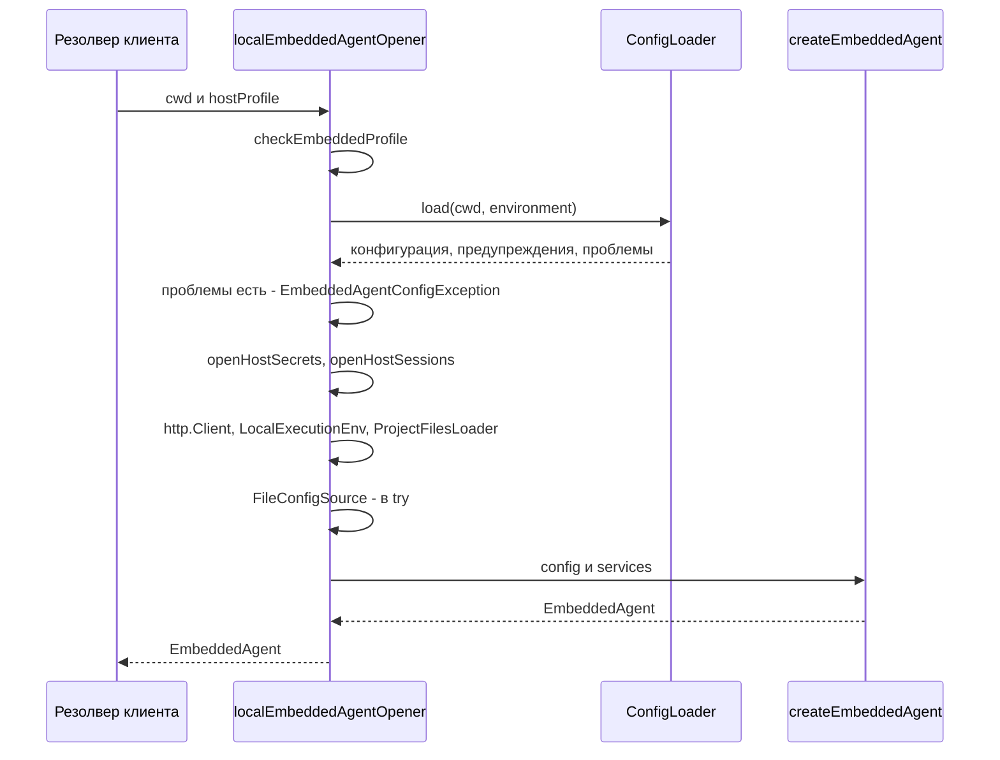
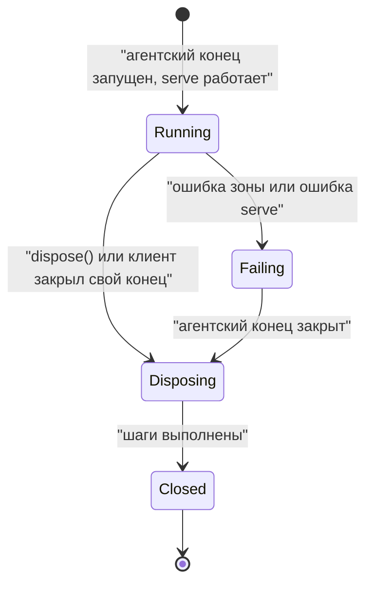

# Устройство моста и отладка

Глава объясняет, из чего состоит `codelab_embedded`, кто что вправе импортировать, чем два открывателя отличаются, как агент открывается и останавливается, как прогнать тесты и проверки и как отлаживать. Сборку ядра (`buildAgentCore`, профили, `EmbeddedHostServices`, `createEmbeddedAgent` и `assembleEmbeddedAgent`, параметры `AcpServerConfig`) и путь запроса глава не повторяет: они описаны в [главе 2 руководства по ядру](../../codelab_agent_core/doc/02-assembly-and-hosts.md#хост-2-codelab_embedded) и в разделе [«Встроенный режим»](../../codelab_agent_core/doc/03-request-flow.md#встроенный-режим).

Клиентам (`codelab`, настольное приложение) нужен агент в своём процессе, но `package:codelab_agent_*` они импортировать не вправе. Мост — хост ядра, как бинарь `codelab-agent`, но вместо процесса и stdio у него пара `InProcessAcpLink`. Резолвер транспорта, который превращает профиль подключения в транспорт, живёт в клиенте (`apps/codelab_cli/lib/src/embedded_transport_resolver.dart` и своя копия в `apps/codelab_desktop/lib/app/`). Зависимости пакета — на схеме в [README](../README.md#место-в-архитектуре).

## Карта `lib/`

| Файл | Что в нём |
|---|---|
| `lib/codelab_embedded.dart` | основной барель: публичные типы, константа `embeddedAgentVersion`, из ядра — `Logger`, `LogLevel`, `McpStatusPort`, `McpServerSummary`, `McpServerState` |
| `lib/io.dart` | настольный открыватель `localEmbeddedAgentOpener` и перенос секретов (`SecretMigrator`, `secretMigrationOptionsFor`) |
| `lib/testing.dart` | `scriptedEmbeddedAgentOpener`, `FakeMcpHttpHost`, `FakeMcpServer`, `FakeMcpTool` |
| `lib/src/embedded_agent.dart` | интерфейс `EmbeddedAgent` и тип `EmbeddedAgentOpener` |
| `lib/src/embedded_agent_config.dart` | `EmbeddedAgentConfig`, `EmbeddedHostServices`, `EmbeddedAgentConfigException` |
| `lib/src/create_embedded_agent.dart` | `createEmbeddedAgent` и `checkEmbeddedProfile` |
| `lib/src/assemble.dart` | `assembleEmbeddedAgent` (во внешний API не входит), реализация агента `_Agent`, `embeddedAgentVersion` |
| `lib/src/io/local_opener.dart`, `lib/src/io/migration_options.dart` | реализация `io.dart` |
| `lib/src/testing/scripted_opener.dart`, `lib/src/testing/fake_mcp_http_host.dart` | реализация `testing.dart` |

## Три бареля и кто может их импортировать

Барелей три, потому что у них разные ограничения.

| Барель | Что нельзя тянуть | Кто вправе импортировать |
|---|---|---|
| `package:codelab_embedded/codelab_embedded.dart` | `dart:io`, `dart:isolate`, `dart:ffi`, `dart:html`, `dart:js_interop`, `package:web/`, `package:flutter/`, `package:codelab_acp_transports/io.dart`, `package:codelab_agent_io/`, `package:codelab_client_*`; ссылки на `io.dart`, `testing.dart` и их каталоги | любой клиентский код: барель собирается для web |
| `package:codelab_embedded/io.dart` | Flutter, `fluent_ui`, `codelab_ui`, `codelab_client_*`; `package:codelab_agent_io/testing.dart`, `package:codelab_agent_mcp/testing.dart` и ссылки на `testing.dart` | только composition root клиента: `apps/codelab_cli/lib/src/composition_root.dart` и `apps/codelab_desktop/lib/app/`; плюс тесты |
| `package:codelab_embedded/testing.dart` | Flutter, `fluent_ui`, `codelab_ui`, `codelab_client_*` | только тесты и `apps/codelab_cli/lib/src/scenario/` (драйвер `codelab test-scenario`); в `lib/` настольного приложения импорт запрещён |

Зачем так. Основной барель web-безопасен, чтобы одни и те же типы можно было собрать и для браузера: `dart:io` и `codelab_agent_io` живут только в `io.dart`. Сценарий модели вынесен в `testing.dart`, чтобы он структурно не мог попасть в релизную сборку приложения: если бы он лежал в `io.dart`, любая сборка с открывателем содержала бы и его. Поэтому ни основной барель, ни `io.dart` не принимают функцию модели, сценарий или `PermissionGate`: вопросы о разрешениях идут клиенту по ACP.

Кто следит за правилами:

| Правило | Где |
|---|---|
| запреты импортов внутри пакета (два правила `packages/dart/codelab_embedded`) | `packages/dart/codelab_architecture_tests/test/support/rules.dart`, проверяет `import_guard_test.dart` |
| `package:codelab_agent_io/testing.dart` и `package:codelab_agent_mcp/testing.dart` — только `lib/testing.dart` и `lib/src/testing/` | то же правило (`forbidden` плюс `exclude`) |
| «запечатанный» `io.dart`: файлы вне `io.dart` и `lib/src/io/` не ссылаются на них даже относительным путём; то же для `testing.dart` | `PackageRule.sealExclude` (по умолчанию `true`) |
| `io.dart` клиента — только composition root, `testing.dart` — только сценарный каталог CLI и тесты | правила `apps/codelab_cli/lib`, `apps/codelab_cli/bin`, `apps/codelab_desktop/lib` в том же файле |
| `dependencies` — подмножество `embeddedAllowlist`; расширение — только OpenSpec change | `pubspec_allowlist_test.dart` |
| ядро собирается только через `buildAgentCore`: в `lib/` нет `ToolRegistry(`, `Agent(`, `AgentRuntime(` | `host_assembly_guard_test.dart` |

Проверка одной командой: `guard` из корня репозитория (таблица скриптов — [ниже](#запуск-тестов-и-проверок)). Правило нового пакета или барела правит тот, кто меняет границу (корневой [`AGENTS.md`](../../../../AGENTS.md), §5).

Клиентские пакеты `codelab_client_acp` и `codelab_client_core` подключены только как `dev_dependencies`: они нужны бенчмарку в `benchmark/`, который лежит вне `lib/` и поэтому вне поля зрения сторожа импортов.

## Два открывателя

`EmbeddedAgentOpener` — функция `({required String cwd, required String hostProfile}) → Future<EmbeddedAgent>`. Клиент хранит её и зовёт при каждом подключении. Открывателей два, и они собирают одного и того же агента из разных служб.

| | `localEmbeddedAgentOpener` (`io.dart`) | `scriptedEmbeddedAgentOpener` (`testing.dart`) |
|---|---|---|
| Для кого | настольные хосты (`codelab`, приложение) | тесты и `codelab test-scenario` |
| Профили | `embedded-app-desktop`, `embedded-cli` | любые, в том числе `agent-serve`; `hostProfile` фабрики заменяет профиль вызова |
| Модель | провайдеры из конфигурации | сценарий (`LlmScript`, блок `llm` фикстуры) |
| Конфигурация | `ConfigLoader().load` по файлам, `CODELAB_*` и `environment` | загрузчик с `scripted: true`: файлы `$CODELAB_HOME` и проекта не читаются |
| Секреты | `openHostSecrets` по `secrets.backend` конфигурации | всегда бэкенд `env` (`selectionReason: 'forced by scripted opener'`) |
| Журнал сессий | `openHostSessions`: JSONL под `$CODELAB_HOME/sessions` или `sessions.dir` | в памяти; JSONL — только если задан `sessionsDir` (тогда `loadSession` объявляется) |
| HTTP-клиент | переданный `httpClient` (не закрывается) или свой `web.Client()` (закрывается в `dispose`) | `MockClient`, который бросает `StateError` на любой запрос |
| Перезагрузка конфигурации | `FileConfigSource` (он же `projectConfig`) | нет |
| Файлы проекта и навыки | `ProjectFilesLoader` с `$CODELAB_HOME` и домашним каталогом пользователя | тот же загрузчик без обоих (`home: null`) |
| Память последней модели | `FileLastModelStore` над `$CODELAB_HOME` | нет |
| Пути PERM-11 | `agentConfigPathsFor` | нет |
| MCP | `McpClientConnector`, `Random.secure()` | `McpClientConnector`, `Random(0)`; серверы фикстур в процесс не передаются |
| Идентификаторы | `RandomIdGenerator(Random.secure())` | параметр `ids` или случайные |

### Порядок в `localEmbeddedAgentOpener`

Порядок важен: невалидная конфигурация не должна оставлять ни сокетов, ни процессов.



1. `checkEmbeddedProfile` — до всего. Чужой профиль даёт `HostWiringException` и не открывает ни файла, ни сокета.
2. `CODELAB_HOME`: `_homeOf` раскрывает `~` через `codelabHomeOf` ещё до загрузки; `~user/...` даёт `EmbeddedAgentConfigException`.
3. `ConfigLoader().load`. Ошибка использования (`~user` в `CODELAB_HOME`, чужое имя файла в `CODELAB_CONFIG`) и проблемы конфигурации превращаются в `EmbeddedAgentConfigException`. Предупреждения (`logConfigWarnings`) пишутся и при невалидной конфигурации, до исключения.
4. Секреты. Недоступное хранилище — тоже `EmbeddedAgentConfigException` (ключ `secrets.backend`).
5. Журнал сессий.
6. Только теперь создаются HTTP-клиент, локальное окружение и загрузчик файлов проекта.
7. `FileConfigSource` создаётся последним и внутри `try`: его конструктор запускает наблюдатель за файлами. Любой срыв дальше закрывает источник (и свой HTTP-клиент) до проброса ошибки.
8. `secretsInConfig` — `true`, если среди предупреждений загрузки есть `config.secret.in_file`. Признак вычисляется один раз при открытии и не пересчитывается: после переноса секретов он обновится при следующем подключении.

Отсутствие ключа провайдера — не ошибка открытия: агент откроется, а первый ход закончится ошибкой провайдера с именем секрета.

Пример: текст `EmbeddedAgentConfigException` при пустом `CODELAB_HOME` (реальный вывод; путь заменён). Это тот же текст, что `codelab` печатает в stderr с кодом `64`, а приложение показывает в баннере соединения:

```text
defaults: agent.default_model: no model is configured; add a provider with at least one model
Configure the embedded agent in ~/demo/home/config.yaml; check it with: codelab config check
```

## Жизненный цикл агента

Один `EmbeddedAgent` обслуживает одно соединение. Клиент закрыл свой конец пары — агент останавливается. Чтобы переподключиться, клиент открывает нового агента: резолвер клиента сначала освобождает прежнего (`dispose`), потом зовёт открыватель, и два агента не пишут один журнал сессий одновременно.



Состояний в коде нет в виде перечисления: их задают поля `_failed`, `_disposing` и `_closed` в `_Agent` (`lib/src/assemble.dart`). Схема описывает наблюдаемое поведение.

### Охраняемая зона

`serve` и вся асинхронная работа агента идут в `runZonedGuarded`. Ядро живёт в процессе клиента, и необработанная асинхронная ошибка дошла бы до `PlatformDispatcher.onError` приложения, где сломанный агент остался бы жить. Зона превращает такую ошибку в отказ с остановкой, как смерть процесса `codelab-agent`:

1. В лог пишется `embedded.agent.failed {error_class}` (только класс ошибки).
2. Закрывается агентский конец пары: клиент сразу получает событие `failed` с кодом `disconnected` и показывает потерю соединения.
3. Выполняется обычный `dispose`.

Повторная ошибка после начала остановки пишется как `embedded.agent.late_error` и ничего не запускает заново. Зону запоминает `_Agent` и в ней же выполняет `dispose()`: ошибки остановки не попадают в обработчик ошибок приложения.

Остаточный риск: синхронный бесконечный цикл в ядре зона не прервёт. Ядро и UI делят один isolate; замер нагрузки — [бенчмарк](#бенчмарк-задержки-потока).

### `dispose()`

`dispose()` идемпотентен: повторный вызов возвращает тот же `Future`. Шаги идут по порядку, каждый в своём `try`:

| Шаг (`step`) | Что делает | Почему здесь |
|---|---|---|
| `shutdown` | `AcpAgentServer.shutdown(grace: 5 с)`: ходы отменяются, журнал дописывается | сначала останавливаются ходы, затем ресурсы |
| `runtime` | `core.runtime.dispose()` | освобождает сессии, MCP-процессы |
| `config_source` | `closeConfigSource` (если задан) | после `runtime`: перезагрузка могла идти до его остановки и нуждается в источнике до конца |
| `link` | закрывает агентский конец пары | клиент видит конец соединения |
| `http` | `http.close()`, только если `closeHttpOnDispose` | клиент закрывается, лишь когда его создал хост |

Сбой шага пишет `embedded.agent.dispose_failed {step, error_class}` и не мешает остальным. `closed` завершается всегда, в `finally`.

Если сборка упала после `buildAgentCore` (например, конструктор сервера бросил `HostWiringException`), `_releaseCore` освобождает рантайм, источник конфигурации и свой HTTP-клиент, иначе они утекли бы: агента у вызывающего не будет.

## Статус MCP для хоста

`EmbeddedAgent.mcpStatus(sessionId)` отдаёт `McpStatusPort` сессии: структурную таблицу состояний MCP-серверов без промпта и без разбора текста `/mcp list`. Приложению она нужна для живой таблицы «Agent status». Порт есть у любой открытой сессии (без серверов `servers` пуст); `null` — сессия неизвестна или закрыта. Идентификатор сессии ACP совпадает с `SessionId` рантайма. Потоки порта закрываются вместе с сессией и с `dispose`.

## Фейковый MCP-сервер для тестов приложения

`FakeMcpHttpHost` (`testing.dart`) поднимает настоящий HTTP-сервер на `127.0.0.1` и свободном порту поверх `FakeMcpServer`. Его `url` подставляется в `mcp.servers` временного `CODELAB_HOME`, чтобы встроенный агент прошёл весь путь клиента MCP (`initialize`, `tools/list`) без сети. Заголовок `Authorization` доступен тесту в `authorizations`, но в журнал хоста не попадает: в записи только метод и путь. По умолчанию сервер отдаёт один инструмент `echo`.

## Запуск тестов и проверок

```bash
cd packages/dart/codelab_embedded
fvm dart test
```

Подготовка репозитория (SDK, `melos bootstrap`, генерация кода) — в [запуске из исходников](../../../../docs/user/run-from-source.md#1-подготовка). Без сгенерированного кода зависимостей (`codelab_acp_protocol`, `codelab_acp_transports`) тесты не загрузятся: `The getter 'meta' isn't defined`. Сети и настоящего провайдера не нужно: агент в тестах работает на модели-сценарии, а `CODELAB_HOME` у каждого теста временный. Один файл или один тест:

```bash
fvm dart test test/lifecycle_test.dart
fvm dart test test/embedded_agent_test.dart --name "hello and end_turn"
```

Карта тестов и правила их написания — в [следующей главе](01-tests-recipes-troubleshooting.md).

### Проверки Melos

Скрипты запускаются из корня репозитория. Какие из них нужны перед pull request, зависит от изменения (корневой [`AGENTS.md`](../../../../AGENTS.md), §21).

| Скрипт | Что проверяет | Когда нужен |
|---|---|---|
| `fvm dart run melos run guard` | границы пакета: запрещённые импорты барелей, allowlist зависимостей, «ядро только через `buildAgentCore`» | изменились `pubspec.yaml`, импорты или файлы в `lib/` |
| `fvm dart run melos run conformance:embedded` | золотые фикстуры ACP проигрываются против встроенного агента внутри процесса `codelab` | изменился мост, встроенный агент или клиентский слой, через который с ним работает CLI |
| `fvm dart run melos run test:e2e:cli:embedded` | сквозные тесты терминального клиента со встроенным агентом на модели-сценарии | то же; входит в `melos run check` |
| `fvm dart run melos run web-compile` | `test/web_smoke/main.dart` компилируется в JavaScript и WebAssembly | изменился основной барель или то, что он импортирует |
| `fvm dart run melos run test:e2e:app:embedded` | интеграционные тесты настольного приложения со встроенным агентом | только в ветке `release/*`, на macOS |

Скрипт `conformance:embedded` запускает `codelab test-scenario ... --agent embedded`. Тот же прогон без Melos, из `apps/codelab_cli`:

```bash
cd apps/codelab_cli
fvm dart run bin/codelab.dart test-scenario ../../packages/dart/codelab_acp_testing/fixtures/acp --agent embedded
```

Вывод — по строке на фикстуру и итог (хвост реального прогона):

```text
PASS acp/tool-write-permission-diff (0.2s)
SKIP acp/usage-ledger-rebuild (0.0s)
    embedded: setup.sessions cannot be played by the embedded agent
PASS acp/usage-ledger-request (0.2s)
SKIP acp/ws-auth-bearer-required (0.0s)
    acp/ws-auth-bearer-required has setup.transport: the transport driver of codelab-agent plays it against the binary process
50 passed, 0 failed, 35 skipped
```

`SKIP` с причиной — не ошибка: часть фикстур проверяет транспорт или сценарии, которые встроенный агент не воспроизводит. Числа меняются вместе с корпусом фикстур.

## Бенчмарк задержки потока

Встроенный агент живёт в одном isolate с клиентом. Чтобы потоковый ответ не отнимал кадры у интерфейса, `benchmark/stream_latency_benchmark.dart` прогоняет ход с 10 000 фрагментов ответа через настоящий клиентский слой и измеряет, насколько позже срока срабатывает таймер в 1 мс. Критерии (p99 больше 8 мс или максимум больше 50 мс — ядро переносится в отдельный isolate) — в [спецификации `embedded-agent`](../../../../openspec/specs/embedded-agent/spec.md); решение «оставить `InProcessAcpLink`» и условия замера (AOT, эталонная машина) — D11 и D13 п. 3 в [`design.md`](../../../../openspec/changes/archive/2026-11-02-add-embedded-agent-mode/design.md).

```bash
fvm dart run packages/dart/codelab_embedded/benchmark/stream_latency_benchmark.dart
```

Запуск из корня репозитория. Сети и ключей не нужно: ответ провайдера подделан. Бенчмарк печатает в stdout и записи клиентского слоя (JSON), и итог в конце:

```text
mode: sse
chunks: 10000, burst: 1, client: true
outcome: PromptCompleted
timer samples: 1475
idle p50 (baseline): 1.558 ms
p50: 1.027 ms
p99: 8.406 ms
max: 30.799 ms
turn: 3676 ms
```

Цифры выше получены на JIT (`dart run`) и справочные. Критерий — по сборке AOT, как у релиза Flutter (D13, п. 3 в [`design.md`](../../../../openspec/changes/archive/2026-11-02-add-embedded-agent-mode/design.md)), поэтому для решений собирайте исполняемый файл:

```bash
fvm dart compile exe packages/dart/codelab_embedded/benchmark/stream_latency_benchmark.dart -o <out>
```

Параметры: `--mode=scripted` (сценарий выдаёт все 10 000 фрагментов без пауз; верхняя граница), `--burst=N` (N событий на одно чтение сокета), `--no-client` (без клиентской проекции; разница с полным прогоном — её цена). Критерии применяются к режиму `sse` с клиентом.

## Увидеть агента в работе

- Терминальный клиент `codelab` по умолчанию запускает встроенного агента. Нужна настроенная модель ([настройка агента](../../../../docs/user/configuration.md)); подробный лог агента — `codelab -v` (подробнее — в [главе 0 руководства по ядру](../../codelab_agent_core/doc/00-getting-started.md#подробный-лог)).
- Без провайдера: тест или `codelab test-scenario` с моделью-сценарием. Минимальный запуск агента из кода — рецепт [«Написать тест встроенного агента»](01-tests-recipes-troubleshooting.md#написать-тест-встроенного-агента).
- Настольное приложение: `localEmbeddedAgentOpener` вызывается в `apps/codelab_desktop/lib/app/app_scope.dart`; события агента попадают в журнал приложения с компонентом `embedded`.

## Отладка

Мост пишет в порт `Logger` ядра ([журнал диагностики](../../codelab_agent_core/doc/10-observability-and-errors.md#журнал-диагностики)); куда идут записи, решает клиент. Собственные события моста:

| Событие | Уровень | Когда | Поля |
|---|---|---|---|
| `embedded.agent.failed` | `error` | необработанная ошибка в зоне агента или ошибка `serve`; агент остановлен | `error_class` |
| `embedded.agent.late_error` | `warning` | ещё одна ошибка, когда агент уже остановлен или останавливается | `error_class` |
| `embedded.agent.dispose_failed` | `error` | шаг остановки или освобождения при сбое сборки бросил исключение | `step`, `error_class` |

Во всех трёх только класс ошибки, без текста: текст мог бы содержать ответ провайдера, путь или фрагмент файла (`lib/src/assemble.dart`). Значения поля `step`: `shutdown`, `runtime`, `config_source`, `link`, `http`.

Остальные события — ядра и сервера (`host.plan`, `session.model.selected`, `skills.loaded` и другие). Пример: так выглядят события при открытии агента сценарным открывателем и одном ходе `hello` (реальный вывод логгера, печатающего каждую запись; идентификатор сессии заменён):

```text
info secrets.backend.selected {backend: env, path: null, reason: forced by scripted opener}
info host.plan {profile: embedded-cli, tools: [read, write, edit, task_create, task_update, task_list, task_get, exec, ls, search], off: {sessionPersistence: сценарий: сессии в памяти}}
debug acp.extensions.negotiated {keys: []}
info session.model.selected {session_id: <session-id>, model: scripted/scripted-1, source: config}
info skills.loaded {session_id: <session-id>, count: 0, names: [], project: false}
info commands.loaded {session_id: <session-id>, count: 0, project: false}
info agents.loaded {session_id: <session-id>, names: []}
```

В тестах записи собирает `RecordingLogger` из `package:codelab_agent_core/testing.dart`: `logger.eventsOf('host.plan')`.

## Что изменить — куда смотреть

| Хочу… | Смотреть |
|---|---|
| изменить, что отдаёт `EmbeddedAgent` клиентам | `lib/src/embedded_agent.dart`, `_Agent` в `lib/src/assemble.dart`, спецификация `embedded-agent` |
| передать ядру новый порт | `EmbeddedHostServices`, `assembleEmbeddedAgent`, оба открывателя — [рецепт](01-tests-recipes-troubleshooting.md#добавить-порт-хоста) |
| поменять порядок остановки | `_Agent._dispose` в `lib/src/assemble.dart`; `test/lifecycle_test.dart` |
| поменять загрузку конфигурации, секретов, журнала настольного хоста | `lib/src/io/local_opener.dart`; `test/io/local_opener_test.dart` |
| поменять сценарного агента | `lib/src/testing/scripted_opener.dart` |
| поменять принимаемые профили | `checkEmbeddedProfile` в `lib/src/create_embedded_agent.dart` |
| добавить публичное имя | барель `lib/codelab_embedded.dart`, `lib/io.dart` или `lib/testing.dart`; затем `guard` |

## Смотрите также

- [Тесты, рецепты и частые проблемы](01-tests-recipes-troubleshooting.md);
- [`AGENTS.md`](../AGENTS.md) пакета и [README](../README.md);
- [`openspec/specs/embedded-agent/spec.md`](../../../../openspec/specs/embedded-agent/spec.md).
