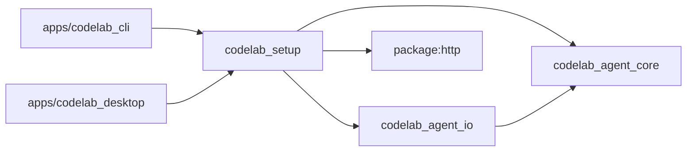

# codelab_setup

Мост настроек Dart-агента для клиентов. Клиентам (`apps/codelab_desktop`, `apps/codelab_cli`) нельзя импортировать `package:codelab_agent_*`, а настройки агента нужны обоим: читать и записывать конфигурацию, ключи провайдеров, MCP-серверы, показывать их в интерфейсе. Пакет отдаёт им это в одном месте, чтобы приложение и терминал вели себя одинаково.

## Место в архитектуре

Пакет не относится ни к стороне `client`, ни к `agent`: это мост между сторонами, поэтому в имени нет префикса `codelab_agent_` (ADR-0002, [`AGENTS.md`](../../../AGENTS.md) §5). Чистый Dart, Flutter не нужен. Основной барель `codelab_setup.dart` web-безопасен; барель `io.dart` использует `dart:io` через `codelab_agent_io`.

Схема показывает, кто использует пакет и от чего он зависит (по `pubspec.yaml` пакетов).



- Приложения зависят от моста, а не от `codelab_agent_core` и `codelab_agent_io`. Список допустимых зависимостей моста фиксирует сторож (`melos run guard`); новую зависимость добавляет только OpenSpec change.
- Основной барель не импортирует `codelab_agent_io`. Только `lib/io.dart` и `lib/src/io/` знают про IO-пакет агента.
- Агента во встроенном режиме клиенты получают другим мостом — `codelab_embedded`. Не путайте: `codelab_setup` про настройки, `codelab_embedded` про запуск агента.

Подробнее о составе моста — [`12-4-first-run-and-settings.md`](../../../docs/architecture/proposals/dart-agent-and-clients/12-4-first-run-and-settings.md) §12.4.2.

## Что внутри

Публичное API экспортируют два бареля.

### `lib/codelab_setup.dart` — основной, web-безопасный

| Часть | Для чего |
|---|---|
| Реэкспорт типов ядра (`ConfigLayer`, `ConfigTarget`, `ConfigSnapshot`, `ConfigEdit`, `SetValue`, `UnsetValue`, `RemoveTable`, `UpsertMcpServer`, `RemoveMcpServer`, `ConfigIssue`, `ConfigLoadResult`, `SecretNames`, `SettingsRegistry`, `CancelToken` и др.) | чистые типы конфигурации; точный список — оператор `export … show` в бареле |
| `resolveSettingsAccess`, `SettingsAccess` (`EditableSettings`, `RemoteReadOnly`, `NotManaged`) | чьи настройки читать и куда писать; цели записи — `user` и `projectLocal` |
| `AgentConfigStore`, `AgentConfigSnapshot`, `ConfigSaveOutcome` | порт чтения и записи конфига агента; снимок слоёв и проблем загрузки; исходы записи |
| `providerEntriesOf`, `mcpServerEntriesOf`, `settingFieldsOf`, `sessionDefaultsOf`, `agentDefinitionRowsOf` | модели представления для страниц настроек и `/settings`; значения секретов не раскрываются |
| `SettingEditRefusal` (`UnknownSetting`, `TrustBoundarySetting`, `SecretSetting`, `ExternalSourceSetting`, `MaskedSetting`), `settingKeyEditRefusalOf`, `settingEditRefusalOf` | почему строку настроек нельзя править из клиента; `null` — править можно. Значений в причинах нет, тексты — дело клиента |
| `ProviderCheck`, `HttpProviderCheck` | проверка адреса провайдера запросом `/models` на переданном `http.Client` |
| `ProviderSetupFlow`, `ProviderPresets`, `ProviderSetupPlan`, `ProviderSetupCommitter`, `ProviderKeys` | мастер подключения провайдера: автомат, пресеты, запись «секрет, затем конфиг» с откатом. Для клиентов с переводом состояния несут `ProviderSetupErrorCode? errorCode` рядом с текстом `error` (`EnteringBaseUrl`, `ChoosingKey`, `EnteringModelDetails`, `Reviewing`), `literalKeyInConfig` (правится провайдер с литеральным ключом в конфиге) и `notVerified` (вид пропущенной проверки: `unreachable`, `timeout`). Поля аддитивны: CLI по-прежнему печатает `error`; тексты хранилища секретов (`keyNotStored`, подсказка бэкенда) передаются как есть |
| `ProviderRemover` | удаление провайдера одной записью конфига; секрет удаляется только после успешной записи |
| `providerSetupNeeded`, `checkProviderReadiness` | признак «провайдера нет» и готовность модели и ключа к ходу |
| `McpServerDraft`, `McpServerCommitter`, `McpServerRemover` | форма, запись и удаление MCP-серверов |
| `McpDraftProblem`, `McpDraftProblemCode`, `McpDraftProblem.of` | проблема черновика сервера: поле `code` (одиннадцать кодов: `nameInvalid`, `renameNotAllowed`, `nameTaken`, `commandEmpty`, `urlInvalid`, `urlHasUserinfo`, `keyHasSpaces`, `keyDuplicate`, `keyEmpty`, `secretValueEmpty`, `secretNameCollision`) и `argument` — имя ключа, он есть только у `keyHasSpaces`, `keyDuplicate`, `secretValueEmpty` и `secretNameCollision`. Приложение строит по коду текст на своём языке; `message` остаётся прежним английским текстом для CLI. Код и текст создаёт одна фабрика `McpDraftProblem.of`, `validate()` строит проблемы через неё; конструктор оставлен для проблем чужого источника (`code == null`). Значений URL, секретов и заголовков нет ни в `argument`, ни в `message` |
| `restartRequiredServers`, `restartRequiredProviders` | какие изменения агент применит только после перезапуска |
| `agentExtensionsOf`, `skillsListEdit` | вид расширений агента (цепочка `AGENTS.md`, навыки, шаблоны команд) и правило записи списков навыков. Для перевода подписей вид навыков несёт `SkillEntryView.overridesScope` (область перекрытого навыка; `null` — перекрытий нет или перекрыт навык той же области) и `SkillRootView.extraEntry` (элемент `skills.extra_roots` как записан у корня `extra`, иначе `null`); `overridesLabel` и `label` остаются прежним английским текстом для CLI |
| `SecretValue` | значение секрета: `toString()` и JSON дают `***`, значение — только через `reveal()` |
| `displayBaseUrl` | адрес провайдера без userinfo, query и fragment |

### `lib/io.dart` — только `dart:io`

| Часть | Для чего |
|---|---|
| `ConfigCommands` (`check`, `path`, `get`, `set`, `unset`), `CheckOptions`, `ConfigCommandResult` | общие подкоманды `config`: `codelab config check` печатает то же, что `codelab-agent config check` |
| `configValidExit` (0), `configInvalidExit` (1), `configUsageExit` (64) | коды выхода `config check` |
| `ProviderCommands`, `McpServerCommands` и их опции | подкоманды `provider` и `mcp` (`add`, `list`, `remove`) |
| `SecretCommands`, `StdinSecretInput`, `SecretAdmin`, `SecretMigrator`, `openSecretStore` и результаты | подкоманда `secret` (`set`, `delete`, `list`, `migrate`) и доступ страницы настроек к хранилищу секретов |
| `ClientSecretAccess`, `secretReadOnlyHint` | клиентский доступ к секретам: выбор бэкенда по `secrets.backend`, чтение без кэша |
| `FileAgentConfigStore` | файловая реализация порта `AgentConfigStore` |
| `ioProviderCheck()` | `ProviderCheck` на `IOClient`; единственное место, где создаётся `IOClient` |
| `providerKeysOf`, `secretDeleterOf` | реализации портов `ProviderKeys` и `SecretDeleter` |
| `readAgentExtensions`, `agentDefinitionRowsAt` | чтение файлов проекта, навыков и определений агентов с диска |

Логика подкоманд и секретов живёт в `codelab_agent_io` ([README](../codelab_agent_io/README.md)), здесь её нет. Классы `EnvSecretStore`, `FileSecretStore` и функция `openHostSecrets` намеренно не экспортируются: они принадлежат хосту агента.

## Кто может импортировать `io.dart`

`package:codelab_setup/io.dart` импортирует только composition root клиента. Это проверяет сторож (`melos run guard`, правила в `packages/dart/codelab_architecture_tests/test/support/rules.dart`):

| Клиент | Где разрешён `io.dart` |
|---|---|
| `apps/codelab_cli` | только `lib/src/run.dart`; остальной код CLI получает нужное через порты |
| `apps/codelab_desktop` | только `lib/app/`; в `lib/features/settings/presentation` запрещён вместе с `dart:io` |

Основной барель импортируется свободно.

## Как использовать

Минимальный пример: проверка конфигурации, как в `codelab config check`. Вызывается из composition root.

```dart
import 'dart:io';

import 'package:codelab_setup/io.dart';

Future<int> checkConfig() async {
  final result = await ConfigCommands().check(
    CheckOptions(cwd: Directory.current.path, environment: Platform.environment),
  );
  result.stdout.forEach(stdout.writeln);
  result.stderr.forEach(stderr.writeln);
  return result.exitCode; // 0, 1 или 64
}
```

Страницы настроек работают через порт: composition root создаёт `FileAgentConfigStore(paths: …, environment: …, secrets: …)`, а Cubit-ы и виджеты получают порт `AgentConfigStore` и строят виды функциями основного бареля.

Расположение конфигурации, секретов и журналов описывают [`docs/ops/codelab-home.md`](../../../docs/ops/codelab-home.md) и [`docs/user/configuration.md`](../../../docs/user/configuration.md); коды выхода и окружение терминального клиента — [`apps/codelab_cli/doc/operations.md`](../../../apps/codelab_cli/doc/operations.md).

## Тесты

```bash
cd packages/dart/codelab_setup
fvm dart test
```

Тесты логики моста идут на временных каталогах и фиктивных значениях, без `~/.codelab`, хранилища ОС и внешней сети. Проверка основного бареля как web-безопасного — из корня репозитория:

```bash
melos run web-compile
```

Скрипт собирает `test/web_smoke/main.dart` в JS и Wasm. Границы импортов проверяет `melos run guard`. Тесты самих подкоманд `config`, `provider`, `mcp` и `secret` лежат в `codelab_agent_io`; здесь только проверка, что реэкспорты компилируются (`test/*_exports_test.dart`).

## Правила пакета

Правила для изменений — в [`AGENTS.md`](AGENTS.md). Главное: основной барель не импортирует `dart:io` и `codelab_agent_io`; `http` — только `package:http/http.dart` (`IOClient` создаёт `io.dart`); значения секретов не попадают в виды и `toString()`.

## Смотрите также

- [`codelab_agent_core`](../codelab_agent_core/README.md) — ядро агента, источник реэкспортируемых типов.
- [`codelab_agent_io`](../codelab_agent_io/README.md) — реализация подкоманд и хранилищ секретов.
- [`docs/architecture/layers-and-dependencies.md`](../../../docs/architecture/layers-and-dependencies.md) — слои и границы.
- [`openspec/specs/client-agent-setup`](../../../openspec/specs/client-agent-setup) и [`openspec/specs/agent-configuration`](../../../openspec/specs/agent-configuration) — спецификации.
