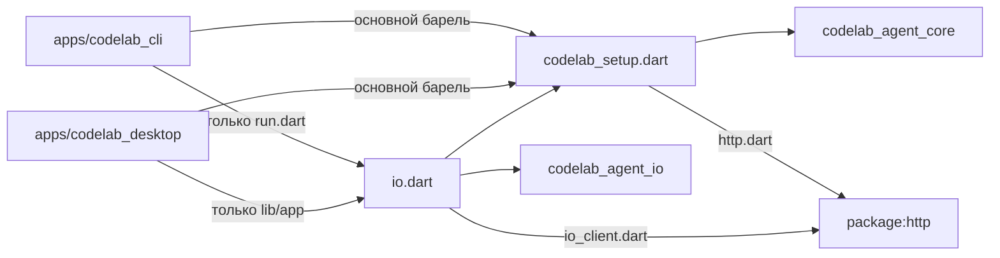
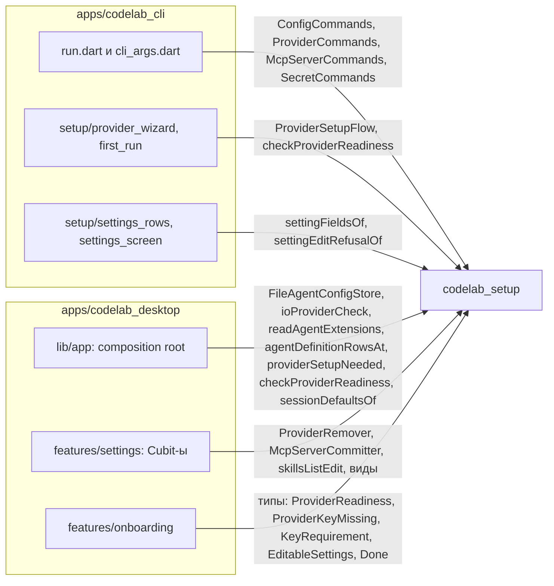

# Обзор пакета

Глава объясняет, что на самом деле находится в `codelab_setup`, почему пакет вырос до девяти тысяч строк и кто его использует. Прочитав её, вы поймёте границы пакета и найдёте нужную подсистему на карте модулей.

## Почему пакет такой большой

Корневой `AGENTS.md` называет `codelab_setup` «мостом настроек»: реэкспорт типов конфигурации ядра и общие подкоманды `config` в `lib/io.dart`. Так пакет и начинался (change `add-agent-configuration`). С тех пор он вырос: все клиенты агента — десктопное приложение и терминал — получили экраны настройки, а клиентам нельзя импортировать `package:codelab_agent_*` (`AGENTS.md` §5). Всё, что экраны знают о настройке агента, пришлось положить в мост, иначе приложение и терминал написали бы это дважды (инвариант SETUP-8 спецификации `client-agent-setup`).

Сегодня пакет состоит из пяти подсистем и тонкого слоя реэкспорта. Реэкспорт и подкоманды — самая маленькая часть.

| Слой | Что это | Строк в `lib/src/` |
|---|---|---|
| Доступ и конфиг | чьи настройки правит клиент, порт `AgentConfigStore`, снимок слоёв и источники ключей, файловая реализация | `access/`, `config/`, `io/file_agent_config_store.dart`: около 1000 |
| Мастер провайдера | автомат шагов, пресеты, проверка `/models`, запись «секрет, затем конфиг», удаление, готовность | `provider/`: 3149 |
| MCP-серверы | черновик формы, запись, удаление, очистка секретов, перезапуск | `mcp/`: 1611 |
| Расширения агента | вид навыков, цепочки `AGENTS.md`, шаблонов; правило записи списков навыков; таблица определений агентов | `extensions/`, `io/agent_*`, `io/extensions_host_paths.dart`: около 1600 |
| Представления | строки для списков и таблиц: провайдеры, настройки, режимы, MCP, определения | `views/`: 1351 |
| Реэкспорт и подкоманды | `lib/codelab_setup.dart` и `lib/io.dart` | 252 |

Эти слои не случайны. Каждый закрывает один вопрос экрана настроек: «чьё это», «что записать», «как записать безопасно», «что показать». Логику секретов, подкоманд `config`, `provider`, `mcp`, `secret` и загрузку конфигурации пакет не содержит — она остаётся в `codelab_agent_io` и ядре ([README `codelab_agent_io`](../../codelab_agent_io/README.md), [конфигурация ядра](../../codelab_agent_core/doc/09-config-prompts-commands.md)). Мост вызывает её и переводит исходы в типы, удобные клиентам.

> Размер не означает, что пакет делает «всё». Он не хранит состояние экрана: Cubit-ы приложения и команды терминала владеют состоянием, а пакет отдаёт им чистые функции, автоматы и порты.

## Карта модулей

Таблица перечисляет подкаталоги `lib/src/`. В колонке «экспорт» указано, где подсистему видят клиенты: `main` — `lib/codelab_setup.dart`, `io` — `lib/io.dart`, `—` — внутренняя.

| Каталог / файл | Что внутри | Экспорт | Глава |
|---|---|---|---|
| `access/settings_access.dart` | `SettingsAccess` (`EditableSettings`, `RemoteReadOnly`, `NotManaged`), `ConfigPaths`, `AgentLaunchKind`, `resolveSettingsAccess` | main | [02](02-config-store.md) |
| `config/agent_config_store.dart` | порт `AgentConfigStore`, `AgentConfigSnapshot`, исходы записи `ConfigSaved`, `ConfigConflict`, `ConfigRejected`, `ConfigInlineSecret`, `isIgnoredByTrust` | main | [02](02-config-store.md) |
| `config/config_source_view.dart` | `ConfigSourceView`, `ConfigSourceKind` | main | [02](02-config-store.md) |
| `config/config_values.dart`, `project_trust.dart`, `secret_references.dart`, `display_base_url.dart` | плоские листья и их сравнение, доверие проекта, поиск ссылок на секрет, адрес без userinfo | main только у `display_base_url`, остальное внутреннее | [02](02-config-store.md) |
| `secret/secret_value.dart` | `SecretValue` | main | [03](03-provider-wizard.md) |
| `provider/` | мастер (`ProviderSetupFlow`, состояния, события, план), пресеты, порт `ProviderCheck` и `HttpProviderCheck`, порт `ProviderKeys`, `ProviderSetupCommitter`, `ProviderRemover`, готовность | main | [03](03-provider-wizard.md) |
| `mcp/` | `McpServerDraft`, `McpServerCommitter`, `McpServerRemover`, `restartRequiredServers` и `restartRequiredProviders`; внутри — `mcp_layers`, `mcp_masking`, `mcp_secret_cleanup` | main (внутренние файлы — нет) | [04](04-mcp-servers.md) |
| `extensions/` | `AgentExtensionsView` и её части, `agentExtensionsOf`, `skillsListEdit` | main | [05](05-agent-extensions.md) |
| `views/` | `ProviderEntryView`, `KeyStatusView`, `McpServerEntryView`, `SettingFieldView`, правила правки строк, `SessionDefaultsView`, `AgentDefinitionRowView` | main | [06](06-views.md) |
| `io/` | `FileAgentConfigStore`, `ioProviderCheck`, `providerKeysOf`, `secretDeleterOf`, `readAgentExtensions`, `agentDefinitionRowsAt`, перевод путей | io | [02](02-config-store.md), [03](03-provider-wizard.md), [05](05-agent-extensions.md) |

Не все публичные функции вида (`providerIdsOf`, `modelsOf`, `providerString`) экспортируются барелем: `lib/codelab_setup.dart` открывает у `provider_entry_view.dart` только `ProviderEntryView` и `providerEntriesOf`, а у `agent_definition_row_view.dart` — `AgentDefinitionRowView`, `AgentRowScope`, `AgentRowStatus` и `agentDefinitionRowsOf`. Остальное — внутренняя помощь файлов пакета.

## Два барелья и граница web-безопасности

Пакет отдаёт API двумя файлами.

- **`package:codelab_setup/codelab_setup.dart`** — основной барель. Это чистый Dart: он не импортирует `dart:io`, `package:codelab_agent_io/` и `package:http/io_client.dart`. Его собирают в JS и Wasm (`melos run web-compile`, точка входа `test/web_smoke/main.dart`). Он содержит всю логику: автоматы, правила, виды, порты.
- **`package:codelab_setup/io.dart`** — IO-барель. Он содержит реализации портов на `dart:io` (`FileAgentConfigStore`, `ioProviderCheck()`, `providerKeysOf`, `secretDeleterOf`, `readAgentExtensions`, `agentDefinitionRowsAt`) и реэкспорт подкоманд и секретов из `codelab_agent_io`.

Идея разделения такая: логика в основном бареле, а всё, что трогает диск и сеть, — адаптеры в `io.dart`. Так мастер и виды тестируются на фейках и работают в вебе, а нужный `dart:io` подставляет composition root клиента. Пример: основной барель проверяет `/models` поверх абстрактного `http.Client`, а `IOClient` создаёт только `ioProviderCheck()`.

На схеме показано, кто что импортирует. Стрелка «io → main» означает, что файлы `lib/src/io/` используют код основного барелья.

Границы закреплены в двух местах. Правила для людей — раздел «Границы» в [`AGENTS.md`](../AGENTS.md) пакета. Правила для машины — `packages/dart/codelab_architecture_tests/test/support/rules.dart` (сторож) и `pubspec_allowlist_test.dart`:

| Правило | Что проверяет сторож |
|---|---|
| Вне `lib/io.dart` и `lib/src/io/` нет `dart:io`, `dart:isolate`, `dart:ffi`, `package:flutter/`, `package:codelab_agent_io/`, `package:codelab_acp_*`, `package:codelab_client_*` | основной барель остаётся web-безопасным |
| `package:http/io_client.dart` и `browser_client.dart` разрешены только в `io.dart` и `src/io/` | `IOClient` создаётся в одном месте |
| В `dependencies` только `codelab_agent_core`, `codelab_agent_io`, `http`, `meta` (`setupAllowlist`) | новая зависимость требует OpenSpec change |
| `apps/codelab_desktop/lib`: `io.dart` только из `lib/app/`; `features/settings/presentation` не импортирует ни `io.dart`, ни `dart:io` | Cubit-ы и виджеты получают порты, а не файлы |

## Кто использует пакет

Пакет подключают два приложения: `apps/codelab_cli` и `apps/codelab_desktop` (их `pubspec.yaml`). Другие пакеты его не используют. Потребители берут из него разное.

Что берёт каждый потребитель (по `grep` исходников клиентов):

| Возможность моста | Терминал `codelab` | Приложение |
|---|---|---|
| подкоманды `config`, `provider`, `mcp`, `secret` | `lib/src/run.dart`, `cli_args.dart`, `setup/setup_commands.dart` | не использует |
| `resolveSettingsAccess` | `setup/settings_access.dart`, `setup/settings_screen.dart`, `run.dart` | `lib/app/*`, Cubit-ы страниц настроек |
| `FileAgentConfigStore`, `ioProviderCheck()` | `run.dart`, `setup/setup_commands.dart` | `lib/app/provider_settings_session.dart`, `provider_setup_probe.dart`, `onboarding_probe.dart` |
| `ProviderSetupFlow` | `setup/provider_wizard.dart`, `first_run.dart`, `provider_add_flags.dart`, экраны TUI | `provider_wizard_cubit.dart` |
| `checkProviderReadiness`, `providerSetupNeeded` | `setup/first_run.dart` | баннер «Add provider», `onboarding_probe.dart` |
| `settingFieldsOf`, `settingEditRefusalOf` | `/settings`: `setup/settings_rows.dart` | страница «General»: `agent_defaults_cubit.dart` |
| `ProviderRemover`, `providerEntriesOf` | не использует | `provider_settings_cubit.dart` |
| MCP: `McpServerDraft`, `McpServerCommitter`, `McpServerRemover`, `mcpServerEntriesOf`, `restartRequiredServers` | не использует | `mcp_settings_cubit.dart`, `mcp_page.dart` |
| `readAgentExtensions`, `skillsListEdit` | не использует | `skills_settings_cubit.dart` |
| `agentDefinitionRowsAt`, `sessionDefaultsOf` | не использует | `agents_modes_cubit.dart`, `agent_definitions_loader.dart` |

Терминал использует мастер, готовность, строки `/settings` и подкоманды. Приложение использует всё остальное — страницы Providers, MCP servers, Skills, Agents & modes, General. Поэтому большая часть пакета нужна именно приложению; терминал добавил к ней немного.

## Инварианты, на которых держится пакет

Пакет несёт несколько обязательных правил. Они записаны в спецификации [`client-agent-setup`](../../../../openspec/specs/client-agent-setup/spec.md) и в комментариях кода под именами `SETUP-n`. Вы встретите их в тестах и сообщениях.

| Инвариант | Смысл | Где живёт |
|---|---|---|
| SETUP-1 | значение секрета не попадает в `toString()`, JSON, журнал, состояние и сообщения об ошибках | `SecretValue`, все виды |
| SETUP-3 | клиент пишет только слои `user` и `projectLocal`; слой `project` и файл `--config` — только чтение | `EditableSettings.targets`, `ConfigSourceView.editable` |
| SETUP-4 | пропуск проверки `/models` только для `unreachable` и `timeout`, после подтверждения, с пометкой «Not verified» | `ProviderSetupFlow` |
| SETUP-5 | существующий секрет не перезаписывается без явного «Replace it»; порядок записи «секрет, затем конфиг» | `ProviderSetupCommitter` |
| SETUP-6 | конфликт записи не повторяется автоматически; снимок перечитывается, решает пользователь | `FileAgentConfigStore.apply` |
| SETUP-8 | клиент не пересобирает логику моста у себя | весь пакет |
| SETUP-10, SETUP-23 | проверка `/models` идёт только на введённый адрес, без редиректов, ключ только в заголовке | `HttpProviderCheck` |
| SETUP-24 | секрет удаляется после успешной записи и только если на него нет ссылок | `ProviderRemover`, `McpServerRemover` |
| SETUP-25 | в видах расширений нет текстов `AGENTS.md`, тел навыков и шаблонов | `AgentExtensionsView` |

## Словарь

| Термин | Значение |
|---|---|
| Слой конфигурации | один из файлов конфигурации: `user` (`$CODELAB_HOME/config.yaml`), `project` (`<проект>/.codelab/config.yaml`), `projectLocal` (`<проект>/.codelab/config.local.yaml`). Подробно — [конфигурация ядра](../../codelab_agent_core/doc/09-config-prompts-commands.md) |
| Снимок (`AgentConfigSnapshot`) | прочитанные слои, итог загрузки, источник каждого ключа и описание хранилища секретов, взятые одним вызовом |
| Лист | конечное значение в дереве конфига с путём вида `providers.gw.base_url` |
| Источник (`ConfigSourceView`) | откуда пришло итоговое значение ключа: слой, `--config` или окружение |
| Порт | интерфейс, который пакет вызывает, а реализует composition root или тест: `AgentConfigStore`, `ProviderCheck`, `ProviderKeys`, `SecretDeleter` |
| Composition root | место в клиенте, где собираются реализации портов; для терминала `lib/src/run.dart`, для приложения `lib/app/` |
| Вид (view) | неизменяемый объект для показа в интерфейсе без значений секретов: `ProviderEntryView`, `SettingFieldView` и др. |
| Fail-closed | при недостатке данных выбирается безопасный вариант: проект недоверенный, слой нечитаемый, секрет не удаляется |
| Пространство секретов страницы | имена `codelab/<id>` для ключа провайдера и `codelab/mcp/<имя>/…` для значений MCP-сервера; только их мост считает «своими» и удаляет |

## Где что описано

| Если нужно | Читайте |
|---|---|
| выбор слоёв и записи, сам файл конфига | [02. Хранилище конфигурации](02-config-store.md) |
| пошаговое добавление провайдера | [03. Мастер провайдера](03-provider-wizard.md) |
| серверы MCP | [04. MCP-серверы](04-mcp-servers.md) |
| навыки, шаблоны, определения агентов | [05. Расширения агента](05-agent-extensions.md) |
| модели показа | [06. Представления](06-views.md) |
