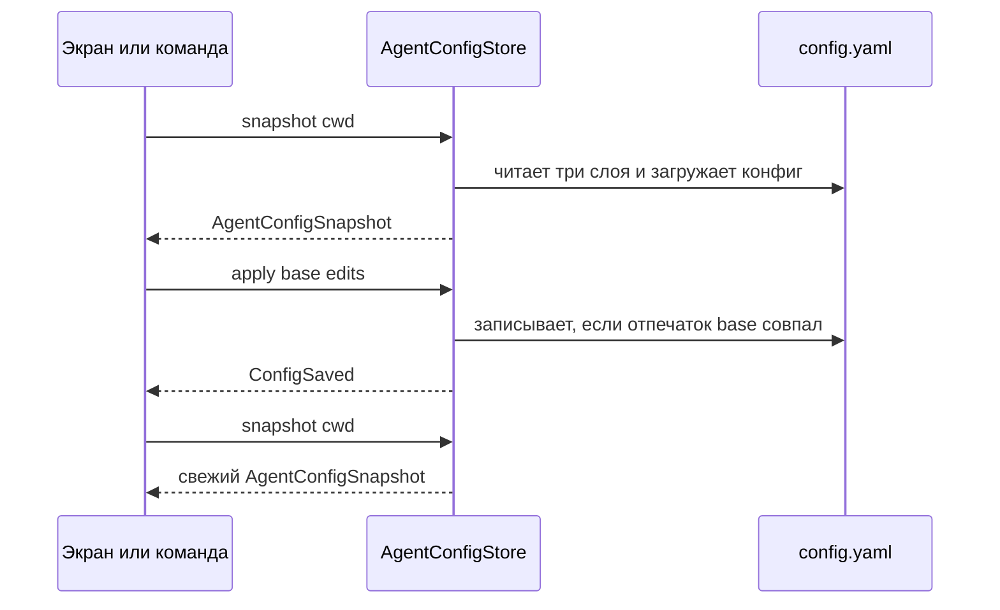

# Хранилище конфигурации агента

Глава описывает основу всех страниц настроек: кто и что вправе править (`SettingsAccess`), как выглядит снимок конфига (`AgentConfigSnapshot`), как клиент пишет файл (порт `AgentConfigStore` и `FileAgentConfigStore`) и что значат исходы записи. Семантику самих слоёв конфигурации, слияние и доверие проекта эта глава не повторяет — их описывает [конфигурация ядра](../../codelab_agent_core/doc/09-config-prompts-commands.md).

## Общая картина

Клиентский экран всегда делает одно и то же:

1. Узнаёт, чьи настройки можно править (`resolveSettingsAccess`).
2. Берёт снимок (`AgentConfigStore.snapshot`).
3. Строит из снимка вид (`providerEntriesOf`, `settingFieldsOf` и др. — [глава 06](06-views.md)).
4. По действию пользователя собирает правки и пишет их в слой снимка (`AgentConfigStore.apply`).
5. После записи или конфликта берёт снимок заново.

Чтобы обновить снимок после записи, клиент вызывает `snapshot` снова: слежения за файлом нет.



## Чьи настройки: `resolveSettingsAccess`

Файл `lib/src/access/settings_access.dart`. Клиент может править конфиг только того агента, который читает те же файлы. Функция `resolveSettingsAccess` решает по профилю подключения и возвращает запечатанный `SettingsAccess`:

| Профиль | Результат | Что это значит |
|---|---|---|
| `AgentLaunchKind.embedded` | `EditableSettings` с `codelabHome` приложения (`defaultCodelabHome`) | встроенный агент читает те же файлы, что клиент |
| `AgentLaunchKind.stdio`, команда `codelab-agent` (по базовому имени, без `.exe`) | `EditableSettings`; дом — `CODELAB_HOME` из `env` профиля, иначе `defaultCodelabHome`; файл `--config` из аргументов или `CODELAB_CONFIG` — `extraConfig` (только чтение) | локальный процесс нашего агента |
| `AgentLaunchKind.stdio`, другая команда или `agentName` из `initialize` не `codelab-agent` | `NotManaged(agentName ?? base ?? 'unknown')`: имя из `initialize`, иначе базовое имя команды | чужой агент: его конфигурация не наша |
| `AgentLaunchKind.webSocket` | `RemoteReadOnly(endpoint)`; без `endpoint` — `ArgumentError.notNull('endpoint')` | конфиг на чужой машине |

Команда решает, чей это конфиг; самоназвание из `initialize` только опровергает (чужой агент под нашей командой), но не доказывает.

Пример, проверенный запуском: команда `/opt/bin/codelab-agent.exe`, аргументы `serve --stdio --config=/x/c.yaml`, `CODELAB_HOME=/h2` в `env` профиля и папка проекта `/p`. Функция вернула `EditableSettings` с `codelabHome` `/h2`, `extraConfig` `/x/c.yaml` и целями записи `ConfigTarget(user)` и `ConfigTarget(projectLocal, /p)`.

Для команды `zed` с `agentName: 'zed'` результат — `NotManaged`.

### Цели записи

`EditableSettings.targets` — единственный источник целей записи (SETUP-3): `ConfigTarget.user()` и, если известна папка проекта, `ConfigTarget.projectLocal(cwd)`. Слой `project` и файл `--config` клиент не пишет. Не придумывайте цель сами: передавайте в `apply` слой, выбранный из `targets`.

### Данные без путей

`ConfigPaths` хранит `codelabHome`, `projectDir`, `extraConfig` и не вычисляет пути к файлам. Файлы `config.yaml` и `config.local.yaml` находит писатель `ConfigWriter` из `codelab_agent_io` (канонизация ссылок, `dart:io`). Поэтому `SettingsAccess` остаётся web-безопасным.

## Снимок: `AgentConfigSnapshot`

Файл `lib/src/config/agent_config_store.dart`. Странице нужно сразу много: слои как основа записи, итог загрузки с проблемами, источник каждого ключа, описание хранилища секретов. Собирать их из разных вызовов значило бы показывать состояние, которого не было ни в один момент. Поэтому снимок — один объект:

| Поле | Что внутри |
|---|---|
| `cwd` | папка проекта, для которой прочитаны проектные слои |
| `layers` | `Map<ConfigLayer, ConfigSnapshot>`: только читаемые слои. Слой с битым YAML в карте отсутствует (`isReadable(layer) == false`) |
| `loaded` | `ConfigLoadResult` ядра: `config`, `values` (листья), `issues`, `warnings`, `sources` |
| `origins` | `Map<String, ConfigSourceView>`: источник каждого листа |
| `secrets` | `SecretBackendInfo` (бэкенд секретов) для строки «Key storage» |
| `leaves` | эффективные листья: `loaded.values`, а при проблемах загрузки — слияние читаемых слоёв |

В каждом слое лежит отпечаток файла (`ConfigSnapshot.fingerprint`). Запись защищена им: если файл изменился после чтения, `apply` вернёт конфликт.

### Три списка проблем

Загрузчик ядра возвращает `loaded.issues`. Снимок делит их на три представления, и клиент выбирает нужное.

| Геттер | Что содержит | Что делает страница |
|---|---|---|
| `issues` | проблемы, из-за которых конфиг нельзя прочитать и править: синтаксис, тип и значение существующих ключей, неизвестные ключи | показывает ошибку загрузчика и не пишет файл |
| `startProblems` | проблемы запуска из-за **отсутствия** ключа (`agent.default_model: required` на новой установке) | показывает пустое состояние: файл читается, мастер создаст недостающее |
| `rejections` | то, что агент **отклонит**: виды `value`, `semantic`, `inlineSecret` из `issues` плюс стартовые проблемы с событием `unsetVariable` (незаданная `${VAR}`) | страница MCP показывает «агент отклонил конфиг» и не блокирует запись |

Различие между `issues` и `startProblems` — по структуре, а не по тексту: проблема «нужен ключ» имеет вид `value`, как и «неверное значение», и отличается лишь тем, что ключа нет ни в одном применённом слое (`_isMissingKey`). Источники `env`, `flags`, `app-storage`, а также файл `--config` считаются внешними: ключ там есть, значит, проблема — в значении, а не в отсутствии. Путь `--config` для этого сравнивается в двух формах: как передан и с раскрытыми ссылками (`_pathForms`, `resolveSymbolicLinksSync`) — загрузчик может назвать файл любым из них; при несовпадении неверное значение внешнего ключа сошло бы за «ключ отсутствует».

### Откуда берётся источник ключа

`AgentConfigSnapshot.fromLayers` определяет источник листа по значениям, а не по файлам:

1. Слои перебираются от самого приоритетного (`projectLocal`) к `user`.
2. Источником становится первый слой, чей лист **равен** итоговому значению (`sameConfigValue`).
3. Слой недоверенного проекта пропускается: загрузчик его значения не применил и приписывать ему источник нельзя (`isIgnoredByTrust` по предупреждению `config.project.untrusted_key`).
4. Если ни один файл не совпал, источник спрашивается у функции `externalOrigin` (файл `--config` или окружение).

Особый случай: ключи, которые недоверенный проект не заменяет, а объединяет с нижними слоями (сейчас только `skills.disabled`, константа `mergedByUntrustedProject` в `project_trust.dart`). Для них источник ищется по значениям без проектных слоёв — иначе объединение, совпавшее со списком проекта, дало бы источником проект. Константа повторяет знание ядра (`trust.dart`); при новом объединяемом ключе её пополняют или переносят в ядро.

Тип источника — `ConfigSourceKind`:

| Вид | Файл или переменные | `editable` |
|---|---|---|
| `user` | `$CODELAB_HOME/config.yaml` | да |
| `project` | `<проект>/.codelab/config.yaml` | нет |
| `projectLocal` | `<проект>/.codelab/config.local.yaml` | да |
| `extraFile` | `--config` или `CODELAB_CONFIG` | нет |
| `environment` | переменные `CODELAB_*` | нет |

`ConfigSourceView.label` — путь файла или `env`. Значений в нём нет.

## Порт `AgentConfigStore`

```dart
abstract interface class AgentConfigStore {
  Future<AgentConfigSnapshot> snapshot({required String cwd});
  Future<ConfigSaveOutcome> apply(ConfigSnapshot base, List<ConfigEdit> edits);
}
```

`snapshot` вызывают при открытии страницы, после своей записи и после конфликта. `apply` пишет `edits` в слой `base` одним вызовом; `base` берут из `snapshot.layers`. Правки — типы ядра `SetValue`, `UnsetValue`, `RemoveTable`, `UpsertMcpServer`, `RemoveMcpServer` (реэкспортируются основным барелем). Всё, что нужно записать «вместе или никак», кладут в один `apply`: провайдер вместе с моделью по умолчанию, например.

В тестах порт заменяют фейком: `FakeConfigStore` из `test/support/provider_setup_fakes.dart` пишет вызовы в журнал и отдаёт заданный исход.

## Исходы записи

`ConfigSaveOutcome` — запечатанная иерархия. Страницы разбирают её через `switch` без `default`.

| Исход | Когда | Что делает клиент |
|---|---|---|
| `ConfigSaved(fingerprint, warnings, restartRequiredKeys)` | записано | берёт новый снимок; если `restartRequiredKeys` не пуст — подсказывает перезапуск агента |
| `ConfigConflict(path)` | файл изменился после чтения или занят другим писателем | сохраняет черновик, перечитывает снимок, **не** повторяет запись сам (SETUP-6) |
| `ConfigRejected(issues)` | валидатор ядра отклонил правку; файл не изменён | показывает проблемы |
| `ConfigInlineSecret(key, suggestedSecretName)` | в правке секрет значением (CFG-2) | предлагает сохранить значение как секрет под `suggestedSecretName` |

Поле `key` у `ConfigInlineSecret` — путь ключа; самого значения в исходе нет.

Настоящий прогон на временном `CODELAB_HOME` (значения `agent.effort` выбраны для примера, путь в выводе заменён на `<home>`): после внешней правки файла запись по старому слою даёт конфликт, а по свежему — успех; неверное значение отклоняется валидатором.

```text
apply after external change: ConfigConflict(<home>/config.yaml)
apply on fresh base: ConfigSaved
bad value: ConfigRejected(1) [value:agent.effort]
```

## Файловая реализация: `FileAgentConfigStore`

Файл `lib/src/io/file_agent_config_store.dart`, экспорт — `lib/io.dart`. Класс собирает `ConfigWriter` и `ConfigLoader` из `codelab_agent_io`. Блокировку, отпечаток, атомарную замену и сохранение комментариев держит `ConfigWriter`; здесь только сборка и перевод исключений.

```dart
final store = FileAgentConfigStore(
  paths: access.paths,
  environment: agentEnvironment,
  secrets: await ClientSecretAccess.open(
    codelabHome: access.paths.codelabHome,
    environment: agentEnvironment,
    logger: logger,
  ),
);
```

Обязательные параметры: `paths`, `environment`, `secrets`. Необязательные — `logger`, `loader`, `clock`, `random` (шов тестов). Без `logger` класс молчит.

### `snapshot`

1. Запоминает `cwd` (нужен писателю при записи в слой `user`: он проверяет проектные слои).
2. Читает три слоя: `user`, `project(cwd)`, `projectLocal(cwd)`. Если слой не разобрался (`ConfigException`), он остаётся вне карты, а в журнал уходит `config.snapshot.layer_unreadable` с полем `layer`.
3. Вызывает `ConfigLoader.load(cwd, environment, extraConfig)` — тот же загрузчик, что у агента. Проверка «агент примет конфиг» совпадает с настоящей загрузкой.
4. Строит снимок через `AgentConfigSnapshot.fromLayers`.

Окружение: `CODELAB_HOME` из `paths` перекрывает окружение клиента. Тот же дом, что у агента — требование согласованности.

Ошибка использования (`ConfigUsageException`: `~user` в `CODELAB_HOME`, `.toml` в `--config`) не вылетает исключением. Она превращается в проблему загрузки с ключом `''` и текстом ошибки, и страница показывает её как `issues`, не пытаясь писать файл.

### Источник внешнего значения

Если лист не найден ни в одном файловом слое, его источник — `--config` или окружение. У итога загрузки нет разбивки по слоям, поэтому `_ExternalOrigins` загружает конфиг ещё раз **без** переменных `CODELAB_*` (кроме `CODELAB_HOME` и `CODELAB_CONFIG`). Совпавший лист пришёл из `--config`, иначе из окружения. Вторая загрузка делается лениво и один раз, только если файл `--config` задан.

### `apply`

Вызывает `ConfigWriter.apply(base, edits)` и переводит исключения в исходы. Порядок важен:

```dart
} on ConfigConflictException catch (error) {
  return ConfigConflict(error.path);
} on ConfigInlineSecretException catch (error) {
  return ConfigInlineSecret(key: error.key, suggestedSecretName: error.suggestedSecretName);
} on ConfigException catch (error) {
  return ConfigRejected(error.issues);
}
```

`ConfigInlineSecretException` — подкласс `ConfigException`, поэтому его ловят раньше: иначе подсказка «сохраните значение как секрет» превратилась бы в общий отказ. Другие исключения не перехватываются: это ошибки программиста.

## Что ещё лежит рядом

- **`SecretValue`** (`lib/src/secret/secret_value.dart`) — обёртка над значением секрета. `toString()` и `toJson()` дают `***`; значение достаётся только `reveal()`. Её используют мастер и MCP-форма.
- **`displayBaseUrl(url)`** (`lib/src/config/display_base_url.dart`) — адрес без userinfo, query и fragment. В `base_url` бывают пароль в userinfo и ключ в query (у Azure OpenAI `api-version` штатный), поэтому на экран и в журнал адрес целиком не выводят. Для пустой строки, адреса без схемы или хоста функция возвращает `null`.
- **`snapshotReferencesSecret`** (`lib/src/config/secret_references.dart`) — внутреннее правило «есть ли в снимке ссылка на секрет»: значение, равное имени, или `${secret:<имя>}` в любой строке. Смотрит все слои, включая недоверенный проект. Лишняя ссылка стоит только неудалённого секрета, пропущенная — удаления нужного. Его используют `ProviderRemover` и `McpServerRemover`.

## Подкоманды `config`, `provider`, `mcp`, `secret` в `io.dart`

`lib/io.dart` реэкспортирует из `codelab_agent_io` подкоманды и их опции, чтобы терминал не импортировал `package:codelab_agent_*`:

| Группа | Что экспортируется |
|---|---|
| `config` | `ConfigCommands` (`check`, `path`, `get`, `set`, `unset`), `CheckOptions`, `ConfigPathOptions`, `ConfigGetOptions`, `ConfigSetOptions`, `ConfigUnsetOptions`, `ConfigGetLayer`, `ConfigCommandResult`, `configValidExit`, `configInvalidExit`, `configUsageExit` |
| `provider`, `mcp` | `ProviderCommands`, `McpServerCommands` и опции `add`, `list`, `remove` |
| `secret` | `SecretCommands`, `SecretInput`, `StdinSecretInput`, `SecretAdmin` и результаты, `SecretMigrator` и пункты отчёта, `openSecretStore`, `ClientSecretAccess`, `secretReadOnlyHint` |

Логика, маскирование вывода и запись живут в `codelab_agent_io`. Здесь проверяется только, что реэкспорт компилируется (`test/*_exports_test.dart`). Подробности — [README `codelab_agent_io`](../../codelab_agent_io/README.md).

Классы `EnvSecretStore`, `FileSecretStore` и функция `openHostSecrets` намеренно не экспортируются: они принадлежат хосту агента. Клиент читает секреты только через `ClientSecretAccess`.

## Смотрите также

- [Мастер провайдера](03-provider-wizard.md) использует порт при записи и откате.
- [Представления](06-views.md) строятся по снимку.
- Расположение конфигурации и секретов для пользователя — [`docs/user/configuration.md`](../../../../docs/user/configuration.md) и [`docs/ops/codelab-home.md`](../../../../docs/ops/codelab-home.md).
- Спецификация — требование «Снимок и запись конфига агента» в [`client-agent-setup`](../../../../openspec/specs/client-agent-setup/spec.md).
