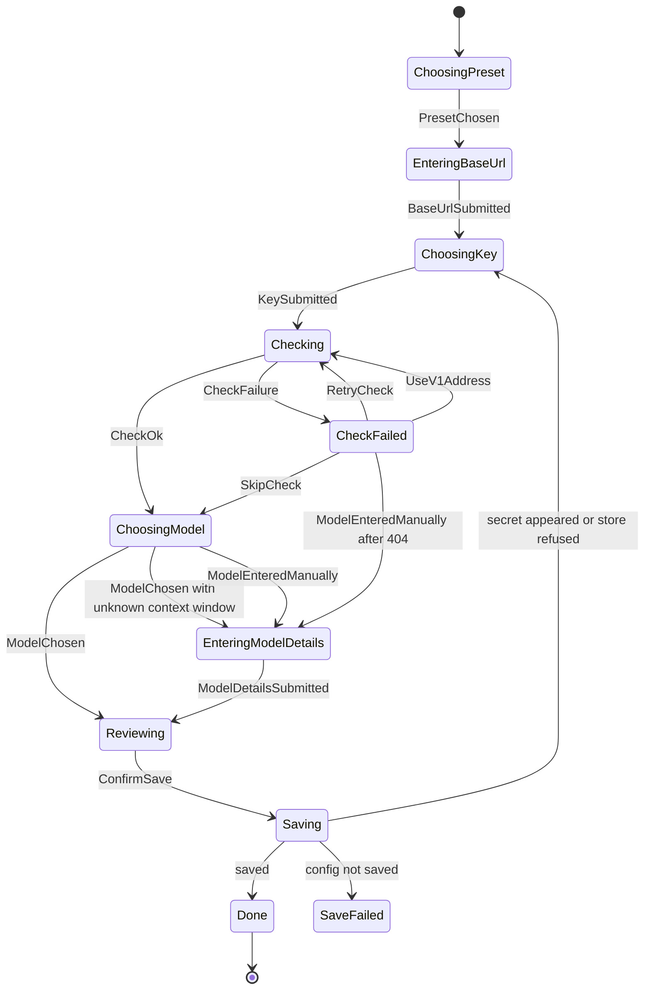
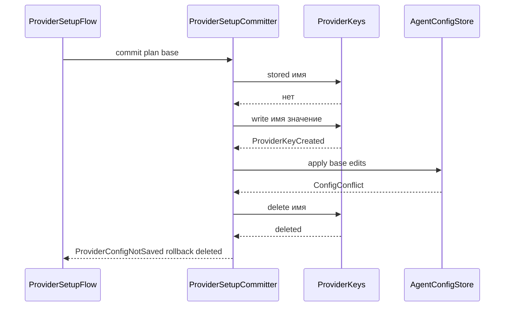

# Мастер настройки провайдера

Глава описывает самую большую подсистему пакета — `lib/src/provider/` (3149 строк): автомат мастера, который ведёт пользователя от выбора пресета до записи провайдера в конфиг. Сюда же относятся проверка списка моделей `/models`, порядок записи «секрет, затем конфиг», удаление провайдера и проверка готовности. Один и тот же автомат работает в терминале и в приложении; клиент лишь посылает события и показывает состояния (SETUP-8).

Мастер хранит значения секретов только в `SecretValue` и пишет их только через порт `ProviderKeys`. Конфигурацию ядра и формат ключей `providers.*` см. в [главе ядра о конфигурации](../../codelab_agent_core/doc/09-config-prompts-commands.md).

## Из чего состоит подсистема

| Файл | Что в нём |
|---|---|
| `provider_setup_flow.dart` | автомат `ProviderSetupFlow`: диспетчер событий, шаги, проверка, запись |
| `provider_setup_state.dart` | состояния, события, `ProviderDraft`, `ProviderSetupErrorCode`, `PlanRefusal`, `ProviderWizardEntry` |
| `provider_setup_plan.dart` | `KeyChoice`, `PlannedModel`, `ProviderSetupPlan.toEdits()` |
| `provider_presets.dart` | таблица пресетов `ProviderPresets.all` |
| `provider_check.dart`, `http_provider_check.dart` | порт `ProviderCheck`, результаты и `HttpProviderCheck` |
| `provider_keys.dart` | порт `ProviderKeys` и исходы записи ключа |
| `provider_setup_committer.dart` | `ProviderSetupCommitter`: секрет, затем конфиг, откат |
| `provider_remover.dart` | `ProviderRemover`, `providerEditRefusal`, `SecretCleanup` |
| `provider_readiness.dart` | `providerSetupNeeded`, `checkProviderReadiness` |
| `lib/src/io/…` | адаптеры: `ioProviderCheck`, `providerKeysOf`, `secretDeleterOf`, классификатор ошибок |

## Автомат `ProviderSetupFlow`

### Почему автомат

Шаги, отказы проверки, поздние результаты и запись имеют сочетания, которые набор флагов не запретит (`AGENTS.md` §8). Поэтому состояние — запечатанная иерархия `ProviderSetupState`, события — запечатанная иерархия `ProviderSetupEvent`, а переходы — один `switch` в `dispatch`. Клиент сопоставляет состояние со своим экраном без `default`; новая ветка не пройдёт мимо компилятора.

### Создание и использование

Автомат создаёт composition root. Побочные эффекты — только через порты, поэтому сам автомат остаётся чистым Dart без `dart:io`.

```dart
final flow = ProviderSetupFlow(
  check: ioProviderCheck(logger: logger),      // порт проверки /models
  committer: ProviderSetupCommitter(config: store, keys: keys),
  keys: keys,                                  // порт ProviderKeys
  snapshot: snapshot,                          // AgentConfigSnapshot
  access: editableSettings,                    // EditableSettings
  environment: agentEnvironment,               // для UseEnvVar и api_key_env
  isLocalHost: isLocalHost,                    // правило «локальный хост» клиентов
  logger: logger,
  entry: ProviderWizardEntry.app,              // откуда открыт мастер
);
flow.states.listen(render);                    // broadcast-поток состояний
flow.dispatch(const PresetChosen('openai'));   // события
// ...
await flow.dispose();                          // по Done и Cancelled
```

Необязательные параметры: `presets` (по умолчанию `ProviderPresets.all`), `editing` (правка существующего провайдера), `forceDefault` (модель по умолчанию нельзя снять: мастер первого запуска терминала и баннер приложения), `checkTimeout` (по умолчанию `defaultProviderCheckTimeout` — 10 секунд), `newStopwatch` (шов тестов).

`isLocalHost` не определён в пакете: правило «локальный хост» одно у клиентов и приходит из клиентского слоя, мост его не дублирует. Мастер использует его, чтобы не требовать подтверждения для `http://` на локальный адрес и чтобы строить id для «Custom»-провайдера.

`flow.current` — текущее состояние, `flow.states` — поток смен состояния (broadcast, повторов нет). Событие, не подходящее к текущему состоянию, не бросает исключение: автомат его игнорирует и пишет `provider_wizard.event_ignored` (уровень `debug`).

### Состояния



Схема показывает путь вперёд. Событие `Back` шагает назад, `Cancel` ведёт в `Cancelled` из любого шага, кроме `Saving`, `Done` и `Cancelled`. Режим правки стартует сразу с `EnteringBaseUrl`.

| Состояние | Что показывает клиент | Ключевые поля |
|---|---|---|
| `ChoosingPreset` | список пресетов | `presets` |
| `EnteringBaseUrl` | поле адреса | `draft`, `error`, `errorCode`, `insecureHost` (запрос подтверждения `http://`) |
| `ChoosingKey` | выбор источника ключа | `ready`, `canStoreSecret`, `canKeepStored`, `existingSecret`, `readOnlyHint`, `literalKeyInConfig`, `suggestedEnvVar`, `backend` |
| `Checking` | «проверяю…» | `probeUrl`, `attempt` |
| `CheckFailed` | отказ проверки и варианты | `failure`, `elapsed`, `canSkip`, `canUseV1` |
| `ChoosingModel` | список моделей провайдера | `models`, `checked`, `currentModel` |
| `EnteringModelDetails` | окно контекста вручную | `modelId`, `suggestedContextWindow` |
| `Reviewing` | сводка плана | `plan`, `warnings`, `refusal`, `notVerified` |
| `Saving`, `SaveFailed`, `Done`, `Cancelled` | запись, отказ записи, успех, отмена | `plan`, `failure` (`ProviderConfigNotSaved`), `committed` (`ProviderCommitted`) |

### События

| Событие | Принимается в | Что делает |
|---|---|---|
| `PresetChosen(presetId)` | `ChoosingPreset` | создаёт черновик: у не-custom пресета id провайдера уникален (`openai`, `openai-2`); у custom пустой, строится из хоста |
| `BaseUrlSubmitted(text)` | `EnteringBaseUrl` | разбирает адрес; `http://` на нелокальный хост просит подтверждение |
| `InsecureAddressConfirmed(text)` | `EnteringBaseUrl` при `insecureHost` | подтверждение действует только на адрес, который сейчас в поле |
| `KeySubmitted(choice, replaceExisting)` | `ChoosingKey` при `ready` | проверяет выбор и запускает проверку |
| `RetryCheck`, `UseV1Address`, `SkipCheck(confirmed)` | `CheckFailed` | повтор, адрес с `/v1`, пропуск проверки |
| `ModelChosen(id)`, `ModelEnteredManually(id)` | `ChoosingModel` (ручной ввод и в `CheckFailed` при 404) | выбор модели |
| `ModelDetailsSubmitted(contextWindow, maxOutputTokens)` | `EnteringModelDetails` | окно контекста |
| `ReviewEdited(providerId, makeDefault, target)` | `Reviewing` | правки плана |
| `ConfirmSave` | `Reviewing` | запись |
| `Back`, `Cancel` | почти везде | шаг назад, отмена |

### Шаг адреса

Адрес разбирает `_parseAddress`: схема только `http` или `https`, хост обязателен, userinfo запрещён, завершающие `/` убираются, query сохраняется. Ошибки (код — в `errorCode`, текст — в `error`):

| Код | Текст (английский, как в CLI) | Причина |
|---|---|---|
| `addressInvalid` | `Enter an http or https address.` | нет схемы или хоста, схема не `http` и не `https` |
| `addressHasUserinfo` | `Remove the user name and password from the address.` | в адресе есть имя и пароль |

Если адрес с `http://` и хост не локальный, автомат остаётся в `EnteringBaseUrl` с `insecureHost` и пишет `provider_wizard.insecure_address`. Подтверждение `InsecureAddressConfirmed` действует только на тот же адрес. Для «Custom»-пресета после подтверждения адреса id провайдера строится из хоста (`api.example.com` → `api-example-com`, локальные хосты → `local`, порт добавляется суффиксом) и делается уникальным.

### Шаг ключа

При входе в шаг автомат один раз спрашивает `ProviderKeys.stored('codelab/<id>')`. До ответа состояние `ChoosingKey(ready: false)`, и `KeySubmitted` игнорируется. Если порт упал, автомат пишет `provider_wizard.keys_unavailable` и считает, что секрета нет.

Выбор ключа — запечатанный `KeyChoice`:

| Вариант | Смысл | Ошибка шага |
|---|---|---|
| `StoreSecret(SecretValue)` | записать значение в хранилище как `codelab/<id>` | `secretStoreReadOnly` (бэкенд только для чтения), `keyEmpty` (`Enter the API key.`), `keyAlreadyStored` (`A stored key <имя> already exists in <бэкенд>.`, если нет `replaceExisting`) |
| `KeepStoredSecret` | оставить прежнюю ссылку (правка) или использовать уже сохранённый секрет (новый провайдер) | `nothingToKeep` (`There is no stored key to keep.`) |
| `UseEnvVar(name)` | брать ключ из переменной окружения агента (`api_key_env`) | `envVarEmpty` (`Enter the environment variable name.`) |
| `NoKey` | без ключа (локальные серверы) | — |

Ошибка шага не меняет состояние на другое: автомат остаётся в `ChoosingKey` с `error` и `errorCode`. Инвариант тестов: `error` и `errorCode` всегда появляются вместе (`test/provider_setup_error_code_test.dart`).

Правка существующего провайдера с литеральным ключом в конфиге (`api_key`) показывает `literalKeyInConfig: true` и `notice`: `The key is written in config.yaml. Choose where to keep it instead.` «Оставить» такой ключ нельзя.

### Проверка и отмена устаревших результатов

Событие `KeySubmitted` запускает `_startCheck`. Правила (SETUP-4, D21 change `add-provider-setup-ui`):

- Каждая проверка получает номер попытки `_attempt` и свой `CancelTokenSource`.
- «Retry», «Back», «Cancel» и `dispose()` вызывают `_invalidateCheck`: номер растёт, токен отменяется, а в журнал пишется `provider_wizard.check_discarded` (`debug`). Запрос закрывает соединение.
- Поздний результат устаревшей попытки молча отбрасывается: сначала сравнивается номер, потом результат применяется.
- `CheckCancelled` состояние не меняет.

Ключ для запроса берёт `_checkKey`: значение `StoreSecret`, переменная окружения `UseEnvVar`, прочитанный через `ProviderKeys.read` секрет у `KeepStoredSecret`. Если хранилище не прочиталось, запрос идёт без ключа и покажет отказ провайдера.

Результат проверки:

| Результат | Что делает автомат |
|---|---|
| `CheckOk(models)` | `ChoosingModel(checked: true)` |
| `CheckFailure` | `CheckFailed` с `canSkip` (только `unreachable` и `timeout`) и `canUseV1` (только `notFound` на `openai-compatible`, когда путь не кончается на `/v1`) |
| `CheckCancelled` | ничего |

Пропустить проверку (`SkipCheck(confirmed: true)`) можно только при `canSkip`. Тогда в черновике `notVerified` получает вид отказа (`unreachable` или `timeout`), в `Reviewing` попадает предупреждение `Not verified: <kind>`, а список моделей пуст. Если адрес жив, но сервер не умеет `/models` (`notFound`), ручной ввод модели возможен без пропуска.

### Модель и окно контекста

Из списка провайдера окно берётся из ответа (`RemoteModel.contextWindow`), затем из каталога ядра (`builtinModelInfo`). Если окно неизвестно, автомат просит его: `EnteringModelDetails` с подсказкой `suggestedContextWindow` — окно из каталога или `safeDefaultContextWindow` ядра. Проверки ввода: окно больше нуля (`contextWindowInvalid`: `Context window must be a positive number.`), максимум выходных токенов больше нуля (`maxOutputInvalid`: `Max output tokens must be a positive number.`).

### План и правки

`Reviewing.plan` — `ProviderSetupPlan`. Он показывается пользователю, а `toEdits()` даёт ровно те листовые правки, что пишет `codelab provider add`:

```text
SetValue(providers.openrouter.kind)
SetValue(providers.openrouter.base_url)
SetValue(providers.openrouter.api_key_secret)
SetValue(providers.openrouter.models."acme/model-1".context_window)
SetValue(agent.default_model)
```

(Вывод получен запуском; `toString()` правки не печатает значений.) Порядок: `kind`, `base_url`, ключ (`api_key_secret` или `api_key_env`), окно модели, `max_output_tokens`, `agent.default_model` при `makeDefault`, затем `UnsetValue` для `unsetKeys`. Id модели с точкой или слэшем (`acme/model-1`) идёт в кавычках (`_segment`).

Правка (`editing != null`) строит `unsetKeys`: при смене источника ключа убирается второй из пары `api_key_secret`/`api_key_env`, а литеральный `api_key` удаляется любым новым источником.

`makeDefault` по умолчанию истинно, если `agent.default_model` не задан или правится провайдер по умолчанию; при `forceDefault` оно всегда истинно. Цель записи (`target`) в режиме добавления выбирается событием `ReviewEdited(target:)` из `access.targets`, по умолчанию `user`; в режиме правки — слой, где лежит провайдер. Недопустимая цель даёт ошибку `targetUnavailable` (`This target is not available.`). Id провайдера правится в обзоре только у нового провайдера: `[a-z0-9_-]+`, не занят, не вместе с `KeepStoredSecret`; иначе `providerIdInvalid`. Смена id сбрасывает `replaceSecret`: «Replace it» относился к прежнему имени секрета, и существующий секрет не должен перезаписаться молча (SETUP-5).

### Запись и отказы

`ConfirmSave` сначала проверяет, можно ли писать (поле `Reviewing.refusal`, тип `PlanRefusal`): `providerExists` (`A provider with this id already exists.`), `providerMissing` (`The provider is no longer in the config.`), `notEditable` (`This provider cannot be edited here.`), `multipleLayers` (`This provider is defined in several config files.`), `layerUnreadable` (`The config file cannot be read.`). Все они оставляют автомат в `Reviewing`.

Затем запись идёт через `ProviderSetupCommitter.commit` (следующий раздел). Исходы возвращают в состояния так:

| Исход коммитера | Состояние | Журнал |
|---|---|---|
| `ProviderCommitted` | `Done(plan без значения ключа, committed)` | `provider_wizard.saved` (`info`) |
| `ProviderKeyAppeared` | `ChoosingKey` с `keyAlreadyStored` | `provider_wizard.save_failed` (`outcome: secret_appeared`) |
| `ProviderKeyNotStored` | `ChoosingKey` с `keyNotStored` и причиной хранилища как есть | `save_failed` (`secret_failed`) |
| `ProviderConfigNotSaved` | `SaveFailed(plan, failure)` | `save_failed` (`conflict`, `rejected`, `inline_secret` или `error`) |

После `ConfigConflict` автомат перечитывает снимок (`ProviderSetupCommitter.reload`) и строит план заново, чтобы повторное «Save» шло от свежего отпечатка. Автоповтора нет.

Ссылка на значение ключа сбрасывается при `Done`, `Cancel` и `dispose()`: `Done` несёт `plan.withoutSecretValue()` (там `KeepStoredSecret` с тем же именем).

## Порядок записи: `ProviderSetupCommitter`

Файл `provider_setup_committer.dart`. В обратном порядке получился бы конфиг со ссылкой на несуществующий секрет, а это ошибка при первом ходе агента. Поэтому секрет пишется первым, а при неудаче записи конфига откатывается.



На схеме неудачный путь: секрет создан, запись конфига не удалась, секрет удалён. Правила:

1. Для `StoreSecret` без `replaceSecret` повторно спрашивается `stored`: имя могло появиться после шага ключа. Если появилось — `ProviderKeyAppeared`, ничего не записано.
2. `write` различает исходы: `ProviderKeyCreated` (можно откатить), `ProviderKeyReplaced` (заменён существующий секрет: прежнего значения клиент не знает, откатить нельзя; агент держит старое значение до перезапуска, `keyReplaced: true`), `ProviderKeyRefused(reason)` (отказ хранилища — `ProviderKeyNotStored`, конфиг не пишется).
3. `apply` оборачивается в `try`: любое исключение превращается в `errorType` (только имя типа — текст мог процитировать значение, SETUP-1), и созданный секрет всё равно откатывается.
4. Откат: `KeyRollback.deleted` (удалён или его уже не было), `KeyRollback.failed` (хранилище отказало или бросило — секрет остался), `KeyRollback.none` (откат не требовался). Сбой отката не теряет исход записи конфига.

## Проверка `/models`

### Порт и результаты

Файл `provider_check.dart`. Проверка — значение, а не исключение: отказ провайдера — обычный исход.

```dart
abstract interface class ProviderCheck {
  Future<ProviderCheckResult> listModels(
    String kind, Uri baseUrl, SecretValue? key, {
    Duration timeout = defaultProviderCheckTimeout,
    CancelToken? cancel,
  });
}
```

Результат — `CheckOk(models)`, `CheckFailure(failure)` или `CheckCancelled`. `ProviderCheckFailure` несёт `kind`, `statusCode` и фиксированный английский `message`; тела ответа в нём нет (тело ошибки может цитировать ключ). Виды отказа (`ProviderCheckFailureKind`): `unauthorized` (401, 403), `notFound` (404), `unreachable`, `timeout`, `tlsError`, `badResponse` (любой статус, кроме 200, 401, 403 и 404: 3xx, прочие 4xx вроде 400 и 429, 5xx; а также ответ не JSON, слишком большой ответ и вид без поддержки проверки).

Вспомогательные функции для клиентов: `supportsProviderCheck(kind)` — `true` только для `openai-compatible` и `anthropic` (у `gemini` страница делает кнопку «Check» неактивной), `defaultProviderBaseUrl(kind)` — адрес по умолчанию для `anthropic` и `gemini`, как у ядра.

### `HttpProviderCheck`

Файл `http_provider_check.dart`. Живёт в основном бареле, поэтому принимает фабрику `http.Client`: в тестах `MockClient`, в composition root `ioProviderCheck()` из `io.dart`. Клиент создаётся на каждую проверку и закрывается в `finally`, поэтому таймаут и отмена закрывают соединение. Правила безопасности (SETUP-10, SETUP-23, SETUP-1):

- запрос идёт только на введённый адрес: `GET <путь>/models` для `openai-compatible` (заголовок `Authorization: Bearer <ключ>`) и `GET <путь>/v1/models` для `anthropic` (заголовки `x-api-key` и `anthropic-version: 2023-06-01`);
- редиректы не выполняются (`followRedirects = false`), `3xx` — `badResponse`: иначе ключ ушёл бы на другой хост;
- тело ответа об ошибке не читается; тело успеха ограничено 8 МиБ;
- в журнале — только `scheme://host:port`, без пути, query и userinfo.

Реальный прогон на loopback-сервере (запущенном в этом же процессе) с ключом `sk-test-0000`; сервер на `/denied` отвечал телом, цитирующим ключ:

```text
ok -> CheckOk(2 models)
denied -> CheckFailure(unauthorized) / the provider rejected the key (HTTP 401)
moved -> CheckFailure(badResponse) / the address redirects (HTTP 302); redirects are not followed
missing -> CheckFailure(notFound) / the provider has no model list at this address (HTTP 404)
slow -> CheckFailure(timeout) / no response in time
cancelled -> CheckCancelled
refused -> CheckFailure(unreachable)
gemini -> CheckFailure(badResponse) / the model list check is not supported for this provider kind
```

Строка `moved` показывает правило: сервер вернул `302` на закрытый порт, а результат — `badResponse` со статусом 302. Если бы проверка следовала редиректу, она получила бы отказ соединения и вернула `unreachable`. Тело `denied` (`bad key sk-leak`) в результат не попало. Отдельный тест `test/io/io_provider_check_redirect_test.dart` поднимает второй сервер и проверяет, что он не получил ни одного запроса.

Классификатор: в основном бареле нельзя назвать `TlsException` и `SocketException` (это типы `dart:io`), поэтому `ioProviderCheck()` передаёт в `HttpProviderCheck` функцию `classifyProviderCheckError`: `TlsException` → `tlsError`, `SocketException` → `unreachable`, остальное → `null` (`HttpProviderCheck` берёт `unreachable`). Текст исключения не разбирается: он зависит от ОС и SDK и может нести адрес. `HttpProviderCheck` без классификатора превратит любую сетевую ошибку в `unreachable`, а ошибку TLS отличить не сможет.

В журнал `HttpProviderCheck` пишет `provider_check.result` (`info`) с полями `origin`, `kind`, `outcome` (`ok`, `cancelled` или имя вида отказа), `status` и `models`.

## Порт `ProviderKeys`

Файл `provider_keys.dart`. Всё, что мастеру и коммитерам нужно от хранилища секретов, — шесть членов:

| Член | Назначение |
|---|---|
| `backend` | `SecretBackendInfo`: `id`, `writable`, `unavailableReason` |
| `readOnlyHint` | готовая подсказка о бэкенде только для чтения или `null` |
| `stored(name)` | есть ли имя в бэкенде (переменные `CODELAB_SECRET_*` не считаются) |
| `read(name)` | значение (`SecretValue?`): сначала переменная `CODELAB_SECRET_*`, затем бэкенд, без кэша |
| `write(name, value)` | `ProviderKeyCreated`, `ProviderKeyReplaced` или `ProviderKeyRefused(reason)` |
| `delete(name)` | `SecretDeletion.deleted`, `notSet` или `failed` |

Порт принадлежит основному барелю, потому что `ClientSecretAccess` и `SecretAdmin` из `codelab_agent_io` ему недоступны. Адаптер `providerKeysOf(access, home:)` из `io.dart` строит порт поверх них. Значение секрета раскрывается (`reveal()`) только внутри `write`. Тексты отказов адаптера: `Invalid secret name: <причина>`, `Invalid secret value: <причина>`, `The name collides with <другой> (<переменная>).`; при бэкенде только для чтения подсказку строит `secretReadOnlyHint`. Тот же порт обслуживает MCP-форму ([глава 04](04-mcp-servers.md)).

## Удаление: `ProviderRemover`

Файл `provider_remover.dart`. Порядок удаления важен для целостности данных: одна запись конфига, и только потом секрет.

```dart
final remover = ProviderRemover(
  config: store,
  deleteSecret: secretDeleterOf(access),   // SecretDeleter из io.dart
);
final outcome = await remover.remove(
  snapshot,
  providerId: 'gw',
  newDefaultModel: 'other/model',          // обязателен, если удаляется провайдер модели по умолчанию
  deleteStoredKey: true,
);
```

1. **Проверки до записи.** `providerEditRefusal(snapshot, id)` отвечает: можно ли править провайдера записью конфига. Отказы: `unknownProvider`, `notEditable` (лист в слое 3, `--config` или окружении), `multipleLayers` (листья провайдера в нескольких слоях: один `apply` пишет один слой), `layerUnreadable`. Дальше `remove` добавляет свои: `lastProvider` (агенту нужен хотя бы один), `newDefaultRequired`, `newDefaultInvalid` (новая модель принадлежит удаляемому или неизвестному провайдеру), `defaultOverridden` (`agent.default_model` задан слоем выше слоя провайдера). Результат — `ProviderRemovalRefused(reason)`, файл и хранилище не тронуты. Эту же функцию вызывает мастер при правке.
2. **Одна запись.** `RemoveTable('providers.<id>')` и, если нужно, `SetValue('agent.default_model', новая)` идут одним `apply`: между двумя записями конфиг остался бы без допустимой модели по умолчанию. Не записано — `ProviderRemovalNotSaved(outcome)`; секрет не тронут.
3. **Секрет после `ConfigSaved`.** Секрет удаляется, только если он «свой» (`ProviderRemover.ownedSecretName`: `api_key_secret` равен `codelab/<id>` и на него не ссылаются другие провайдеры, MCP-серверы и т. п.) и пользователь попросил (`deleteStoredKey`). Перед удалением снимок читается заново: между снимком и записью другой процесс мог добавить ссылку.

Итог — `ProviderRemoved(saved, secret)`; `SecretCleanup` описывает судьбу ключа:

| Значение | Что случилось |
|---|---|
| `notRequested` | удаление не запрашивалось или секрет не принадлежит провайдеру |
| `deleted` | секрет удалён |
| `alreadyAbsent` | секрета уже не было |
| `failed` | провайдер удалён, секрет остался: хранилище отказало или свежий снимок получить не удалось (безопасность удаления не доказана) |
| `stillReferenced` | после записи в конфиге нашлась ссылка на секрет |
| `kept` | секрет вне пространства страницы (MCP: `${secret:shared}`): принадлежит пользователю |

## Готовность: `providerSetupNeeded` и `checkProviderReadiness`

Файл `provider_readiness.dart`. Один признак для терминала (первый запуск) и приложения (баннер «Add provider»).

`providerSetupNeeded(snapshot)` истинно, если одновременно: у загрузчика есть проблемы, все они — вида `value` с ключом `agent.default_model`, и либо есть проблема с событием `config.model.none` (ядро: нет ни одной модели), либо в конфиге нет ни одного провайдера. Текст проблем не разбирается: он меняется вместе с валидатором. Ключ `agent.default_model` необязателен (change `optional-default-model`): провайдер с моделью даёт рабочую модель и без него. Любая другая проблема (`budget.max_steps: 0`) или явная модель с неверным именем при существующих провайдерах мастером не лечится.

`checkProviderReadiness(snapshot, keys, env)` возвращает запечатанный `ProviderReadiness`:

| Результат | Условие |
|---|---|
| `NoProviderConfigured` | `providerSetupNeeded`, либо нет `loaded.config` |
| `ConfigBroken(issues)` | другие проблемы валидатора |
| `ProviderKeyMissing(providerId, reference, backend)` | у провайдера модели по умолчанию нет ключа: `reference` — `secret codelab/gw` или `env GW_API_KEY` |
| `ProviderReady(model)` | модель и ключ готовы |

Модель берётся как у ядра (`CoreConfig.defaultModel`), а не из листа `agent.default_model`: алгоритм выбора мост не повторяет. Значения ключей не читаются: секрет проверяется по имени через `keys.stored`, переопределение `CODELAB_SECRET_<имя>` — по `env`.

Прогон на настоящем `FileAgentConfigStore` с провайдером `gw` и `api_key_secret: codelab/gw`, без самого секрета, дал: `setup needed: false`, `readiness: ProviderKeyMissing(gw, secret codelab/gw)`.

## Пресеты

`ProviderPresets.all` — таблица MVP: `openai`, `anthropic`, `openrouter`, `ollama`, `custom-openai`, `custom-anthropic`. У пресета: `id`, `label`, `kind` (`openai-compatible` или `anthropic`), `baseUrl`, `key` (`KeyRequirement`: `required`, `optional`, `none`) и `suggestedEnvVar`. Адреса — общеизвестные адреса API провайдеров. Подписи английские, одни слова в терминале и приложении.

## Журнал мастера

События `provider_wizard.*` перечислены в [главе 09](09-troubleshooting.md#события-журнала). Секретов и адресов с путём они не несут; `endpoint` и `origin` — `scheme://host[:port]`.

## Смотрите также

- [Алгоритм настроек: запись провайдера мастером с перезагрузкой](../../codelab_agent_core/doc/algorithms/settings.md) и [настройки на клиенте](../../codelab_client_core/doc/settings-on-client.md).
- Рецепт «новый шаг мастера» и «новый пресет» — [глава 08](08-extending.md).
- Тесты мастера — `test/provider_setup_flow_test.dart` (1731 строка), `test/provider_setup_error_code_test.dart`, `test/provider_setup_commit_test.dart`; описание — [глава 07](07-testing.md).
- Спецификация — требования «Мастер провайдера», «Проверка списка моделей», «Порядок записи провайдера», «Готовность провайдера» в [`client-agent-setup`](../../../../openspec/specs/client-agent-setup/spec.md).
