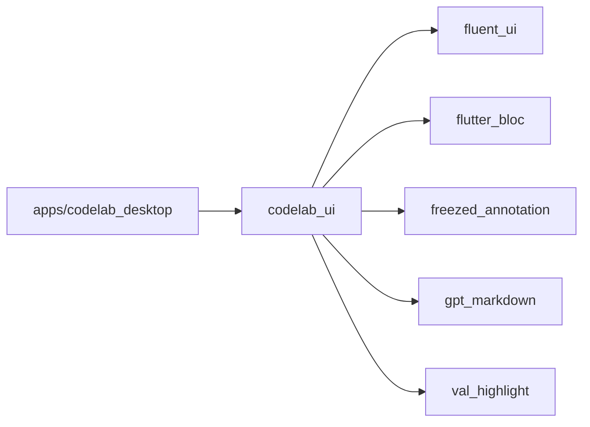

# codelab_ui

Набор Fluent UI виджетов рабочего места CodeLab: лента диалога, одобрения, панели дока, настройки, боковая панель сессий. Пакет только рисует. Решения и данные приходят из приложения `apps/codelab_desktop` уже готовыми.

## Место в архитектуре

Пакет лежит в `packages/flutter/`, поэтому ему разрешена зависимость от Flutter. Внутренних пакетов CodeLab он не использует. Единственный потребитель сейчас — `apps/codelab_desktop`.



Зависимости на схеме взяты из `pubspec.yaml`. `gpt_markdown` и `val_highlight` импортируются только из `lib/src/rendering/`.

Модели ACP и состояние клиента в пакет не попадают. Маппер приложения (`apps/codelab_desktop/lib/features/workbench/application/ui_mappers.dart`) переводит их в типы кита: `CodeLabTranscriptRow`, `CodeLabToolCallRow`, `CodeLabNoticeRow`, `CodeLabTranscriptApproval`. Слои приложения описаны в [`docs/architecture/layers-and-dependencies.md`](../../../docs/architecture/layers-and-dependencies.md), приложение — в [`development.md`](../../../apps/codelab_desktop/doc/development.md).

## Граница: никакой логики

Виджет не решает, опасно ли действие, какой показать риск, тон или текст заметки. Он не разбирает протокольный текст. Всё это приходит готовым полем, например `streaming` у `CodeLabAgentTextRow`. В виджете допустима только вёрстка: раскладка, обрезка, раскрытие, фокус, клавиши и временное состояние просмотра.

Политику ссылок и изображений в markdown тоже решает приложение: оно передаёт её через `CodeLabMarkdownScope`, а кит сообщает о клике.

## Что внутри

Код разложен по слоям. Импорт идёт вниз: `atomics` → `molecules` → `organisms`; `rendering` импортирует только `atomics`, а использует его `organisms`. Единственное исключение — `CodeLabPromptComposer` из `molecules/` импортирует `CodeLabCommandPaletteSurface` из `organisms/`; новые виджеты так не пишут.

| Слой (`lib/src/`) | Для чего | Примеры |
|---|---|---|
| `atomics/` | базовые элементы без составных частей кита | `CodeLabText` (роли `title`…`mono`), `CodeLabBadge`, `CodeLabButton`, `CodeLabIconButton`, `CodeLabIcon`, `CodeLabMonospaceBlock`, `CodeLabStatusIndicator`, `CodeLabResizeHandle`, `CodeLabDialogTitle`, `CodeLabProgressIndicator`, `CodeLabTone`, `CodeLabShortcut` (каталог сочетаний), `CodeLabKeycaps` |
| `molecules/` | составные из атомов | `CodeLabKeyValueList`, `CodeLabStepBreadcrumb`, `CodeLabThoughtBlock`, `CodeLabToolCallSummary`, `CodeLabPromptComposer`, `CodeLabApprovalOptionGroup`, `CodeLabSessionStatusBar`, `CodeLabConnectionBanner`, `CodeLabForm`, `CodeLabSettingsRow`, `CodeLabSettingsSection`, `CodeLabExpanderCard` |
| `rendering/` | отрисовка ответа агента как markdown | `CodeLabMarkdown`, `CodeLabMarkdownConfig`, `CodeLabMarkdownScope`, `CodeLabCodeBlock`, `CodeLabCodeTheme`, `CodeLabCodeHighlighter`, `CodeLabMarkdownStats` |
| `organisms/` | ленты, плитки, панели, экраны | `CodeLabTranscriptPanel`, `CodeLabToolCallTile`, `CodeLabApprovalPrompt`, `CodeLabStatusTable`, `CodeLabUsagePane`, `CodeLabTerminalPane`, `CodeLabAgentsPane`, `CodeLabToolDock`, `CodeLabSessionSidebar`, `CodeLabFileTree`, `CodeLabFilePreview`, `CodeLabProgressChecklist`, `CodeLabPromptQueuePanel`, `CodeLabSettingsNavigation`, `CodeLabConnectionScreen`, `CodeLabStartScreen`, `CodeLabWorkbenchLayout`, `CodeLabWorkbenchShortcuts`, `CodeLabShortcutTable` |

Публичное API экспортирует `lib/codelab_ui.dart` через четыре барели слоёв: `atomics.dart`, `molecules.dart`, `organisms.dart`, `rendering.dart`. Полный список — в этих файлах. `CodeLabPressable` (нажимаемая область без таймеров кнопки Fluent) — внутренняя деталь, барель его не экспортирует.

Особые виджеты, у которых данные приходят из слота или колбэка:

- `CodeLabTerminalPane` получает виджет терминала в слот `content`; сам `xterm2` в кит не импортируется.
- `CodeLabSettingsRow` показывает описание под заголовком не длиннее двух строк с многоточием; параметр `descriptionMaxLines` меняет предел, `null` снимает ограничение (страница, которой важен весь текст, например «General» приложения).
- `CodeLabSettingsRow.footer` рисует элемент под заголовком и описанием внутри той же карточки (переключатель с длинной подписью в узкой области); без него вёрстка прежняя.
- `CodeLabStatusTable` рисует готовые строки и ячейки; действие строки — колбэк.
- `CodeLabUsagePane` показывает уже отформатированные значения (`CodeLabUsageCard`, `CodeLabUsageRow`, `CodeLabUsageNote`); кит ничего не считает.

## Одобрение: фокус и переход

`CodeLabApprovalPrompt` (полоса решения) не берёт клавиатурный фокус сама и не привязывает своих клавиш. Ответ с клавиатуры даёт `CodeLabWorkbenchShortcuts.onAnswerApproval`: сочетания действуют с любого места рабочего места, включая поле ввода, и не повторяются при удержании клавиши. Клик по кнопке варианта просто отвечает этой кнопкой.

- **Клавиши по платформе.** Каталог `CodeLabShortcut` хранит клавиши ответа отдельно для macOS (⌘Y, ⌥⌘Y, ⌥⌘Z, ⌥⇧⌘Z) и для Windows и Linux (Alt+Shift+Y, Q, X, W); клавиши на платформе даёт `combosFor(TargetPlatform)`, точный ⌘ без Ctrl задаёт поле `meta` комбинации.
- **Раскладка ввода (D16).** Сочетания каталога не зависят от раскладки: латинская логическая клавиша совпадает как есть (AZERTY, QWERTZ, Dvorak — по напечатанной букве), нелатинская (кириллица) — по физической позиции клавиши в раскладке US (буквы, цифры, `,` `.` `/` `-` `=`). Физические клавиши используются только в каталоге (`CodeLabLayoutActivator`, `CodeLabKeyCombo.accepts`); кириллица без модификатора сочетанием не считается.
- **Что решает хост.** Кит передаёт в `onAnswerApproval` вид варианта (`CodeLabApprovalOptionKind`) и, на Windows и Linux, сколько Alt и Shift зажаты вместе к моменту нажатия буквы (`CodeLabModifierHoldTracker`; часы — параметр `clock` у `CodeLabWorkbenchShortcuts`; на macOS `null`). Цель, наличие варианта, видимость полосы, срок зажатия модификаторов (Alt+Shift — ещё и смена раскладки) и задержку после появления решает app.
- **Видимость.** `CodeLabApprovalVisibility` передаётся в `CodeLabTranscriptPanel(approvalVisibility:)`; `isVisible(sessionId, approvalId)` говорит, видна ли полоса целиком и не закрыта ли панелью поверх ленты. Без ленты полоса считается невидимой.
- **Переход.** `CodeLabWorkbenchShortcuts.onGoToApproval` привязывает `CodeLabShortcut.goToApproval` (⇧⌘A, `Ctrl+Shift+A`). Какое одобрение показать, решает app. Он просит ленту показать цель с `CodeLabTranscriptShowRequest.focusApproval`, и лента ставит фокус на полосу.
- **Вид.** Фокус на полосе виден рамкой (`focusFrameKey`); Tab идёт сразу к кнопкам, Enter и Space на самой полосе ничего не выбирают. На кнопках варианта стоят подсказки клавиш платформы.
- **Возврат.** Когда полоса с фокусом уходит, она вызывает `onApprovalFocusReleased`; хост возвращает фокус.
- **Ключ.** Ключ полосы строится из id сессии и id запроса (`CodeLabApprovalPrompt.keyFor`): новый запрос не наследует фокус прежнего.

`CodeLabApprovalOptionGroup` тоже без `autofocus` и без своих клавиш.

## Тема и тоны

Своей темы у пакета нет: виджеты берут цвета и типографику из `FluentTheme.of(context)`, поэтому ими управляет `FluentApp` приложения (`apps/codelab_desktop/lib/app/codelab_app_widget.dart`). Светлую и тёмную тему проверяют превью.

Смысл виджета задают два перечисления:

| Тип | Значения |
|---|---|
| `CodeLabTone` | `neutral`, `accent`, `success`, `warning`, `danger` |
| `CodeLabTextRole` | `title`, `subtitle`, `body`, `strong`, `caption`, `mono` |

Цвет не единственный носитель смысла: тег всегда содержит текст. Пары «подпись и тон» для `CodeLabApprovalRisk` (включая `unknown`, тон `warning`) и `CodeLabToolCallStatus` зафиксированы внутри кита; подпись берётся из каталога языка (см. «Локализация»). Какой риск или статус показать, решает приложение.

## Как использовать

Приложение собирает данные и передаёт их виджету. Пример с тегом и ролью текста:

```dart
import 'package:codelab_ui/codelab_ui.dart';
import 'package:fluent_ui/fluent_ui.dart';

Widget build(BuildContext context) {
  return const Row(
    children: [
      CodeLabText('fvm dart analyze', role: CodeLabTextRole.mono),
      SizedBox(width: 8),
      CodeLabBadge(label: 'running', tone: CodeLabTone.accent),
    ],
  );
}
```

Виджет вызывается внутри `FluentApp` (или `FluentTheme`) и `Directionality`. Без темы `FluentTheme.of` не найдёт данных.

## Локализация

Кит показывает текст на английском и русском (`en`, `ru`). Каталог сообщений лежит в `lib/src/l10n/`: `codelab_ui_en.arb` — шаблон, `codelab_ui_ru.arb` — перевод, рядом сгенерированный `CodeLabLocalizations`. В барель он выходит только как `CodeLabLocalizations` (делегат и список языков); внутри кита текст берёт `codeLabStringsOf(context)`.

Хост добавляет делегат кита в `localizationsDelegates` своего `FluentApp`, как это делает `apps/codelab_desktop/lib/app/codelab_app_widget.dart`:

```dart
FluentApp(
  localizationsDelegates: const [
    ...AppLocalizations.localizationsDelegates,
    CodeLabLocalizations.delegate,
  ],
  supportedLocales: AppLocalizations.supportedLocales,
  // ...
)
```

Без делегата в дереве кит показывает английский. Поэтому тесты и превью с обычным `FluentApp` работают без настройки.

Что важно знать при вызове виджетов:

- Параметры с текстом по умолчанию — `placeholder`, `emptyLabel`, `reconnectLabel`, `actionsLabel` — имеют тип `String?`. При `null` показывается перевод из каталога; явная строка показывается как есть, без перевода.
- Названия панелей дока: `toolPaneTitleOf(context, pane)`. Поля `label` у `ToolPane` нет.
- Подпись риска на языке интерфейса: `CodeLabApprovalRisk.labelOf(context)`. Поле `label` и `CodeLabApprovalPrompt.noSuchOption` — английские эталоны для тестов.
- Не переводятся клавиши и сочетания, идентификаторы, `ValueKey` и строки, которые передают приложение и агент.

Правка текстов: измени `codelab_ui_en.arb` и `codelab_ui_ru.arb` (у каждого сообщения `en` есть `@key.description`), затем в `packages/flutter/codelab_ui` выполни `fvm flutter gen-l10n`. Сгенерированный код коммитится; устаревший код ловит `melos run l10n:check`. Русские формулировки — по `docs/architecture/l10n-glossary.md`. Правила каталога — в [`AGENTS.md`](AGENTS.md), раздел про локализацию.

## Как добавить виджет

1. Определи слой. Атом при втором употреблении, а не «на вырост». Составной из атомов — `molecules/`. Лента, панель, экран — `organisms/`.
2. Данные виджета — готовые значения: строки, перечисления, `CodeLabTone`, колбэки. Собственные подписи виджета добавляй в каталог (см. «Локализация»), а не литералом в коде. Не принимай модели ACP или клиентского ядра, не импортируй `dart:io`.
3. Экспортируй файл из барели слоя (`atomics.dart`, `molecules.dart` или `organisms.dart`).
4. Добавь превью на фиктивных данных в `codelab_molecule_previews.dart` или `codelab_organism_previews.dart`. Превью — функция с аннотацией `@Preview(name:, group:, size:)`, которая возвращает виджет в оболочке с `FluentTheme`. Без секретов и настоящих путей.
5. Добавь вызов превью в `test/codelab_previews_test.dart`.
6. Напиши widget-тест в `test/`: ключи `ValueKey`, видимые подписи, тон. Проверяется поведение, а не пиксели.
7. Если виджет использует сгенерированный `freezed`-тип, перегенерируй код (см. ниже).
8. Подключи виджет в приложении через маппер; логика остаётся в приложении.

Комментарии к коду — на русском по схеме «почему, для чего, как» (корневой [`AGENTS.md`](../../../AGENTS.md), §15).

## Тесты

Файлы `*.freezed.dart` в git не хранятся. Перед первым запуском сгенерируй их по шагу из [`docs/user/run-from-source.md`](../../../docs/user/run-from-source.md) или только для пакета:

```bash
cd packages/flutter/codelab_ui
fvm dart run build_runner build --delete-conflicting-outputs
```

Затем:

```bash
fvm flutter test
fvm dart format --set-exit-if-changed lib test
fvm dart analyze
```

Тесты лежат в `test/`. Golden-тестов (`matchesGoldenFile`) в пакете нет, поэтому эталонных изображений виджетов в репозитории тоже нет. Набор `test/codelab_previews_test.dart` собирает превью и проверяет, что они не бросают исключений.

Превью (`@Preview`) можно открыть в IDE, которая поддерживает Flutter Widget Previewer. Пакет требует Flutter `>=3.35.0` (`pubspec.yaml`).

<!-- screenshot: превью ключевых виджетов (CodeLabTranscriptPanel, CodeLabApprovalPrompt, CodeLabUsagePane) в светлой и тёмной теме — снять через Flutter Widget Previewer -->

## Правила пакета

Правила для изменений — в [`AGENTS.md`](AGENTS.md). Главное: кит не зависит от внутренних пакетов CodeLab и не содержит бизнес-логики. Обратное направление проверяет сторож (`melos run guard`): Dart-пакеты и CLI не импортируют `package:codelab_ui/`.

## Смотрите также

- [`apps/codelab_desktop/doc/development.md`](../../../apps/codelab_desktop/doc/development.md) — как приложение собирает данные для виджетов.
- [`docs/architecture/layers-and-dependencies.md`](../../../docs/architecture/layers-and-dependencies.md) — слои и направление зависимостей.
