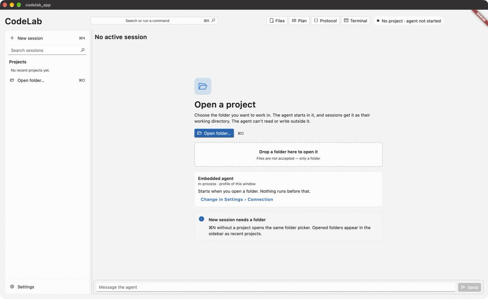

# Начало работы с UI-китом

Эта глава для разработчика, который впервые открыл `codelab_ui`. Она отвечает на практические вопросы: как подготовить репозиторий, как прогнать тесты и анализ, как увидеть виджет глазами и куда смотреть, когда нужно что-то изменить.

## Подготовка репозитория

Шаги подготовки описаны в [запуске из исходников](../../../../docs/user/run-from-source.md#1-подготовка). Здесь — конспект для работы с китом.

1. Установите [FVM](https://fvm.app). Версия Flutter SDK лежит в `.fvmrc` в корне репозитория; все команды идут через `fvm`. Пакету нужен Flutter не ниже 3.35.0 (`pubspec.yaml` пакета).
2. Поставьте SDK и свяжите пакеты:

   ```bash
   fvm install
   fvm flutter pub get
   fvm dart run melos bootstrap
   ```

3. Создайте сгенерированный код. В git его нет, без него пакет не соберётся:

   ```bash
   cd packages/flutter/codelab_ui
   fvm dart run build_runner build --delete-conflicting-outputs
   ```

   Генерируются только два файла `*.freezed.dart` — для `CodeLabCommandAction` и `CodeLabConfigOption` из `lib/src/molecules/`. Код локализации, наоборот, лежит в git (`lib/src/l10n/codelab_localizations*.dart`) и перегенерируется отдельной командой — см. [главу о локализации](04-localization-and-shortcuts.md).

Пакет не зависит от внутренних пакетов CodeLab и не требует ни агента, ни сети, ни ключей провайдеров: все его тесты работают на фиктивных данных.

## Три команды

Команды запускаются в каталоге пакета `packages/flutter/codelab_ui`:

```bash
fvm flutter test
fvm dart format --set-exit-if-changed lib test
fvm dart analyze
```

Полный прогон 2026-11-25 (927 тестов, около минуты) закончился так:

```text
01:00 +923: test/acp_markdown_test.dart: a foreign image error is passed through untouched
01:00 +924: test/acp_markdown_test.dart: a shown image does not open the same url in another answer
01:00 +925: test/acp_markdown_test.dart: http and data images are placeholders without Show image
01:00 +926: test/acp_markdown_test.dart: without a scope images have no Show image button
01:00 +927: All tests passed!
```

Вывод получен запуском `fvm flutter test --reporter expanded` в каталоге пакета; показаны последние строки, пути сокращены до относительных. Анализатор в том же каталоге ответил:

```text
Analyzing codelab_ui...
No issues found!
```

## Один тест

Запуск одного файла:

```bash
fvm flutter test test/codelab_settings_row_test.dart
```

Запуск одного теста по имени (часть имени подойдёт):

```bash
fvm flutter test test/codelab_settings_row_test.dart --plain-name "footer"
```

Файл `test/shortcut_catalog_guard_test.dart` и `test/codelab_settings_row_test.dart` вместе дают такой вывод (получен запуском с `--reporter expanded`, показан хвост):

```text
00:00 +0: test/shortcut_catalog_guard_test.dart: сторож различает литералы активаторов и комментарии
00:00 +1: test/shortcut_catalog_guard_test.dart: вне каталога нет литералов активаторов и сравнений клавиш
00:00 +2: test/codelab_settings_row_test.dart: shows title, description and the trailing control
…
00:01 +13: test/codelab_settings_row_test.dart: footer footer и trailing вместе не переполняют строку
00:01 +14: All tests passed!
```

Устройство тестов — в [главе о тестировании](05-testing.md).

## Как увидеть виджет

У кита нет собственного приложения, но есть три способа посмотреть виджет.

| Способ | Что показывает | Когда брать |
|---|---|---|
| Превью `@Preview` | один виджет на фиктивных данных в светлой или тёмной теме | сверстать виджет, проверить узкую ширину и русский язык |
| Тест превью | строит те же функции и проверяет, что они не бросают исключений | убедиться, что превью не сломалось |
| Приложение `codelab_desktop` | виджет в настоящем окне с настоящими данными | проверить фокус, прокрутку, сочетания клавиш |

### Превью

Превью лежат в двух файлах: `lib/src/molecules/codelab_molecule_previews.dart` (группа `ACP molecules`) и `lib/src/organisms/codelab_organism_previews.dart` (группа `ACP organisms`). Это 56 функций вида:

```dart
@Preview(
  name: 'Transcript panel conversation',
  group: codelabOrganismPreviewGroup,
  size: Size(820, 460),
)
Widget codelabTranscriptPanelPreview() {
  return const _AcpOrganismPreviewSurface(
    child: SizedBox(
      width: 820,
      height: 460,
      child: CodeLabTranscriptPanel(rows: [/* … */]),
    ),
  );
}
```

Аннотация `@Preview` — из `package:flutter/widget_previews.dart`. Функции не экспортируются из барелей: это внутренняя оснастка, а не публичное API.

Превью рисуются без `FluentApp`, поэтому каждая оболочка сама даёт то, что виджетам нужно:

- `_AcpPreviewSurface` (молекулы): `Directionality` и `FluentTheme` с выбранной яркостью.
- `_AcpOrganismPreviewSurface` (организмы): то же плюс `Localizations` с делегатами `CodeLabLocalizations`, `FluentLocalizations` и `DefaultWidgetsLocalizations` (без `FluentLocalizations` падает `InfoBar` заметок ленты) и `Overlay` (подсказки сайдбара и app bar требуют его). Язык берётся из параметра `locale`, по умолчанию `en`; русский вариант есть, например, у `codelabApprovalPromptRuPreview`.

Открыть превью можно в IDE с поддержкой Flutter Widget Previewer. Из командной строки у Flutter есть подкоманда `widget-preview` с действиями `start` и `clean`:

```bash
fvm flutter widget-preview start
```

Команда поднимает среду превью для проекта в текущем каталоге. Сам запуск при подготовке руководства не прогонялся: проверено только, что подкоманды `start` и `clean` перечислены в `fvm flutter widget-preview --help`.

<!-- screenshot: окно Flutter Widget Previewer со списком групп «ACP molecules» и «ACP organisms» и превью «Transcript panel conversation» -->

### Тест превью

`test/codelab_previews_test.dart` строит функции превью через `tester.pumpWidget(...)` и проверяет `tester.takeException()`, а у части — ещё и наличие нужного виджета и тему. Он ловит переполнение вёрстки, пропущенную локализацию и отсутствующий предок (`Overlay`, `FluentTheme`) на фиктивных данных. Обратите внимание: восемь из 56 превью в нём не вызываются — `codelabActivityBarPlanCollapsedPreview`, `codelabActivityBarPlanExpandedPreview`, `codelabCustomPalettePreview`, `codelabOpenProjectBodyPreview`, `codelabOpenProjectScreenPreview`, `codelabOpenProjectScreenRuPreview`, `codelabStartScreenPreview` и `codelabTerminalPanePreview`. Для них проверка «превью не падает» отсутствует, пока вы не добавите вызов.

### Приложение

Настоящее окно видно только в `apps/codelab_desktop`. Приложение с расширением `flutter_driver` запускается так (подробности — в [руководстве приложения](../../../../apps/codelab_desktop/doc/development.md)):

```bash
cd apps/codelab_desktop
fvm flutter run -d macos -t test_driver/app.dart --print-dtd
```

Управлять приложением можно по стабильным `ValueKey` виджетов кита, например `tool-pane-files`, `tool-toggle-files`, `approval-allow`. Ключи кита перечислены в главе о [ключевых виджетах](03-key-widgets.md) и в самих виджетах (`static const …Key`).

Скриншоты экранов приложения, где виден кит, лежат в `apps/codelab_desktop/doc/images/`. На них видны рабочее место (`CodeLabWorkbenchLayout`), app bar, сайдбар, композер и экран «Open a project»:



На снимке три зоны рабочего места (app bar, сайдбар, панель сессии; дока нет) и экран `CodeLabOpenProjectScreen` в панели сессии.

## Что изменить — куда смотреть

Пути даны от `packages/flutter/codelab_ui/`.

| Что нужно | Где менять | Какой тест смотреть |
|---|---|---|
| Цвет тона, ссылки, фона diff | `lib/src/atomics/codelab_palette.dart` | `test/codelab_palette_test.dart` |
| Шрифт и роли текста | `lib/src/atomics/codelab_text.dart` | `test/codelab_atomics_test.dart` |
| Цвета подсветки кода | `lib/src/rendering/codelab_code_theme.dart` | `test/rendering/code_highlighter_test.dart`, `test/acp_markdown_test.dart` |
| Строки ленты (пользователь, ответ, мысли, вызов, заметка) | `lib/src/organisms/codelab_transcript_row.dart`, `codelab_transcript_panel.dart`, `codelab_tool_call_tile.dart` | `test/codelab_transcript_test.dart`, `test/codelab_subagent_row_test.dart`, `test/codelab_task_list_test.dart` |
| Прокрутка ленты, «Show in transcript» | `lib/src/organisms/codelab_transcript_panel.dart` | `test/codelab_transcript_show_request_test.dart` |
| Полоса одобрения и её фокус | `lib/src/organisms/codelab_approval_prompt.dart`, `lib/src/molecules/codelab_approval_option_group.dart` | `test/codelab_approval_focus_test.dart`, `test/codelab_transcript_approval_visibility_test.dart` |
| Сочетания клавиш | `lib/src/atomics/codelab_shortcuts.dart`, `lib/src/organisms/codelab_workbench_shortcuts.dart` | `test/codelab_shortcuts_test.dart`, `test/codelab_shortcut_bindings_test.dart`, `test/codelab_modifier_hold_test.dart` |
| Markdown, ссылки, изображения | `lib/src/rendering/` | `test/acp_markdown_test.dart`, `test/codelab_markdown_tables_test.dart` |
| Экранирование недоверенного текста | `lib/src/rendering/escape_for_display.dart` | `test/escape_for_display_extra_test.dart` |
| Раскладка по ширине окна, док | `lib/src/organisms/codelab_workbench_layout.dart`, `codelab_tool_dock.dart` | `test/codelab_organisms_test.dart`, `test/codelab_tool_dock_test.dart` |
| Панели дока (Usage, Agents, Protocol, Terminal, Files) | `lib/src/organisms/codelab_usage_pane.dart`, `codelab_agents_pane.dart`, `codelab_protocol_pane.dart`, `codelab_terminal_pane.dart`, `codelab_file_tree.dart`, `codelab_file_preview.dart` | одноимённые `test/codelab_*_test.dart` |
| Строки, секции и навигация настроек | `lib/src/molecules/codelab_settings_row.dart`, `codelab_settings_section.dart`, `lib/src/organisms/codelab_settings_navigation.dart` | `test/codelab_settings_row_test.dart`, `test/codelab_settings_section_test.dart`, `test/codelab_settings_navigation_test.dart` |
| Текст интерфейса | `lib/src/l10n/codelab_ui_en.arb`, `codelab_ui_ru.arb` | `test/l10n_catalogs_test.dart`, `test/codelab_l10n_test.dart` |
| Превью | `lib/src/molecules/codelab_molecule_previews.dart`, `lib/src/organisms/codelab_organism_previews.dart` | `test/codelab_previews_test.dart` |

## Смотрите также

- [Обзор](01-overview.md) — слои и граница «никакой логики».
- [Расширение](06-extending.md) — рецепты со скелетами кода.
- [Частые проблемы](07-troubleshooting.md) — когда тест или анализ упал.
- [`AGENTS.md`](../AGENTS.md) пакета и корневой [`AGENTS.md`](../../../../AGENTS.md) (§15, §21) — правила и проверки перед pull request.
