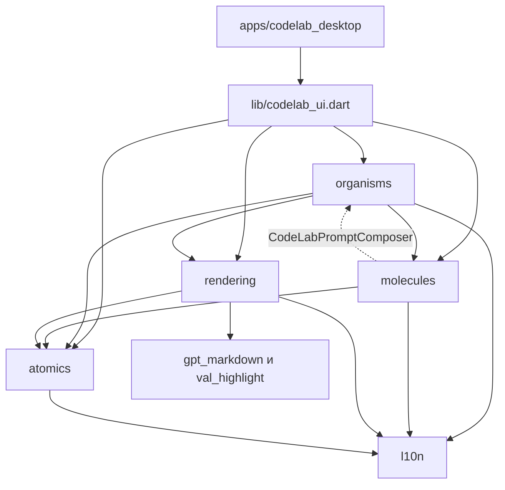
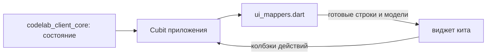

# Обзор UI-кита

Глава объясняет, из чего состоит `codelab_ui`, как слои импортируют друг друга, где проходит граница «кит только рисует» и кто следит за её соблюдением. В конце — словарь терминов, которые встречаются в остальных главах.

## Что это и чего в нём нет

`codelab_ui` — пакет Flutter с виджетами рабочего места CodeLab на Fluent UI: лента переписки, полоса одобрения, панели дока, настройки, боковая панель сессий. Единственный потребитель сейчас — `apps/codelab_desktop`.

Кит только рисует. Он не знает про ACP, сессии, провайдеров и файлы проекта. Приложение передаёт ему готовые значения — строки, перечисления, тоны, колбэки, — а кит рисует их и сообщает о действиях пользователя через колбэки. Решения принимает приложение: что опасно, какой показать риск, что считать ответом на одобрение (корневой [`AGENTS.md`](../../../../AGENTS.md), §10, и [`AGENTS.md`](../AGENTS.md) пакета, раздел «Нет логики»).

Пакет лежит в `packages/flutter/`, поэтому ему разрешён Flutter. Внутренних пакетов CodeLab у него нет. Зависимости из `pubspec.yaml`: `fluent_ui`, `flutter_bloc`, `freezed_annotation`, `gpt_markdown`, `val_highlight`, а также `flutter_localizations` и `intl` для каталога текстов. `flutter_bloc` в `pubspec.yaml` объявлен, но ни `lib/`, ни `test/` его сейчас не импортируют (проверено поиском).

## Слои

Код лежит в `lib/src/` и разложен на четыре слоя и каталог текстов. Деление взято из требования спецификации [«Организация виджетов по Atomic Design»](../../../../openspec/specs/agent-workbench-ui/spec.md): минимальный переиспользуемый элемент — атом, крупный блок workflow (лента, одобрение, сайдбар) — организм.

| Слой | Для чего | Файлов `.dart` |
|---|---|---|
| `atomics/` | базовые элементы без составных частей кита: текст, бейдж, кнопка, палитра, каталог сочетаний | 15 |
| `molecules/` | составные из атомов: строка настройки, полоса статуса сессии, группа вариантов одобрения, композер | 22 (без двух сгенерированных `*.freezed.dart`) |
| `rendering/` | отрисовка ответа агента как markdown: разбор, блок кода, подсветка, ссылки, изображения | 12 |
| `organisms/` | ленты, плитки, панели дока, экраны, каркас рабочего места | 31 |
| `l10n/` | каталог текстов кита на английском и русском | 4, плюс два файла ARB |

Полный перечень виджетов по слоям — в таблице [README пакета](../README.md). Здесь важнее другое: кто кого импортирует.

На схеме — направление импортов внутри `lib/src/`. Сплошная стрелка означает «импортирует»; пунктирная — единственное исключение.



Что из этого следует:

- Импорт идёт вниз: `organisms` → `molecules` и `rendering` → `atomics`. `atomics` не импортирует вышестоящие слои — это проверено поиском по `lib/src/atomics/`.
- `rendering` импортирует только `atomics` и `l10n`; его используют `organisms` (лента, плитка вызова, панели Usage и Agents, таблица статусов).
- Исключение одно: `lib/src/molecules/codelab_prompt_composer.dart` импортирует `CodeLabCommandPaletteSurface` из `organisms/`. Новые виджеты так не пишут: если молекуле нужен кусок организма, его опускают в слой ниже.
- Парсер `gpt_markdown` и движок подсветки `val_highlight` разрешены только в `lib/src/rendering/`. Замена пакета меняет один каталог.
- `l10n` почти везде нужен: его импортирует один файл атомов (`codelab_keycaps.dart`), 10 файлов молекул, 4 файла `rendering` и 22 файла организмов. На схеме он отдельный узел, чтобы не рисовать каждую стрелку.

## Барели и публичное API

Публичное API экспортирует только `lib/codelab_ui.dart`:

```dart
export 'src/atomics/atomics.dart';
export 'src/molecules/molecules.dart';
export 'src/organisms/organisms.dart';
export 'src/rendering/rendering.dart';
export 'src/l10n/codelab_localizations.dart' show CodeLabLocalizations;
```

Правила:

- Другие пакеты импортируют `package:codelab_ui/codelab_ui.dart` и ничего больше. Внутри пакета можно импортировать файлы напрямую (корневой `AGENTS.md`, §15).
- Новый публичный виджет экспортируется из барели своего слоя.
- Барель `rendering.dart` экспортирует часть файлов через `show`: наружу выходят `CodeLabCodeBlock`, `escapeForDisplay`, `CodeLabMarkdownConfig`, `CodeLabImagePlaceholder`, `kMaxMarkdownNestingDepth`, типы подсветки и т. п., а, например, `displayAddress` остаётся внутренним.
- Каталог текстов наружу выходит только как `CodeLabLocalizations` (делегат и список языков). `codeLabStringsOf` и сообщения — внутренние.
- Внутренние файлы, которых нет в барелях: `CodeLabPressable` (нажимаемая область без таймеров кнопки Fluent), `TranscriptTargetFrame` (рамка цели показа), оба файла превью.

## Граница «никакой логики»

Виджет кита допускает только вёрстку: раскладку, обрезку, раскрытие, фокус, клавиши и временное состояние просмотра. Пример временного состояния — «Show full command» в плитке вызова: этот выбор живёт в `State` плитки и не переживает уход её с экрана.

Всё остальное приходит готовым. В таблице — что решает приложение и что остаётся киту.

| Вопрос | Кто решает | Как попадает в кит |
|---|---|---|
| Какой риск у действия | приложение | `CodeLabApprovalRisk` в `CodeLabTranscriptApproval.pending` (`ui_mappers.dart`, функция `_approvalRiskOf` переводит `ApprovalRiskLevel`) |
| Идёт ли ответ стримом | приложение | поле `streaming` у `CodeLabAgentTextRow` и `CodeLabThoughtRow` |
| Можно ли открыть ссылку или загрузить изображение | приложение | функции в `CodeLabMarkdownScope` |
| Какую цель показать и ответить ли на одобрение | приложение | `CodeLabTranscriptShowRequest`, `CodeLabWorkbenchShortcuts.onAnswerApproval` |
| Принимать ли папку, брошенную из ОС | приложение (`desktop_drop` за адаптером) | `dropActive` и `dropMessage` у `CodeLabOpenProjectScreen` |
| Какая панель дока открыта | приложение | `CodeLabToolDock.active`, `tabs` |
| Что раскрыто в ленте | приложение хранит, кит рисует | `expansionOverrides` и `onExpansionChanged` у `CodeLabTranscriptPanel` |
| Как обрезать длинную строку, куда поставить фокус, как выглядит рамка | кит | вёрстка виджета |

Причина разделения — безопасность (корневой `AGENTS.md`, §2 и §10): виджет не должен определять, опасно ли действие, а решение пользователя должно быть связано с нужным запросом. Приложение владеет этими решениями, их легко проверить без Flutter, а кит остаётся заменяемым слоем рисования.

## Как приложение передаёт данные

Состояние сессии принадлежит `codelab_client_core`; Cubit-ы приложения только отображают его. Между состоянием и виджетом стоит маппер приложения `apps/codelab_desktop/lib/features/workbench/application/ui_mappers.dart`. Он превращает типы клиентского ядра в типы кита: `CodeLabTranscriptRow` (и наследники), `CodeLabToolCallRow`, `CodeLabNoticeRow`, `CodeLabTranscriptApproval`, `CodeLabSessionListItem`.



Колбэк уходит обратно в Cubit: например, `onOptionSelected` полосы одобрения вызывает метод приложения, а то отправляет решение агенту. Подробности цепочки — в главе о потоке состояния [руководства приложения](../../../../apps/codelab_desktop/doc/03-state-flow.md) и в [`development.md`](../../../../apps/codelab_desktop/doc/development.md).

## Кто проверяет границу

Границу держат три механизма.

1. **`pubspec.yaml`.** У пакета нет зависимостей от внутренних пакетов, поэтому импорт `package:codelab_client_*` или `package:codelab_acp_*` просто не соберётся.
2. **Сторож репозитория** `packages/dart/codelab_architecture_tests` (запуск — `melos run guard`; описание — [README пакета](../../../../packages/dart/codelab_architecture_tests/README.md)). Правила, которые касаются кита (`test/support/rules.dart`):
   - `package:desktop_drop/` запрещён во всём `packages/flutter/codelab_ui/lib`: плагин перетаскивания живёт только в адаптере приложения;
   - `package:gpt_markdown/` и `package:val_highlight/` запрещены везде, кроме `src/rendering/`;
   - `material_ui`, `cupertino_ui`, `val_highlight_flutter`, `val_latex_flutter`, `flutter_svg` запрещены в ките и в приложении целиком;
   - обратное направление: `apps/codelab_agent`, `apps/codelab_cli` и `codelab_embedded` не импортируют `package:codelab_ui/`;
   - `pubspec_allowlist_test.dart` разрешает `codelab_ui` в зависимостях `apps/codelab_desktop`;
   - `ui_literals_test.dart` ищет в `packages/flutter/codelab_ui/lib/src` английские литералы интерфейса мимо каталога ARB (подробнее — в [главе о локализации](04-localization-and-shortcuts.md)).
3. **Тесты самого пакета.** `test/shortcut_catalog_guard_test.dart` запрещает литералы активаторов клавиш вне каталога; `test/l10n_catalogs_test.dart` сверяет каталоги `en` и `ru`.

Запрета на `dart:io` и на нелокальные пакеты `codelab_*` в `lib/` кита правилом сторожа нет: сейчас таких импортов нет, а новые ловит ревью (`AGENTS.md` пакета, раздел 1).

## Словарь

| Термин | Что значит |
|---|---|
| Кит | пакет `codelab_ui` целиком |
| Хост | код приложения, который создаёт виджеты кита и отвечает на их колбэки |
| Атом, молекула, организм | уровни составных виджетов: из чего собран виджет и насколько он крупный |
| Барель | файл `*.dart`, который реэкспортирует публичные файлы слоя |
| Тон (`CodeLabTone`) | смысловой цвет: `neutral`, `accent`, `success`, `warning`, `danger` |
| Палитра (`CodeLabPalette`) | расширение темы с цветами тонов, ссылок, diff и выделения |
| Роль текста (`CodeLabTextRole`) | `title`, `subtitle`, `body`, `strong`, `caption`, `mono` |
| Строка ленты (`CodeLabTranscriptRow`) | одна запись переписки: сообщение пользователя, ответ, мысли, вызов, заметка, тихая строка задач |
| Цель показа | строка или блок одобрения, к которому лента прокручивается по запросу `CodeLabTranscriptShowRequest` |
| Полоса одобрения (`CodeLabApprovalPrompt`) | панель выбора «разрешить или отклонить» внутри строки вызова |
| Док (`CodeLabToolDock`) | зона вкладок инструментов справа от панели сессии |
| Панель (`ToolPane`) | один инструмент дока: Files, Diff, Terminal, Plan, Timeline, Agents, Usage, Branches, Protocol |
| Слот | параметр-виджет, через который хост подставляет своё содержимое (`content` у терминала, `sessionPane` у каркаса) |
| Превью | функция с `@Preview`, которая показывает виджет на фиктивных данных |
| Каталог текстов | пара ARB-файлов `en` и `ru` и сгенерированный `CodeLabLocalizations` |
| Каталог сочетаний | перечисление `CodeLabShortcut`: единственный источник клавиш рабочего места |

## Смотрите также

- [Тема и токены](02-theme-and-tokens.md) — откуда у виджета цвета.
- [Ключевые виджеты](03-key-widgets.md) — как устроены лента, одобрение и markdown.
- [`docs/architecture/layers-and-dependencies.md`](../../../../docs/architecture/layers-and-dependencies.md) — слои приложения и направление зависимостей.
- [`docs/architecture/permissions.md`](../../../../docs/architecture/permissions.md) — почему решения об опасных действиях принадлежат приложению.
