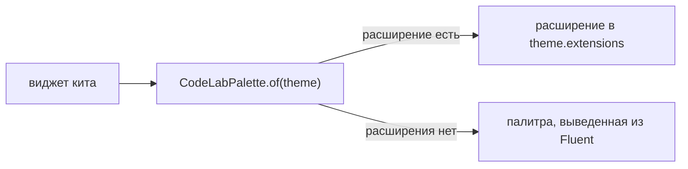

# Тема и токены

Глава объясняет, откуда виджеты кита берут цвета, шрифты и смысловые тона, как приложение подменяет их пользовательской темой и что при этом гарантирует кит. Если вы добавляете виджет, который что-то красит, прочитайте её до конца.

## Своей темы у кита нет

Кит не создаёт `FluentThemeData`. Каждый виджет читает `FluentTheme.of(context)`, поэтому внешний вид задаёт `FluentApp` приложения. В тесте это обычный `FluentApp`, в превью — `FluentTheme` из оболочки превью.

Без `FluentTheme` в дереве виджет не работает. В пробном запуске `CodeLabText` внутри одного `Directionality` падает с `Null check operator used on a null value`; в тестах и превью виджет всегда оборачивают в `FluentApp` или `FluentTheme`.

Что откуда берётся:

| Что | Источник | Где в коде |
|---|---|---|
| Цвета тонов `success`, `warning`, `danger`, `accent`, цвет ссылок, фоны diff, выделение | расширение темы `CodeLabPalette` | `lib/src/atomics/codelab_palette.dart` |
| Цвета подсветки кода и фон блока кода | расширение темы `CodeLabCodeTheme` | `lib/src/rendering/codelab_code_theme.dart` |
| Шрифты и размеры текста | `FluentTheme.of(context).typography` через роли `CodeLabTextRole` | `lib/src/atomics/codelab_text.dart` |
| Фоны карточек, рамки, основной и вторичный цвет текста, акцент | `FluentTheme.of(context).resources`, `accentColor`, `micaBackgroundColor` | в самих виджетах |

Цвет не единственный носитель смысла (спецификация [«Цвета кита из палитры темы»](../../../../openspec/specs/agent-workbench-ui/spec.md)): у тега статуса всегда есть текст или значок рядом. Не делайте виджет, в котором тон различим только цветом.

## Тоны

`CodeLabTone` — пять значений: `neutral`, `accent`, `success`, `warning`, `danger`. Тон выражает смысл (успех, предупреждение), а не цвет. Виджет принимает тон параметром (`CodeLabBadge.tone`, `CodeLabIcon.tone`, `CodeLabApprovalOption.tone`), а конкретный цвет получает из палитры:

```dart
final theme = FluentTheme.of(context);
final color = CodeLabPalette.of(theme).toneColor(tone, theme);
```

Так устроен `CodeLabBadge`: фон тега — цвет тона с прозрачностью (46 из 255, для `warning` — 56), текст — сам цвет тона.

`neutral` — особый случай. Это не цвет палитры, а роль текста: в светлой теме `Colors.grey`, в тёмной — `textFillColorSecondary` темы. Серый нейтральный тег в тёмной теме читался с контрастом 1,3:1, поэтому для тёмной темы взят цвет вторичного текста (комментарий в `CodeLabPalette.toneColor`).

## Палитра `CodeLabPalette`

`CodeLabPalette` — `ThemeExtension` с восемью цветами:

| Поле | Для чего | Значение без расширения |
|---|---|---|
| `success` | тон `success` | `Colors.green` |
| `warning` | тон `warning` | `Colors.warningPrimaryColor` |
| `danger` | тон `danger` | `Colors.red` |
| `accent` | тон `accent` | `Colors.blue` |
| `info` | ссылки markdown и просмотра файла | акцент темы (`theme.accentColor`) |
| `diffAddBackground` | фон добавленной строки diff | зелёный с прозрачностью 0,18 |
| `diffRemoveBackground` | фон удалённой строки diff | красный с прозрачностью 0,18 |
| `selection` | фон выделенной строки списков и просмотра | акцент темы с прозрачностью 0,18 |

Поиск палитры — `CodeLabPalette.of(theme)`:



Если приложение положило `CodeLabPalette` в `FluentThemeData.extensions`, возвращается она. Иначе палитра выводится из темы с прежними значениями (таблица выше) и кешируется на объект темы. Благодаря этому виджеты кита работают в обычном `FluentApp` без настройки, а вид по умолчанию совпадает с видом до появления пользовательских тем.

Чтобы проверить виджет с другими цветами, положите палитру в тему. Так делает тест `test/codelab_palette_test.dart` и превью `codelabCustomPalettePreview`:

```dart
FluentApp(
  theme: FluentThemeData(
    extensions: const [
      CodeLabPalette(
        success: Color(0xFFA6E3A1),
        warning: Color(0xFFF9E2AF),
        danger: Color(0xFFF38BA8),
        accent: Color(0xFF89B4FA),
        info: Color(0xFF89B4FA),
        diffAddBackground: Color(0xFF1E3A2A),
        diffRemoveBackground: Color(0xFF3A1E26),
        selection: Color(0xFF45475A),
      ),
    ],
  ),
  home: const CodeLabBadge(label: 'Done', tone: CodeLabTone.success),
)
```

Рамки блока одобрения в палитре нет: у блока нет акцентной рамки (решение `lighten-approval-block`, Q8), и пользовательская тема её не возвращает.

## Подсветка кода: `CodeLabCodeTheme`

Блок кода в ответе агента красится палитрой `CodeLabCodeTheme`. Она тоже расширение темы: `CodeLabCodeTheme.of(theme)` вернёт зарегистрированную в `extensions` или рассчитает свою по ролям Fluent.

Расчётная палитра устроена так:

- фон блока — цвет карточки (`cardBackgroundFillColorSecondary`) поверх фона страницы, непрозрачный;
- обычный и приглушённый текст — `textFillColorPrimary` и `textFillColorSecondary`;
- ключевые слова — акцент темы, остальные классы токенов (`CodeLabTokenClass`: `string`, `number`, `type`, `function`, `variable`, `attribute` и т. д.) — оттенки акцентных цветов Fluent, тёмные для светлого фона и светлые для тёмного;
- яркость каждого цвета сдвигается шагами по 0,025, пока контраст с фоном блока не достигнет 4,7:1. Порог требования — 4,5:1 (DSK-19 в комментариях кода), запас 0,2 нужен, чтобы округления не опускали цвет ниже.

Встроенные темы пакета `val_highlight` не используются: они светлые и в тёмной теме Fluent блок кода с ними нечитаем.

## Роли текста: `CodeLabText`

`CodeLabText` — единственный способ показать текст в ките. Роль `CodeLabTextRole` выбирает стиль из `FluentTheme.of(context).typography`:

| Роль | Стиль |
|---|---|
| `title` | `typography.title` |
| `subtitle` | `typography.subtitle` |
| `body` | `typography.body` (по умолчанию) |
| `strong` | `typography.bodyStrong` |
| `caption` | `typography.caption` |
| `mono` | `typography.body`, семейство `Menlo`, размер 12,5 |

Для `mono` задан список запасных шрифтов (`SF Mono`, `Consolas`, `Cascadia Mono`, `DejaVu Sans Mono`, `Courier New`, `monospace`): на Windows нет `Menlo`, на Linux нет ни его, ни `Consolas`.

Два приёма, о которых легко забыть:

- `CodeLabText.styleOf(context, role)` возвращает стиль роли для составного текста (`Text.rich`), где часть фразы набрана другой ролью — например, моноширинная цель в строке вызова «Read lib/main.dart».
- `CodeLabText(…, symbols: true)` набирает знаки клавиш (⌘ ⇧ ⌥ ⏎ ⌫) системным шрифтом с кеглем роли. В `Menlo` эти знаки нарисованы мельче букв, поэтому плашки клавиш (`CodeLabKeycaps`) используют `symbols`.

Параметр `color` переопределяет цвет роли — только там, где смысл нужно передать цветом текста при отсутствии места для отдельного бейджа.

## Пары «значение — тон»

Часть словарей кита сопоставляет значение и тон намертво. Какое значение показать, решает приложение, а пара зафиксирована в ките.

Риск действия — `CodeLabApprovalRisk` (`lib/src/organisms/codelab_approval_prompt.dart`):

| Риск | Подпись по умолчанию | Тон |
|---|---|---|
| `readOnly` | Read-only | `success` |
| `unknown` | Unknown risk | `warning` |
| `localWrite` | Local write | `warning` |
| `network` | Network | `warning` |
| `shell` | Shell | `danger` |
| `destructive` | Destructive | `danger` |

Статус вызова — `CodeLabToolCallStatus` (объявлен в `lib/src/molecules/codelab_tool_call_summary.dart`); тон тега в плитке ленты выбирает `_statusTag` в `lib/src/organisms/codelab_tool_call_tile.dart`:

| Статус | Тон тега |
|---|---|
| `queued` | `neutral` |
| `running` | `accent` |
| `succeeded` | `success` |
| `failed` | `danger` |
| `cancelled` | `warning` |

Пока вызов ждёт одобрения, тег показывает риск вместо статуса. Вложенный вызов, решение по которому принимается в блоке под строкой корня, получает тег «Awaiting approval» с тоном `accent`.

Исход решённого одобрения — `CodeLabApprovalOutcome`: `allowed` — `success`, `rejected` — `danger`, `cancelled` — `warning`, `unknown` — `neutral`.

Молекула `CodeLabToolCallSummary` рисует статус не тегом, а `CodeLabStatusIndicator` со своим перечислением `CodeLabStatusTone` (`idle`, `active`, `warning`, `danger`); у неё `succeeded` показывается как `active`. Не путайте эти два словаря.

## Как приложение строит тему

Тему кита собирает не кит, а приложение. Функция `buildFluentTheme(ThemeFile theme, {Color? systemAccent})` в `apps/codelab_desktop/lib/app/appearance/fluent_theme_builder.dart` берёт файл темы `codelab_client_core` и делает из него `FluentThemeData`:

1. База — `FluentThemeData` нужной яркости (`light` или `dark`).
2. Поверх неё накладываются роли встроенной темы-основы и роли самой темы: текст, акцент, `success`, `warning`, `error` и другие.
3. В `extensions` кладутся два расширения: `CodeLabPalette` и `CodeLabCodeTheme`.
4. Цвета, которые тема не задала, выводит кит из той же темы Fluent, а приложение подгоняет их под фон (см. ниже).

Системный акцент ОС, если он включён, заменяет роль `accent` любой темы. `FluentApp` получает две темы (светлую и тёмную) и `themeMode` — подробности в [руководстве приложения](../../../../apps/codelab_desktop/doc/README.md) и в главе об оформлении, которая описывает [платформу и оформление](../../../../apps/codelab_desktop/doc/06-platform-and-appearance.md).

## Контраст

Контраст проверяется в двух местах, и граница между ними такая.

- **Кит** гарантирует контраст только для расчётной палитры кода (`CodeLabCodeTheme`): цвета подгоняются до 4,7:1 к фону блока. Палитру тонов `CodeLabPalette` кит не подгоняет: значения без расширения равны прежним `Colors.*`, а подгонка встроенных тем — дело приложения (спецификация «Цвета кита из палитры темы»).
- **Приложение** при сборке палитры подгоняет по контрасту только те цвета, которые выводит само: тоны, для которых в теме нет роли. В тёмной теме тон `success`, `warning` и `accent` подгоняются под страницу, карточку, фон кода и заливку тега (целевой контраст 4,7:1); `danger` подгоняется в обеих темах. Пользовательская роль применяется как задана — даже с низким контрастом. Страница «Appearance» помечает роли ниже порога как `Low contrast` (проверки — `apps/codelab_desktop/lib/features/settings/application/contrast_checks.dart`).

Практический вывод для автора виджета: берите цвета только через `CodeLabPalette` и роли Fluent, не зашивайте `Colors.green` и `Colors.red`. Зашитый цвет не подчинится теме и не пройдёт подгонку.

## Смотрите также

- [Обзор](01-overview.md) — слои и граница «никакой логики».
- [Расширение](06-extending.md) — как добавить цвет палитры или тон.
- [`AGENTS.md`](../AGENTS.md) пакета, раздел «Тоны и риски».
- Спецификация [`agent-workbench-ui`](../../../../openspec/specs/agent-workbench-ui/spec.md), требование «Цвета кита из палитры темы».
