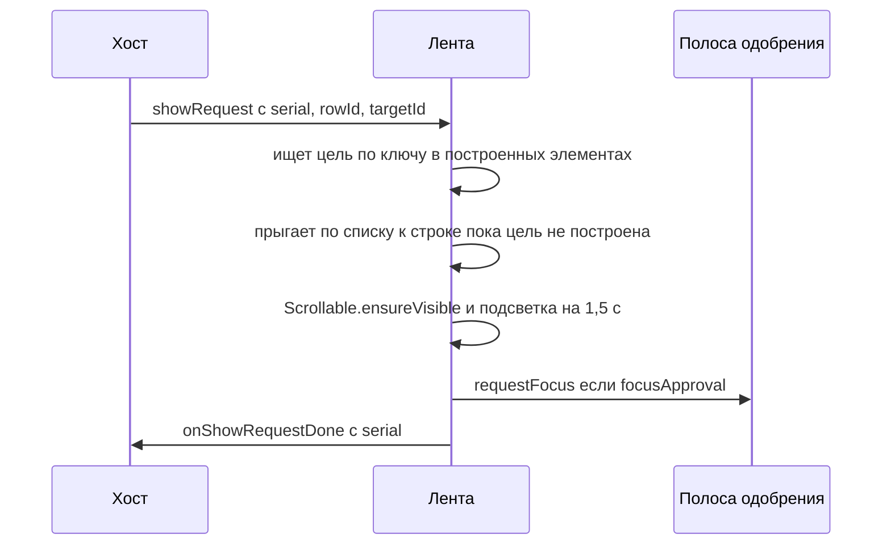
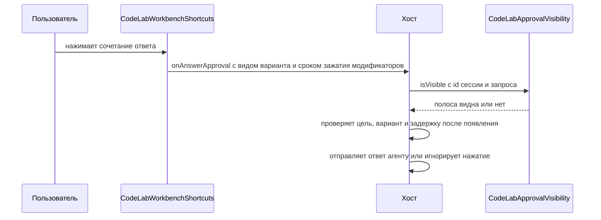
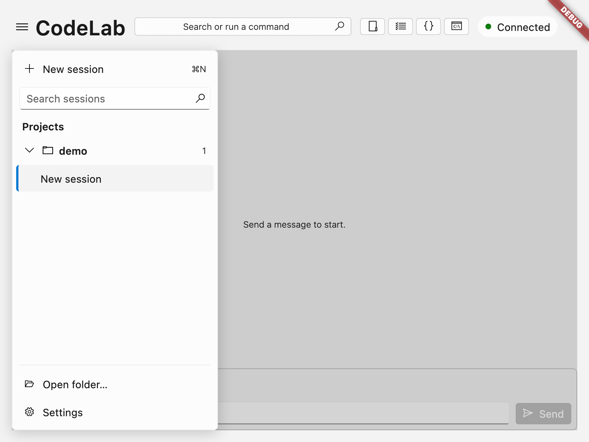
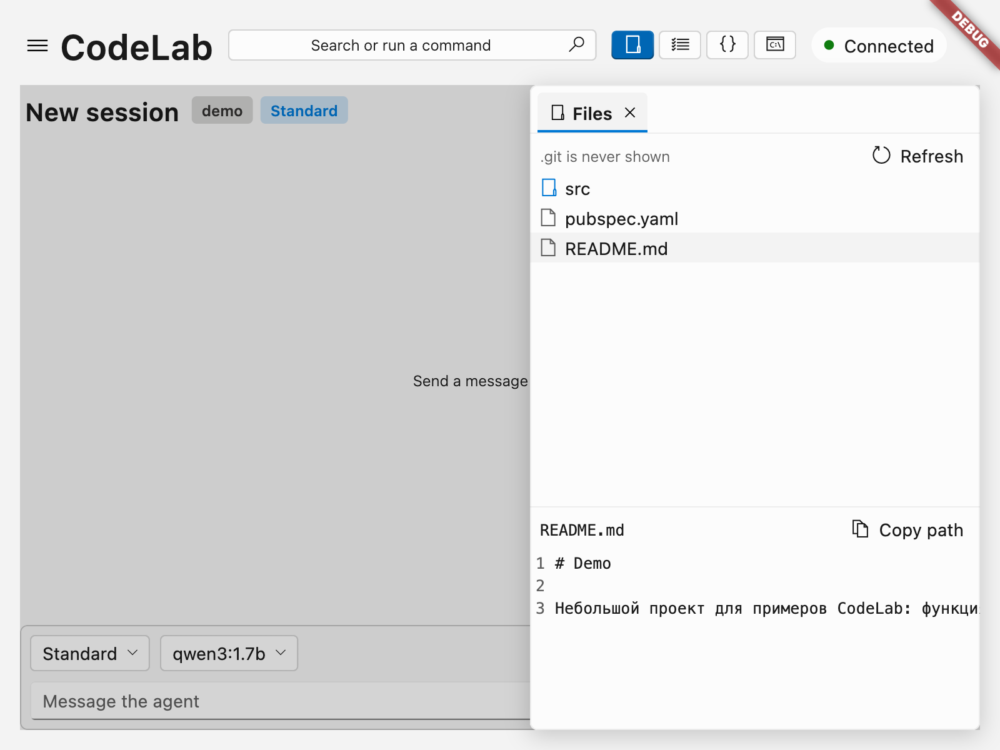
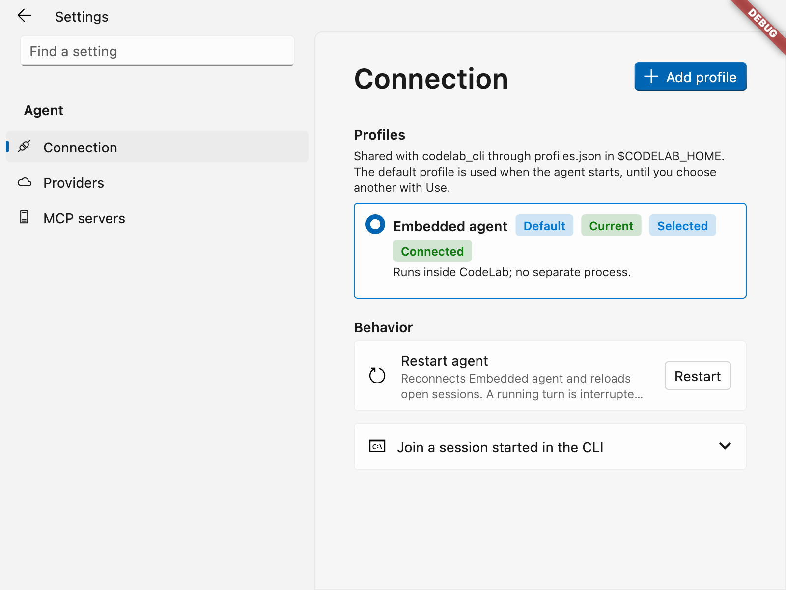

# Ключевые виджеты

Глава разбирает устройство составных виджетов, в которых больше всего нетривиального поведения: лента переписки, полоса одобрения, markdown-рендеринг, каркас рабочего места с доком и виджеты настроек. Что делает каждый виджет и какие у него параметры, читайте в самом коде: у каждого есть doc-комментарий «почему, для чего, как». Здесь — как части связаны между собой и какие решения за этим стоят.

## Лента переписки

`CodeLabTranscriptPanel` (`lib/src/organisms/codelab_transcript_panel.dart`) рисует список строк `List<CodeLabTranscriptRow>`. Это `ListView.builder`: строки создаются лениво, поэтому всё, что должно пережить уход строки с экрана, хранит хост, а не `State` строки.

### Строки

`CodeLabTranscriptRow` — запечатанный класс (`sealed`). Каждый наследник рисуется своим виджетом; выбор делает `switch` в `_TranscriptRowView`:

| Строка | Что в ней | Виджет |
|---|---|---|
| `CodeLabUserRow` | сообщение пользователя | пузырь справа (`_UserBubble`) |
| `CodeLabAgentTextRow` | ответ агента, markdown | `CodeLabMarkdown` |
| `CodeLabThoughtRow` | мысли модели, текст без markdown | `CodeLabThoughtBlock` |
| `CodeLabToolCallRow` | вызов инструмента, вывод, одобрение, потомки субагента | `CodeLabToolCallTile` |
| `CodeLabNoticeRow` | заметка: сбой хода, потеря соединения, пустой ход | `CodeLabTranscriptNotice` |
| `CodeLabTaskOpsRow` | тихая строка операций со списком задач | `CodeLabTaskOpsLine` |

Поля строк — готовые значения, которые строит маппер приложения. Каждая строка несёт стабильный `id`: по нему лента хранит ручное раскрытие, по нему строятся ключи виджетов и ключи копирования блоков кода. Если `id` меняется между обновлениями, строка теряет раскрытие и состояние.

Ряд деталей, которые легко не заметить:

- **Ширина колонки.** Колонка не шире `kTranscriptColumnMaxWidth` = 760 px вместе с боковыми полями по 20 px (тексту остаётся 720). Промежуток между строками — 12 px, поля сверху и снизу — 8 и 12.
- **Пузырь пользователя** занимает 78% ширины колонки, а в колонке уже 560 px — 90%: иначе многострочный промпт превращался бы в столбик слов.
- **Раскрытие.** Ручной выбор лежит в `expansionOverrides` (карта `id → раскрыто`), его меняют через `onExpansionChanged`. Если пользователь строку не трогал, действует выбор по умолчанию из `_expandedByDefault`: мысли раскрыты во время стрима (в режиме `summary` свёрнуты, в `verbose` раскрыты всегда); вызовы раскрыты только в `verbose`. Строка вызова с ожидающим одобрением раскрыта всегда и свернуть её нельзя.
- **Режимы вида** — `CodeLabViewMode`: `summary`, `normal`, `verbose`.
- **Вложенные строки** субагента (`CodeLabToolCallRow.children`) раскрываются теми же переопределениями по своему `id`, по умолчанию свёрнуты.
- **Пустая лента** показывает `emptyLabel`; при `null` — текст кита «No transcript yet».

На схеме — как строки превращаются в виджеты и откуда берётся рисование внутри.

```mermaid
flowchart LR
  panel["CodeLabTranscriptPanel"]
  user["CodeLabUserRow"]
  agent["CodeLabAgentTextRow"]
  thought["CodeLabThoughtRow"]
  call["CodeLabToolCallRow"]
  notice["CodeLabNoticeRow"]
  ops["CodeLabTaskOpsRow"]
  panel --> user
  panel --> agent
  panel --> thought
  panel --> call
  panel --> notice
  panel --> ops
  agent -->|"markdown"| md["CodeLabMarkdown"]
  call -->|"ожидающее одобрение"| bar["CodeLabApprovalPrompt"]
  call -->|"потомки субагента"| nested["вложенные строки"]
```

### Прокрутка и хвост

Записи дописываются в конец ленты, а ленивый список сам к ним не прокручивается. Поэтому `State` панели владеет `ScrollController` и решает, когда двигать позицию (требование [«Лента transcript следует за хвостом»](../../../../openspec/specs/agent-workbench-ui/spec.md)). Механизмов два, и оба отключаются, когда пользователь прокрутил ленту вверх:

- **Следование за хвостом.** Если обновление пришло, пока пользователь был у низа (в пределах 80 px, `_autoScrollBottomThreshold`), лента мгновенно прыгает к новому низу. Любая прокрутка пользователя сбрасывает режим.
- **Новое ожидающее одобрение.** Если появилась строка вызова с `awaitsApproval`, лента плавно (200 мс) прокручивается вниз и дальше «держит» низ, потому что ленивый список лишь оценивает высоту непостроенных строк и реальный низ может сместиться.

Если пользователь отошёл от низа дальше порога, он «читает историю»: позиция не меняется, пока он сам не вернётся к хвосту.

### Цели показа

Панель Agents просит ленту показать строку или блок одобрения потомка («Show in transcript», «Go to approval»). Для этого хост передаёт `CodeLabTranscriptShowRequest`: `rowId` — строка верхнего уровня, `targetId` — цель внутри неё (равна `rowId`, если цель — сама строка), `serial` — номер запроса.



Правила, которые стоят за схемой:

- Исполняется только запрос с `serial` больше последнего исполненного. Номер общий для всех сессий, а лента одна: при возврате в сессию прежний запрос снова приходит в `showRequest` и без этой памяти повторил бы прокрутку.
- Цели находятся по `ValueKey`: строка — `CodeLabTranscriptPanel.rowKey(id)` (`transcript-row-<id>`), цель внутри строки — `CodeLabTranscriptPanel.targetKey(id)` (`transcript-target-<id>`). Обход идёт по построенным элементам, потому что ключи не `GlobalKey`, а строк в окне немного.
- Если строки с `rowId` в ленте нет, показ сразу заканчивается: хост получает `onShowRequestDone`. Если строка есть, но цель не построена, лента делает до 40 попыток: первая — прыжок по оценке позиции строки, следующие — сдвиг на 0,8 высоты окна в сторону строки; потом тоже сообщает о завершении. Если на полосе цели фокус уже стоит, запрос с `focusApproval` ничего не прокручивает и сразу сообщает о завершении.
- Рамка цели — `TranscriptTargetFrame`: накладка в `Stack`, а не `DecoratedBox` вокруг содержимого, чтобы включение подсветки не пересоздавало элемент строки и она не теряла `State` (например, «Show full command»).
- Запрос с `focusApproval: true` после показа ставит фокус на полосу одобрения — но только если запрос ещё актуален и полоса с ключом `CodeLabApprovalPrompt.keyFor(sessionId, approvalId)` построена в цели. Нет полосы или она другая — фокус остаётся прежним.
- Хост сам гасит запрос по `onShowRequestDone`, чтобы перемонтированная лента не прокручивала заново.

## Одобрение

Одобрение — самое чувствительное место кита: ошибка в нём превращает запрос разрешения в действие без явного выбора пользователя (корневой [`AGENTS.md`](../../../../AGENTS.md), §10, и [`docs/architecture/permissions.md`](../../../../docs/architecture/permissions.md)). Устройство построено так, чтобы клавиатура никогда не отвечала на запрос «случайно».

Составные части:

- **`CodeLabTranscriptApproval`** — модель одобрения внутри строки вызова: `pending` (ожидающее) или `resolved` (решённое, с исходом `CodeLabApprovalOutcome`). Решённое одобрение показывается тегом исхода без кнопок.
- **`CodeLabApprovalPrompt`** — полоса решения: кнопки «Allow» и «Reject», выбор охвата («Only this time» или «Always»), значок «View raw input». Варианты агента сопоставляются по виду `CodeLabApprovalOptionKind` (`allow_once`, `allow_always`, `reject_once`, `reject_always`), а не по подписи: подпись — свободный текст агента. Нет варианта для выбранного охвата — кнопка недоступна.
- **`CodeLabApprovalOptionGroup`** — молекула с группой вариантов; тоже без собственных клавиш.
- **`CodeLabWorkbenchShortcuts.onAnswerApproval`** — единственный путь ответа с клавиатуры.
- **`CodeLabApprovalVisibility`** — ручка, которая отвечает на вопрос «видна ли полоса».

### Фокус

Полоса не берёт клавиатурный фокус сама: `autofocus` у неё и у группы вариантов запрещён. Раньше `Focus(autofocus: true)` ловил потерянный фокус (клик по пустой ленте, закрытая палитра), и Cmd/Ctrl+Enter отвечал `allow_once` без явного действия пользователя.

Сейчас:

- у полосы свой узел фокуса, принадлежащий её `State`, с `skipTraversal: true`: Tab идёт сразу к кнопкам, а Enter и Space на самой полосе ничего не выбирают;
- пока фокус в полосе или внутри неё, видна рамка `CodeLabApprovalPrompt.focusFrameKey`;
- ключ полосы строится из id сессии и id запроса (`keyFor`): новый запрос получает новый `State` и новый узел фокуса, фокус прежнего запроса к нему не переносится. Id запросов уникальны только внутри соединения, поэтому в ключ входит и сессия;
- если фокус был в полосе, когда её убрали из дерева (ответ, отмена хода, смена сессии), полоса один раз вызывает `onApprovalFocusReleased`, а хост возвращает фокус. Состояние «фокус был» запоминается в `deactivate`, потому что к `dispose` дочерние узлы уже отсоединены;
- пока идёт ответ на другое одобрение, хост выключает кнопки всех полос (`enabled: false`). Выключенная кнопка теряет фокус, поэтому фокус из неё переходит на узел самой полосы: пользователь остаётся в полосе, а варианты выбираются только явным действием.

### Ответ сочетанием

Ответ с клавиатуры устроен так: кит различает нажатие и сообщает о нём, а хост решает, отвечать ли.



Что делает кит:

- сочетания действуют с любого места рабочего места, включая поле ввода: `CallbackShortcuts` стоит над содержимым, `Focus(autofocus: true)` подхватывает фокус для всего поддерева;
- автоповтор удерживаемой клавиши не вызывает колбэк (`includeRepeats: false`): одно нажатие — не больше одного ответа;
- на Windows и Linux Alt+Shift — ещё и смена раскладки. Поэтому `CodeLabModifierHoldTracker` считает, сколько Alt и Shift зажаты вместе к моменту нажатия буквы, и кит передаёт это в `modifiersHeldFor`. На macOS (⌘) значение `null`. Сколько этого достаточно, решает хост: если буква наложилась на смену раскладки, пользователь не собирался отвечать;
- без колбэка `onAnswerApproval` сочетания не привязаны.

Чего кит не делает: не выбирает цель, не проверяет, есть ли у цели нужный вариант, не отправляет ответ и не задаёт задержку после появления запроса — это политика приложения.

### Видимость

Глобальное сочетание не должно отвечать на запрос, которого пользователь не видит. Видимость знает только лента: у неё прокрутка и построенные полосы. `CodeLabApprovalVisibility` — ручка, которую хост создаёт и передаёт в `CodeLabTranscriptPanel(approvalVisibility:)`. Лента подключает её в `initState` и отключает в `dispose`; пока ленты нет, полоса считается невидимой — это безопасная сторона.

`isVisible(sessionId, approvalId)` истинно, если:

1. полоса с ключом `keyFor(sessionId, approvalId)` построена и имеет размер;
2. её прямоугольник целиком внутри области прокрутки (допуск 0,5 px);
3. в центре и у четырёх углов (отступ 4 px) нажатие доходит до неё, а не до панели поверх ленты. Проверка идёт через hit-test.

Допущение: слой без hit-test (например, `IgnorePointer`) перекрытием не считается, даже если он закрывает полосу глазу. Панели поверх ленты (палитра, меню) принимают указатель, поэтому их перекрытие распознаётся.

`check(sessionId, approvalId)` возвращает причину отказа для журнала: `visible`, `not_built`, `out_of_viewport bar=… viewport=…`, `obscured by=<Type> owner=<Type> at=(x,y)`. Данные — только типы и геометрия, без подписей, путей и текста ленты.

## Markdown и недоверенный текст

Ответ агента — недоверенный текст. Он может содержать ссылку на чужой хост, изображение с адресом ``, невидимые символы, из-за которых один адрес выглядит как другой, и вложенность, на которой упал бы разбор. Слой `lib/src/rendering/` построен вокруг этих рисков.

### Путь ответа

`CodeLabMarkdown` (`codelab_markdown.dart`) делает следующее:

1. **Проверяет вложенность.** `markdownNestingDepth(text)` оценивает вложенность цитат и списков с запасом сверху. Если оценка больше `kMaxMarkdownNestingDepth` (32), ответ показывается как текст в `CodeLabMonospaceBlock` с пояснением «Shown as plain text: nesting is too deep.». Причина: пакет `gpt_markdown` рекурсивен и на вложенности около 1000 падает со Stack Overflow. Решение принимается до разбора, потому что падает именно разбор; оценка намеренно завышена — ошибка в сторону простого текста безопасна.
2. **Находит блоки кода.** `scanFencedBlocks` нужен только ради порядкового номера блока: ключ кнопки копирования `code-copy-<id>-<n>`. Отрисовку разбирает пакет.
3. **Рисует через `GptMarkdown`.** Явные настройки: `html: false`, `useDollarSignsForLatex: false`, анимация выключена; формулы — только `\(…\)` и `\[…\]`.
4. **Оборачивает в `SelectableRegion`.** Не `SelectionArea`: тот и его контекстное меню принадлежат Material, а кит работает без Material-предка. Контекстное меню («Copy», «Select all») собрано на Fluent. Фокус области выделения с `skipTraversal`, чтобы ответ не был остановкой Tab.

Конфигурация `CodeLabMarkdownConfig` создаётся один раз на тему Fluent и живёт в `State` ленты. Это не стиль: пакет кеширует виджеты закрытых блоков, только пока тема и builder'ы — те же объекты. Новая конфигурация на каждой сборке замедлила бы разбор и перестроила бы все закрытые блоки. Счётчики `CodeLabMarkdownStats` (только в debug, внутри `assert`) позволяют тесту проверить, что закрытый блок кода строится не больше одного раза за стрим.

### Ссылки

Политику ссылок решает приложение и передаёт через `CodeLabMarkdownScope` — `InheritedWidget` над лентой. Кит спрашивает `canOpenLink(uri)`; если ответ «нет» или scope нет вовсе, ссылка рисуется обычным текстом без подчёркивания и не кликается. Разрешённая ссылка — подчёркнутый `TextSpan` с распознавателем клика, а не `WidgetSpan`: подпись переносится по строкам вместе с абзацем и выделяется. При наведении показывается подсказка с полным адресом; адрес перед показом проходит через `displayAddress` (экранирование и обрезка до 2048 символов с `…`).

### Изображения

`CodeLabImagePlaceholder` по умолчанию не обращается к сети. Он показывает «Image», хост, имя файла и полный адрес в подсказке. Если приложение разрешило загрузку (`canLoadImage`), добавляется кнопка «Show image»; нажатие сообщает ключ `<rowId>#image:<url>` в `onShowImage`. Когда ключ попал в `shownImages`, вместо заглушки рисуется `Image(imageFor(uri))` не больше натурального размера, не шире абзаца и не выше 480 px. Ошибка загрузки возвращает заглушку без исключения и один раз сообщается в `onImageFailed(key, error)`: кит ошибку не разбирает, код причины определяет приложение. Без scope кнопки «Show image» нет.

### Блок кода

`CodeLabCodeBlock` показывает подпись языка, кнопку «Copy» и код моноширинно. Подпись и кнопка лежат внутри `SelectionContainer.disabled`, поэтому выделение ответа содержит только код. «Copy» кладёт в буфер код без ограды. Подпись языка из info-строки ограды экранируется и обрезается до 32 символов. Незакрытый блок рисуется тем же моноширинным текстом без кнопки: копировать недописанный код нечего.

Подсветка — `CodeLabCodeHighlighter` на `val_highlight`. Режим выбирает `modeFor(language, code)`:

| Режим | Когда | Что происходит |
|---|---|---|
| `sync` | язык известен; не больше 300 строк и 16 384 символов, строки не длиннее 150 | токенизация в кадре построения, первый кадр уже с цветом |
| `background` | язык известен; не больше 5000 строк и 262 144 символов, строки не длиннее 1000 | токенизация в отдельном isolate; до результата код без цвета; по таймауту 5 с isolate убивается |
| `none` | язык неизвестен, пуст или `text`; код больше порогов | без подсветки |

Порог по длине строки нужен потому, что `RegExp` движка квадратичен по ней. Результат кешируется в LRU на 256 записей; суммарный бюджет кеша — около 8 млн единиц (символы кода плюс вес токенов). Сбой движка или таймаут не роняют ленту: в кеш попадает «без подсветки». Автоопределение языка не используется.

### `escapeForDisplay`

`escapeForDisplay(String)` — публичная функция из `rendering.dart`. Она заменяет управляющие и невидимые символы на видимые `\uXXXX`: C0 и C1 (включая перевод строки), символы направления текста (`U+202A–U+202E`, `U+2066–U+2069`), нулевой ширины (`U+200B–U+200F`), разделители строк, `U+FEFF`, мягкий перенос и теги Unicode. Обход идёт по code point, поэтому символы вне BMP не рвутся на суррогаты; кириллица и эмодзи остаются.

Реальный вывод функции (получен запуском копии файла `escape_for_display.dart` через `fvm dart run`):

```text
вход:  "rm -rf \u202E/ ~ \u200Bok\nпривет 😀" (литерал Dart: \u202E, \u200B и \n — настоящие символы)
выход: rm -rf \u202e/ ~ \u200bok\u000aпривет 😀
```

Обратите внимание на последнее: перевод строки тоже заменяется, поэтому многострочный текст выводится в одну строку. Для подсказок и подписей это нужно, для многострочного вывода — нет.

Где кит применяет функцию сам: подписи заглушек изображений и адрес в подсказках; подпись языка блока кода; заголовок и команда в ожидающем одобрении (модель могла спрятать часть пути bidi-символом); заголовки и подписи панелей Usage, Agents, таблицы статусов; метка и деталь вложенных строк вызова. `CodeLabStatusTable` экранирует ячейки, помеченные `untrusted`. Приложение тоже вызывает её: страница «Appearance» экранирует текст файла темы.

Правило для нового виджета: любой текст, пришедший от модели или из файла, который показывается как подпись, подсказка или адрес, проходит через `escapeForDisplay`. Тело ответа агента проходит через `CodeLabMarkdown`, а не через неё.

## Рабочее место: каркас и док

`CodeLabWorkbenchLayout` (`lib/src/organisms/codelab_workbench_layout.dart`) — только раскладка четырёх зон: app bar, сайдбар сессий, панель сессии и док. Содержимое зон, их ширины и открытость выдвижных панелей передаёт хост.

### Классы по ширине

Раскладку выбирает только ширина окна в логических пикселях (`CodeLabLayoutClass.ofContext`):

| Класс | Ширина окна | Сайдбар | Док |
|---|---|---|---|
| `phone` | меньше 641 | выдвигается поверх (раскладывается как `narrow`) | выдвигается поверх |
| `narrow` | 641–899 | выдвигается поверх | выдвигается поверх |
| `medium` | 900–1279 | колонка, `sidebarCollapsed` сворачивает её в иконки | выдвигается поверх |
| `wide` | от 1280 | колонка | колонка |

Выдвижная панель показывается, пока `sidebarOverlayOpen` или `dockOverlayOpen`; клик мимо (затемнение `workbench-overlay-scrim`) и Esc вызывают `onSidebarOverlayDismiss` и `onDockOverlayDismiss`. Esc привязан через `CodeLabShortcut.closeOverlay`. Ширина выдвижной панели не больше 90% доступной. Панель сессии остаётся тем же элементом дерева при любом классе (ключ ячейки), поэтому лента и композер не теряют прокрутку и черновик при изменении ширины окна. Зоны лежат внутри `SafeArea`, фон — цвет `micaBackgroundColor` под ней.

Значения по умолчанию: сайдбар 280 px, свёрнутый 56 px, док 360 px, промежуток 12, отступы 16.

Границы колонок перетаскиваются: если передан `onSidebarWidthChanged` или `onDockWidthChanged`, между зонами стоит `CodeLabResizeHandle` (зона захвата шириной `gap`). Кит сообщает смещение, а ширину применяет и ограничивает хост. Для дока знак уже развёрнут: положительное значение — док шире, хотя граница на его левом краю. Окончание жеста — `onSidebarResizeEnd`, `onDockResizeEnd`.

Сайдбар или док поверх ленты — признак узкого окна (классы `phone` и `narrow`; док выдвигается поверх и в `medium`).



На снимке сайдбар (`CodeLabSessionSidebar`) выдвинут поверх ленты с затемнением. Следующий снимок — выдвинутый поверх ленты док с вкладкой Files.



На нём видны вкладка дока с кнопкой закрытия, а в теле панели — строка с «Refresh», `CodeLabFileTree` и `CodeLabFilePreview`.

### Док

`CodeLabToolDock` — строка вкладок открытых панелей и содержимое активной. Какие панели открыты и какая активна, хранит хост: он передаёт `tabs` (`CodeLabDockTab`), `active`, `onSelected` и `onClosed`. Без вкладок хост док не показывает (`assert` в конструкторе).

Устройство:

- Вкладки идут слева и прокручиваются. Активная вкладка прокручивается в видимую область, поэтому её заголовок не обрезается даже при русских подписях в доке 360 px.
- Если активной вкладки нет в списке (хост ещё не обновил `active`), показывается первая вкладка, а не пустой док.
- Действия активной вкладки (`CodeLabDockTab.actions`) стоят справа. `CodeLabDockAction` с `pinned: true` всегда на виду, остальные видны, пока помещаются, а лишние уходят в меню «⋯» с той же подписью и доступностью. Прокрутка строки действий отвергнута: трекпад её находит, колесо мыши и клавиатура — нет. Зона действий не меньше `CodeLabToolDock.minActionsWidth` = 180 px, поэтому действия не вытесняют заголовок активной вкладки.
- `checked` у действия делает его переключателем, `onPressed: null` — недоступным.
- Ключи для тестов и автоматизации: `tool-pane-<pane>` (содержимое), `tool-tab-<pane>` (вкладка), `tool-tab-close-<pane>` (закрытие). `ToolPane` — перечисление девяти панелей с иконками; название берётся из каталога текстов через `toolPaneTitleOf(context, pane)`.

Панели дока, которые рисует кит: `CodeLabUsagePane`, `CodeLabAgentsPane`, `CodeLabProtocolPane`, `CodeLabTerminalPane`, `CodeLabFileTree` вместе с `CodeLabFilePreview`, `CodeLabProgressChecklist`. У всех одно правило: значения готовые, действия — колбэки, ничего не считается. `CodeLabTerminalPane` получает виджет терминала в слот `content`; сам `xterm2` в кит не импортируется.

## Виджеты настроек

Страницы настроек приложения собираются из четырёх строительных блоков кита. Они задают вёрстку макета, а не поведение: значение и реакцию хранит владелец.

| Виджет | Что делает | Важное |
|---|---|---|
| `CodeLabSettingsNavigation` | `NavigationView` Fluent с поиском «Find a setting», группами пунктов, кнопкой «Back» и телом страницы | Режим `left` или `top` выбирает хост по ширине окна (порог 760 px взят из макета). Пустой результат поиска показывает строку вместо пунктов. Ключи: `settings-search`, `settings-back`, `settings-nav-<id>` |
| `CodeLabSettingsSection` | подзаголовок секции и столбец строк | отступ от предыдущего блока 18 px, промежуток между карточками 4 px |
| `CodeLabSettingsRow` | карточка: значок, заголовок, описание, элемент управления справа | `descriptionMaxLines` по умолчанию 2, `null` снимает предел; `footer` рисуется под заголовком в той же карточке; `trailing` на узкой строке получает ограниченную ширину |
| `CodeLabExpanderCard` | раскрывающаяся карточка: шапка не ниже 48 px и тело | раскрытие решает владелец; `onToggle: null` — шапка не нажимается и шеврона нет |

Для форм (диалог добавления профиля) есть `CodeLabForm`, `CodeLabFormRow` (подпись слева в колонке 132 px, поле справа, под полем `notes`) и `CodeLabFormNote` с тремя видами `CodeLabFormNoteTone`: `hint`, `error` (объявляется программам чтения с экрана как live region) и `warning`. Для вкладок-переключателя разделов — `CodeLabSelectorBar<T>`: подписи не обрезаются, а при нехватке места ряд прокручивается; ширина родителя должна быть ограниченной.



На снимке главное: слева `CodeLabSettingsNavigation` с поиском и группой «Agent», справа секции страницы и строка настройки с кнопкой справа.

## Смотрите также

- [Обзор](01-overview.md) — граница «никакой логики».
- [Локализация и сочетания клавиш](04-localization-and-shortcuts.md) — каталог `CodeLabShortcut` и клавиши по платформам.
- [Тестирование](05-testing.md) — как проверять ленту, фокус и видимость.
- [Расширение](06-extending.md) — как добавить вариант строки ленты.
- Спецификация [`agent-workbench-ui`](../../../../openspec/specs/agent-workbench-ui/spec.md): требования «Ответ на одобрение сочетанием с любого места рабочего места», «Переход к ожидающему одобрению с клавиатуры», «Markdown в ответе агента», «Layout class follows the window width».
- [`AGENTS.md`](../AGENTS.md) пакета, раздел «Отдельные виджеты».
